# Reference process: Choose a Supplier

`ref/fin/choose-a-supplier v1`

**value stream:** [Buying and paying](../../streams/finance/buying-and-paying.md)
A purchase above `<your threshold>` needs a supplier, and none is chosen
for it yet through an agreement in force or a department's own selection.
The purchasing-coordinator agent takes in the purchase and checks for a
supplier already chosen, and the decision-coordinator agent sets out who
chooses under the delegation of authority and by when. The
supplier-manager agent writes down the requirements with the requester and
fixes the scoring criteria with the purchasing lead before any supplier is
asked. It finds the candidates, sends every one of them the same
requirements and questions with the same closing date, and shares each
answer to a candidate's question with all of them. The supplier-check
agent scores every answer against the criteria at their version and checks
each finalist against the public record and the sanctions lists. The
decision-coordinator agent sets the scores, the checks and the whole cost
side by side, and the budget owner and the purchasing lead, with the
people the delegation of authority names for a purchase of this size,
choose the supplier and say why. The purchasing lead and a legal reviewer
agree the terms, and the signature-manager agent gets the agreement signed
by the named signers on each side and filed. The run closes when the
agreement is signed, every other candidate has heard the outcome, and the
supplier and the agreement are with the purchase order.

**delivers:** agreement, a signed supplier agreement

**starts:** on an event, a purchase above the threshold needs a supplier chosen

## The goals

- Choose the supplier and sign within [8 weeks] of the request
- Ask [3] or more suppliers to answer every request
- Meet [90%] of the ranked requirements with the chosen supplier
- Keep the whole cost over the term inside [the approved amount]

## The activities

| # | Activity | What happens | Agents |
|---|---|---|---|
| 1 | Take in the Purchase | the request, amount, budget line and the date it is needed | [purchasing-coordinator](../../agents/purchasing-coordinator.md) |
| 2 | Check for a Supplier Already Chosen | an agreement or a department's own choice that covers it | purchasing-coordinator |
| 3 | Frame the Decision | who chooses, by when, and the evidence the choice needs | [decision-coordinator](../../agents/decision-coordinator.md) · budget owner (person) |
| 4 | Write Down the Requirements | what the supplier must provide, ranked and testable | [supplier-manager](../../agents/supplier-manager.md) · requester (person) |
| 5 | Set the Scoring Criteria | how each answer scores, fixed before any supplier is asked | supplier-manager · purchasing lead (person) |
| 6 | Find the Candidates | suppliers that could meet the need, and why each is listed | supplier-manager |
| 7 | Issue the Request | the same requirements, questions and due date for all | supplier-manager |
| 8 | Answer the Candidates' Questions | each answer shared with every candidate at once | supplier-manager |
| 9 | Score the Answers | a verdict on every requirement, citing its criterion | [supplier-check](../../agents/supplier-check.md) |
| 10 | Check the Finalists | each finalist against public records and sanctions lists | supplier-check |
| 11 | Set Out the Choice | the scores, the checks and the whole cost side by side | decision-coordinator · supplier-manager |
| 12 | Choose the Supplier | the named people pick one and say why | decision-coordinator · budget owner (person) · purchasing lead (person) |
| 13 | Agree the Terms | price, term, exit and what the supplier must meet | purchasing lead (person) · legal reviewer (person) |
| 14 | Get the Agreement Signed | the named signers on each side sign, and it is filed | [signature-manager](../../agents/signature-manager.md) · authorized signer (person) |
| 15 | Tell the Other Candidates | each hears the outcome once the agreement is signed | supplier-manager |
| 16 | Hand the Supplier On | to supplier setup if new, and the agreement to the order | purchasing-coordinator |
| 17 | Record What the Choice Taught | what the criteria missed, and the date to look again | decision-coordinator · supplier-manager |

The request comes from `ref/fin/issue-a-purchase-order` when the amount
passes `<your threshold>` and no supplier is chosen. Where a department
has already chosen the supplier through its own selection, such as
`ref/rev/choose-a-tool`, `ref/mkt/select-marketing-technology` or
`ref/mkt/engage-marketing-agency`, that record stands and this process
does not run again. A supplier new to the company is set up at
`ref/fin/set-up-a-supplier` before the first order goes to it, and the
decision-coordinator agent sets the date the choice is looked at again.

## The graph

```mermaid
flowchart LR
  T([a purchase above the threshold needs a supplier chosen]) --> A1[1. Take in the Purchase]
  A1 --> A2[2. Check for a Supplier Already Chosen]
  A2 -. an agreement in force already covers it .-> A16
  A2 --> A3[3. Frame the Decision]
  A3 --> A4[4. Write Down the Requirements]
  A4 --> A5[5. Set the Scoring Criteria]
  A5 --> A6[6. Find the Candidates]
  A6 --> A7[7. Issue the Request]
  A7 --> A8[8. Answer the Candidates' Questions]
  A8 --> A9[9. Score the Answers]
  A9 -. no candidate meets the must-have requirements .-> A4
  A9 --> A10[10. Check the Finalists]
  A10 --> A11[11. Set Out the Choice]
  A11 --> A12[12. Choose the Supplier]
  A12 -. the deciders choose none of the finalists .-> A6
  A12 --> A13[13. Agree the Terms]
  A13 -. the terms cannot be agreed .-> A11
  A13 --> A14[14. Get the Agreement Signed]
  A14 -. the supplier will not sign the agreed version .-> A13
  A14 --> A15[15. Tell the Other Candidates]
  A14 --> A16[16. Hand the Supplier On]
  A15 --> A17[17. Record What the Choice Taught]
  A16 --> A17
  A17 --> DONE([the supplier is chosen, the agreement is signed, and the purchase can be ordered])
```



## The document, with the blanks marked

```
PROCESS: choose a supplier            id: <team>/choose-a-supplier   v1
from: ref/fin/choose-a-supplier v1
owner: <who>                          effective: <date>
trigger: a request at ref/fin/issue-a-purchase-order passes <your
         threshold> with no supplier chosen for it, or a budget owner
         asks for a supplier for a purchase of that size, in <your
         purchasing system>
         watch: record=<purchase request> system=<your purchasing system>
                change=<a request needs a supplier chosen>
concurrency: runs may overlap freely - one purchase is one run, a second
             request for the same need joins the run already open, and a
             candidate's answer is scored only against the criteria fixed
             for that run
goal: one supplier chosen by the people <your delegation of authority>
      names, against requirements and criteria fixed before any supplier
      was asked, the agreement signed by the named signers on each side
      within <weeks> of the request, every other candidate told the
      outcome, and the supplier and the agreement handed to the purchase
      order
phases:
  take-in-purchase   - system: the purchase lands with the request, the
                       amount, the budget line, the requester and the date
                       the supplier is needed by
                       owner: purchasing-coordinator   after: trigger
                       automation: <level>
  check-existing     - runs assessment: the supplier record and the
                       agreements in force read for a supplier that
                       already covers the purchase, and the records of a
                       department's own selection, such as
                       ref/rev/choose-a-tool, read for a choice already
                       made
                       owner: purchasing-coordinator
                       after: take-in-purchase    automation: <level>
  frame-decision     - convenes briefing: who chooses under <your
                       delegation of authority> for a purchase of this
                       size, the date the choice is needed by, and the
                       evidence each decider needs, agreed with the budget
                       owner
                       owner: decision-coordinator
                       after: check-existing      automation: <level>
  write-requirements - human: what the supplier must provide, each
                       requirement testable and ranked as a must-have or
                       a nice-to-have, written down with the requester at
                       a version
                       owner: supplier-manager
                       after: frame-decision      automation: <level>
  set-criteria       - runs assessment: the scoring criteria and their
                       weights fixed and dated before any supplier is
                       asked, and agreed by <your purchasing lead role>
                       owner: supplier-manager
                       after: write-requirements  automation: <level>
  find-candidates    - runs collect-and-report: the suppliers that could
                       meet the requirements, from the supplier record and
                       the market, each with the reason it is listed, and
                       at least <number> for a purchase of this size
                       owner: supplier-manager
                       after: set-criteria        automation: <level>
  issue-request      - system: the same requirements, questions, format
                       and closing date sent to every candidate at once
                       through <your sourcing channel>
                       owner: supplier-manager
                       after: find-candidates     automation: <level>
  answer-questions   - runs collect-and-report: each question a candidate
                       asks before the closing date, and its answer,
                       shared with every candidate at once, and every
                       contact between a candidate and the company
                       recorded
                       owner: supplier-manager
                       after: issue-request       by: <the closing date>
                       automation: <level>
  score-answers      - runs assessment: a verdict on every requirement for
                       each candidate that answered by the closing date,
                       citing its criterion and the evidence, with a
                       requirement it could not test marked not tested
                       and the finalists named by score
                       owner: supplier-check
                       after: answer-questions    automation: <level>
  check-finalists    - runs assessment: each finalist checked against the
                       public record for its registration and standing,
                       and screened with its owners against <your
                       sanctions lists>, with every hit sent to <your
                       compliance lead role>
                       owner: supplier-check
                       after: score-answers       automation: <level>
  set-out-choice     - runs collect-and-report: the finalists side by
                       side with their scores, their checks and the whole
                       cost over the term, and any interest a decider has
                       declared
                       owner: decision-coordinator
                       after: check-finalists     automation: <level>
  choose-supplier    - convenes decide-and-announce: the budget owner,
                       <your purchasing lead role> and the people <your
                       delegation of authority> names choose one finalist
                       and record why, with any dissent and the finalist
                       next in line
                       owner: <your budget owner role>
                       after: set-out-choice      by: <days>
                       automation: never
  agree-terms        - convenes decide-and-announce: <your purchasing lead
                       role> and <your legal reviewer role> agree the
                       price, the term, the exit, the service levels and
                       the data terms with the supplier, inside the
                       approved amount
                       owner: <your purchasing lead role>
                       after: choose-supplier     automation: never
  get-signed         - runs collect-and-report: the agreed version sent to
                       the named signers on each side in the order <your
                       delegation of authority> sets, and the executed
                       copy filed with every schedule it names
                       owner: signature-manager
                       after: agree-terms         by: <days>
                       automation: <level>
  tell-candidates    - human: each other candidate told the outcome in
                       writing once the agreement is signed, with its own
                       scores where <your purchasing policy> allows
                       owner: supplier-manager
                       after: get-signed          by: <days>
                       automation: <level>
  hand-on            - system: a supplier new to the company handed to
                       ref/fin/set-up-a-supplier, and the signed agreement
                       or the agreement already in force handed to the
                       request at ref/fin/issue-a-purchase-order
                       owner: purchasing-coordinator
                       after: get-signed, or check-existing when an
                       agreement in force already covers the purchase
                       automation: <level>
  record-learning    - convenes debrief: what the requirements and the
                       criteria missed, how many candidates answered, how
                       long each step took, and the date the choice is
                       looked at again
                       owner: decision-coordinator
                       after: hand-on, and tell-candidates when candidates
                       were asked                 automation: <level>
run-scoped:
  status    - runs roll-call                    owner: decision-coordinator
              every: <cadence>
              from: frame-decision      until: choose-supplier
  questions - runs collect-and-report           owner: supplier-manager
              from: issue-request       until: score-answers
handoffs:
  take-in-purchase -> check-existing [purchase]: the request, the amount,
    the budget line and the date the supplier is needed by
  check-existing -> frame-decision [no-supplier-chosen]: what the supplier
    record and the agreements in force hold for this need, and why none
    of it covers the purchase
  check-existing -> hand-on [existing-choice]: the agreement in force or
    the department's selection record that covers the purchase
  frame-decision -> write-requirements [decision-frame]: who chooses, by
    when, and the evidence the choice needs
  write-requirements -> set-criteria [requirements]: the requirements,
    ranked, at a version
  set-criteria -> find-candidates [criteria]: the criteria and their
    weights, fixed and dated
  find-candidates -> issue-request [candidate-list]: each candidate and
    the reason it is listed
  issue-request -> answer-questions [request-issued]: the request as sent,
    with the closing date and every candidate that received it
  answer-questions -> score-answers [answers]: every answer that arrived
    by the closing date, and each question and answer shared with all
  score-answers -> check-finalists [scores]: a scoring sheet for each
    candidate at a version, and the finalists
  check-finalists -> set-out-choice [checked-finalists]: each finalist's
    checks, with any hit and what the compliance lead decided
  set-out-choice -> choose-supplier [choice]: the finalists side by side
    with their scores, their checks and the whole cost over the term
  choose-supplier -> agree-terms [chosen-supplier]: the supplier chosen,
    the reasons and any dissent, and the finalist next in line
  agree-terms -> get-signed [agreed-terms]: the agreement at its final
    version
  get-signed -> tell-candidates / hand-on [signed-agreement]: the executed
    agreement as filed
  tell-candidates -> record-learning [candidates-told]: each other
    candidate told, and when
  hand-on -> record-learning [supplier-handed-on]: the supplier and the
    agreement as handed to supplier setup and to the request
deviations:
  check-existing -> hand-on [already-covered]: an agreement in force or a
    department's own selection already covers the purchase, so it goes to
    the request and no new choice runs
  score-answers -> write-requirements [no-candidate-meets-must-haves]: no
    candidate meets the must-have requirements, so a person loosens a
    requirement in writing or the search widens
  choose-supplier -> find-candidates [deciders-choose-none]: the deciders
    will take none of the finalists, so more candidates are found and
    asked the same questions
  agree-terms -> set-out-choice [terms-not-agreed]: the terms cannot be
    agreed inside the approved amount, so the choice is set out again
    with the finalist next in line
  get-signed -> agree-terms [supplier-will-not-sign]: the supplier will
    not sign the agreed version, so the terms are agreed again
bindings:
  roster:  <who holds each role - agents claiming the abstract agents
           above, and named people for the requester, the budget owner,
           <your purchasing lead role>, <your legal reviewer role>, <your
           compliance lead role>, each decider and each authorized
           signer>
  systems: <your purchasing system> (write), the supplier record (read),
           <your sourcing channel> (write), the scoring record (write),
           the decision record (write), the screening service (read), the
           signature system (trigger), the notification channel (write)
  data:    <your purchasing policy> <version>, <your delegation of
           authority> <version>, the requirements and criteria
           <version>, <your standard supplier terms> <version>
policy:
  the requirements and the scoring criteria are fixed and dated before
    any supplier is asked, and a change after that is a person's
    decision, recorded with the scores it affects
  every candidate gets the same requirements, the same questions and the
    same answers to any question, on the same dates
  the supplier is chosen by the people <your delegation of authority>
    names for a purchase of this size, and the record says why and who
    disagreed
  each decider declares any interest in a candidate before the scores
    are seen, and a decider with an interest steps out of the choice
  a finalist with a screening hit is chosen only once <your compliance
    lead role> has cleared it in writing, and nothing about the hit is
    said to the supplier
  the agents choose no supplier, agree no price and sign nothing
  no order goes to the supplier before the agreement is signed by the
    named signers on each side
  the whole cost over the term stays inside the approved amount, and a
    cost past it goes back to the budget owner
measures:
  cycle time: <weeks> from the request to the signed agreement
  competition: <target> share of choices with at least <number>
               candidates scored
  volume: <choices per period>
  quality gate: every choice traces to criteria fixed before any supplier
                was asked, a verdict on every requirement for every
                candidate, and a decision by the named people
```

## The failure edges

- **An agreement in force already covers the purchase.** The
  purchasing-coordinator agent hands that agreement to the request, and
  no new choice runs. Where the agreement is near its end or its prices
  are out of date, the purchasing lead decides whether to run the choice
  anyway.
- **No candidate meets the must-have requirements.** The requirements go
  back to the requester and the purchasing lead, who loosen a
  requirement in writing or widen the search. A change to the criteria
  after the answers are seen is recorded with the scores it affects.
- **A finalist has a screening hit.** The supplier-check agent sends the
  hit to the compliance lead, and the finalist stays out of the choice
  until the compliance lead has decided in writing. Nothing about the
  hit is said to the supplier.
- **A decider has an interest in a candidate.** The decider declares it
  before the scores are seen and steps out of the choice, and the
  delegation of authority names who stands in.
- **A candidate tries to get what the others did not.** Every answer to a
  candidate's question goes to all of them at once. A candidate that
  contacts a decider outside the request is reminded of the rule in
  writing, and the contact is recorded with the scores.
- **The terms cannot be agreed.** The decision-coordinator agent sets
  out the choice again with the finalist next in line, and the deciders
  choose again. A price past the approved amount goes back to the budget
  owner before anyone agrees it.
- **The trigger fires while a run is in flight.** One purchase is one
  run. A second request for the same need joins the run already open,
  and a candidate's answer is scored only against the criteria fixed for
  that run.
- **A run is abandoned.** The need goes away or the money is withdrawn.
  Every candidate is told in writing that the choice has ended, nothing
  is signed, and the requirements and the scores are kept for the next
  time the need comes up.
