# Reference process: Close the Month

`ref/fin/close-the-month v1`

**value stream:** [Closing the books](../../streams/finance/closing-the-books.md)
A month has ended, and the books have to be closed on the calendar so the
results can be reported and relied on. The close-plan-keeper agent opens
the close calendar at its version with one owner and one day on every
task, announces the cutoff for each sub-ledger and each team, and chases
every task past its day. The owners of the payables, receivables, asset,
lease, payroll and revenue sub-ledgers close them. The ledger-accountant
agent books the period's accruals and posts the close journals, each
approved by a named person who did not prepare it, and the
account-reconciler agent reconciles every account on the reconciliation
list for a named reviewer to sign off. The reporting-accountant agent
sets each account in each entity beside the last period and flags each
movement above `<your threshold>` that nobody has explained, each account
owner explains a flagged movement with its evidence, and an error found
is corrected by an entry approved like any other. The controller reviews
the close, signs it off and closes the period to entries. The run closes
when every task on the calendar is done and reviewed, every
reconciliation is signed off, every flagged movement is explained, the
controller's sign-off is recorded, and the closed books have gone to
consolidation and to the monthly results.

**delivers:** status board, a signed-off month-end close

**starts:** on a schedule, a month ends on the close calendar

## The goals

- Close each month within [5 working days] of its end
- Have [100%] of reconciliations reviewed before the sign-off
- Reopen [zero] closed months
- Keep the close under [300 hours] of team time each month

## The activities

| # | Activity | What happens | Agents |
|---|---|---|---|
| 1 | Open the Close Calendar | every task with one owner and one day, at its version | [close-plan-keeper](../../agents/close-plan-keeper.md) · controller (person) |
| 2 | Announce the Cutoffs | the last day for entries from each sub-ledger and each team | close-plan-keeper |
| 3 | Close the Sub-Ledgers | payables, receivables, assets, leases, payroll and revenue | sub-ledger owner (person) · close-plan-keeper |
| 4 | Book the Accruals | the period-end accruals, reviewed and posted | [ledger-accountant](../../agents/ledger-accountant.md) · accrual reviewer (person) |
| 5 | Post the Close Journals | allocations, reclassifications, corrections, each approved | ledger-accountant · journal approver (person) |
| 6 | Reconcile the Accounts | every listed account, prepared and reviewed | [account-reconciler](../../agents/account-reconciler.md) · reconciliation reviewer (person) |
| 7 | Chase the Late Tasks | each task past its day chased with its owner, or re-dated | close-plan-keeper |
| 8 | Compare With the Last Period | each account against last period, large movements flagged | [reporting-accountant](../../agents/reporting-accountant.md) |
| 9 | Explain Each Movement | each flagged movement explained by its owner with evidence | account owner (person) · reporting-accountant |
| 10 | Correct What the Check Found | an entry that corrects an error, approved like any other | ledger-accountant · journal approver (person) |
| 11 | Review the Close | the reconciliations, journals and explained movements | controller (person) |
| 12 | Sign Off the Close | the controller signs off and closes the period to entries | controller (person) |
| 13 | Record the Sign-Off | the version signed, who signed it and when | reporting-accountant |
| 14 | Hand On the Closed Books | the closed trial balance, to consolidation and the results | reporting-accountant |
| 15 | Record What the Close Taught | the tasks that slipped and why, and what next month changes | close-plan-keeper |

Most of the work on the calendar is done in the other processes of this
stream, and the close holds them to their days. The accruals are booked
at `ref/fin/book-the-period-end-accruals`, the close journals post
through `ref/fin/post-a-manual-journal-entry`, the accounts are
reconciled at `ref/fin/reconcile-a-balance-sheet-account`, the revenue is
worked out at `ref/fin/recognize-revenue`, and the assets and leases are
posted at `ref/fin/account-for-fixed-assets` and
`ref/fin/account-for-a-lease`. The payroll journal posts at
`ref/hr/run-payroll`, the supplier invoices and the card spend close at
`ref/fin/process-a-supplier-invoice` and
`ref/fin/reconcile-company-card-spend`, and the customer accounts close at
`ref/fin/apply-a-customer-payment`. The closed books go to
`ref/fin/consolidate-the-group-accounts` and
`ref/fin/report-the-monthly-results`, where the results are set beside
the budget and the forecast. Each entity closes on its own calendar, and
a quarter or a year end adds the tasks the calendar names for it.

## The graph

```mermaid
flowchart LR
  T([a month ends on the close calendar]) --> A1[1. Open the Close Calendar]
  A1 --> A2[2. Announce the Cutoffs]
  A2 --> A3[3. Close the Sub-Ledgers]
  A3 --> A4[4. Book the Accruals]
  A3 --> A5[5. Post the Close Journals]
  A4 --> A6[6. Reconcile the Accounts]
  A5 --> A6
  A2 --> A7[7. Chase the Late Tasks]
  A7 -. a date moves and the tasks behind it move too .-> A1
  A6 --> A8[8. Compare With the Last Period]
  A7 --> A8
  A8 --> A9[9. Explain Each Movement]
  A9 -. a movement is an error .-> A10[10. Correct What the Check Found]
  A10 -. the correction touches a reconciled account .-> A6
  A9 --> A11[11. Review the Close]
  A10 --> A11
  A11 -. the controller finds a task not done or not reviewed .-> A7
  A11 --> A12[12. Sign Off the Close]
  A12 --> A13[13. Record the Sign-Off]
  A13 --> A14[14. Hand On the Closed Books]
  A14 --> A15[15. Record What the Close Taught]
  A15 --> DONE([the close is signed off and the closed books have gone on])
```



## The document, with the blanks marked

```
PROCESS: close the month              id: <team>/close-the-month   v1
from: ref/fin/close-the-month v1
owner: <who>                          effective: <date>
trigger: a month of an entity reaches its end on <your close calendar>
         watch: record=<accounting period> system=<your close calendar>
                change=<the month end passes>
concurrency: runs may overlap across entities - one month of one entity
             is one run, an entity has one close open at a time, and the
             next month's close starts only once this one is signed off
goal: every task on the close calendar for <the month> done by its owner
      and reviewed, every reconciliation signed off, every movement above
      <your threshold> explained, and the close signed off by <your
      controller role> within <days> of the month end
phases:
  open-calendar        - system: the close calendar opened at its version
                         with every task, one owner and one day on each,
                         and the quarter and year tasks where they apply,
                         as <your controller role> confirms it
                         owner: close-plan-keeper   after: trigger
                         automation: <level>
  announce-cutoffs     - system: the last day for entries from each
                         sub-ledger and each team announced to every task
                         owner, with the calendar at its version
                         owner: close-plan-keeper
                         after: open-calendar       automation: <level>
  close-sub-ledgers    - human: each <your sub-ledger owner role> closes the
                         payables, receivables, asset, lease, payroll or
                         revenue sub-ledger by its day, and its totals
                         agree to the ledger
                         owner: <your sub-ledger owner role>
                         after: announce-cutoffs    by: <days>
                         automation: never
  book-accruals        - system: the period's accruals worked out,
                         reviewed and posted through
                         ref/fin/book-the-period-end-accruals by their day
                         on the calendar
                         owner: ledger-accountant
                         after: close-sub-ledgers   automation: <level>
  post-close-journals  - system: the allocations, reclassifications and
                         corrections the calendar names, each prepared and
                         posted through ref/fin/post-a-manual-journal-entry
                         once a named approver has approved it
                         owner: ledger-accountant
                         after: close-sub-ledgers   automation: <level>
  reconcile-accounts   - system: every account on <your reconciliation
                         list> reconciled through
                         ref/fin/reconcile-a-balance-sheet-account and
                         signed off by its reviewer by its day
                         owner: account-reconciler
                         after: book-accruals + post-close-journals
                         automation: <level>
  chase-late-tasks     - runs roll-call: each task past its day chased with
                         its owner, and either done the same day or re-dated
                         with <your controller role>, with every task
                         behind it re-dated too
                         owner: close-plan-keeper
                         after: announce-cutoffs    automation: <level>
  compare-periods      - runs assessment: each account in each entity's
                         trial balance set beside the last period, and
                         each movement above <your threshold> with no
                         explanation flagged
                         owner: reporting-accountant
                         after: reconcile-accounts + chase-late-tasks
                         automation: <level>
  explain-movements    - human: each <your account owner role> explains
                         each flagged movement in writing with the
                         evidence behind it, or names it as an error
                         owner: <your account owner role>
                         after: compare-periods     by: <days>
                         automation: never
  correct-errors       - system: each error found corrected by an entry
                         prepared and posted through
                         ref/fin/post-a-manual-journal-entry once a named
                         approver has approved it
                         owner: ledger-accountant
                         after: explain-movements, when a movement is an
                         error                      automation: <level>
  review-close         - convenes assessment: <your controller role> reads
                         the calendar, the signed reconciliations, the
                         journals and the explained movements, and names
                         anything not done or not reviewed
                         owner: <your controller role>
                         after: explain-movements, and correct-errors
                         when it ran                by: <days>
                         automation: never
  sign-off-close       - convenes approval: <your controller role> signs
                         off the close at its version and closes the
                         period to entries in <your general ledger>
                         owner: <your controller role>
                         after: review-close        by: <days>
                         automation: never
  record-sign-off      - system: the version of the close signed off, who
                         signed it and when, kept with the calendar and
                         every reconciliation and journal it covers
                         owner: reporting-accountant
                         after: sign-off-close      automation: <level>
  hand-on-books        - system: each entity's closed trial balance handed
                         to ref/fin/consolidate-the-group-accounts and
                         ref/fin/report-the-monthly-results, with the
                         figures the tax provision and the covenant tests
                         read
                         owner: reporting-accountant
                         after: record-sign-off     automation: <level>
  record-learning      - convenes debrief: which tasks slipped and why,
                         the day each part of the close finished, the
                         corrections found late, and what next month's
                         calendar changes
                         owner: close-plan-keeper
                         after: hand-on-books       automation: <level>
run-scoped:
  calendar - runs roll-call                     owner: close-plan-keeper
             every: <cadence>
             from: open-calendar       until: sign-off-close
handoffs:
  open-calendar -> announce-cutoffs [close-calendar]: every task with its
    owner and its day, at the calendar's version
  announce-cutoffs -> close-sub-ledgers / chase-late-tasks [cutoffs]: the
    last day for entries from each sub-ledger and team
  close-sub-ledgers -> book-accruals / post-close-journals
    [closed-sub-ledgers]: each sub-ledger closed, with its totals agreed
    to the ledger
  book-accruals -> reconcile-accounts [posted-accruals]: the accrual
    schedule and the posted journals
  post-close-journals -> reconcile-accounts [posted-close-journals]: each
    close journal as posted, with its approval
  reconcile-accounts -> compare-periods [signed-reconciliations]: every
    reconciliation on the list, signed off by its reviewer
  chase-late-tasks -> compare-periods [task-status]: every task done or
    re-dated, with the reason for each new date
  compare-periods -> explain-movements [flagged-movements]: each movement
    above the threshold with no explanation
  explain-movements -> correct-errors / review-close
    [explained-movements]: each movement explained with evidence, or named
    as an error
  correct-errors -> review-close [corrections]: each correcting entry as
    posted, with its approval
  review-close -> sign-off-close [reviewed-close]: the close as the
    controller read it, with nothing left open
  sign-off-close -> record-sign-off [signed-off-close]: the close signed
    off at its version and the period closed to entries
  record-sign-off -> hand-on-books [sign-off-record]: who signed, what
    version and when
  hand-on-books -> record-learning [closed-books]: each entity's closed
    trial balance as it was handed on
deviations:
  chase-late-tasks -> open-calendar [date-moves]: a task cannot be done by
    its day, so the calendar is re-dated at a new version and every task
    behind it moves too
  correct-errors -> reconcile-accounts [correction-touches-account]: a
    correction posts to an account already reconciled, so that account is
    reconciled again and signed off again
  review-close -> chase-late-tasks [task-not-done]: the controller finds a
    task not done or not reviewed, so it is chased with its owner before
    the close returns
bindings:
  roster:  <who holds each role - agents claiming the abstract agents
           above, and named people for the controller, each sub-ledger
           owner, each account owner, the accrual reviewer, the journal
           approvers and the reconciliation reviewers>
  systems: the general ledger (write), the close calendar (write), the
           ERP (read), the payroll system (read), the billing system
           (read), the asset and lease register (read), the notification
           channel (write)
  data:    <your close calendar> <version>, <your reconciliation list>
           <version>, <your threshold for movements> <version>, <your
           close policy> <version>
policy:
  every task on the calendar has one owner and one day, and a day moves
    only with <your controller role>'s agreement, recorded with the reason
  no journal posts in the close without an approval by a named person who
    did not prepare it
  no reconciliation counts toward the close until a named reviewer who
    did not prepare it has signed it off
  every movement above <your threshold> is explained in writing by its
    owner before the controller signs off
  the controller signs off the close in writing, and no agent signs off a
    close or closes a period
  a closed period is reopened only by <your controller role> in writing,
    with the reason and the entries it lets in, and it is closed again
    with a new sign-off
  each entity closes under <your accounting framework> and the local
    rules that apply to it, and its calendar names any task they add
measures:
  cycle time: <working days> from the month end to the sign-off
  on time: <target> share of calendar tasks done by their day
  volume: <tasks per close>
  quality gate: every close signed off has every task done and reviewed,
                every reconciliation signed off and every large movement
                explained
```

## The failure edges

- **A task cannot be done by its day.** The close-plan-keeper agent
  chases it with its owner, and a task that still cannot be done goes to
  the controller, who re-dates it with the reason. Every task behind it
  moves too, so the calendar never shows a day it cannot meet.
- **A sub-ledger does not agree to the ledger.** Its owner finds the
  cause before closing it, and the accruals and the journals that depend
  on it wait. A difference nobody has explained is never carried into the
  close as a plug figure.
- **A movement is an error.** It is corrected by an entry approved like
  any other, and an account the correction touches is reconciled and
  signed off again.
- **An account owner does not explain a movement by the day.** The
  movement stays flagged on the close, and the controller decides whether
  the close waits or the movement is signed off as open with a date. It
  is never explained by the agent on the owner's behalf.
- **The controller finds a task not done or not reviewed.** It is chased
  with its owner before the close returns, and the controller reads the
  close again.
- **An entry is needed after the sign-off.** The controller decides
  whether it waits for the next month or the period is reopened. A
  reopened period lets in only the entries the controller named, and it
  is signed off again.
- **The trigger fires while a run is in flight.** An entity has one close
  open at a time. The next month's close starts only once this one is
  signed off, and its tasks wait on the calendar.
- **A run is abandoned.** The close cannot finish on its calendar, for
  example when the ledger is unavailable for days. Nothing is signed off
  incomplete. The controller sets a new calendar at a new version, tells
  the people who read the monthly results, and the close starts again
  from the last task that was done.
