# Reference process: Collect an Overdue Invoice

`ref/fin/collect-an-overdue-invoice v1`

**value stream:** [Billing and collecting](../../streams/finance/billing-and-collecting.md)
An invoice has passed its due date and is still open on the customer's
account. The receivables-keeper agent confirms that it is still owed, with
no payment waiting to be applied, no credit note pending and no dispute
open against it, and the credit-analyst agent gives the follow-up level
the customer's risk has set. The collections-coordinator agent sends
reminders on that schedule to the customer's payables contact, records
each promise to pay and checks that it was kept, and sends any claim that
the invoice is wrong to the dispute process. The account owner is brought
in at the stage the schedule sets, and the credit-analyst agent reviews
the customer's credit when a promise is broken or the schedule reaches its
last stage. An account that still does not pay is set out for the named
credit and collections lead, who hears the account owner and decides
whether to hold further orders, agree a payment plan, pass the debt to an
agency or propose a write-off, and any step past `<your threshold>` is
decided by the people the delegation of authority names. The run closes
when each overdue invoice on the account is paid, credited, with an agency
or proposed for write-off, and the reminders have stopped.

**delivers:** status board, an overdue account worked to a close

## The goals

- Collect [85%] of overdue invoices within 30 days of their due date
- Keep orders held for overdue debt under [1%] of orders booked
- Pass less than [2%] of overdue debt to an agency
- Keep complaints about collection contact under [1%] of accounts followed up

## The activities

| # | Activity | What happens | Agents |
|---|---|---|---|
| 1 | Take In the Overdue Invoice | the invoice, the customer, the amount and the days past due | [receivables-keeper](../../agents/receivables-keeper.md) |
| 2 | Confirm the Invoice Is Still Owed | no payment waiting, no credit pending and no dispute open | receivables-keeper |
| 3 | Read the Follow-Up Level | the schedule the customer's risk has set | [credit-analyst](../../agents/credit-analyst.md) |
| 4 | Set the Reminder Schedule | each reminder's date, wording and contact | [collections-coordinator](../../agents/collections-coordinator.md) |
| 5 | Send the Reminders | to the payables contact on the customer's record | collections-coordinator |
| 6 | Bring In the Account Owner | the amount owed and what was said, when the schedule says | collections-coordinator · account owner (person) |
| 7 | Record Each Promise to Pay | the amount, the date and who promised it | collections-coordinator |
| 8 | Check Each Promise Was Kept | each promise set against the receipts on its date | collections-coordinator · receivables-keeper |
| 9 | Send a Dispute to Its Own Process | a claim that the invoice is wrong, with reminders paused | collections-coordinator |
| 10 | Review the Customer's Credit | a broken promise or a growing debt read against the policy | credit-analyst |
| 11 | Set Out the Account for a Decision | everything tried, everything owed, and the choices open | collections-coordinator |
| 12 | Decide on Orders and the Debt | a hold on orders, a payment plan, an agency or a write-off | credit and collections lead (person) · account owner (person) |
| 13 | Follow the Decision Through | reminders changed, and each instalment watched as a promise | collections-coordinator · credit and collections lead (person) |
| 14 | Lift a Hold Once It Is Met | the named person lifts the hold, and the account team hears | credit and collections lead (person) |
| 15 | Record the Outcome | paid, credited, with an agency or proposed for write-off | receivables-keeper |
| 16 | Record What the Run Taught | which reminders worked, and what led to a broken promise | collections-coordinator |

The open invoice and its age come from `ref/fin/apply-a-customer-payment`,
and the follow-up level from `ref/fin/set-a-customers-credit-limit`, which
also takes any review of the customer's credit this run opens. A claim
that the invoice is wrong is answered at
`ref/fin/resolve-a-billing-dispute`, and a debt that cannot be collected
is decided at `ref/fin/write-off-a-bad-debt`. A hold on orders is recorded
in `<your credit record>`, where the credit check in
`ref/sls/book-the-order` reads it, and the account checks in
`ref/sls/research-an-account` and `ref/sls/spot-an-expansion` read the
account's place in collections before anyone approaches it to sell.

## The graph

```mermaid
flowchart LR
  T([an invoice passes its due date unpaid]) --> A1[1. Take In the Overdue Invoice]
  A1 --> A2[2. Confirm the Invoice Is Still Owed]
  A2 -. the invoice is not owed after all .-> A15[15. Record the Outcome]
  A2 --> A3[3. Read the Follow-Up Level]
  A3 --> A4[4. Set the Reminder Schedule]
  A4 --> A5[5. Send the Reminders]
  A5 --> A6[6. Bring In the Account Owner]
  A5 --> A7[7. Record Each Promise to Pay]
  A6 --> A7
  A7 --> A8[8. Check Each Promise Was Kept]
  A8 -. a promise is broken and the schedule goes on .-> A5
  A8 --> A15
  A5 -. the customer says the invoice is wrong .-> A9[9. Send a Dispute to Its Own Process]
  A9 -. the dispute is answered and an amount is still owed .-> A5
  A9 --> A15
  A5 --> A10[10. Review the Customer's Credit]
  A8 --> A10
  A10 --> A11[11. Set Out the Account for a Decision]
  A11 --> A12[12. Decide on Orders and the Debt]
  A12 -. the lead asks for one more attempt .-> A5
  A12 --> A13[13. Follow the Decision Through]
  A13 -. the customer breaks the payment plan .-> A11
  A13 --> A14[14. Lift a Hold Once It Is Met]
  A13 --> A15
  A14 --> A15
  A15 --> A16[16. Record What the Run Taught]
  A16 --> DONE([each overdue invoice is paid, credited, with an agency or proposed for write-off])
```



## The document, with the blanks marked

```
PROCESS: collect an overdue invoice   id: <team>/collect-an-overdue-invoice   v1
from: ref/fin/collect-an-overdue-invoice v1
owner: <who>                          effective: <date>
trigger: an invoice in <your receivables ledger> passes its due date with
         an amount still open
         watch: record=<customer invoice> system=<your receivables ledger>
                change=<the due date passes and an amount is open>
concurrency: runs may overlap freely - one customer's overdue account is
             one run, a further invoice that passes its due date while it
             is open joins it, and the customer hears from one schedule
goal: each overdue invoice on the account paid, credited at
      ref/fin/resolve-a-billing-dispute, passed to an agency or proposed
      at ref/fin/write-off-a-bad-debt within <days> of its due date, with
      every hold, payment plan and agency handover decided by a named
      person and the reminders stopped
phases:
  take-in-invoice    - system: the invoice that passed its due date, the
                       customer, the amount still open, the days past due
                       and the other invoices open on the account, from
                       <your receivables ledger>
                       owner: receivables-keeper  after: trigger
                       automation: <level>
  confirm-owed       - runs assessment: the invoice checked for a receipt
                       held and not yet applied, a credit note approved
                       and not yet issued, and a dispute open against it,
                       and an invoice that is not owed after all sent to
                       record-outcome with the reason
                       owner: receivables-keeper
                       after: take-in-invoice     automation: <level>
  read-follow-up     - runs collect-and-report: the follow-up level set
                       for the customer at
                       ref/fin/set-a-customers-credit-limit, and any
                       warning sign recorded against it since
                       owner: credit-analyst
                       after: confirm-owed        automation: <level>
  set-schedule       - system: each reminder's date, its wording from
                       <your collection templates> and the contact it goes
                       to, set by the follow-up level under <your credit
                       policy>, with the stage at which the account owner
                       is brought in
                       owner: collections-coordinator
                       after: read-follow-up      automation: <level>
  send-reminders     - human: each reminder sent on its date to the
                       payables contact on the customer's record, with a
                       copy of the invoice and the ways to pay, and each
                       reply kept against the invoice
                       owner: collections-coordinator
                       after: set-schedule, and check-promise,
                       send-dispute or decide-account when the schedule
                       goes on                    automation: <level>
  bring-in-owner     - convenes briefing: the account owner hears what is
                       owed, what was sent and what the customer said, and
                       speaks to the customer at the stage the schedule
                       sets
                       owner: collections-coordinator
                       after: send-reminders, at the stage the schedule
                       sets                       automation: <level>
  record-promise     - system: each promise to pay recorded with the
                       amount, the date, the person who made it and how it
                       was made
                       owner: collections-coordinator
                       after: send-reminders, or bring-in-owner when it
                       ran                        automation: <level>
  check-promise      - runs assessment: each promise set against the
                       receipts applied at ref/fin/apply-a-customer-payment
                       on its date, and a promise not kept named with what
                       was paid
                       owner: collections-coordinator
                       after: record-promise      by: <the promised date>
                       automation: <level>
  send-dispute       - system: a claim that the invoice is wrong sent to
                       ref/fin/resolve-a-billing-dispute with the
                       customer's own words, and the reminders paused on
                       the amount claimed while the rest is followed up
                       owner: collections-coordinator
                       after: send-reminders, when the customer says the
                       invoice is wrong           automation: <level>
  review-credit      - runs assessment: the customer's credit read again
                       against <your credit policy> when a promise is
                       broken, the debt passes <your threshold> or the
                       schedule reaches its last stage, and any lower
                       limit proposed through
                       ref/fin/set-a-customers-credit-limit
                       owner: credit-analyst
                       after: send-reminders at the last stage, or
                       check-promise when a promise is broken
                       automation: <level>
  set-out-account    - human: everything tried, every promise and whether
                       it was kept, the amount and the age of all that is
                       owed, the credit review, and the choices open, set
                       out for the people who decide
                       owner: collections-coordinator
                       after: review-credit       automation: <level>
  decide-account     - convenes decide-and-announce: <your credit and
                       collections lead role> hears the account owner and
                       decides whether to hold further orders, agree a
                       payment plan, pass the debt to an agency or propose
                       a write-off, with each step past <your threshold>
                       decided by the people <your delegation of
                       authority> names, and records any hold in <your
                       credit record>
                       owner: <your credit and collections lead role>
                       after: set-out-account     by: <days>
                       automation: never
  follow-through     - runs collect-and-report: the reminders changed to
                       fit the decision, each instalment of an agreed
                       payment plan recorded and checked as a promise, and
                       the file the agency agreement allows passed to the
                       agency by <your credit and collections lead role>
                       owner: collections-coordinator
                       after: decide-account      automation: <level>
  lift-hold          - human: <your credit and collections lead role>
                       lifts a hold on orders in <your credit record> once
                       the debt is paid or the payment plan is kept to the
                       point the decision set, and the account owner and
                       <your deal desk role> are told the same day
                       owner: <your credit and collections lead role>
                       after: follow-through, when a hold was set and is
                       met                        automation: never
  record-outcome     - system: the outcome recorded against each invoice
                       in <your receivables ledger>: paid, credited, with
                       an agency, or proposed for write-off at
                       ref/fin/write-off-a-bad-debt, with the reminders
                       stopped and the invoice left open until it is paid,
                       credited or written off
                       owner: receivables-keeper
                       after: confirm-owed, check-promise, send-dispute,
                       follow-through or lift-hold, whichever ends the
                       follow-up                  automation: <level>
  record-learning    - convenes debrief: which reminders brought payment,
                       which promises were broken, how long each stage
                       took, which warning signs came first, and what the
                       follow-up level for this customer should be
                       owner: collections-coordinator
                       after: record-outcome      automation: <level>
run-scoped:
  schedule - runs roll-call                     owner: collections-coordinator
             every: <cadence>
             from: set-schedule        until: record-outcome
  promises - runs collect-and-report            owner: collections-coordinator
             from: record-promise      until: record-outcome
handoffs:
  take-in-invoice -> confirm-owed [overdue-invoice]: the invoice, the
    customer, the amount open, the days past due and the other open
    invoices on the account
  confirm-owed -> read-follow-up [confirmed-debt]: the invoice confirmed as
    owed, with nothing waiting against it
  read-follow-up -> set-schedule [follow-up-level]: the level the
    customer's risk has set, and any warning sign since
  set-schedule -> send-reminders [reminder-schedule]: each reminder's
    date, wording and contact, and the stage for the account owner
  send-reminders -> bring-in-owner / record-promise [reminders-sent]: each
    reminder as sent and each reply as it came
  bring-in-owner -> record-promise [owner-briefed]: what the account owner
    was told and what the customer said to the account owner
  record-promise -> check-promise [promise-to-pay]: the amount, the date,
    who promised and how
  check-promise -> record-outcome [promise-kept]: the receipt that kept
    the promise
  send-dispute -> record-outcome [dispute-answered]: the answer from the
    dispute process and any credit note issued
  check-promise / send-reminders -> review-credit [account-standing]: the
    broken promises, the debt and its age, and the stage reached
  review-credit -> set-out-account [credit-review]: the customer's credit
    read again, and any lower limit proposed
  set-out-account -> decide-account [account-for-decision]: everything
    tried, everything owed, the credit review and the choices open
  decide-account -> follow-through [collection-decision]: the decision,
    who made it, the approval behind it where the amount needed one, and
    any hold as recorded
  follow-through -> lift-hold / record-outcome [decision-followed]: each
    instalment against its date, and the agency handover with its date
  lift-hold -> record-outcome [hold-lifted]: the hold lifted, by whom, and
    who was told
  record-outcome -> record-learning [collection-outcome]: the outcome for
    each invoice, and the date the reminders stopped
deviations:
  confirm-owed -> record-outcome [not-owed]: a receipt, a credit note or a
    dispute is already open against the invoice, so nothing is chased and
    the outcome is recorded with the reason
  check-promise -> send-reminders [promise-broken]: the customer did not
    pay what it promised by the date, so the schedule goes on from the
    stage it had reached
  send-reminders -> send-dispute [invoice-disputed]: the customer says the
    invoice is wrong, so the claim goes to the dispute process and the
    reminders pause on the amount claimed
  send-dispute -> send-reminders [amount-still-owed]: the dispute is
    answered and an amount is still owed, so the schedule restarts on that
    amount from the stage it had reached
  decide-account -> send-reminders [one-more-attempt]: the lead asks for
    one more attempt before deciding, so the schedule goes on with the
    date the lead set
  follow-through -> set-out-account [plan-broken]: the customer breaks an
    agreed payment plan, so the account is set out again for a decision
bindings:
  roster:  <who holds each role - agents claiming the abstract agents
           above, and named people for the credit and collections lead,
           the account owner, the deal desk and each approver <your
           delegation of authority> names, and the collection agency
           where one is engaged>
  systems: <your receivables ledger> (read, write), <your credit record>
           (write), <your collections tool> (write), <your CRM> (read),
           <your billing system> (read), <your verified bank record>
           (read), the agency's portal (write), the notification channel
           (write)
  data:    <your credit policy> <version>, <your collection policy>
           <version>, <your collection templates> <version>, <your
           delegation of authority> <version>, <your agency agreement>
           <version>
policy:
  a reminder goes only to the payables contact on the customer's record,
    in the wording of <your collection templates> at its version, and as
    <your jurisdiction's rules on debt collection> allow
  no invoice is chased while a receipt, a credit note or a dispute against
    it is open, and a disputed amount is followed up only once the dispute
    is answered
  a hold on orders, a payment plan, a settlement and passing a debt to an
    agency are decided by <your credit and collections lead role> or the
    people <your delegation of authority> names, and none of them is ever
    agreed by an agent
  a settlement for less than is owed gives up the rest only through
    ref/fin/write-off-a-bad-debt
  interest or a late charge is added only where the agreement and <your
    jurisdiction's rules on late payment> allow it, and only as a named
    person decides
  an agency receives only what the agency agreement and <your
    jurisdiction's rules on personal data> allow, and works under <your
    collection policy>
  the account owner is heard before a hold, an agency or a write-off is
    decided, and does not decide it
  every reminder carries the company's bank details from <your verified
    bank record>, and a customer who asks whether they have changed is
    answered through a contact already on file
measures:
  cycle time: <days> from the due date to each invoice paid or decided
  on time: <target> share of overdue invoices paid within <days> of the
           due date
  volume: <overdue accounts per period>
  quality gate: every reminder went to the contact on record, every
                promise was checked on its date, and every hold, plan,
                agency handover and write-off proposal names the person
                who decided it
```

## The failure edges

- **The invoice is not owed after all.** A receipt is waiting to be
  applied, a credit note has been approved, or a dispute is already open.
  Nothing is chased, the outcome is recorded with the reason, and the
  customer never receives a reminder for money it has already paid or
  claimed.
- **The customer says the invoice is wrong.** The claim goes to
  `ref/fin/resolve-a-billing-dispute` in the customer's own words, and the
  reminders pause on the amount claimed while the rest of the account is
  followed up. Once the dispute is answered, any amount still owed is
  followed up again from the stage the schedule had reached.
- **A promise is broken.** The collections-coordinator agent names what
  was paid and what was not, the schedule goes on, and the credit-analyst
  agent reads the customer's credit again. A customer that breaks a
  second promise is set out for a decision at once.
- **The customer asks to pay over time.** The collections-coordinator
  agent records the request and sets it out with the account. Only the
  credit and collections lead, or the people the delegation of authority
  names for the amount, agrees a payment plan, and each instalment is
  then watched as a promise.
- **A reminder or an agency goes too far.** A customer complains that a
  reminder or an agency's contact broke the rules or the company's own
  policy. The credit and collections lead answers the complaint, the
  contact stops until it is answered, and anything that broke
  `<your jurisdiction's rules on debt collection>` goes to counsel the
  same day.
- **The lead asks for one more attempt.** The schedule goes on with the
  date the lead set, and the account comes back for a decision on that
  date with what the attempt brought.
- **The trigger fires while a run is in flight.** One customer's overdue
  account is one run. A further invoice that passes its due date while it
  is open joins it, so the customer hears from one schedule and one
  person at a time.
- **A run is abandoned.** The customer enters insolvency, or the company
  stops chasing for a reason of its own, such as a legal claim between
  the two. The reminders stop at once, the outcome is recorded with the
  person who decided it, any claim in an insolvency is filed as
  `<your jurisdiction's insolvency rules>` require, and the debt stays
  open until it is paid, credited or written off at
  `ref/fin/write-off-a-bad-debt`.
