# Reference process: Consolidate the Group Accounts

`ref/fin/consolidate-the-group-accounts v1`

**value stream:** [Closing the books](../../streams/finance/closing-the-books.md)
Every entity in the group has closed its books for a period, and the
group needs one set of accounts in one currency. The reporting-accountant
agent opens the consolidation with the entities in the group and the
share the group owns of each, takes in each entity's closed trial balance
as its entity controller signed it off, maps each local account to the
group's chart, and translates each entity into `<your group currency>`
at the closing, average and historical rates from
`<your source of exchange rates>`, each with its date. The
account-reconciler agent matches the balances and the trading between
each pair of entities and explains each mismatch with the evidence from
both sides, and the two entity controllers agree how each is corrected in
their own books and which balances are settled in cash. The
reporting-accountant agent prepares the eliminations and the other group
entries, a named approver who prepared none of them approves them, and it
builds the consolidated trial balance and sets each figure beside the
last period. The group controller reviews the consolidated trial balance
and signs it off. The run closes when the consolidated trial balance is
signed off with every balance between entities matched and eliminated,
every translation difference explained, and the group figures handed on.

**delivers:** sheet, a consolidated trial balance

**starts:** on an event, every entity in the group has signed off its close for the period

## The goals

- Consolidate within [3 working days] of the last entity's sign-off
- Leave mismatches between entities under [0.5%] of each pair's balance
- Settle the balances between entities within [60 days] of each period end
- Keep the group adjustments under [10] entries a period

## The activities

| # | Activity | What happens | Agents |
|---|---|---|---|
| 1 | Open the Consolidation | the period, the entities and the share owned of each | [reporting-accountant](../../agents/reporting-accountant.md) |
| 2 | Take In Each Entity's Trial Balance | each closed trial balance, as its controller signed it off | reporting-accountant · entity controller (person) |
| 3 | Map Each Entity to the Group Chart | each local account to its group account | reporting-accountant |
| 4 | Set the Exchange Rates | closing, average and historical rates, with date and source | reporting-accountant |
| 5 | Translate Into the Group Currency | each entity at dated rates, the difference in its reserve | reporting-accountant |
| 6 | Match the Balances Between Entities | each pair's balances and trading, side by side | [account-reconciler](../../agents/account-reconciler.md) |
| 7 | Explain Each Mismatch | timing, rate or error, with the evidence from both sides | account-reconciler |
| 8 | Agree the Corrections and Settlements | each entity corrects its side, and the settlement is named | entity controller (person) · account-reconciler |
| 9 | Prepare the Eliminations | balances, trading and profit between entities removed | reporting-accountant |
| 10 | Prepare the Other Group Entries | the share outside owners hold and other group adjustments | reporting-accountant |
| 11 | Approve the Group Entries | a named approver who prepared none of them | journal approver (person) |
| 12 | Build the Consolidated Trial Balance | the translated entities, eliminations and group entries | reporting-accountant |
| 13 | Compare With the Last Period | each group figure beside last period, each movement traced | reporting-accountant |
| 14 | Review the Consolidated Trial Balance | the named reviewer reads it and signs it off | group controller (person) |
| 15 | Hand On the Group Figures | to the statements, results, tax provision and covenants | reporting-accountant |
| 16 | Record What the Consolidation Taught | repeat mismatches, late entities, what next period changes | reporting-accountant · account-reconciler |

Each entity's trial balance comes from its own run of
`ref/fin/close-the-month`, where the balances it holds with other
entities were already reconciled at
`ref/fin/reconcile-a-balance-sheet-account`. A balance the entity
controllers agree to settle in cash is paid through
`ref/fin/move-cash-between-accounts`, where named people approve and
release it, and the prices charged between entities are set outside this
process under `<your transfer pricing policy>`. The consolidated figures
go to `ref/fin/prepare-the-financial-statements`,
`ref/fin/report-the-monthly-results`,
`ref/fin/calculate-the-tax-provision` and
`ref/fin/check-the-debt-covenants`. The group covers the company and the
entities it controls, and a fund the company manages is accounted for in
Private capital.

## The graph

```mermaid
flowchart LR
  T([every entity in the group has signed off its close for the period]) --> A1[1. Open the Consolidation]
  A1 --> A2[2. Take In Each Entity's Trial Balance]
  A2 --> A3[3. Map Each Entity to the Group Chart]
  A1 --> A4[4. Set the Exchange Rates]
  A3 --> A5[5. Translate Into the Group Currency]
  A4 --> A5
  A2 --> A6[6. Match the Balances Between Entities]
  A6 --> A7[7. Explain Each Mismatch]
  A7 --> A8[8. Agree the Corrections and Settlements]
  A8 -. an entity corrects its own books .-> A2
  A5 --> A9[9. Prepare the Eliminations]
  A8 --> A9
  A9 --> A10[10. Prepare the Other Group Entries]
  A10 --> A11[11. Approve the Group Entries]
  A11 -. the approver will not approve an entry .-> A9
  A11 --> A12[12. Build the Consolidated Trial Balance]
  A12 --> A13[13. Compare With the Last Period]
  A13 -. a movement traces to a mapping or a rate .-> A3
  A13 --> A14[14. Review the Consolidated Trial Balance]
  A14 -. the reviewer finds an error .-> A9
  A14 --> A15[15. Hand On the Group Figures]
  A15 --> A16[16. Record What the Consolidation Taught]
  A16 --> DONE([the consolidated trial balance is signed off and the group figures are handed on])
```



## The document, with the blanks marked

```
PROCESS: consolidate the group accounts   id: <team>/consolidate-the-group-accounts   v1
from: ref/fin/consolidate-the-group-accounts v1
owner: <who>                          effective: <date>
trigger: the last entity in the group signs off its close for a period
         on <your consolidation calendar>
         watch: record=<group period> system=<your consolidation system>
                change=<every entity's close is signed off>
concurrency: runs never overlap - one period of the group is one run, the
             next period's run starts only once this one is signed off,
             and an entity that reopens its close reopens the run it fed
goal: one consolidated trial balance for <the period> in <your group
      currency>, with every entity translated at dated rates, every
      balance between entities matched and eliminated, every group entry
      approved, and the whole signed off by a named reviewer within <days>
      of the last entity's sign-off
phases:
  open-consolidation   - system: the period opened with the entities in
                         the group, the share the group owns of each, and
                         any entity joining or leaving the group in the
                         period
                         owner: reporting-accountant
                         after: trigger             automation: <level>
  take-in-balances     - human: each <your entity controller role> hands
                         over the entity's closed trial balance as signed
                         off at ref/fin/close-the-month
                         owner: <your entity controller role>
                         after: open-consolidation  by: <days>
                         automation: never
  map-accounts         - system: each local account mapped to its account
                         in <your group chart of accounts>, and an account
                         with no mapping named for <your group controller
                         role>
                         owner: reporting-accountant
                         after: take-in-balances    automation: <level>
  set-rates            - system: the closing, average and historical rates
                         for each currency from <your source of exchange
                         rates>, each with its date and its source
                         owner: reporting-accountant
                         after: open-consolidation  automation: <level>
  translate            - runs assessment: each entity translated into <your
                         group currency> at the rates <your accounting
                         framework> sets for each kind of balance, with
                         the difference carried to the translation reserve
                         owner: reporting-accountant
                         after: map-accounts + set-rates
                         automation: <level>
  match-between        - runs allocate-and-reconcile: each pair of
                         entities' balances and trading with each other
                         set side by side in one currency, and every
                         mismatch listed
                         owner: account-reconciler
                         after: take-in-balances    automation: <level>
  explain-mismatches   - runs assessment: each mismatch explained as
                         timing, rate or error, with the evidence from both
                         sides
                         owner: account-reconciler
                         after: match-between       automation: <level>
  agree-corrections    - convenes decide-and-announce: the entity
                         controllers of each pair agree in writing how
                         each error is corrected in their own books and
                         which balances are settled in cash
                         owner: <your entity controller role>
                         after: explain-mismatches  by: <days>
                         automation: never
  prepare-eliminations - human: the entries that remove the balances, the
                         trading and the profit not yet realized between
                         entities, with the matched balances as support
                         owner: reporting-accountant
                         after: translate + agree-corrections
                         automation: <level>
  prepare-adjustments  - human: the share held by outside owners, any
                         entity that joined or left, and the other group
                         adjustments <your accounting framework> requires,
                         each with its support
                         owner: reporting-accountant
                         after: prepare-eliminations automation: <level>
  approve-entries      - convenes approval: <your journal approver role>,
                         who prepared none of the group entries, approves
                         each at its version, with the approvers <your
                         delegation of authority> names above <your
                         threshold>
                         owner: <your journal approver role>
                         after: prepare-adjustments by: <hours>
                         automation: never
  build-trial-balance  - system: the consolidated trial balance built from
                         the translated entities, the approved eliminations
                         and the approved group entries, at a version
                         owner: reporting-accountant
                         after: approve-entries     automation: <level>
  compare-periods      - runs assessment: each group figure set beside the
                         last period, and each movement above <your
                         threshold> traced to an entity, a rate or a group
                         entry
                         owner: reporting-accountant
                         after: build-trial-balance automation: <level>
  review-and-sign-off  - convenes approval: <your group controller role>
                         reads the consolidated trial balance with the
                         matched balances, the rates and the group entries,
                         and signs it off at its version
                         owner: <your group controller role>
                         after: compare-periods     by: <days>
                         automation: never
  hand-on-figures      - system: the signed consolidated trial balance
                         handed to ref/fin/prepare-the-financial-statements,
                         ref/fin/report-the-monthly-results,
                         ref/fin/calculate-the-tax-provision and
                         ref/fin/check-the-debt-covenants
                         owner: reporting-accountant
                         after: review-and-sign-off automation: <level>
  record-learning      - convenes debrief: which mismatches came back,
                         which entities were late, which mappings changed,
                         and what next period does differently
                         owner: reporting-accountant
                         after: hand-on-figures     automation: <level>
run-scoped:
  entities - runs roll-call                     owner: reporting-accountant
             every: <cadence>
             from: open-consolidation  until: review-and-sign-off
handoffs:
  open-consolidation -> take-in-balances / set-rates [group-period]: the
    period, the entities and the share owned of each
  take-in-balances -> map-accounts / match-between [entity-balances]:
    each entity's closed trial balance, with who signed it off
  map-accounts -> translate [mapped-balances]: each entity's balances on
    the group chart
  set-rates -> translate [dated-rates]: each rate with its date and its
    source
  translate -> prepare-eliminations [translated-balances]: each entity in
    the group currency, with its translation difference
  match-between -> explain-mismatches [mismatches]: each mismatch between
    a pair of entities
  explain-mismatches -> agree-corrections [explained-mismatches]: each
    mismatch with its cause and the evidence from both sides
  agree-corrections -> prepare-eliminations [agreed-corrections]: each
    correction each entity will make, and each balance to settle in cash
  prepare-eliminations -> prepare-adjustments [eliminations]: the
    eliminating entries with their support
  prepare-adjustments -> approve-entries [group-entries]: every
    group entry at a version, with its support
  approve-entries -> build-trial-balance [approved-group-entries]:
    the entries as approved. A change to any line voids the approval
  build-trial-balance -> compare-periods [consolidated-trial-balance]: the
    consolidated trial balance at its version
  compare-periods -> review-and-sign-off [traced-movements]: each large
    movement traced to its source
  review-and-sign-off -> hand-on-figures [signed-trial-balance]: the
    consolidated trial balance as signed off. A change after sign-off
    voids it
  hand-on-figures -> record-learning [group-figures]: what each process
    received, and when
deviations:
  agree-corrections -> take-in-balances [entity-corrects-books]: an entity
    corrects its own books, so its close is signed off again and its trial
    balance is taken in again
  approve-entries -> prepare-eliminations [entry-refused]: the
    approver will not approve an entry, so the eliminations and the group
    entries are prepared again on the lines the approver named
  compare-periods -> map-accounts [mapping-or-rate-wrong]: a movement
    traces to a wrong mapping or a wrong rate, so the accounts are mapped
    again and the entity translated again
  review-and-sign-off -> prepare-eliminations [reviewer-finds-error]: the
    reviewer finds an error in the group entries, so they are prepared and
    approved again
bindings:
  roster:  <who holds each role - agents claiming the abstract agents
           above, and named people for each entity controller, the group
           controller and the journal approvers>
  systems: the general ledger of each entity (read), the consolidation
           system (write), the source of exchange rates (read), the
           document store (write), the notification channel (write)
  data:    <your group chart of accounts> <version>, <your accounting
           framework> <version>, <your consolidation policy> <version>,
           <your source of exchange rates> <version>, the group structure
           and ownership <version>
policy:
  only a trial balance its entity controller signed off is consolidated,
    and an entity that changes its books after sign-off signs off again
  every rate is dated and comes from <your source of exchange rates>, and
    the same rate is used for the same balance in every entity
  a mismatch between entities is corrected in the books of the entity
    that made the error, and is never forced to agree by a group entry
  every group entry is approved by a named person who prepared none of
    them, and no agent approves or signs off any part of the consolidation
  a balance between entities is settled in cash only through
    ref/fin/move-cash-between-accounts, and the consolidation moves no
    money
  the consolidation follows <your accounting framework> for each kind of
    entity and each kind of ownership, and a change to the group structure
    takes effect only once <your group controller role> confirms it
measures:
  cycle time: <days> from the last entity's sign-off to the group
              sign-off
  on time: <target> share of periods consolidated by the calendar day
  volume: <entities and group entries per period>
  quality gate: every consolidated trial balance has every entity
                translated at dated rates, every balance between entities
                matched and eliminated, and every group entry approved
```

## The failure edges

- **An entity has not signed off its close.** The consolidation waits for
  it, and the group controller tells the CFO the day the calendar slips.
  Where the group cannot wait, the CFO decides in writing whether the
  reporting dates move. A trial balance that is not signed off is never
  consolidated.
- **An account has no mapping to the group chart.** The group controller
  decides its group account in writing, and the mapping is kept for every
  later period.
- **A mismatch between entities will not resolve.** The two entity
  controllers set out their sides in writing, and the group controller
  decides which entity corrects. A mismatch is never eliminated against a
  suspense account to make the group balance.
- **A rate is missing or wrong.** The reporting-accountant agent takes the
  rate from the named source for the right date, the entity is
  translated again, and a rate taken from anywhere else is set aside.
- **The approver will not approve a group entry.** The eliminations and
  the group entries are prepared again on the lines the approver named,
  and approved again.
- **The reviewer finds an error.** The group entries are prepared and
  approved again, and an error in an entity's own books goes back to that
  entity to correct and sign off again.
- **The trigger fires while a run is in flight.** One period of the group
  is one run. A later period's consolidation starts only once the earlier
  one is signed off, and an entity that reopens its close reopens the run
  its figures fed.
- **A run is abandoned.** The consolidation cannot finish, for example
  when an entity is sold during the period. The group controller records
  what the group covers for the period, the run starts again from the
  last signed-off entity balances, and the CFO decides whether the
  reporting dates move.
