# Reference process: File an Indirect Tax Return

`ref/fin/file-an-indirect-tax-return v1`

**value stream:** [Filing and paying tax](../../streams/finance/filing-and-paying-tax.md)
A period for an indirect tax return has ended for one entity in one
jurisdiction, such as a period for a value added tax, a goods and
services tax or a sales tax, and the return is coming due on the tax
calendar. The filing-coordinator agent opens the return with its form,
its due date and the named person who signs it, and the tax-analyst agent
asks the head of tax to confirm whether a rate, a rule or the form has
changed under `<your jurisdiction's indirect tax rules>`. The tax-analyst
agent gathers the period's sales and purchase lines from the ledger and
the invoices, and the data-quality-check agent checks the tax codes, the
addresses and the amounts before anything is worked out, with each
failure fixed in the system it came from. The tax-analyst agent works out
the tax charged on sales and the tax the company may recover on
purchases, sets out each transaction whose treatment the rules leave open
for the head of tax to decide, reconciles the return to the tax accounts
in the ledger, and explains every change from the last return. The head
of tax reviews the return, the named signer signs it, and the
filing-coordinator agent files it by its due date. A named approver who
prepared none of it approves any payment, and two named people release
it. The run closes when the authority holds the signed return and any tax
due by the due date, the receipt, the filed copy and the data are kept at
a version, and the calendar shows the next date.

**delivers:** statement, an indirect tax return

**starts:** on a schedule, an indirect tax period ends and its return comes due on the tax calendar

## The goals

- File and pay [100%] of indirect tax returns by their due date
- Recover [98%] of the tax on purchases that the rules allow
- Keep corrections of past returns to [2] a year or fewer
- Spend no more than [3 days] of staff time on a routine return

## The activities

| # | Activity | What happens | Agents |
|---|---|---|---|
| 1 | Open the Return From the Calendar | the entity, jurisdiction, period, due date and signer | [filing-coordinator](../../agents/filing-coordinator.md) |
| 2 | Confirm the Rules for the Period | any change to a rate, rule or form since the last return | [tax-analyst](../../agents/tax-analyst.md) · head of tax (person) |
| 3 | Gather the Period's Transactions | sales and purchase lines from the ledger and the invoices | tax-analyst |
| 4 | Check the Data | tax codes, addresses and amounts, complete and consistent | [data-quality-check](../../agents/data-quality-check.md) |
| 5 | Trace Each Failure to Its Source | the invoice, the code or the feed that wrote the bad value | data-quality-check |
| 6 | Fix the Data at Its Source | the owner of the system corrects it there | source system owner (person) |
| 7 | Work Out the Tax on Sales | the tax charged on each sale, by rate and by jurisdiction | tax-analyst |
| 8 | Work Out the Tax on Purchases | the tax paid that the rules let the company recover | tax-analyst |
| 9 | Set Out Each Open Treatment | each transaction the rules leave open, with its support | tax-analyst |
| 10 | Decide Each Treatment | the head of tax takes each position in writing | head of tax (person) |
| 11 | Reconcile the Return to the Ledger | the return's figures against the tax accounts | tax-analyst |
| 12 | Compare With the Last Return | each change from the last return explained | tax-analyst |
| 13 | Review the Return | the head of tax reads it as the authority will | head of tax (person) |
| 14 | Sign the Return | the named signer signs it | return signer (person) |
| 15 | File by the Deadline | sent through the route the authority sets | filing-coordinator |
| 16 | Prepare the Payment | the amount due, the reference and the date, for the approver | tax-analyst |
| 17 | Approve the Payment | a named approver who prepared none of it approves | tax payment approver (person) |
| 18 | Release the Payment | two named people release it under dual control | payment releaser (person) · second releaser (person) |
| 19 | Keep the Receipt | the receipt, filed copy, payment and data at a version | filing-coordinator |
| 20 | Record What the Return Taught | what the checks caught, and the next date with its lead time | filing-coordinator |

The sales lines come from the invoices issued at
`ref/fin/issue-a-customer-invoice` and the purchase lines from the
invoices captured at `ref/fin/process-a-supplier-invoice`, so an invoice
that shows the wrong tax is corrected through the process that issued or
captured it, and the return never carries a figure the invoices do not.
Tax withheld from pay is paid and filed at `ref/hr/run-payroll`, and this
process covers the tax on what the company sells and buys. The tax
accounts are reconciled each month at
`ref/fin/reconcile-a-balance-sheet-account`. An outside tax adviser may
prepare the return for the company, and the roster says which, but the
company's named signer still signs it.

## The graph

```mermaid
flowchart LR
  T([an indirect tax period ends and its return comes due on the tax calendar]) --> A1[1. Open the Return From the Calendar]
  A1 --> A2[2. Confirm the Rules for the Period]
  A2 --> A3[3. Gather the Period's Transactions]
  A3 --> A4[4. Check the Data]
  A4 -. a check fails .-> A5[5. Trace Each Failure to Its Source]
  A5 --> A6[6. Fix the Data at Its Source]
  A6 -. the source is fixed .-> A3
  A4 --> A7[7. Work Out the Tax on Sales]
  A7 --> A8[8. Work Out the Tax on Purchases]
  A8 --> A9[9. Set Out Each Open Treatment]
  A9 --> A10[10. Decide Each Treatment]
  A10 --> A11[11. Reconcile the Return to the Ledger]
  A11 -. the return does not agree with the ledger .-> A3
  A11 --> A12[12. Compare With the Last Return]
  A12 -. a change from the last return has no explanation .-> A4
  A12 --> A13[13. Review the Return]
  A13 -. the head of tax sends the return back .-> A7
  A13 --> A14[14. Sign the Return]
  A14 -. the signer will not sign .-> A7
  A14 --> A15[15. File by the Deadline]
  A14 -. tax is due .-> A16[16. Prepare the Payment]
  A16 --> A17[17. Approve the Payment]
  A17 -. the approver will not approve the payment .-> A16
  A17 --> A18[18. Release the Payment]
  A15 --> A19[19. Keep the Receipt]
  A18 --> A19
  A19 --> A20[20. Record What the Return Taught]
  A20 --> DONE([the signed return and any tax due are with the authority by the due date, kept with the receipt and the data])
```



## The document, with the blanks marked

```
PROCESS: file an indirect tax return  id: <team>/file-an-indirect-tax-return   v1
from: ref/fin/file-an-indirect-tax-return v1
owner: <who>                          effective: <date>
trigger: an indirect tax period ends for an entity in a jurisdiction where
         it is registered, and its return comes due on <your tax
         calendar>, <lead time> before the due date
         watch: record=<indirect tax return> system=<your tax calendar>
                change=<a return reaches its lead time>
concurrency: runs may overlap freely, and one return for one entity, one
             jurisdiction and one period is one run. A correction of a
             past return that cannot be carried on the current one is its
             own run, and it reads the first run's record
goal: every indirect tax return worked out from data the checks passed,
      reconciled to the ledger, signed by the named signer and filed by
      <the due date>, any tax due released by named people under dual
      control in time to arrive by the same date, and the return kept
      with its receipt and its data at a version
phases:
  open-return          - system: the return opened from <your tax
                         calendar> with the entity, the jurisdiction, the
                         period, the form, the due date and the named
                         signer
                         owner: filing-coordinator  after: trigger
                         automation: <level>
  confirm-rules        - runs assessment: the rates, the rules and the
                         form for the period read against the last
                         return, and <your head of tax role> asked to
                         confirm any change in <your jurisdiction's
                         indirect tax rules>
                         owner: tax-analyst         after: open-return
                         by: <days>                 automation: <level>
  gather-transactions  - runs collect-and-report: every sales and purchase
                         line for the period from <your general ledger>,
                         <your billing system> and <your ERP>, with the
                         tax code, the amount and the place each one is
                         taxed, read at the period end
                         owner: tax-analyst         after: confirm-rules
                         automation: <level>
  check-data           - runs assessment: the lines read against <your
                         data quality rules> for a missing or wrong tax
                         code, a missing address or tax number, and an
                         amount that does not agree with its invoice
                         owner: data-quality-check
                         after: gather-transactions automation: <level>
  trace-failure        - runs assessment: each failure confirmed as real,
                         measured, and traced to the invoice, the code or
                         the feed that wrote the bad value
                         owner: data-quality-check  after: check-data
                         automation: <level>
  fix-source           - human: the bad values corrected in the system
                         they came from by the person who owns it, and a
                         wrong invoice corrected through the process that
                         issued or captured it
                         owner: <your source system owner role>
                         after: trace-failure       by: <days>
                         automation: <level>
  tax-on-sales         - system: the tax charged on each sale worked out
                         by rate and by jurisdiction under <your
                         jurisdiction's indirect tax rules>, and agreed to
                         the tax shown on the invoices
                         owner: tax-analyst         after: check-data
                         automation: <level>
  tax-on-purchases     - system: the tax paid on each purchase, and the
                         share of it the rules let the company recover,
                         with each line the rules exclude named
                         owner: tax-analyst         after: tax-on-sales
                         automation: <level>
  set-out-treatments   - runs assessment: each transaction whose treatment
                         the rules leave open, with the facts, the reading
                         of the rule, the support for each treatment and
                         the tax at stake
                         owner: tax-analyst
                         after: tax-on-purchases    automation: <level>
  decide-treatments    - convenes decide-and-announce: <your head of tax
                         role> takes each position in writing, with the
                         outside tax adviser's view where it was asked for
                         owner: <your head of tax role>
                         after: set-out-treatments  by: <days>
                         automation: never
  reconcile-ledger     - runs allocate-and-reconcile: the return's figures
                         agreed to the tax accounts in <your general
                         ledger> for the period, with each difference
                         named and explained
                         owner: tax-analyst
                         after: decide-treatments   automation: <level>
  compare-last         - runs assessment: each box of the return set beside
                         the same box in the last return and in the same
                         period a year before, and every change beyond
                         <your tolerance> explained
                         owner: tax-analyst         after: reconcile-ledger
                         automation: <level>
  review-return        - convenes approval: <your head of tax role> reads
                         the whole return as the authority will, with each
                         position and each explanation beside it
                         owner: <your head of tax role>
                         after: compare-last        by: <days>
                         automation: <level>
  sign-return          - convenes approval: <your return signer role> signs
                         the return as a named signer
                         owner: <your return signer role>
                         after: review-return       by: <days>
                         automation: never
  file-return          - system: the signed return sent through the route
                         the authority sets, by the due date
                         owner: filing-coordinator  after: sign-return
                         by: <due date>             automation: <level>
  prepare-payment      - system: the tax due, the authority's reference and
                         the date it must arrive, with the account read
                         from the authority's own published payment
                         details, set out for the approver
                         owner: tax-analyst         after: sign-return,
                         when tax is due            automation: <level>
  approve-payment      - convenes approval: <your tax payment approver
                         role> approves the payment as a named approver
                         who prepared none of the return or the payment
                         owner: <your tax payment approver role>
                         after: prepare-payment     by: <hours>
                         automation: never
  release-payment      - convenes approval: two named releasers release
                         the payment in <your bank portal> under <your dual
                         control rule>, in time for it to arrive by the
                         due date
                         owner: <your payment releaser role>
                         after: approve-payment     by: <hours>
                         automation: never
  keep-receipt         - system: the receipt, the filed copy, the bank's
                         confirmation of the payment and the data the
                         return was built from kept at a version for
                         <your jurisdiction's rule on tax record
                         retention>
                         owner: filing-coordinator
                         after: file-return, and release-payment when tax
                         was due                    automation: <level>
  record-learning      - convenes debrief: what the checks caught, what was
                         fixed at its source, which positions were taken,
                         and the next date on the calendar with its lead
                         time
                         owner: filing-coordinator  after: keep-receipt
                         automation: <level>
run-scoped:
  due-date - runs roll-call                 owner: filing-coordinator
             every: <cadence>
             from: open-return      until: release-payment
  data-set - runs collect-and-report        owner: tax-analyst
             from: gather-transactions      until: run close
handoffs:
  open-return -> confirm-rules [opened-return]: the entity, jurisdiction,
    period, form, due date and signer
  confirm-rules -> gather-transactions [return-requirements]: the rates,
    the rules and the boxes the form asks for, and what the head of tax
    confirmed has changed
  gather-transactions -> check-data [period-lines]: every sales and
    purchase line for the period, read at the period end
  check-data -> trace-failure [failed-checks]: each rule that failed and
    the lines it failed on
  trace-failure -> fix-source [traced-failures]: each failure, how far it
    spread and the source that wrote it
  check-data -> tax-on-sales [checked-lines]: the lines the checks passed,
    at a version
  tax-on-sales -> tax-on-purchases [sales-tax]: the tax charged, by rate
    and by jurisdiction
  tax-on-purchases -> set-out-treatments [purchase-tax]: the tax paid and
    the share recoverable, with each excluded line named
  set-out-treatments -> decide-treatments [open-treatments]: each open
    treatment with its facts, its support and the tax at stake
  decide-treatments -> reconcile-ledger [treatment-decisions]: each
    position taken, with who took it and when
  reconcile-ledger -> compare-last [reconciled-return]: the return agreed
    to the ledger, with each difference explained
  compare-last -> review-return [compared-return]: the return with each
    change from the last one explained
  review-return -> sign-return [reviewed-return]: the return the head of
    tax approved, at a version
  sign-return -> file-return / prepare-payment [signed-return]: the signed
    return. A change to any figure after signing voids the signature
  prepare-payment -> approve-payment [payment-request]: the tax due, the
    reference, the date and the authority's published account
  approve-payment -> release-payment [approved-payment]: the payment as
    approved. A change to the amount or the account voids the approval
  file-return -> keep-receipt [sent-return]: the return as sent, the route
    and the time
  release-payment -> keep-receipt [released-payment]: the payment
    released, with its bank reference and the people who released it
  keep-receipt -> record-learning [return-record]: the receipt, the filed
    copy, the payment and the data set at its version
deviations:
  fix-source -> gather-transactions [source-fixed]: the source is fixed,
    so the lines are gathered again and checked from the start, and
    nothing is patched in the return alone
  reconcile-ledger -> gather-transactions [return-does-not-agree]: the
    return does not agree with the tax accounts in the ledger, so the
    missing or extra lines are found and the lines are gathered again
  compare-last -> check-data [change-unexplained]: a change from the last
    return has no explanation, so the data behind it is checked again
  review-return -> tax-on-sales [head-of-tax-sends-back]: the head of tax
    sends the return back, so it is worked out again on the points named
  sign-return -> tax-on-sales [signer-refuses]: the signer will not sign,
    so the return is worked out again on the signer's points
  approve-payment -> prepare-payment [approver-refuses]: the approver will
    not approve the payment, so it is prepared again on the points the
    approver named
bindings:
  roster:  <who holds each role - agents claiming the abstract agents
           above, or an outside tax adviser where it prepares the return
           for the company, and named people for the head of tax, each
           source system owner, the return signer, the tax payment
           approver and the payment releasers>
  systems: <your tax calendar> (write), <your general ledger> (read),
           <your billing system> (read), <your ERP> (read), <your bank
           portal> (read), <the authority's filing route> (write), the
           document store (write), the notification channel (write)
  data:    the return form and its instructions <version>, <your
           jurisdiction's indirect tax rules> at the version for the
           period, the last return and its receipt, <your data quality
           rules> <version>, <your tolerance> for changes from the last
           return, <your delegation of authority> <version>, <your dual
           control rule> <version>, the authority's published payment
           details
policy:
  no return is filed before <your return signer role> has signed it, and
    a change to any figure after signing voids the signature
  every treatment the rules leave open is a tax position that <your head
    of tax role> takes in writing, and the agents never take one
  every return is built from data the checks passed, and a failure is
    fixed in the system it came from and never patched in the return
    alone
  the return agrees with the tax accounts in <your general ledger> before
    it is reviewed, and every difference is explained in writing
  whoever reviews or signs the return, or approves or releases the
    payment, prepared none of it, and each of them is named in <your
    delegation of authority> at the version in force
  money is released by two named people in <your bank portal> under
    <your dual control rule>, and the release is never delegated to an
    agent
  a tax payment goes only to the account the authority publishes, read
    from its own published details and never from an email or a letter
    alone
  an error found in a past return is corrected as <your jurisdiction's
    rule on correcting returns> allows, with its own review and signature
  the filed copy, the receipt and the data the return was built from are
    kept for <your jurisdiction's rule on tax record retention>
measures:
  cycle time: <days> from the period end to the return filed
  on time: <target> share of returns filed and paid by their due date
  recovery: <share> of the tax on purchases the rules allow that was
            recovered
  corrections: <corrections of past returns per year>
  volume: <returns per period>
  quality gate: every figure traces to checked data at a version, the
                return agrees with the ledger, and every return traces to
                a signature, a receipt and any payment released
```

## The failure edges

- **The rules or the form have changed.** The head of tax confirms what
  changed, and the tax-analyst agent works to the new rate or rule from
  the date it applies. A change nobody can confirm before the due date
  goes to the head of tax, who decides whether to file on the last
  confirmed reading with a note to the authority or to ask for more time
  where `<your jurisdiction's indirect tax rules>` allow it.
- **A data check fails.** The data-quality-check agent traces the failure
  to its source, and the owner of that system fixes it there. A wrong
  invoice is corrected through the process that issued or captured it, and
  the lines are gathered again and checked from the start, so the return
  and the invoices agree.
- **The return does not agree with the ledger.** The tax-analyst agent
  finds the lines that are missing or extra, such as an invoice posted to
  the wrong period or a journal coded to a tax account by hand, and the
  lines are gathered again. The return does not go to review with a
  difference nobody has explained in writing.
- **A transaction's treatment is open.** The tax-analyst agent sets out
  the facts, the reading of the rule and the tax at stake, and the head of
  tax takes the position in writing, asking the outside tax adviser where
  the amount or the doubt calls for it. No treatment stands only because a
  system code happened to apply it.
- **The head of tax or the signer sends the return back.** It is worked
  out again on their points. Nothing is filed with a signature missing,
  and nobody signs in the place of a signer who refused.
- **The approver will not approve the payment.** The payment is prepared
  again on the approver's points. Where the due date is close, the head of
  tax tells the chief financial officer (CFO) the same day, because a late
  payment can carry interest and a penalty even when the return is on
  time.
- **The return shows a refund.** No payment is prepared. The
  filing-coordinator agent keeps the claim on the calendar until the
  refund arrives, the refund is added to what the cash forecast at
  `ref/fin/forecast-cash` expects to arrive, and a refund the authority
  questions is answered at `ref/fin/respond-to-a-tax-notice`.
- **The due date will be missed.** The due-date roll-call raises it at the
  warning point the company sets. The head of tax asks the authority for
  more time in writing where the rules allow it, and any penalty or
  interest is recorded against the run.
- **An error turns up in a past return.** The tax-analyst agent works out
  its effect, and the head of tax decides how it is corrected under
  `<your jurisdiction's rule on correcting returns>`, in the current
  return or by an amended return. Either way the correction is reviewed
  and signed like a return of its own.
- **The trigger fires while a run is in flight.** One return for one
  entity, one jurisdiction and one period has one run. A correction that
  cannot be carried on the current return is its own run and reads the
  first run's record.
- **A run is abandoned.** The return is no longer owed, for example
  because the entity's registration was cancelled and its final return
  has been filed. The head of tax confirms it in writing, the calendar is
  updated, and the record shows why nothing was filed.
