# Reference process: File the Income Tax Return

`ref/fin/file-the-income-tax-return v1`

**value stream:** [Filing and paying tax](../../streams/finance/filing-and-paying-tax.md)
An entity's year has closed, its accounts are signed at
`ref/fin/prepare-the-financial-statements`, and its income tax return is
coming due on the tax calendar. The filing-coordinator agent opens the
return with its form, its due date and the named person who signs it.
The tax-analyst agent takes in the signed accounts and the year-end
provision, asks the head of tax to confirm whether a rate, a rule or the
form has changed under `<your jurisdiction's income tax rules>`, gathers
the schedules the return needs, and works the accounts through to taxable
income item by item. It sets out every position the return takes, and
the head of tax takes each one in writing, with the outside tax
adviser's view where it is asked for and the chief financial officer
(CFO) taking those above `<your threshold>`. The tax-analyst agent works
out the tax after credits, losses and the instalments already paid, and
explains every difference from the provision and from the last return.
The head of tax reviews the return, the named signer signs it, and the
filing-coordinator agent files it by its due date. A named approver who
prepared none of it approves any balance due, and two named people
release the payment. The run closes when the authority holds the signed
return and any tax due by the due date, the receipt and the workpapers
are kept at a version, and the difference between the return and the
provision is posted and carried into the next provision.

**delivers:** statement, an income tax return

**starts:** on a schedule, an entity's accounts for the year are signed and its income tax return comes due

## The goals

- File [95%] of returns by the original due date without an extension
- Claim [100%] of the reliefs and credits the company qualifies for
- Keep amended returns to [zero] a year
- Keep each return within [3%] of the provision for its year

## The activities

| # | Activity | What happens | Agents |
|---|---|---|---|
| 1 | Open the Return From the Calendar | the entity, jurisdiction, year, due date and signer | [filing-coordinator](../../agents/filing-coordinator.md) |
| 2 | Take In the Closed Accounts | the signed accounts and the year-end provision, at a version | [tax-analyst](../../agents/tax-analyst.md) |
| 3 | Confirm the Rules for the Year | any change to a rate, rule or form since the last return | tax-analyst · head of tax (person) |
| 4 | Gather the Schedules | assets, pay, charges between entities and past losses | tax-analyst |
| 5 | Work Out the Taxable Income | the accounts adjusted to the tax rules, item by item | tax-analyst |
| 6 | Set Out Each Position | each choice the rules leave open, with the tax at stake | tax-analyst |
| 7 | Take Each Position | the head of tax in writing, and the CFO above the threshold | head of tax (person) · CFO (person) |
| 8 | Work Out the Tax Due | the tax after credits, losses and instalments already paid | tax-analyst |
| 9 | Compare With the Provision and the Last Return | each difference explained | tax-analyst |
| 10 | Review the Return | the head of tax reads it as the authority will | head of tax (person) |
| 11 | Sign the Return | the named signer signs it | return signer (person) |
| 12 | File by the Deadline | sent through the route the authority sets, with any election | filing-coordinator |
| 13 | Prepare the Payment | the balance due, reference and date, for the approver | tax-analyst |
| 14 | Approve the Payment | a named approver who prepared none of it approves | tax payment approver (person) |
| 15 | Release the Payment | two named people release it under dual control | payment releaser (person) · second releaser (person) |
| 16 | Keep the Receipt | receipt, filed copy, payment and workpapers at a version | filing-coordinator |
| 17 | Adjust the Provision to the Return | the difference posted, and carried into the next provision | tax-analyst |
| 18 | Record What the Return Taught | the positions, the late items and what changes next year | filing-coordinator |

The return is built from the accounts signed at
`ref/fin/prepare-the-financial-statements` and the year-end provision from
`ref/fin/calculate-the-tax-provision`, and the difference between the two
goes back into the next provision. The fixed asset detail comes from the
register kept at `ref/fin/account-for-fixed-assets`, and the pay totals
from the payroll year closed at `ref/hr/close-the-payroll-year`. A fund's
own returns and its investors' tax documents are prepared at
`ref/pc/close-the-year-end-audit-and-tax-documents`, and this process
covers the company's own entities. An outside tax adviser may prepare the
return for the company, and the roster says which, but the company's
named signer still signs it and the head of tax still takes every
position in it.

## The graph

```mermaid
flowchart LR
  T([an entity's accounts for the year are signed and its income tax return comes due]) --> A1[1. Open the Return From the Calendar]
  A1 --> A2[2. Take In the Closed Accounts]
  A2 --> A3[3. Confirm the Rules for the Year]
  A3 --> A4[4. Gather the Schedules]
  A4 --> A5[5. Work Out the Taxable Income]
  A5 --> A6[6. Set Out Each Position]
  A6 --> A7[7. Take Each Position]
  A7 -. the head of tax asks for more support .-> A6
  A7 --> A8[8. Work Out the Tax Due]
  A8 --> A9[9. Compare With the Provision and the Last Return]
  A9 -. a difference has no explanation .-> A5
  A9 --> A10[10. Review the Return]
  A10 -. the head of tax sends the return back .-> A5
  A10 --> A11[11. Sign the Return]
  A11 -. the signer will not sign .-> A5
  A11 --> A12[12. File by the Deadline]
  A11 -. a balance is due .-> A13[13. Prepare the Payment]
  A13 --> A14[14. Approve the Payment]
  A14 -. the approver will not approve the payment .-> A13
  A14 --> A15[15. Release the Payment]
  A12 --> A16[16. Keep the Receipt]
  A15 --> A16
  A16 --> A17[17. Adjust the Provision to the Return]
  A17 --> A18[18. Record What the Return Taught]
  A18 --> DONE([the signed return and any tax due are with the authority by the due date, and the provision matches the return])
```



## The document, with the blanks marked

```
PROCESS: file the income tax return   id: <team>/file-the-income-tax-return   v1
from: ref/fin/file-the-income-tax-return v1
owner: <who>                          effective: <date>
trigger: an entity's income tax return comes due on <your tax calendar>,
         <lead time> before the due date, and its accounts for the year
         are signed at ref/fin/prepare-the-financial-statements
         watch: record=<income tax return> system=<your tax calendar>
                change=<a return reaches its lead time>
concurrency: runs may overlap freely, and one return for one entity, one
             jurisdiction and one year is one run. An amended return for
             a year already filed is its own run, and it reads the first
             run's record
goal: every income tax return built from the signed accounts, every
      position in it taken by a named person, signed by the named signer
      and filed by <the due date>, any balance due released by named
      people under dual control in time to arrive by the same date, and
      the difference from the provision posted and carried into the next
      provision
phases:
  open-return          - system: the return opened from <your tax
                         calendar> with the entity, the jurisdiction, the
                         year, the form, the due date and the named signer
                         owner: filing-coordinator  after: trigger
                         automation: <level>
  take-in-accounts     - system: the entity's signed accounts from
                         ref/fin/prepare-the-financial-statements and the
                         year-end provision from
                         ref/fin/calculate-the-tax-provision, each at its
                         version
                         owner: tax-analyst         after: open-return
                         automation: <level>
  confirm-rules        - runs assessment: the rates, the rules and the
                         form for the year read against the last return,
                         and <your head of tax role> asked to confirm any
                         change in <your jurisdiction's income tax rules>
                         owner: tax-analyst
                         after: take-in-accounts    by: <days>
                         automation: <level>
  gather-schedules     - runs collect-and-report: the detail the return
                         needs, such as the fixed asset register, the pay
                         totals, the charges between entities and the
                         losses and credits brought forward, each from its
                         source at a version
                         owner: tax-analyst         after: confirm-rules
                         automation: <level>
  taxable-income       - system: the accounts worked through to taxable
                         income under <your jurisdiction's income tax
                         rules>, item by item, with each adjustment traced
                         to the accounts and to the rule behind it
                         owner: tax-analyst
                         after: gather-schedules    automation: <level>
  set-out-positions    - runs assessment: each treatment the rules leave
                         open, each relief or credit the company may claim
                         and each election the return can make, with the
                         facts, the support and the tax at stake
                         owner: tax-analyst         after: taxable-income
                         automation: <level>
  take-positions       - convenes decide-and-announce: <your head of tax
                         role> takes each position and decides each claim
                         and election in writing, with <your outside tax
                         adviser role>'s view where it was asked for, and
                         <your CFO role> takes each one above <your
                         threshold> in <your delegation of authority>
                         owner: <your head of tax role>
                         after: set-out-positions   by: <days>
                         automation: never
  work-out-tax         - system: the tax after the credits, losses and
                         reliefs claimed, less the instalments already
                         paid, and the balance due or the refund owed
                         owner: tax-analyst         after: take-positions
                         automation: <level>
  compare-provision    - runs assessment: the return set beside the
                         year-end provision and the last return, and every
                         difference beyond <your tolerance> explained
                         owner: tax-analyst         after: work-out-tax
                         automation: <level>
  review-return        - convenes approval: <your head of tax role> reads
                         the whole return as the authority will, with each
                         position and each explanation beside it
                         owner: <your head of tax role>
                         after: compare-provision   by: <days>
                         automation: <level>
  sign-return          - convenes approval: <your return signer role> signs
                         the return as a named signer
                         owner: <your return signer role>
                         after: review-return       by: <days>
                         automation: never
  file-return          - system: the signed return and each election sent
                         through the route the authority sets, by the due
                         date
                         owner: filing-coordinator  after: sign-return
                         by: <due date>             automation: <level>
  prepare-payment      - system: the balance due, the authority's reference
                         and the date it must arrive, with the account read
                         from the authority's own published payment
                         details, set out for the approver
                         owner: tax-analyst         after: sign-return,
                         when a balance is due      automation: <level>
  approve-payment      - convenes approval: <your tax payment approver
                         role> approves the payment as a named approver
                         who prepared none of the return or the payment
                         owner: <your tax payment approver role>
                         after: prepare-payment     by: <hours>
                         automation: never
  release-payment      - convenes approval: two named releasers release
                         the payment in <your bank portal> under <your dual
                         control rule>, in time for it to arrive by the
                         due date
                         owner: <your payment releaser role>
                         after: approve-payment     by: <hours>
                         automation: never
  keep-receipt         - system: the receipt, the filed copy, the bank's
                         confirmation of the payment and the workpapers
                         kept at a version for <your jurisdiction's rule
                         on tax record retention>
                         owner: filing-coordinator
                         after: file-return, and release-payment when a
                         balance was due            automation: <level>
  adjust-provision     - runs allocate-and-reconcile: the difference
                         between the return and the provision for its year
                         worked out, sent for approval and posting at
                         ref/fin/post-a-manual-journal-entry, and passed to
                         the next run of ref/fin/calculate-the-tax-provision
                         owner: tax-analyst         after: keep-receipt
                         automation: <level>
  record-learning      - convenes debrief: which positions were taken,
                         which schedules arrived late, how far the return
                         moved from the provision, and the next date on the
                         calendar with its lead time
                         owner: filing-coordinator
                         after: adjust-provision    automation: <level>
run-scoped:
  due-date   - runs roll-call               owner: filing-coordinator
               every: <cadence>
               from: open-return      until: release-payment
  workpapers - runs collect-and-report      owner: tax-analyst
               from: take-in-accounts until: run close
handoffs:
  open-return -> take-in-accounts [opened-return]: the entity,
    jurisdiction, year, form, due date and signer
  take-in-accounts -> confirm-rules [closed-accounts]: the signed accounts
    and the year-end provision, at their versions
  confirm-rules -> gather-schedules [return-requirements]: the rates, the
    rules and the schedules the form asks for, and what the head of tax
    confirmed has changed
  gather-schedules -> taxable-income [schedules]: each schedule with its
    source and its version
  taxable-income -> set-out-positions [taxable-income]: taxable income
    with each adjustment traced to the accounts and the rule
  set-out-positions -> take-positions [open-positions]: each open
    treatment, claim and election with its support and the tax at stake
  take-positions -> work-out-tax [position-decisions]: each position,
    claim and election decided, with who decided it and when
  work-out-tax -> compare-provision [tax-due]: the tax, the credits, the
    instalments and the balance due or the refund owed
  compare-provision -> review-return [compared-return]: the return with
    every difference from the provision and the last return explained
  review-return -> sign-return [reviewed-return]: the return the head of
    tax approved, at a version
  sign-return -> file-return / prepare-payment [signed-return]: the signed
    return. A change to any figure after signing voids the signature
  prepare-payment -> approve-payment [payment-request]: the balance due,
    the reference, the date and the authority's published account
  approve-payment -> release-payment [approved-payment]: the payment as
    approved. A change to the amount or the account voids the approval
  file-return -> keep-receipt [sent-return]: the return as sent, the route
    and the time
  release-payment -> keep-receipt [released-payment]: the payment
    released, with its bank reference and the people who released it
  keep-receipt -> adjust-provision [return-record]: the receipt, the filed
    copy, the payment and the workpapers at their version
  adjust-provision -> record-learning [provision-adjustment]: the entry
    sent for posting and the difference passed to the next provision
deviations:
  take-positions -> set-out-positions [more-support-needed]: the head of
    tax asks for more support before taking a position, so the position is
    set out again with what was asked for
  compare-provision -> taxable-income [difference-unexplained]: a
    difference from the provision or the last return has no explanation,
    so taxable income is worked out again where the difference arises
  review-return -> taxable-income [head-of-tax-sends-back]: the head of
    tax sends the return back, so it is worked out again on the points
    named
  sign-return -> taxable-income [signer-refuses]: the signer will not
    sign, so the return is worked out again on the signer's points
  approve-payment -> prepare-payment [approver-refuses]: the approver will
    not approve the payment, so it is prepared again on the points the
    approver named
bindings:
  roster:  <who holds each role - agents claiming the abstract agents
           above, or an outside tax adviser where it prepares the return
           for the company, and named people for the head of tax, the
           CFO, the outside tax adviser, the return signer, the tax
           payment approver and the payment releasers>
  systems: <your tax calendar> (write), <your general ledger> (read),
           <your consolidation system> (read), <your fixed asset
           register> (read), <your payroll system> (read), <your tax
           workpapers> (write), <your bank portal> (read), <the
           authority's filing route> (write), the document store (write),
           the notification channel (write)
  data:    the return form and its instructions <version>, <your
           jurisdiction's income tax rules> at the version for the year,
           the signed accounts and the year-end provision at their
           versions, the last return and its receipt, <your tolerance> for
           differences from the provision, <your delegation of authority>
           <version>, <your dual control rule> <version>, the authority's
           published payment details
policy:
  no return is filed before <your return signer role> has signed it, and
    a change to any figure after signing voids the signature
  every position, claim and election in the return is taken in writing by
    <your head of tax role>, or by <your CFO role> above <your
    threshold>, and the agents never take one
  the return is built from the signed accounts at their version, and every
    adjustment to taxable income traces to the accounts and to a rule
  every difference from the provision beyond <your tolerance> is explained
    before the return is reviewed
  whoever reviews or signs the return, or approves or releases the
    payment, prepared none of it, and each of them is named in <your
    delegation of authority> at the version in force
  money is released by two named people in <your bank portal> under
    <your dual control rule>, and the release is never delegated to an
    agent
  a tax payment goes only to the account the authority publishes, read
    from its own published details and never from an email or a letter
    alone
  more time to file is asked for only where <your jurisdiction's income
    tax rules> allow it, and any tax those rules require by the original
    date is still paid by it
  the filed copy, the receipt and the workpapers are kept for <your
    jurisdiction's rule on tax record retention>
measures:
  cycle time: <days> from the accounts signed to the return filed
  on time: <target> share of returns filed and paid by their original due
           date
  accuracy: <share> difference between each return and its provision
  amendments: <amended returns per year>
  volume: <returns per year>
  quality gate: every figure traces to the signed accounts or a schedule
                at a version, every position to a named decision, and
                every return to a signature, a receipt and any payment
                released
```

## The failure edges

- **The accounts change after the return is prepared.** The return is
  built again from the accounts at their new version, and the head of tax
  is told what moved. A change after the return is filed is corrected by
  an amended return as `<your jurisdiction's income tax rules>` allow.
- **The rules or the form have changed.** The head of tax confirms what
  changed, and the tax-analyst agent works to the new rule from the year it
  applies. A change nobody can confirm in time goes to the head of tax,
  who asks the outside tax adviser and decides how the return reads it.
- **A schedule is missing or does not agree with the accounts.** The
  tax-analyst agent names the gap and the source it came from, and the
  owner of that source fixes it there, such as the fixed asset register at
  `ref/fin/account-for-fixed-assets`. The return never carries a figure
  that does not trace to the accounts or a schedule.
- **A position is close.** The tax-analyst agent sets out the facts, the
  support and the tax at stake, and the head of tax asks the outside tax
  adviser where the doubt calls for it. A position above
  `<your threshold>` goes to the CFO, and each one is recorded with its
  reasons so the provision and any later audit read the same decision.
- **The return differs from the provision by more than the tolerance.**
  The tax-analyst agent explains each difference before the return goes to
  review, and the head of tax decides whether the provision for the
  current period needs to move as well as the one being closed.
- **The return will not be ready by the due date.** The due-date roll-call
  raises it at the warning point the company sets. The head of tax asks
  for more time where the rules allow it, and any tax the rules require by
  the original date is paid by it through the same approval and release.
- **The approver will not approve the payment.** The payment is prepared
  again on the approver's points. Where the due date is close, the head of
  tax tells the CFO the same day, because a late payment can carry
  interest and a penalty even when the return is on time.
- **The return shows a refund.** No payment is prepared. The
  filing-coordinator agent keeps the claim on the calendar until the
  refund arrives, the refund is added to what the cash forecast at
  `ref/fin/forecast-cash` expects to arrive, and a refund the authority
  questions is answered at `ref/fin/respond-to-a-tax-notice`.
- **An error turns up after the return is filed.** The tax-analyst agent
  works out its effect, and the head of tax decides whether and how it is
  corrected. An amended return is its own run, reviewed and signed like
  the first, and the record keeps both with the reason for the change.
- **The trigger fires while a run is in flight.** One return for one
  entity, one jurisdiction and one year has one run. An amended return for
  a year already filed is its own run and reads the first run's record.
- **A run is abandoned.** The return is no longer owed, for example
  because the entity was merged into another before its year ended and the
  rules carry its income on the other entity's return. The head of tax
  confirms it in writing with the outside tax adviser's view, the calendar
  is updated, and the record shows why nothing was filed.
