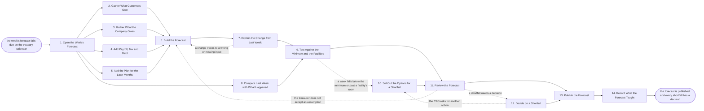

# Reference process: Forecast Cash

`ref/fin/forecast-cash v1`

**value stream:** [Cash and banking](../../streams/finance/cash-and-banking.md)
Each week the treasurer and the chief financial officer (CFO) need to see
whether the company will hold enough cash over the coming weeks and
months, early enough to act on what they see. The treasury-analyst agent
opens the week's forecast from the last version, the receivables-keeper
agent gives what customers owe with the week each receipt is expected,
and the payables-processor agent gives what the company owes with the
week each payment falls due. The
treasury-analyst agent adds the paydays from the pay calendar, the tax
from the filing calendar, and the interest and repayments of each loan,
and the planning-analyst agent gives the latest reforecast for the months
the open items do not yet cover. The treasury-analyst agent builds the
forecast by week and then by month for each entity and currency,
explains every change from last week's forecast, sets last week's
forecast beside what actually happened, and tests each week against
`<your minimum cash>` and the room left in each credit facility. Where a
shortfall appears, it sets out the options for meeting it, such as
drawing on a facility, moving cash between entities or changing when
payments go out, with what each would cost and when it must start. The
treasurer reviews the forecast, the CFO decides on any shortfall, and the
forecast is published at a version. The run closes when the forecast is
published and every shortfall has a decision from a named person.

**delivers:** report, a weekly cash forecast

**starts:** on a schedule, the week's forecast falls due on the treasury calendar

## The goals

- Publish the forecast by [noon on the second working day] of each week
- Keep each week's forecast within [5%] of the cash the company actually held
- Raise each shortfall at least [6 weeks] before it would happen
- Raise no more than [one] shortfall a quarter that never happens

## The activities

| # | Activity | What happens | Agents |
|---|---|---|---|
| 1 | Open the Week's Forecast | the horizon in weeks and months, from the last version | [treasury-analyst](../../agents/treasury-analyst.md) |
| 2 | Gather What Customers Owe | each open invoice and the week its payment is expected | [receivables-keeper](../../agents/receivables-keeper.md) |
| 3 | Gather What the Company Owes | approved invoices and open orders by the week they fall due | [payables-processor](../../agents/payables-processor.md) |
| 4 | Add Payroll, Tax and Debt | the paydays, the tax dates, the interest and the repayments | treasury-analyst |
| 5 | Add the Plan for the Later Months | the latest reforecast for the months the open items miss | [planning-analyst](../../agents/planning-analyst.md) |
| 6 | Build the Forecast | cash by week and then by month, for each entity and currency | treasury-analyst |
| 7 | Explain the Change from Last Week | every movement from the last version traced to its cause | treasury-analyst |
| 8 | Compare Last Week with What Happened | forecast against actual cash, and the reason for each miss | treasury-analyst |
| 9 | Test Against the Minimum and the Facilities | each week against minimum cash and room in each facility | treasury-analyst |
| 10 | Set Out the Options for a Shortfall | each option with what it costs and when it must start | treasury-analyst |
| 11 | Review the Forecast | the treasurer reviews the assumptions and the changes | treasurer (person) |
| 12 | Decide on a Shortfall | the CFO chooses an option or asks for another | CFO (person) |
| 13 | Publish the Forecast | the forecast at a version, to the CFO and the leaders | treasury-analyst |
| 14 | Record What the Forecast Taught | which assumptions missed, and what the next week changes | treasury-analyst |

The open items come from the records that `ref/fin/apply-a-customer-payment`,
`ref/fin/collect-an-overdue-invoice`, `ref/fin/process-a-supplier-invoice`
and `ref/fin/pay-approved-invoices` keep, the paydays from the pay
calendar that `ref/hr/run-payroll` runs on, the tax dates from the filing
calendar the tax returns are filed on, and the interest and
repayments from the facilities held at `ref/fin/check-the-debt-covenants`.
The later months read the reforecast published at
`ref/fin/reforecast-the-year`, which already reads the revenue forecast
Revenue operations publishes, and this process builds no plan of its own.
The actual cash it compares with comes from each day's position at
`ref/fin/report-the-daily-cash-position`. A shortfall that would threaten
a covenant goes to `ref/fin/check-the-debt-covenants` the same week, and a
transfer the CFO chooses runs at `ref/fin/move-cash-between-accounts`.

## The graph



## The document, with the blanks marked

```
PROCESS: forecast cash                id: <team>/forecast-cash   v1
from: ref/fin/forecast-cash v1
owner: <who>                          effective: <date>
trigger: the week's forecast falls due on <your treasury calendar>, or
         <your treasurer role> or <your CFO role> calls a forecast out of
         cycle after an event that moves cash, such as a large customer
         failing to pay or a large purchase approved
         watch: record=<cash forecast> system=<your treasury system>
                change=<the forecast date comes up, or a forecast is
                called out of cycle>
concurrency: one forecast is open at a time - a forecast called out of
             cycle replaces the week's run and starts from the last
             published version, and the daily positions keep running
             beside it
goal: a forecast of cash by week for <weeks> and by month for <months>,
      for each entity and currency, published at a version by <the day>,
      with every change from the last version explained, last week's
      forecast set beside what happened, and every shortfall decided by
      a named person
phases:
  open-forecast      - system: the week's forecast opened from the last
                       published version, with the horizon in weeks and
                       months, the entities, the currencies and the rates
                       dated for the week
                       owner: treasury-analyst    after: trigger
                       automation: <level>
  gather-receivables - runs collect-and-report: each open customer
                       invoice from <your billing system> and the week
                       its payment is expected from the customer's own
                       record of paying, with each promise to pay and
                       each disputed amount marked
                       owner: receivables-keeper  after: open-forecast
                       automation: <level>
  gather-payables    - runs collect-and-report: each approved invoice and
                       each open purchase order from <your ERP> by the
                       week it falls due, with the payment runs already
                       proposed
                       owner: payables-processor  after: open-forecast
                       automation: <level>
  add-fixed-flows    - runs collect-and-report: each payday and its
                       expected total from <your pay calendar>, each tax
                       payment from <your tax filing calendar>, and the
                       interest, fees and repayments of each facility on
                       <your facility record>
                       owner: treasury-analyst
                       after: open-forecast       automation: <level>
  add-later-months   - runs collect-and-report: the cash the latest
                       reforecast from ref/fin/reforecast-the-year implies
                       for the months the open items do not yet cover, at
                       its version
                       owner: planning-analyst    after: open-forecast
                       automation: <level>
  build-forecast     - system: the forecast by week and then by month for
                       each entity and currency, starting from the cash
                       the banks report, with every line naming its
                       source and the assumption behind it
                       owner: treasury-analyst
                       after: gather-receivables + gather-payables +
                       add-fixed-flows + add-later-months
                       automation: <level>
  explain-changes    - runs assessment: every movement from the last
                       published version above <threshold> traced to its
                       cause, such as a receipt that moved, a new
                       commitment or a changed assumption
                       owner: treasury-analyst
                       after: build-forecast      automation: <level>
  compare-actuals    - runs assessment: last week's forecast set beside
                       the cash each day's position at
                       ref/fin/report-the-daily-cash-position recorded,
                       with the reason for each miss above <threshold>
                       owner: treasury-analyst
                       after: open-forecast       automation: <level>
  test-headroom      - runs assessment: each week tested against <your
                       minimum cash> and the room left in each credit
                       facility, and each covenant the forecast would
                       move named for ref/fin/check-the-debt-covenants
                       owner: treasury-analyst
                       after: explain-changes + compare-actuals
                       automation: <level>
  set-out-options    - runs assessment: each way to meet a shortfall,
                       such as drawing on a facility, moving cash between
                       entities or changing when payments go out, with
                       what it costs, what it needs and when it must start
                       owner: treasury-analyst
                       after: test-headroom, when a week is short, and
                       decide-shortfall when the CFO asks for another
                       automation: <level>
  review-forecast    - convenes approval: <your treasurer role> reviews
                       the assumptions, the changes and the misses, and
                       accepts the forecast or names the lines to build
                       again
                       owner: <your treasurer role>
                       after: test-headroom, and set-out-options when it
                       ran                        by: <hours>
                       automation: never
  decide-shortfall   - convenes decide-and-announce: <your CFO role>
                       chooses how to meet each shortfall, or asks for
                       another option, and each choice then runs through
                       its own process with its own approvals
                       owner: <your CFO role>
                       after: review-forecast, when a week is short
                       by: <days>                 automation: never
  publish-forecast   - system: the forecast published at a version to
                       <your CFO role> and <the leaders who plan against
                       it>, with every shortfall and the decision on it
                       owner: treasury-analyst
                       after: review-forecast, and decide-shortfall when
                       it ran                     by: <the day>
                       automation: <level>
  record-learning    - convenes debrief: which assumptions missed and by
                       how much, which inputs came late, and what the
                       next week's forecast does differently
                       owner: treasury-analyst
                       after: publish-forecast    automation: <level>
run-scoped:
  inputs   - runs roll-call                     owner: treasury-analyst
             every: <cadence>
             from: open-forecast       until: build-forecast
handoffs:
  open-forecast -> gather-receivables / gather-payables / add-fixed-flows /
    add-later-months / compare-actuals [forecast-frame]: the horizon, the
    entities, the currencies and the last published version
  gather-receivables -> build-forecast [expected-receipts]: each open
    invoice with the week its payment is expected
  gather-payables -> build-forecast [expected-payments]: each approved
    invoice and open order with the week it falls due
  add-fixed-flows -> build-forecast [fixed-flows]: the paydays, the tax
    payments and each facility's interest, fees and repayments
  add-later-months -> build-forecast [plan-months]: the cash the
    reforecast implies for the later months, at its version
  build-forecast -> explain-changes [draft-forecast]: the forecast with
    every line's source and assumption
  explain-changes -> test-headroom [explained-forecast]: the forecast with
    every change from the last version traced to its cause
  compare-actuals -> test-headroom [forecast-misses]: last week's forecast
    beside what happened, with the reason for each miss
  test-headroom -> set-out-options [shortfalls]: each week below the
    minimum or past a facility's room, with its size
  test-headroom -> review-forecast [tested-forecast]: the forecast with
    each week's headroom
  set-out-options -> review-forecast [shortfall-options]: each option with
    its cost, what it needs and when it must start
  review-forecast -> decide-shortfall [reviewed-shortfall]: each shortfall
    and its options, as the treasurer accepted them
  decide-shortfall -> publish-forecast [shortfall-decisions]: the option
    chosen for each shortfall, by whom and when
  review-forecast -> publish-forecast [accepted-forecast]: the forecast as
    the treasurer accepted it
  publish-forecast -> record-learning [published-forecast]: the forecast
    at its version, and who it went to
deviations:
  explain-changes -> build-forecast [input-wrong]: a change traces to a
    wrong or missing input, so the input is corrected and the forecast is
    built again
  review-forecast -> build-forecast [assumption-rejected]: the treasurer
    does not accept an assumption, so the lines it touches are built
    again on the assumption the treasurer names
  decide-shortfall -> set-out-options [another-option]: the CFO asks for
    another option, so the options are set out again with the one asked
    for
  test-headroom -> set-out-options [week-short]: a week falls below the
    minimum cash or past a facility's room, so the options for meeting it
    are set out before the review
bindings:
  roster:  <who holds each role - agents claiming the abstract agents
           above, and named people for the treasurer and the CFO>
  systems: <your treasury system> (write), <your billing system> (read),
           <your ERP> (read), <your payroll system> (read), <your
           facility record> (read), <your planning system> (read), the
           notification channel (write)
  data:    <your minimum cash> <version>, <your treasury policy>
           <version>, <your pay calendar> <version>, <your tax filing
           calendar> <version>, the latest reforecast <version>, the
           exchange rates <dated>
policy:
  the forecast starts from the cash the banks report, and every line
    beyond it names its source and the assumption behind it
  each receipt is forecast for the week the customer's own record of
    paying points to, which may be later than its due date, and a
    disputed amount is left out until the dispute is settled
  the later months read the reforecast published at
    ref/fin/reforecast-the-year at its version, and this process builds
    no plan of its own
  a shortfall against <your minimum cash> or a facility's room reaches
    <your CFO role> in the week it first shows, with the options and what
    each would cost
  the choice of an option is a human decision, and a drawing on a
    facility, a transfer or a change to when payments go out each runs
    through its own process with its own approvals
  the agents hold no right to move money, draw on a facility or change a
    payment's date
measures:
  cycle time: <hours> from the forecast date to the forecast published
  on time: <target> share of forecasts published by <the day>
  volume: <entities> and <currencies>
  quality gate: every line in the forecast names its source, and last
                week's forecast sits beside what happened with every miss
                above <threshold> explained
```

## The failure edges

- **An input is late.** The treasury-analyst agent asks for it again, and
  if it has still not come by the day the forecast is due, last week's
  figures for it are carried forward and marked as carried, so the
  treasurer sees which lines are stale.
- **A change from last week has no cause anyone can name.** The change is
  traced before the forecast goes to review. A forecast never goes out
  with a movement nobody can explain.
- **Last week's forecast missed by more than the threshold.** The reason
  is recorded, and the assumption that missed is changed for the coming
  weeks once the treasurer accepts it. A pattern of misses in one kind of
  receipt or payment goes to the team that owns those items.
- **A shortfall appears.** The options reach the CFO in the week the
  shortfall first shows, with when each must start to be in time. A
  drawing on a facility is made by the people the delegation of
  authority names under the facility's terms, and a shortfall that would
  break a covenant goes to `ref/fin/check-the-debt-covenants` the same
  week.
- **The CFO chooses none of the options.** The CFO asks for another, and
  the forecast is published with the shortfall marked as open and the
  date by which a decision is needed.
- **The trigger fires while a run is in flight.** One forecast is open at
  a time. A forecast called out of cycle replaces the week's run and
  starts from the last published version.
- **A run is abandoned.** The forecast cannot be built, for example when
  an input system fails. The last published version stays in force with
  a note that it was not refreshed, the treasurer tells the CFO, and the
  next run starts from it.
