# Reference process: Fund the Payroll

`ref/fin/fund-the-payroll v1`

**value stream:** [Cash and banking](../../streams/finance/cash-and-banking.md)
Human resources has an approved pay register at `ref/hr/run-payroll`, and
the payroll account has to hold the money before the payroll approver
releases the payments. The payroll-administrator agent gives the
register's total and its payday, with the withholding that
`<your payroll funding rule>` pays from the same account, and the
treasury-analyst agent confirms them against the approved register and
reads what the payroll account already holds and what else is due from
it before payday. It works out the amount to fund in time for the bank's
cutoff before payday, checks that the account the money comes from holds
it beside its own payments, and prepares the funding transfer. The
wire-check agent checks the transfer against the approved register's
total and both accounts against the verified bank record. A named
approver who did not prepare the transfer approves it, and two named
people release it under `<your dual control rule>`. The wire-check agent
confirms the funding landed, and the treasury-analyst agent tells the
payroll manager and the payroll approver that the account is funded, so
the payments may be released. After payday the treasury-analyst agent
matches the funding to the payments that left, explains whatever is left
in the account with the payroll-administrator agent, and records the
funding for the ledger and for the monthly reconciliation of the payroll
accounts. The run closes when the funding is matched to the payments and
recorded.

**delivers:** status board, a funded payroll account

## The goals

- Have the payroll account funded [1 working day] before payday
- Release the funding within [4 working hours] of the register's approval
- Leave under [1%] of the register's total idle in the payroll account after payday
- Match each funding to the payments within [2 working days] of payday

## The activities

| # | Activity | What happens | Agents |
|---|---|---|---|
| 1 | Take In the Approved Register | the total, the payday and the pay group | [payroll-administrator](../../agents/payroll-administrator.md) |
| 2 | Confirm the Total and the Payday | net pay and any withholding it pays, against the register | [treasury-analyst](../../agents/treasury-analyst.md) · payroll-administrator |
| 3 | Read the Payroll Account | what it holds, and what else is due from it before payday | treasury-analyst |
| 4 | Work Out the Funding | the amount, and the date the bank's cutoff needs | treasury-analyst |
| 5 | Check the Cash Is There | the account it comes from holds it beside its own payments | treasury-analyst |
| 6 | Prepare the Funding Transfer | from the funding account to the payroll account | treasury-analyst |
| 7 | Check the Funding Transfer | against the register's total and the verified bank record | [wire-check](../../agents/wire-check.md) |
| 8 | Approve the Funding | a named approver who did not prepare it | funding approver (person) |
| 9 | Release the Funding | two named people under dual control | payment releaser (person) · second signer (person) |
| 10 | Confirm the Funding Landed | in the payroll account before the payments are released | wire-check |
| 11 | Tell Payroll the Account Is Funded | the payroll manager and the approver, before the release | treasury-analyst |
| 12 | Match the Funding to the Payments | the funding against every payment that left on payday | treasury-analyst · wire-check |
| 13 | Explain What Is Left in the Account | returned payments, items not yet presented and the buffer | treasury-analyst · payroll-administrator |
| 14 | Record the Funding | the entries for the ledger and the payroll reconciliation | treasury-analyst |
| 15 | Record What the Run Taught | late registers, rushed fundings, and what next time changes | treasury-analyst |

This process funds the payroll and never runs it. The register is built,
checked by the finance controller and approved at `ref/hr/run-payroll`,
and the payroll approver releases the payments there once this process
has said the account is funded. An off-cycle payment from the same
process, and the year-end adjustments at `ref/hr/close-the-payroll-year`,
are funded the same way as runs of their own. Where an outside payroll
provider collects the money from the company's account by debit, the run
checks and approves the amount the provider will collect in place of
preparing a transfer, and the debit is matched to the approved register
the same way. The payroll accounts are reconciled each month at
`ref/fin/reconcile-a-balance-sheet-account`, and a shortfall in the
account the money comes from is met at `ref/fin/move-cash-between-accounts`.

## The graph

```mermaid
flowchart LR
  T([the payroll approver approves a pay register at ref/hr/run-payroll]) --> A1[1. Take In the Approved Register]
  A1 --> A2[2. Confirm the Total and the Payday]
  A2 -. the total or the payday does not match the approved register .-> A1
  A2 --> A3[3. Read the Payroll Account]
  A3 --> A4[4. Work Out the Funding]
  A4 --> A5[5. Check the Cash Is There]
  A5 -. the funding account is short, and cash is moved into it first .-> A4
  A5 --> A6[6. Prepare the Funding Transfer]
  A6 --> A7[7. Check the Funding Transfer]
  A7 -. the transfer does not match the register or an account is not on the record .-> A6
  A7 --> A8[8. Approve the Funding]
  A8 -. the approver will not approve .-> A4
  A8 --> A9[9. Release the Funding]
  A9 --> A10[10. Confirm the Funding Landed]
  A10 -. the funding is returned or has not arrived .-> A6
  A10 --> A11[11. Tell Payroll the Account Is Funded]
  A11 --> A12[12. Match the Funding to the Payments]
  A12 --> A13[13. Explain What Is Left in the Account]
  A13 --> A14[14. Record the Funding]
  A14 --> A15[15. Record What the Run Taught]
  A15 --> DONE([the payroll account was funded in time, and the funding is matched and recorded])
```



## The document, with the blanks marked

```
PROCESS: fund the payroll             id: <team>/fund-the-payroll   v1
from: ref/fin/fund-the-payroll v1
owner: <who>                          effective: <date>
trigger: <your payroll approver role> approves a pay register at the
         approve-register phase of ref/hr/run-payroll, or an off-cycle
         payment at its correct-error phase, in <your payroll system>
         watch: record=<approved pay register> system=<your payroll system>
                change=<a register or an off-cycle payment is approved>
concurrency: runs may overlap across pay groups - one approved register
             is one run, an off-cycle payment is funded as a run of its
             own, and a register approved again after a change replaces
             the run for the register it changes
goal: the payroll account holding what the approved register needs by
      <the bank's cutoff before payday>, funded by a transfer that a
      named approver who did not prepare it approved and two named
      people released under <your dual control rule>, and the funding
      matched to every payment that left and recorded for the ledger
phases:
  take-in-register   - system: the approved register's total, its payday
                       and its pay group taken from <your payroll
                       system>, with the name of the approver and the
                       time of the approval
                       owner: payroll-administrator   after: trigger
                       automation: <level>
  confirm-total      - runs assessment: the net pay, and the withholding
                       <your payroll funding rule> pays from the payroll
                       account, checked against the approved register,
                       and the payday against <your pay calendar>
                       owner: treasury-analyst
                       after: take-in-register    automation: <level>
  read-account       - runs collect-and-report: what the payroll account
                       holds, the items from earlier runs not yet
                       presented, and anything else due from it before
                       payday
                       owner: treasury-analyst
                       after: confirm-total       automation: <level>
  work-out-funding   - runs assessment: the amount to fund, as what the
                       register needs less what the account already holds
                       for it plus <your payroll buffer>, and the date the
                       bank's cutoff before payday needs it by
                       owner: treasury-analyst
                       after: read-account, and approve-funding when the
                       approver sends it back      automation: <level>
  check-cash         - runs assessment: the account the money comes from
                       holds the funding beside its own payments due that
                       day, and a shortfall goes to <your treasurer role>
                       the same day
                       owner: treasury-analyst
                       after: work-out-funding    automation: <level>
  prepare-funding    - system: the funding transfer prepared in <your
                       treasury system> from the funding account to the
                       payroll account, or to the provider's account on
                       <your bank account record>, with the amount, the
                       value date and the register it funds
                       owner: treasury-analyst
                       after: check-cash          automation: <level>
  check-funding      - runs assessment: the transfer checked against the
                       approved register's total and the amount worked
                       out, and both accounts against <your verified bank
                       record>
                       owner: wire-check
                       after: prepare-funding     automation: <level>
  approve-funding    - convenes approval: <your funding approver role>,
                       who prepared none of it, approves the funding as a
                       named approver under <your delegation of
                       authority>
                       owner: <your funding approver role>
                       after: check-funding       by: <hours>
                       automation: never
  release-funding    - convenes approval: <your payment releaser role>
                       and <your second signer role> release the funding
                       in <your bank portal> under <your dual control
                       rule>, before the bank's cutoff
                       owner: <your payment releaser role>
                       after: approve-funding     by: <hours>
                       automation: never
  confirm-funding    - runs collect-and-report: the funding matched in
                       the payroll account's report before the payroll
                       payments are released, and any funding returned
                       or not arrived held aside with the reason
                       owner: wire-check          after: release-funding
                       by: <the bank's cutoff>    automation: <level>
  tell-payroll       - system: <your payroll manager role> and <your
                       payroll approver role> told the account is funded,
                       with the amount and the bank's reference, so the
                       payments may be released at ref/hr/run-payroll
                       owner: treasury-analyst
                       after: confirm-funding     automation: <level>
  match-payments     - runs allocate-and-reconcile: the funding set
                       against every payment that left the payroll
                       account on payday, by the bank's report
                       owner: treasury-analyst
                       after: tell-payroll        by: <days after payday>
                       automation: <level>
  explain-balance    - runs assessment: whatever is left in the payroll
                       account explained, such as payments returned,
                       items not yet presented, withholding not yet paid
                       and the buffer, against the payroll records
                       owner: treasury-analyst
                       after: match-payments      automation: <level>
  record-funding     - system: the funding recorded in <your treasury
                       system> and its entries prepared for <your general
                       ledger>, with the register it funded and the
                       approval and the release behind it
                       owner: treasury-analyst
                       after: explain-balance     automation: <level>
  record-learning    - convenes debrief: which registers came late, which
                       fundings were rushed or returned, how much was left
                       idle after payday, and what the next run does
                       differently
                       owner: treasury-analyst
                       after: record-funding      automation: <level>
run-scoped:
  cutoff   - runs roll-call                     owner: treasury-analyst
             every: <cadence>
             from: take-in-register    until: confirm-funding
  funding  - runs allocate-and-reconcile        owner: wire-check
             from: prepare-funding     until: confirm-funding
handoffs:
  take-in-register -> confirm-total [approved-register-total]: the total,
    the payday, the pay group and the approval behind them
  confirm-total -> read-account [confirmed-total]: the amount the
    payroll account must pay, checked against the register
  read-account -> work-out-funding [payroll-account]: what the account
    holds and what else is due from it before payday
  work-out-funding -> check-cash [funding-amount]: the amount and the date
    it is needed by
  check-cash -> prepare-funding [cash-confirmed]: the funding account and
    its balance beside its own payments
  prepare-funding -> check-funding [prepared-funding]: the transfer with
    its accounts, its amount, its value date and the register it funds
  check-funding -> approve-funding [checked-funding]: the transfer matched
    to the register's total and the verified accounts
  approve-funding -> release-funding [approved-funding]: the funding as
    approved. A change to the amount or the accounts voids the approval
  release-funding -> confirm-funding [released-funding]: the funding
    released, with its bank reference and the people who released it
  confirm-funding -> tell-payroll [confirmed-funding]: the funding
    matched in the payroll account's report
  tell-payroll -> match-payments [funded-notice]: the notice to payroll,
    with the time it was sent
  match-payments -> explain-balance [matched-payments]: the funding
    against every payment that left, with any difference
  explain-balance -> record-funding [explained-balance]: whatever is left
    in the account, with the cause of each item
  record-funding -> record-learning [recorded-funding]: the funding and
    its entries for the ledger
deviations:
  confirm-total -> take-in-register [total-does-not-match]: the total or
    the payday does not match the approved register, so the register is
    taken in again from <your payroll system> once the payroll manager
    has named the cause
  check-cash -> work-out-funding [funding-account-short]: the account the
    money comes from is short, so <your treasurer role> has cash moved
    into it at ref/fin/move-cash-between-accounts or names another
    account, and the funding is worked out again
  check-funding -> prepare-funding [funding-does-not-match]: the transfer
    does not match the register's total or an account is not on the
    verified record, so the transfer is held and prepared again
  approve-funding -> work-out-funding [approver-refuses]: the approver
    will not approve, so the amount is worked out again on the lines the
    approver named
  confirm-funding -> prepare-funding [funding-returned]: the funding is
    returned or has not arrived by the cutoff, so it is traced with the
    bank and a new transfer is prepared only once the first is known to
    have failed
bindings:
  roster:  <who holds each role - agents claiming the abstract agents
           above, or the outside payroll provider where it holds
           payroll-administrator for the company, and named people for
           the treasurer, the funding approver, the payment releasers,
           the second signers, the payroll manager and the payroll
           approver>
  systems: <your payroll system> (read), <your treasury system> (write),
           each bank's portal (read), <your verified bank record>
           (read), <your bank account record> (read), <your general
           ledger> (write), the notification channel (write)
  data:    <your pay calendar> <version>, <your payroll funding rule>
           <version>, <your payroll buffer> <version>, <your delegation
           of authority> <version>, <your dual control rule> <version>
policy:
  the funding is worked out only from a register <your payroll approver
    role> has approved, and a change to the register after approval
    voids it at ref/hr/run-payroll and the funding is worked out again
    from the new approval
  this process never builds, changes or releases a payroll payment, which
    stay at ref/hr/run-payroll, and the agents see only the totals the
    funding needs and nothing about any one employee's pay
  whoever prepares the funding never approves it, and the approver and
    the releasers are the people <your delegation of authority> names
  the funding goes only to the payroll account on <your bank account
    record>, or to the provider's account on that record, and a change to
    either is confirmed through a contact already on file before any
    funding uses it
  the funding is released by two named people under <your dual control
    rule>, and the release is never delegated to an agent
  the payroll payments are released only once this process has said the
    account is funded, and nobody releases them on the assumption that
    the money is there
measures:
  cycle time: <hours> from the register approved to the funding landed
  on time: <target> share of payrolls funded before <the bank's cutoff
           before payday>
  volume: <fundings per period>
  quality gate: every funding traces to an approved register, a check, a
                named approver who did not prepare it and two named
                releasers, and is matched to the payments that left
```

## The failure edges

- **The register arrives late.** The treasury-analyst agent tells the
  treasurer and the payroll manager the latest time the funding can be
  released for payday. The funding still passes every check, and where
  it cannot land in time, the payroll manager decides with the treasurer
  what employees are told, at `ref/hr/run-payroll`.
- **The total or the payday does not match the approved register.** The
  register is taken in again once the payroll manager has named the
  cause. Nothing is funded from a figure that does not trace to the
  approved register.
- **The account the money comes from is short.** The treasurer has cash
  moved into it at `ref/fin/move-cash-between-accounts` or names another
  account the same day, and the chief financial officer (CFO) hears of
  it. Pay is never held back to cover a shortfall elsewhere without the
  CFO's decision in writing.
- **The approver will not approve.** The amount is worked out again on
  the lines the approver named, and checked again. Where the approver
  questions the register itself, it goes back to the payroll manager at
  `ref/hr/run-payroll`.
- **The funding is returned or does not arrive.** The wire-check agent
  traces it with the bank, the payroll manager is told the same hour, and
  a new transfer is prepared only once the first is known to have failed.
- **The register changes after the funding.** A change to the register
  after approval voids it at `ref/hr/run-payroll`, and the new approval
  starts a run that funds only the difference, or returns the excess to
  the funding account at `ref/fin/move-cash-between-accounts`.
- **The trigger fires while a run is in flight.** One approved register
  is one run, and pay groups may be funded at the same time. A register
  approved again after a change replaces the run for the register it
  changes.
- **A run is abandoned.** The funding cannot be released, for example
  when the bank portal fails. Nothing is released outside the portal
  without the bank's own procedure for a failed portal and the same two
  named people, the payroll manager is told at once, and the run starts
  again from the approved register once the portal returns.
