# Reference process: Issue a Company Card

`ref/fin/issue-a-company-card v1`

**value stream:** [Travel and expenses](../../streams/finance/travel-and-expenses.md)
A manager asks for a company card for an employee whose work needs one,
or for a change to the limit on a card the employee already holds, or
the leaving record names a card holder's last day, or a named person
finds that a holder has broken the card rules. The card-administrator
agent checks a new request against the card policy for whether the role
needs a card, and the delegation-keeper agent names the approver for the
limit asked for from the delegation of authority in force. That named
person sets the limit and the merchant rules, or refuses them, and a
change to a limit is approved the same way. The holder accepts the card
terms before the card-administrator agent orders the card from the card
issuer at exactly the limit and the rules approved, and the holder
activates it. The card-administrator agent freezes a card the same day a
breach is recorded, while the travel and expense lead and the holder's
manager decide what follows, closes a leaver's card at the end of the
last day, and hands any spend still open on a closed card to the card
reconciliation. The run closes when the card in the issuer's portal
matches its approval in the card register, or the card is frozen or
closed with its reason.

**delivers:** status board, a company card at its approved limit

## The goals

- Issue each approved card within [5 working days] of the request
- Close [100%] of leavers' cards by the end of the last day
- Keep the total of card limits under [3 times] the monthly card spend
- Keep declined transactions for holders working inside the policy under [1%]

## The activities

| # | Activity | What happens | Agents |
|---|---|---|---|
| 1 | Take In the Request | a new card, a limit change, a leaver or a breach | [card-administrator](../../agents/card-administrator.md) |
| 2 | Check the Role Needs a Card | the role, travel and buying against the card policy | card-administrator |
| 3 | Look Up the Approver | the approver the delegation of authority names for the limit | [delegation-keeper](../../agents/delegation-keeper.md) |
| 4 | Set the Limit and the Merchant Rules | the named approver sets them, or refuses with the reason | card approver (person) |
| 5 | Accept the Card Terms | the holder accepts the terms and the policy at its version | card holder (person) · card-administrator |
| 6 | Order the Card | ordered from the issuer at the approved limit and rules | card-administrator |
| 7 | Activate the Card | the holder activates it through the issuer's own channel | card holder (person) · card-administrator |
| 8 | Freeze the Card on a Breach | the same day a named person records a breach | card-administrator |
| 9 | Decide What Follows a Breach | restored, restored at a lower limit, or closed | travel and expense lead (person) · manager (person) |
| 10 | Set the Approved Limit in the Portal | a change, a lower limit or a correction, exactly as approved | card-administrator |
| 11 | Close the Card | at the end of a leaver's last day, or on a breach decision | card-administrator |
| 12 | Hand the Open Spend to the Reconciliation | each transaction on a closed card still open for approval | card-administrator |
| 13 | Match the Card to Its Approval | the portal's status, limit and rules against the register | card-administrator |
| 14 | Record the Card in the Register | the holder, limit, rules and the approval behind them | card-administrator |
| 15 | Record What the Request Taught | time to issue, refused requests, breaches and their causes | card-administrator |

A leaver's last day comes from the leaving record at
`ref/hr/offboard-a-leaver`, where the card is also collected with the rest
of the company property, and a breach is recorded when a named person
decides a transaction at `ref/fin/reconcile-company-card-spend`. The card
policy and its limits by role are set at
`ref/fin/publish-a-finance-policy`, and the approver for each limit comes
from the delegation of authority published at
`ref/fin/publish-the-delegation-of-authority`. A conduct matter that
follows a breach is handled at `ref/hr/issue-a-disciplinary-action`. The
card issuer runs its own fraud checks, and a card its holder reports
lost or stolen is blocked through the issuer's own channel and replaced
at the same approved limit and rules.

## The graph

```mermaid
flowchart LR
  T([a card or a limit change is asked for, a holder's last day is recorded, or a breach is recorded]) --> A1[1. Take In the Request]
  A1 --> A2[2. Check the Role Needs a Card]
  A1 -. a change to a limit is asked for .-> A3[3. Look Up the Approver]
  A1 -. a breach of the card rules is recorded .-> A8[8. Freeze the Card on a Breach]
  A1 -. a holder's last day is recorded .-> A11[11. Close the Card]
  A2 -. the role does not need a card .-> A15[15. Record What the Request Taught]
  A2 --> A3
  A3 --> A4[4. Set the Limit and the Merchant Rules]
  A4 -. the approver refuses .-> A15
  A4 --> A5[5. Accept the Card Terms]
  A4 -. a change to a limit is approved .-> A10[10. Set the Approved Limit in the Portal]
  A5 --> A6[6. Order the Card]
  A6 --> A7[7. Activate the Card]
  A7 --> A13[13. Match the Card to Its Approval]
  A8 --> A9[9. Decide What Follows a Breach]
  A9 -. the card is restored at a lower limit .-> A10
  A9 -. the card is closed .-> A11
  A9 --> A13
  A10 --> A13
  A11 --> A12[12. Hand the Open Spend to the Reconciliation]
  A12 --> A13
  A13 -. the portal does not match the approval .-> A10
  A13 --> A14[14. Record the Card in the Register]
  A14 --> A15
  A15 --> DONE([the card matches its approval, or it is frozen or closed with its reason])
```



## The document, with the blanks marked

```
PROCESS: issue a company card         id: <team>/issue-a-company-card   v1
from: ref/fin/issue-a-company-card v1
owner: <who>                          effective: <date>
trigger: a manager asks for a company card for an employee or for a
         change to a card's limit in <your card program>, the leaving
         record at ref/hr/offboard-a-leaver names a card holder's last
         day, or a named person records a breach of the card rules at
         ref/fin/reconcile-company-card-spend
         watch: record=<card request> system=<your card program>
                change=<a request, a last day or a breach is recorded
                against a card or an employee>
concurrency: runs may overlap freely - one request for one card is one
             run, and a card has one request open at a time, except that
             a freeze or a close never waits for an open run and ends it
goal: each new card issued only to an employee whose role needs one, at
      exactly the limit and the merchant rules the approver named by
      <your delegation of authority> set, each change to a limit approved
      the same way before it takes effect, each card frozen on the day a
      breach is recorded and closed at the end of its holder's last day,
      and every card in the issuer's portal matching its approval in the
      card register
phases:
  take-in-request      - system: the request lands with the employee, the
                         card asked for or the card it concerns, the limit
                         and the merchant kinds asked for and the reason,
                         or the last day from the leaving record, or the
                         breach and the named person who recorded it
                         owner: card-administrator  after: trigger
                         automation: <level>
  check-role           - runs assessment: the employee's role and the
                         travel and buying it does read against <your card
                         policy> at its version, and the request marked as
                         fitting the policy or not, with the rule
                         owner: card-administrator
                         after: take-in-request, when a new card is asked
                         for                        automation: <level>
  find-approver        - runs assessment: the approver for the limit asked
                         for read from <your delegation of authority> at
                         the version in force, with anyone else's approval
                         marked as one that does not count
                         owner: delegation-keeper
                         after: check-role, or take-in-request when a
                         change to a limit is asked for
                         automation: <level>
  set-limit            - convenes approval: <your card approver role>, as
                         the delegation of authority names, sets the
                         monthly limit, the limit for one transaction, the
                         merchant kinds allowed and whether cash may be
                         drawn, or refuses the request in writing with the
                         reason
                         owner: <your card approver role>
                         after: find-approver       by: <days>
                         automation: never
  accept-terms         - human: the holder accepts <your card terms> and
                         <your card policy> at their versions in writing,
                         including what happens to personal spend, before
                         the card is ordered, and the card-administrator
                         agent records the acceptance
                         owner: <the card holder>
                         after: set-limit, when a new card is approved
                         by: <days>                 automation: never
  order-card           - system: the card ordered from <your card issuer>
                         in the holder's name at exactly the limit and the
                         merchant rules approved, and sent to the address
                         on the holder's verified record
                         owner: card-administrator
                         after: accept-terms        automation: <level>
  activate-card        - human: the holder activates the card on arrival
                         through the issuer's own channel, and the
                         card-administrator agent records the date
                         owner: <the card holder>
                         after: order-card          automation: never
  freeze-card          - system: the card frozen in the issuer's portal the
                         same day a named person records a breach, and the
                         holder and the holder's manager told the reason
                         owner: card-administrator
                         after: take-in-request, when a breach is recorded
                         by: <hours>                automation: <level>
  decide-breach        - convenes decide-and-announce: <your travel and
                         expense lead role> and the holder's manager
                         decide in writing, with the reason, whether the
                         card is restored, restored at a lower limit or
                         closed, and any conduct matter goes to
                         ref/hr/issue-a-disciplinary-action
                         owner: <your travel and expense lead role>
                         after: freeze-card         by: <days>
                         automation: never
  apply-limit          - system: an approved change to a limit or to the
                         merchant rules, a lower limit decided after a
                         breach, or a correction to match the approval,
                         set in the issuer's portal exactly as approved on
                         the date it takes effect
                         owner: card-administrator
                         after: set-limit when a change to a limit is
                         approved, decide-breach when a lower limit is
                         decided, or match-card when the portal does not
                         match                      automation: <level>
  close-card           - system: the card closed in the issuer's portal at
                         the end of the holder's last day from the leaving
                         record, or the day a named person decides to
                         close it after a breach
                         owner: card-administrator
                         after: take-in-request when a last day is
                         recorded, or decide-breach when the card is
                         closed                     by: <the end of the
                         last day>                  automation: <level>
  hand-open-spend      - system: every transaction on the closed card still
                         without a receipt, a reason or an approval handed
                         to ref/fin/reconcile-company-card-spend, so it is
                         settled before the leaver's final pay where the
                         timing allows
                         owner: card-administrator
                         after: close-card          automation: <level>
  match-card           - runs assessment: the card's status, its limits and
                         its merchant rules in the issuer's portal read
                         field by field against its approval in the card
                         register
                         owner: card-administrator
                         after: activate-card, apply-limit or
                         hand-open-spend, or decide-breach when the card
                         is restored as it was     automation: <level>
  record-card          - system: the card register updated with the holder,
                         the card, the limits, the merchant rules, the
                         approver, the date and the reason, with the old
                         values kept with their dates
                         owner: card-administrator
                         after: match-card          automation: <level>
  record-learning      - convenes debrief: how long each card took to
                         issue, which requests were refused and why, which
                         breaches were recorded and their causes, and which
                         limits were never used
                         owner: card-administrator
                         after: record-card, or check-role or set-limit
                         when the request was refused
                         automation: <level>
run-scoped:
  status  - runs roll-call                      owner: card-administrator
            every: <cadence>
            from: take-in-request  until: record-card
  history - runs collect-and-report             owner: card-administrator
            from: take-in-request  until: run close
handoffs:
  take-in-request -> check-role / find-approver / freeze-card / close-card
    [card-request]: the employee, the card, the limit and the merchant
    kinds asked for and the reason, or the last day, or the breach
  check-role -> find-approver [role-reading]: the request marked as
    fitting the card policy, with the rule
  find-approver -> set-limit [named-approver]: the approver the delegation
    of authority names for the limit, at its version
  set-limit -> accept-terms / apply-limit [approved-limit]: the limits, the
    merchant rules and the cash rule as the approver set them, with the
    name and the date. A change to any of them voids the approval
  accept-terms -> order-card [accepted-terms]: the holder's written
    acceptance of the terms and the policy at their versions
  order-card -> activate-card [ordered-card]: the card ordered, with the
    issuer's reference and the address it was sent to
  activate-card -> match-card [active-card]: the date the holder activated
    the card
  freeze-card -> decide-breach [frozen-card]: the card frozen, the breach
    and the named person who recorded it
  decide-breach -> apply-limit / close-card / match-card
    [breach-decision]: the card restored, restored at a lower limit or
    closed, with who decided and why
  apply-limit -> match-card [applied-limit]: the limits and the rules as
    set in the portal, with the date they took effect
  close-card -> hand-open-spend [closed-card]: the card closed, with the
    date and the time
  hand-open-spend -> match-card [open-spend]: each transaction handed to
    the reconciliation, with what it still needs
  match-card -> record-card [matched-card]: the card in the portal read
    against its approval, field by field
  record-card -> record-learning [card-record]: the register entry, with
    the old values kept
deviations:
  match-card -> apply-limit [portal-does-not-match]: the status, a limit or
    a merchant rule in the portal differs from the approval, so it is set
    again exactly as approved, and a difference nobody can explain goes to
    <your travel and expense lead role> the same day
bindings:
  roster:  <who holds each role - agents claiming the abstract agents
           above, and named people for the managers who ask, each card
           approver, the travel and expense lead and each card holder>
  systems: <your card program> (write), the card issuer's portal (write),
           the HR system (read), <your delegation of authority> (read),
           the card register (write), the notification channel (write)
  data:    <your card policy> <version>, <your card terms> <version>,
           <your delegation of authority> <version>, <your list of
           merchant kinds> <version>
policy:
  no card is ordered and no limit is raised before the approver <your
    delegation of authority> names has set it in writing, and an
    approval from anyone else does not count
  nobody approves a card or a limit for themselves or for a person they
    report to
  the person who approves a limit never sets it in the issuer's portal,
    and the card-administrator agent sets only the limits and the rules
    the approval names
  a card is issued only to an employee whose role needs one under <your
    card policy>, and only after the holder has accepted the card terms
  a card is frozen the same day a breach is recorded and closed at the
    end of its holder's last day, and neither waits for any other step
  the agents set no limit, pay no card bill and spend nothing on a card
    themselves
  personal spend on a closed card is recovered only as <your card policy>
    and <your jurisdiction's rule on deductions from pay> allow, and only
    after the holder is told in writing
measures:
  cycle time: <days> from the request to the card activated
  on time: <target> share of leavers' cards closed by the end of the last
           day
  volume: <cards issued, changed and closed per period>
  quality gate: every card in the issuer's portal matches its approval in
                the card register
```

## The failure edges

- **The role does not need a card.** The card-administrator agent names
  the rule in the card policy, and the manager is told. Spend for an
  employee without a card goes through
  `ref/fin/reimburse-an-expense-claim` or a purchase order, and a manager
  who thinks the policy is wrong raises it at
  `ref/fin/publish-a-finance-policy`.
- **The approver refuses or sets a lower limit than was asked.** The
  manager is told the reason, and a card at the lower limit goes ahead
  only once the holder has accepted the terms. Nobody raises the limit
  later without a new approval.
- **The holder does not accept the terms.** No card is ordered, and the
  request closes with the reason after `<days>`.
- **The portal does not match the approval.** The card-administrator
  agent sets the card again exactly as approved and records the
  difference. A limit or a rule that changed in the portal without an
  approval goes to the travel and expense lead the same day, and the
  access behind it is read at `ref/fin/review-access-to-finance-systems`.
- **A breach is recorded.** The card is frozen the same day, before
  anyone decides what follows, and the holder is told why. The travel and
  expense lead and the manager decide, and the card stays frozen until
  they do.
- **A holder leaves with spend still open.** The card is closed at the end
  of the last day whatever is open. The open transactions go to the card
  reconciliation, and personal spend is recovered from final pay only as
  the local rule allows and after the holder is told in writing.
- **The trigger fires while a run is in flight.** A card has one request
  open at a time, and a second request waits for the first. A freeze or a
  close never waits: it ends any open request for that card.
- **A run is abandoned.** The manager withdraws the request, or the
  employee leaves before the card arrives. A card already ordered is
  cancelled with the issuer and recorded as cancelled, and nothing is
  left active in the portal for a person who no longer needs it.
