# Reference process: Issue a Customer Invoice

`ref/fin/issue-a-customer-invoice v1`

**value stream:** [Billing and collecting](../../streams/finance/billing-and-collecting.md)
A booked order reaches a date on its billing schedule, a period of metered
use closes for a customer that pays for what it uses, or a milestone the
agreement bills on is accepted. The billing-administrator agent opens the
invoice, and the order-check agent supplies the booking it made from the
signed agreement at the version the finance approver signed, with each
field naming the clause it came from. Where the customer pays for what it
uses, the usage-monitor agent supplies the period's metered usage against
the entitlement, and a reading that is missing or does not reconcile is
held, with an estimate billed only where the agreement allows it and the
billing lead approves it. The billing-administrator agent
builds each line from the booking, the billing terms and the usage,
applies the indirect tax each line carries under
`<your jurisdiction's indirect tax rules>`, and checks the invoice for
everything `<your jurisdiction's invoice rules>` require it to show. An
invoice that differs from its booking, the first invoice on a new
agreement and any invoice above `<your threshold>` go to the named billing
lead before they are issued. The run closes when the invoice is numbered,
sent on its date in the form the customer asked for and confirmed as
received, and what was billed has passed to receivables and to revenue
accounting.

**delivers:** statement, a customer invoice

## The goals

- Send [98%] of invoices on their billing date
- Have [99%] of invoices paid with no credit note or replacement
- Bill [100%] of metered usage in the period after it was used
- Send fewer than [5%] of invoices to the billing lead for review

## The activities

| # | Activity | What happens | Agents |
|---|---|---|---|
| 1 | Open the Invoice | the billing date, the booking, and whether it bills on use | [billing-administrator](../../agents/billing-administrator.md) |
| 2 | Supply the Booking at Its Version | the lines, prices, terms and order reference, with clauses | [order-check](../../agents/order-check.md) · billing-administrator |
| 3 | Read the Metered Usage | the period's usage set against the entitlement | [usage-monitor](../../agents/usage-monitor.md) |
| 4 | Check the Usage Reading Is Complete | a missing or broken reading held with its reason | usage-monitor · billing-administrator |
| 5 | Build the Invoice Lines | each line priced from the booking and the usage | billing-administrator |
| 6 | Apply the Indirect Tax | the tax each line carries, for the place it is supplied | billing-administrator |
| 7 | Check What the Invoice Must Show | every field the local invoice rules require | billing-administrator |
| 8 | Check the Invoice Against the Booking | every line traced, and the total set beside the last invoice | billing-administrator |
| 9 | Review the Invoices That Need a Person | a difference from the booking, a first invoice, a large sum | billing lead (person) |
| 10 | Number and Issue the Invoice | the next number in its series, dated and filed | billing-administrator |
| 11 | Send the Invoice in the Customer's Form | the channel, portal or format the customer asked for | billing-administrator |
| 12 | Confirm the Customer Received It | a delivery receipt, or the portal's acceptance or rejection | billing-administrator |
| 13 | Correct a Rejected Invoice | the billing lead decides how it is put right | billing lead (person) · billing-administrator |
| 14 | Pass What Was Billed On | the invoice to receivables, billing to revenue accounting | billing-administrator |
| 15 | Record What the Run Taught | late, rejected and reviewed invoices, and what changes next | billing-administrator |

The booking comes from `ref/sls/book-the-order`, and a renewal's new term
from `ref/sls/close-a-renewal`, each checked and approved before this
process reads it. An issued invoice is never edited. A customer who says
an invoice is wrong goes to `ref/fin/resolve-a-billing-dispute`, and a
credit note or a replacement invoice is approved there. Each invoice then
waits for its payment at `ref/fin/apply-a-customer-payment`, an unpaid one
is followed up at `ref/fin/collect-an-overdue-invoice`, and the period's
billing feeds `ref/fin/recognize-revenue` and the return at
`ref/fin/file-an-indirect-tax-return`.

## The graph

```mermaid
flowchart LR
  T([a booking reaches a billing date, or a usage period closes]) --> A1[1. Open the Invoice]
  A1 --> A2[2. Supply the Booking at Its Version]
  A1 --> A3[3. Read the Metered Usage]
  A3 --> A4[4. Check the Usage Reading Is Complete]
  A4 -. a reading is missing or does not reconcile .-> A3
  A2 --> A5[5. Build the Invoice Lines]
  A4 --> A5
  A5 --> A6[6. Apply the Indirect Tax]
  A6 --> A7[7. Check What the Invoice Must Show]
  A7 -. a field the rules require is missing from the booking .-> A2
  A7 --> A8[8. Check the Invoice Against the Booking]
  A8 -. a line does not trace to the booking or a reading .-> A2
  A8 --> A9[9. Review the Invoices That Need a Person]
  A8 --> A10[10. Number and Issue the Invoice]
  A9 -. the billing lead sends the invoice back .-> A5
  A9 --> A10
  A10 --> A11[11. Send the Invoice in the Customer's Form]
  A11 --> A12[12. Confirm the Customer Received It]
  A12 -. the customer or its portal rejects the invoice .-> A13[13. Correct a Rejected Invoice]
  A13 -. the invoice is to be corrected and sent again .-> A5
  A12 --> A14[14. Pass What Was Billed On]
  A14 --> A15[15. Record What the Run Taught]
  A15 --> DONE([the invoice is sent and received, and what was billed is passed on])
```



## The document, with the blanks marked

```
PROCESS: issue a customer invoice     id: <team>/issue-a-customer-invoice   v1
from: ref/fin/issue-a-customer-invoice v1
owner: <who>                          effective: <date>
trigger: a booking in <your billing system> reaches a date on its billing
         schedule, a usage period closes for a customer billed on use, or
         a milestone the agreement bills on is recorded as accepted
         watch: record=<billing schedule line> system=<your billing system>
                change=<a billing date arrives, a usage period closes or a
                milestone is accepted>
concurrency: runs may overlap freely - one billing period of one booking
             is one run, and a booking has one invoice in progress for a
             billing period at a time
goal: an invoice for the billing period, built from the booking at its
      approved version, the billing terms and dated usage readings,
      showing what <your jurisdiction's invoice rules> require, approved
      by the billing lead where <your billing policy> says so, sent on
      <the billing date> in the form the customer asked for, and passed to
      receivables and revenue accounting
phases:
  open-invoice       - system: the billing date, the booking it bills, the
                       billing terms, and whether the invoice bills on a
                       schedule, on use or on an accepted milestone
                       owner: billing-administrator   after: trigger
                       automation: <level>
  supply-booking     - runs collect-and-report: the booking at the version
                       the finance approver signed at
                       ref/sls/book-the-order, with its lines, its prices,
                       its billing schedule, its payment terms and the
                       customer's order reference, each field naming the
                       clause it came from
                       owner: order-check
                       after: open-invoice        automation: <level>
  read-usage         - runs collect-and-report: each metered item's usage
                       for the period set against the entitlement on the
                       agreement, with the system it was read from and the
                       date it was read
                       owner: usage-monitor
                       after: open-invoice, when the invoice bills on use
                       automation: <level>
  check-reading      - runs assessment: the reading covers the whole
                       billing period and reconciles with the meter and
                       with what was billed before, and a reading that is
                       missing, broken or for the wrong period is held
                       with its reason
                       owner: usage-monitor
                       after: read-usage          automation: <level>
  build-lines        - system: each line priced from the booking at its
                       version and each metered item at the rates the
                       agreement sets, with the payment terms and the due
                       date the agreement sets
                       owner: billing-administrator
                       after: supply-booking, and check-reading when the
                       invoice bills on use       automation: <level>
  apply-tax          - system: the indirect tax on each line worked out
                       under <your jurisdiction's indirect tax rules> for
                       the place each line is supplied, with the
                       customer's tax status read from its record
                       owner: billing-administrator
                       after: build-lines         automation: <level>
  check-rules        - runs assessment: the invoice checked for every
                       field <your jurisdiction's invoice rules> require,
                       such as the legal names and tax numbers of both
                       parties, the date of supply, the tax on each line
                       and the number series
                       owner: billing-administrator
                       after: apply-tax           automation: <level>
  check-booking      - runs assessment: every line traced to the booking
                       at its version or to a dated usage reading, and the
                       total set beside the last invoice on the same
                       agreement, with each difference explained
                       owner: billing-administrator
                       after: check-rules         automation: <level>
  review-invoice     - convenes approval: <your billing lead role> reviews
                       each invoice that differs from its booking, the
                       first invoice on a new or changed agreement and any
                       invoice above <your threshold>, and approves it or
                       sends it back with the reason
                       owner: <your billing lead role>
                       after: check-booking, when the invoice needs a
                       person                     by: <hours>
                       automation: never
  issue-invoice      - system: the invoice given the next number in its
                       series and its date in <your billing system>, and
                       filed for the period <your jurisdiction's rule on
                       invoice retention> sets
                       owner: billing-administrator
                       after: check-booking, and review-invoice when it
                       ran                        automation: <level>
  send-invoice       - system: the invoice sent on its date by the channel
                       on the customer's record, such as its procurement
                       portal, <your e-invoicing channel> or its payables
                       contact, with the customer's order reference
                       owner: billing-administrator
                       after: issue-invoice       by: <hours>
                       automation: <level>
  confirm-receipt    - runs collect-and-report: the delivery receipt, or
                       the portal's acceptance or rejection with its
                       reason, recorded against the invoice
                       owner: billing-administrator
                       after: send-invoice        by: <days>
                       automation: <level>
  correct-rejection  - convenes decide-and-announce: <your billing lead
                       role> decides whether a rejected invoice is
                       corrected and sent again as <your jurisdiction's
                       invoice rules> allow, or credited and replaced, and
                       any credit note goes for its approval through
                       ref/fin/resolve-a-billing-dispute
                       owner: <your billing lead role>
                       after: confirm-receipt, when the invoice is
                       rejected                   automation: never
  pass-billing       - system: the issued invoice passed from <your
                       billing system> to <your receivables ledger> and
                       <your general ledger>, and the period's billing
                       given to revenue accounting for
                       ref/fin/recognize-revenue
                       owner: billing-administrator
                       after: confirm-receipt     automation: <level>
  record-learning    - convenes debrief: whether the invoice went out on
                       its date, whether it went to the billing lead or
                       was rejected and why, and what the booking, the
                       meter or the template changes before the next run
                       owner: billing-administrator
                       after: pass-billing        automation: <level>
run-scoped:
  clock      - runs roll-call                   owner: billing-administrator
               every: <cadence>
               from: open-invoice      until: send-invoice
  exceptions - runs collect-and-report          owner: billing-administrator
               from: check-reading     until: run close
handoffs:
  open-invoice -> supply-booking / read-usage [invoice-opened]: the
    billing date, the booking and how the invoice bills
  supply-booking -> build-lines [booking-at-version]: the lines, the
    prices, the schedule, the terms and the order reference, each with its
    clause, at the approved version
  read-usage -> check-reading [usage-reading]: each metered item's usage
    against the entitlement, with its system and its date
  check-reading -> build-lines [checked-usage]: the readings that cover the
    period and reconcile
  build-lines -> apply-tax [draft-invoice]: the invoice lines, the payment
    terms and the due date
  apply-tax -> check-rules [taxed-invoice]: the invoice with the tax on
    each line and the rule it was worked out under
  check-rules -> check-booking [compliant-invoice]: the invoice with every
    field the rules require present
  check-booking -> review-invoice / issue-invoice [checked-invoice]: the
    invoice with each line traced and each difference explained, and
    whether it needs a person
  review-invoice -> issue-invoice [approved-invoice]: the invoice as the
    billing lead approved it, at its version. A change to any line voids
    the approval
  issue-invoice -> send-invoice [issued-invoice]: the invoice with its
    number and its date, as filed
  send-invoice -> confirm-receipt [sent-invoice]: the invoice as sent, the
    channel and the time
  confirm-receipt -> pass-billing [received-invoice]: the invoice with its
    receipt or its acceptance
  confirm-receipt -> correct-rejection [rejected-invoice]: the rejection
    with its reason, as the customer or its portal gave it
  pass-billing -> record-learning [billed-invoice]: the invoice as passed
    to receivables and revenue accounting, with its totals agreed
deviations:
  check-reading -> read-usage [reading-not-complete]: a reading is
    missing, broken, for the wrong period or does not reconcile, so the
    usage is held and read again once the meter is put right
  check-rules -> supply-booking [required-field-missing]: a field the
    invoice rules require, such as the customer's tax number or order
    reference, is missing from the booking, so it is completed at its
    source before the invoice is built again
  check-booking -> supply-booking [line-does-not-trace]: a line does not
    trace to the booking at its version or to a reading, so the booking is
    read again, and a booking that is itself wrong goes back through
    approval at ref/sls/book-the-order
  review-invoice -> build-lines [billing-lead-sends-back]: the billing
    lead will not approve, so the lines the billing lead named are built
    again and checked again
  confirm-receipt -> correct-rejection [invoice-rejected]: the customer or
    its portal rejects the invoice, so the billing lead decides how it is
    put right
  correct-rejection -> build-lines [invoice-rebuilt]: the billing lead
    decides the invoice is corrected and sent again, so it is built again
    from the corrected source and passes every check again
bindings:
  roster:  <who holds each role - agents claiming the abstract agents
           above, and named people for the billing lead and the finance
           approver who signs each booking>
  systems: <your billing system> (write), <your order system> (read), the
           usage record (read), <your receivables ledger> (write), <your
           general ledger> (write), <your e-invoicing channel> (write),
           each customer's procurement portal (write), <your verified
           bank record> (read), the notification channel (write)
  data:    the booking <version>, <your billing policy> <version>, <your
           jurisdiction's invoice rules> <version>, <your jurisdiction's
           indirect tax rules> <version>, <your invoice template>
           <version>, <your delegation of authority> <version>
policy:
  an invoice is built only from the booking at the version the finance
    approver signed, the billing terms of the agreement and dated usage
    readings
  an issued invoice is never edited, and a correction is made only with a
    credit note or a replacement approved at
    ref/fin/resolve-a-billing-dispute, or as <your jurisdiction's invoice
    rules> allow for an invoice the customer's portal rejected
  a usage reading that is missing or does not reconcile is held, and use
    is billed on an estimate only where the agreement allows it and <your
    billing lead role> approves it
  invoice numbers run in an unbroken series for each selling entity, as
    <your jurisdiction's invoice rules> require
  the invoices <your billing policy> names, including every invoice that
    differs from its booking, are approved by <your billing lead role>
    before they are issued, and that approval is never delegated to an
    agent
  the company's bank details on an invoice are read from <your verified
    bank record> and never typed in by hand
  an invoice goes only to the billing contact and the channel on the
    customer's record, and a request to change them is confirmed with the
    customer through a contact already on file
  each invoice is kept for the period <your jurisdiction's rule on
    invoice retention> sets
measures:
  cycle time: <hours> from the billing date to the invoice sent
  on time: <target> share of invoices sent on their billing date
  volume: <invoices per period>
  quality gate: every line traces to the booking at its version or to a
                dated usage reading, and every invoice shows what the
                local invoice rules require
```

## The failure edges

- **A usage reading is missing or does not reconcile.** The usage-monitor
  agent says so plainly and names the meter and the period. The usage is
  held and read again once the meter is put right, and the customer is
  billed on an estimate only where the agreement allows it and the billing
  lead approves it.
- **A field the rules require is missing.** The customer's tax number, its
  legal name or its order reference is missing from the booking. The field
  is completed at its source, through the booking's own approval where
  that is needed, and the invoice is built again. No invoice goes out
  without what the local rules require it to show.
- **A line does not trace to the booking.** The booking is read again at
  its version. A booking that is itself wrong goes back through approval
  at `ref/sls/book-the-order`, and the invoice waits for the corrected
  version.
- **The billing lead sends an invoice back.** The lines the billing lead
  named are built again and pass every check again. An invoice approved
  at one version and changed afterward goes back to the billing lead.
- **The customer or its portal rejects the invoice.** The rejection is
  recorded with its reason, and the billing lead decides how it is put
  right. Where `<your jurisdiction's invoice rules>` let a rejected
  invoice be corrected and sent again, it is. Where they need a credit
  note, the credit note is approved at `ref/fin/resolve-a-billing-dispute`.
- **The billing date is missed.** The billing system fails, or a reading
  or a booking holds the invoice past its date. The billing lead is told
  the same day, the invoice goes out as soon as it passes its checks, and
  the due date is the one the agreement sets for a late invoice.
- **The trigger fires while a run is in flight.** One billing period of
  one booking is billed by one run. A second trigger for the same booking
  and period joins the open run, so a customer is never billed twice for
  the same period.
- **A run is abandoned.** The booking is withdrawn or the agreement ends
  before the invoice is issued. No invoice is numbered or sent from a run
  that did not pass its checks. An invoice already issued stays issued
  and is passed on, and anything it billed that is no longer owed is
  credited only through `ref/fin/resolve-a-billing-dispute`.
