# Reference process: Issue a Purchase Order

`ref/fin/issue-a-purchase-order v1`

**value stream:** [Buying and paying](../../streams/finance/buying-and-paying.md)
Someone in the company needs to buy goods or a service, and the company
commits money only through an approved purchase order. The
purchasing-coordinator agent takes in the request and checks that it says
what is needed, at what price, on which budget line and by when. The
budget-keeper agent says whether the line has room after what is already
committed, and the purchasing-coordinator agent checks that the supplier
has an approved record and, for a purchase above `<your threshold>`, was
chosen through a choice of supplier or a department's own selection. The
delegation-keeper agent names the approvers that the delegation of
authority in force requires for the amount and the kind of purchase. The
budget owner and each named approver approve the purchase, and the
delegation-keeper agent checks that every approval came from someone the
delegation names and that nobody approved their own request. The
budget-keeper agent records the commitment, and the purchasing-coordinator
agent sends the order to the supplier at a version before any work starts
or anything is delivered, records the supplier's acceptance, and records
each delivery as the requester confirms it. The run closes when the order
is received in full and its last invoice is matched, or it is cancelled,
and whatever is left on it is released from the budget line.

**delivers:** document, an approved purchase order

## The goals

- Send each approved order within [2 working days] of a complete request
- Place [95%] of spend on an order approved before the work starts
- Keep [100%] of orders inside the room left in their budget line
- Ask for missing details on fewer than [10%] of requests

## The activities

| # | Activity | What happens | Agents |
|---|---|---|---|
| 1 | Take in the Request | what is needed, why, the amount, dates and budget line | [purchasing-coordinator](../../agents/purchasing-coordinator.md) · requester (person) |
| 2 | Check the Request Is Complete | description, quantity, price basis, budget line and dates | purchasing-coordinator |
| 3 | Check the Budget Line Has Room | the amount against what the line has left after commitments | [budget-keeper](../../agents/budget-keeper.md) |
| 4 | Check the Supplier | an approved record, and for a large order a chosen supplier | purchasing-coordinator |
| 5 | Ask for a Choice of Supplier | a purchase above the threshold with no supplier chosen | purchasing-coordinator |
| 6 | Ask for a New Supplier | a supplier with no record yet, sent to be set up | purchasing-coordinator |
| 7 | Name the Approvers | the approvers the delegation names for this purchase | [delegation-keeper](../../agents/delegation-keeper.md) |
| 8 | Approve the Purchase | the budget owner and each named approver, in the order set | budget owner (person) · purchase approver (person) |
| 9 | Check Each Approval Counts | each approver in the version in force, none the requester | delegation-keeper |
| 10 | Record the Commitment | the approved amount committed against the budget line | budget-keeper |
| 11 | Issue the Order | the approved request as an order at a version, with terms | purchasing-coordinator |
| 12 | Send the Order to the Supplier | before any work starts or anything is delivered | purchasing-coordinator |
| 13 | Record the Supplier's Acceptance | accepted as sent, or a change taken back for approval | purchasing-coordinator |
| 14 | Record What Was Received | each delivery or piece of work, confirmed by the requester | purchasing-coordinator · requester (person) |
| 15 | Close the Order | received in full or cancelled, and what is left released | purchasing-coordinator · budget-keeper |
| 16 | Record What the Run Taught | requests sent back, slow approvals, work started early | purchasing-coordinator |

A purchase above `<your threshold>` with no supplier chosen waits on
`ref/fin/choose-a-supplier`, and a supplier with no record waits on
`ref/fin/set-up-a-supplier`. Where a department has already chosen the
supplier through its own selection, such as `ref/rev/choose-a-tool`,
`ref/mkt/select-marketing-technology` or
`ref/mkt/engage-marketing-agency`, the request carries that record and
the choice does not run again. The supplier's invoices are matched to the
order and its receipts at `ref/fin/process-a-supplier-invoice`, and what
was received and not yet invoiced at each period end goes to
`ref/fin/book-the-period-end-accruals`. A request with no room in its
line waits until the budget owner finds room under the rules the budget
sets, or until `ref/fin/reforecast-the-year` gives the line more.

## The graph

```mermaid
flowchart LR
  T([someone submits a request to buy]) --> A1[1. Take in the Request]
  A1 --> A2[2. Check the Request Is Complete]
  A2 -. details are missing .-> A1
  A2 --> A3[3. Check the Budget Line Has Room]
  A3 -. the line has no room .-> A1
  A3 --> A4[4. Check the Supplier]
  A4 -. the purchase needs a supplier chosen .-> A5[5. Ask for a Choice of Supplier]
  A4 -. the supplier is not on file .-> A6[6. Ask for a New Supplier]
  A4 --> A7[7. Name the Approvers]
  A5 --> A7
  A6 --> A7
  A7 --> A8[8. Approve the Purchase]
  A8 -. an approver will not approve .-> A1
  A8 --> A9[9. Check Each Approval Counts]
  A9 -. an approval came from someone the delegation does not name .-> A8
  A9 --> A10[10. Record the Commitment]
  A10 --> A11[11. Issue the Order]
  A11 --> A12[12. Send the Order to the Supplier]
  A12 --> A13[13. Record the Supplier's Acceptance]
  A13 -. the supplier changes the price or the terms .-> A7
  A13 --> A14[14. Record What Was Received]
  A14 -. more is needed than the order holds .-> A7
  A14 --> A15[15. Close the Order]
  A15 --> A16[16. Record What the Run Taught]
  A16 --> DONE([the order is approved, sent, received in full or cancelled, and closed])
```



## The document, with the blanks marked

```
PROCESS: issue a purchase order       id: <team>/issue-a-purchase-order   v1
from: ref/fin/issue-a-purchase-order v1
owner: <who>                          effective: <date>
trigger: a request to buy goods or a service is submitted in <your
         purchasing system>
         watch: record=<purchase request> system=<your purchasing system>
                change=<a request is submitted>
concurrency: runs may overlap freely - one request is one run, a second
             request for the same need from the same department is read
             beside the first, and a change to an order already sent
             belongs to the run that issued it
goal: a purchase order approved by every approver <your delegation of
      authority> names, sent to a supplier with an approved record at a
      version before any work starts, every receipt against it recorded,
      and the order closed once it is received in full or cancelled, with
      what is left released from the budget line
phases:
  take-in-request    - system: the request lands with what is needed, why,
                       the amount, the dates, the budget line, the
                       requester and any supplier the requester names
                       owner: purchasing-coordinator   after: trigger
                       automation: <level>
  check-complete     - runs assessment: the request read for a
                       description, a quantity, a price basis, a budget
                       line and the dates, with each missing field named
                       for the requester in one list
                       owner: purchasing-coordinator
                       after: take-in-request     automation: <level>
  check-budget       - runs assessment: the amount set against what the
                       budget line has left after what is already
                       committed, in the approved budget at its version
                       owner: budget-keeper
                       after: check-complete      automation: <level>
  check-supplier     - runs assessment: the supplier read for an approved
                       record in <your ERP>, and for a purchase above
                       <your threshold>, for a choice on record at
                       ref/fin/choose-a-supplier or through a department's
                       own selection, with the requests from the same
                       department read together for one need split into
                       smaller ones
                       owner: purchasing-coordinator
                       after: check-budget        automation: <level>
  ask-for-choice     - system: the request, the amount and the budget line
                       sent to ref/fin/choose-a-supplier, and the request
                       held until a supplier is chosen and its record is
                       approved
                       owner: purchasing-coordinator
                       after: check-supplier, when the purchase passes
                       <your threshold> and no supplier is chosen
                       automation: <level>
  ask-for-supplier   - system: the supplier's name and contact as the
                       requester gave them sent to
                       ref/fin/set-up-a-supplier, and the request held
                       until the record is approved
                       owner: purchasing-coordinator
                       after: check-supplier, when the supplier is not on
                       file                       automation: <level>
  name-approvers     - runs assessment: the approvers <your delegation of
                       authority> names at the version in force for the
                       amount and the kind of purchase, in the order it
                       sets, with the stand-in it names for an approver
                       who is away
                       owner: delegation-keeper
                       after: check-supplier, or ask-for-choice or
                       ask-for-supplier when one ran
                       automation: <level>
  approve-purchase   - convenes approval: the budget owner confirms the
                       spend belongs on the line, and each named approver
                       approves the purchase at its version in the order
                       set
                       owner: <your purchase approver role>
                       after: name-approvers      by: <days>
                       automation: never
  check-approvals    - runs assessment: each approval checked against the
                       approvers the version in force names and against
                       the requester, so an approval by anyone else, or by
                       the requester, is caught before it counts
                       owner: delegation-keeper
                       after: approve-purchase    automation: <level>
  record-commitment  - system: the approved amount recorded as committed
                       against the budget line, with the order it belongs
                       to and the version of the budget
                       owner: budget-keeper
                       after: check-approvals     automation: <level>
  issue-order        - system: the purchase order built from the approved
                       request at a version, with the supplier, the items,
                       the price, the dates, the budget line and the terms
                       of <your purchase order terms> or of the signed
                       agreement
                       owner: purchasing-coordinator
                       after: record-commitment   automation: <level>
  send-order         - system: the order sent to the supplier through the
                       contact on its record before any work starts or
                       anything is delivered
                       owner: purchasing-coordinator
                       after: issue-order         automation: <level>
  record-acceptance  - runs collect-and-report: the supplier's acceptance
                       of the order at its version, and any change the
                       supplier asks for to the price, the dates or the
                       terms taken back for approval
                       owner: purchasing-coordinator
                       after: send-order          by: <days>
                       automation: <level>
  record-receipt     - runs collect-and-report: each delivery or piece of
                       work received against the order, confirmed by the
                       requester with the quantity and the date, and
                       anything damaged, short or late recorded with the
                       reason
                       owner: purchasing-coordinator
                       after: record-acceptance   automation: <level>
  close-order        - system: the order closed once it is received in
                       full and its last invoice is matched at
                       ref/fin/process-a-supplier-invoice, or once it is
                       cancelled, and what is left on it released from the
                       budget line
                       owner: purchasing-coordinator
                       after: record-receipt      automation: <level>
  record-learning    - convenes debrief: which requests went back for
                       details, which approvals waited longest, which work
                       started before an order, and what the next request
                       does differently
                       owner: purchasing-coordinator
                       after: close-order         automation: <level>
run-scoped:
  status   - runs roll-call                     owner: purchasing-coordinator
             every: <cadence>
             from: take-in-request     until: send-order
  receipts - runs collect-and-report            owner: purchasing-coordinator
             from: send-order          until: close-order
handoffs:
  take-in-request -> check-complete [purchase-request]: what is needed,
    why, the amount, the dates, the budget line and the requester
  check-complete -> check-budget [complete-request]: the request with
    every field the order needs
  check-budget -> check-supplier [budget-room]: the room left in the line
    and the amount the request would commit
  check-supplier -> name-approvers [supplier-status]: the supplier's
    approved record, and for a purchase above <your threshold> the choice
    behind it
  check-supplier -> ask-for-choice [choice-needed]: the request, the
    amount and the budget line
  check-supplier -> ask-for-supplier [supplier-needed]: the supplier's
    name and contact as the requester gave them
  ask-for-choice -> name-approvers [chosen-supplier]: the supplier chosen,
    the signed agreement and the supplier's approved record
  ask-for-supplier -> name-approvers [approved-supplier]: the supplier's
    approved record
  name-approvers -> approve-purchase [approval-route]: the approvers in
    order, at the version of the delegation of authority in force
  approve-purchase -> check-approvals [approvals]: each approval, with who
    gave it and when
  check-approvals -> record-commitment [approved-request]: the request
    with every approval counted. A change to the amount, the supplier or
    the budget line voids the approval
  record-commitment -> issue-order [commitment]: the amount committed
    against the line, at the version of the budget
  issue-order -> send-order [purchase-order]: the order at a version,
    with its terms
  send-order -> record-acceptance [sent-order]: the order as sent, with
    the date and the contact it went to
  record-acceptance -> record-receipt [accepted-order]: the supplier's
    acceptance of the order at its version
  record-receipt -> close-order [receipts]: each delivery or piece of
    work received, with who confirmed it and when
  close-order -> record-learning [closed-order]: the order closed, with
    the amount released from the line
deviations:
  check-complete -> take-in-request [details-missing]: the request lacks
    a field the order needs, so the requester is asked once for
    everything missing
  check-budget -> take-in-request [no-room-in-line]: the line has no room
    for the amount, so the budget owner finds room under the rules the
    budget sets or refuses the request
  check-supplier -> ask-for-choice [choice-needed]: the purchase passes
    <your threshold> and no supplier is chosen for it, so a choice of
    supplier runs before any approval
  check-supplier -> ask-for-supplier [supplier-not-on-file]: the supplier
    has no approved record, so it is set up before any approval
  approve-purchase -> take-in-request [approver-refuses]: an approver will
    not approve, so the request goes back to the requester with the
    approver's reason
  check-approvals -> approve-purchase [approval-does-not-count]: an
    approval came from someone the version in force does not name, or
    from the requester, so the approver it names is asked
  record-acceptance -> name-approvers [supplier-changes-terms]: the
    supplier asks for a different price, date or term, so the change goes
    to the approvers at a new version of the order
  record-receipt -> name-approvers [order-needs-more]: more is needed
    than the order holds, so the change goes to the approvers at a new
    version of the order
bindings:
  roster:  <who holds each role - agents claiming the abstract agents
           above, and named people for the requester, the budget owner,
           <your purchasing lead role> and each purchase approver>
  systems: <your purchasing system> (write), <your ERP> (read), the
           budget record (read), the delegation of authority (read), the
           supplier record (read), the notification channel (write)
  data:    <your purchasing policy> <version>, <your delegation of
           authority> <version>, the approved budget <version>, <your
           purchase order terms> <version>
policy:
  no order goes to a supplier before every approver the delegation of
    authority names has approved it, and a change to the amount, the
    supplier or the budget line after approval voids the approval
  nobody approves their own request, and an approval from anyone the
    version in force does not name never counts
  a purchase above <your threshold> is ordered only from a supplier
    chosen at ref/fin/choose-a-supplier or through a department's own
    selection on record, such as ref/rev/choose-a-tool
  an order goes only to a supplier whose record a named person has
    approved at ref/fin/set-up-a-supplier
  a request with no room in its budget line waits until the budget owner
    finds room under the rules the budget sets, and no agent moves money
    between lines
  the agents approve no purchase and commit no money, and only an
    approved order commits the company
  work started or goods delivered before an order was approved are
    recorded as an exception, and <your purchasing lead role> reports
    each one to <who>
measures:
  cycle time: <days> from a complete request to the order sent
  on time: <target> share of spend placed on an order approved before
           the work started
  volume: <orders per period>
  quality gate: every order traces to a complete request, a budget line
                with room, an approved supplier, and an approval from
                each approver the delegation of authority named
```

## The failure edges

- **The request is missing details.** The purchasing-coordinator agent
  asks the requester once, with every missing field in one list, and the
  request waits. An order is never built on a guess about the price or
  the quantity.
- **The budget line has no room.** The budget-keeper agent says how far
  the request is over what the line has left. The budget owner finds
  room under the rules the budget sets, waits for
  `ref/fin/reforecast-the-year`, or refuses the request, and no agent
  moves money between lines.
- **The supplier is not chosen or not set up.** The request waits on
  `ref/fin/choose-a-supplier` or `ref/fin/set-up-a-supplier`, and the
  requester hears the date it is expected. One need split into smaller
  requests that each stay under `<your threshold>` is read as one
  purchase, and the purchasing lead hears of it.
- **An approval does not count.** An approval from someone the
  delegation of authority does not name, from an approver past their
  limit, or from the requester is caught by the delegation-keeper agent
  before it counts, and the approver the version in force names is
  asked. A stand-in approves only where the delegation names one.
- **The work started before the order.** The purchasing-coordinator
  agent records it as an exception, and the approvers the delegation
  names decide whether to approve the purchase after the fact. The
  purchasing lead reports each one, and a pattern of them in one
  department goes to the head of that department.
- **The supplier changes the price or the terms.** The change goes to
  the approvers at a new version of the order, and the supplier works to
  the version it accepted until the new one is approved.
- **The trigger fires while a run is in flight.** One request is one
  run. A second request for the same need from the same department is
  read beside the first, and a change to an order already sent belongs
  to the run that issued it.
- **A run is abandoned.** The need goes away, or the requester withdraws
  the request. An order already sent is cancelled with the supplier in
  writing, the commitment is released from the budget line, and any cost
  already incurred is settled under the order's terms and recorded
  against the run.
