# Reference process: Move Cash Between Accounts

`ref/fin/move-cash-between-accounts v1`

**value stream:** [Cash and banking](../../streams/finance/cash-and-banking.md)
An account that pays needs cash before its payments go out, an account
that collects holds more than it needs, a placement of surplus cash
matures, or the company holds more cash than the coming weeks require.
The treasury-analyst agent takes in the need from the daily cash
position, the forecast or the treasurer, and works out the amount each
account needs for the payments due from it and its own minimum balance.
For surplus cash it sets out the placements `<your investment policy>`
allows, with the limit for each bank and each kind of investment. It
prepares each transfer with its accounts, its amount, its value date and
its reason, and the delegation-keeper agent names who may approve and
release a transfer of that kind and that amount at the version in force.
The wire-check agent checks both accounts against the bank account record
and the amount against the need. A named approver who did not prepare
the transfer approves it and chooses the placement for any surplus, and
two named people release it in the bank portal under
`<your dual control rule>`. The wire-check agent confirms the transfer
landed in both banks' reports, the treasury-analyst agent matches each
placement to the bank's confirmation and records every transfer for the
ledger, and a transfer between two legal entities is recorded as a
balance each side owes the other. The run closes when every transfer is
confirmed where it landed and recorded.

**delivers:** status board, a confirmed cash transfer

## The goals

- Fund [100%] of paying accounts before the payments due from them
- Keep under [10%] of the company's cash in accounts that earn nothing
- Confirm each transfer within [4 working hours] of the need being raised
- Keep [100%] of placements inside the limits of the investment policy

## The activities

| # | Activity | What happens | Agents |
|---|---|---|---|
| 1 | Take In the Need | an account to fund, a balance to sweep, or surplus to place | [treasury-analyst](../../agents/treasury-analyst.md) |
| 2 | Work Out the Amount | what each account needs for its payments and its minimum | treasury-analyst |
| 3 | Set Out the Placements Allowed | the investments the policy allows, with each limit | treasury-analyst |
| 4 | Prepare the Transfer | the accounts, the amount, the value date and the reason | treasury-analyst |
| 5 | Name the Approver and the Releasers | who may approve and release a transfer of this kind and size | [delegation-keeper](../../agents/delegation-keeper.md) |
| 6 | Check the Transfer | both accounts against records, the amount against the need | [wire-check](../../agents/wire-check.md) |
| 7 | Approve the Transfer | a named approver who did not prepare it picks any placement | transfer approver (person) |
| 8 | Release the Transfer | two named people under dual control | payment releaser (person) · second signer (person) |
| 9 | Confirm the Transfer Landed | the transfer matched in both banks' reports | wire-check |
| 10 | Match the Placement Confirmation | the bank's confirmation of each placement against approval | treasury-analyst |
| 11 | Record the Transfer | the cash record and the entries for the ledger | treasury-analyst |
| 12 | Record a Balance Between Entities | a transfer across entities as a balance each side owes | treasury-analyst |
| 13 | Record What the Run Taught | rushed or late transfers, and what the next one changes | treasury-analyst |

The need comes from `ref/fin/report-the-daily-cash-position`, which shows
an account short or holding more than it needs, and from
`ref/fin/forecast-cash`, which shows cash beyond what the coming weeks
require or a shortfall the chief financial officer (CFO) chose to meet by
moving cash, and from `ref/fin/pay-approved-invoices`, where the treasurer
funds the paying account before a supplier payment run. The supplier
payments themselves are released in that process, and the payroll
account is funded at `ref/fin/fund-the-payroll`. The balance of an
account being closed at `ref/fin/change-a-bank-account-or-signer` is moved
here. A balance between two entities is matched and settled each period
at `ref/fin/reconcile-a-balance-sheet-account` and eliminated at
`ref/fin/consolidate-the-group-accounts`, and a transfer between entities
follows `<your intercompany agreement>` and
`<your jurisdiction's rules on lending between entities>`.

## The graph

```mermaid
flowchart LR
  T([an account needs cash, holds more than it needs, or cash is surplus to the forecast]) --> A1[1. Take In the Need]
  A1 --> A2[2. Work Out the Amount]
  A2 -. there is surplus cash to place .-> A3[3. Set Out the Placements Allowed]
  A2 --> A4[4. Prepare the Transfer]
  A3 --> A4
  A4 --> A5[5. Name the Approver and the Releasers]
  A5 --> A6[6. Check the Transfer]
  A6 -. an account is not on the record or the amount does not match the need .-> A4
  A6 --> A7[7. Approve the Transfer]
  A7 -. the approver will not approve or changes the amount .-> A2
  A7 --> A8[8. Release the Transfer]
  A8 --> A9[9. Confirm the Transfer Landed]
  A9 -. the transfer is returned or has not arrived .-> A4
  A9 -. the transfer placed surplus cash .-> A10[10. Match the Placement Confirmation]
  A9 --> A11[11. Record the Transfer]
  A10 --> A11
  A11 -. the transfer crossed two legal entities .-> A12[12. Record a Balance Between Entities]
  A11 --> A13[13. Record What the Run Taught]
  A12 --> A13
  A13 --> DONE([every transfer is confirmed where it landed and recorded])
```



## The document, with the blanks marked

```
PROCESS: move cash between accounts   id: <team>/move-cash-between-accounts   v1
from: ref/fin/move-cash-between-accounts v1
owner: <who>                          effective: <date>
trigger: the daily position at ref/fin/report-the-daily-cash-position
         shows an account short of what its payments need or above its
         own maximum, the forecast at ref/fin/forecast-cash shows cash
         beyond what <your investment policy> keeps as working cash, a
         placement matures, or <your treasurer role> asks for a transfer
         in <your treasury system>
         watch: record=<cash position> system=<your treasury system>
                change=<an account needs funding, holds more than it
                needs, or a placement matures>
concurrency: runs may overlap - one transfer, or one set of transfers
             raised from the same need on the same day, is one run, and
             two runs never move cash out of the same account for the same
             need
goal: every account holding the cash its payments need by <the value
      date>, every surplus swept or placed under <your investment
      policy>, and each transfer approved by a named person who did not
      prepare it, released by two named people under <your dual control
      rule>, confirmed where it landed and recorded for the ledger
phases:
  take-in-need       - system: the need recorded with the account, the
                       entity, the currency and where it came from, such
                       as the daily position, the forecast or the
                       treasurer's request
                       owner: treasury-analyst    after: trigger
                       automation: <level>
  work-out-amount    - runs assessment: the amount each account needs for
                       the payments due from it by the value date and its
                       own minimum balance, or the amount above what the
                       account and the forecast need
                       owner: treasury-analyst
                       after: take-in-need, and approve-transfer when
                       the approver changes the amount
                       automation: <level>
  set-out-placements - runs assessment: each placement <your investment
                       policy> allows for the surplus, with its term, its
                       return, and the room left inside the limit for
                       each bank and each kind of investment
                       owner: treasury-analyst
                       after: work-out-amount, when there is surplus
                       automation: <level>
  prepare-transfer   - system: each transfer prepared in <your treasury
                       system> with the account it leaves, the account or
                       placement it goes to, the amount, the value date
                       and the reason, taken only from <your bank account
                       record> and the approved placements
                       owner: treasury-analyst
                       after: work-out-amount, and set-out-placements
                       when it ran                automation: <level>
  name-approvers     - runs assessment: the approver and the releasers
                       <your delegation of authority> names for a
                       transfer of this kind and this amount at the
                       version in force, with whoever stands in for each
                       owner: delegation-keeper
                       after: prepare-transfer    automation: <level>
  check-transfer     - runs assessment: both accounts checked against
                       <your bank account record>, the amount against the
                       need it meets, and the transfer against every
                       other transfer open for the same account
                       owner: wire-check
                       after: name-approvers      automation: <level>
  approve-transfer   - convenes approval: <your transfer approver role>,
                       who prepared none of it, approves the transfer and
                       chooses the placement for any surplus, or changes
                       the amount with the reason
                       owner: <your transfer approver role>
                       after: check-transfer      by: <hours>
                       automation: never
  release-transfer   - convenes approval: <your payment releaser role>
                       and <your second signer role> release the transfer
                       in <your bank portal> under <your dual control
                       rule>, before the bank's cutoff for the value date
                       owner: <your payment releaser role>
                       after: approve-transfer    by: <hours>
                       automation: never
  confirm-transfer   - runs collect-and-report: the transfer matched in
                       the report of the bank it left and the bank it
                       reached, and any transfer returned, rejected or
                       not arrived held aside with the reason
                       owner: wire-check          after: release-transfer
                       by: <hours>                automation: <level>
  match-placement    - runs allocate-and-reconcile: the bank's or the
                       fund's confirmation of each placement matched to
                       the approved term, rate and amount, and its
                       maturity added to <your treasury system>
                       owner: treasury-analyst
                       after: confirm-transfer, when surplus was placed
                       automation: <level>
  record-transfer    - system: each transfer recorded in <your treasury
                       system> and its entries prepared for <your general
                       ledger>, with the approval and the release behind
                       it
                       owner: treasury-analyst
                       after: confirm-transfer, and match-placement when
                       it ran                     automation: <level>
  book-group-balance - system: a transfer between two legal entities
                       recorded as a balance each side owes the other
                       under <your intercompany agreement>, with the
                       entry on both ledgers
                       owner: treasury-analyst
                       after: record-transfer, when the transfer crossed
                       two entities               automation: <level>
  record-learning    - convenes debrief: which transfers were rushed,
                       late or returned, which needs the forecast did not
                       see coming, and what the next run does differently
                       owner: treasury-analyst
                       after: record-transfer, and book-group-balance
                       when it ran                automation: <level>
run-scoped:
  transfer - runs allocate-and-reconcile        owner: wire-check
             from: prepare-transfer    until: confirm-transfer
handoffs:
  take-in-need -> work-out-amount [cash-need]: the account, the entity,
    the currency and where the need came from
  work-out-amount -> set-out-placements / prepare-transfer [amount]: the
    amount for each account, and any surplus to place
  set-out-placements -> prepare-transfer [allowed-placements]: each
    placement the policy allows, with its term, its return and the room
    left in each limit
  prepare-transfer -> name-approvers [prepared-transfer]: each transfer
    with its accounts, its amount, its value date and its reason
  name-approvers -> check-transfer [named-approvers]: the approver and the
    releasers for this transfer, at the version in force
  check-transfer -> approve-transfer [checked-transfer]: the transfer with
    both accounts checked and the amount matched to the need
  approve-transfer -> release-transfer [approved-transfer]: the transfer
    as approved, with any placement chosen. A change to the accounts or
    the amount voids the approval
  release-transfer -> confirm-transfer [released-transfer]: the transfer
    released, with its bank reference and the people who released it
  confirm-transfer -> match-placement / record-transfer
    [confirmed-transfer]: the transfer matched in both banks' reports
  match-placement -> record-transfer [placement-confirmed]: each
    placement's confirmation, matched to what was approved
  record-transfer -> book-group-balance / record-learning
    [recorded-transfer]: the transfer and its entries for the ledger
  book-group-balance -> record-learning [group-balance]: the balance each
    entity owes the other, posted on both ledgers
deviations:
  check-transfer -> prepare-transfer [transfer-does-not-match]: an account
    is not on the record or the amount does not match the need, so the
    transfer is held and prepared again
  approve-transfer -> work-out-amount [approver-changes]: the approver will
    not approve or changes the amount, so the amount is worked out again
    on the approver's reasons
  confirm-transfer -> prepare-transfer [transfer-returned]: the transfer
    is returned, rejected or has not arrived, so it is traced with the
    bank and a new transfer is prepared only once the first is known to
    have failed
bindings:
  roster:  <who holds each role - agents claiming the abstract agents
           above, and named people for the treasurer, the transfer
           approvers, the payment releasers and the second signers>
  systems: <your treasury system> (write), each bank's portal (read),
           <your bank account record> (read), <your general ledger>
           (write), <your delegation of authority> (read), the
           notification channel (write)
  data:    <your investment policy> <version>, <your treasury policy>
           <version>, <your delegation of authority> <version>, <your
           dual control rule> <version>, <your intercompany agreement>
           <version>, each account's minimum and maximum balance
           <version>
policy:
  the agents prepare and check transfers and hold no right to approve or
    release one in any bank portal
  a transfer goes only between accounts on <your bank account record>,
    or to a placement <your investment policy> allows, and never to an
    account taken from the message that asked for it
  whoever prepares a transfer never approves it, and the approver and the
    releasers are the people <your delegation of authority> names at the
    version in force
  every transfer is released by two named people under <your dual control
    rule>, and the release is never delegated to an agent
  surplus cash is placed only in what <your investment policy> allows,
    inside its limit for each bank and each kind of investment, and the
    choice of placement is a human decision
  a transfer between two legal entities follows <your intercompany
    agreement> and <your jurisdiction's rules on lending between
    entities>, and is recorded as a balance on both sides
  an urgent transfer passes every check a planned one passes, and a
    transfer is never sent a second time on the hope the first was lost
measures:
  cycle time: <hours> from the need raised to the transfer confirmed
  on time: <target> share of accounts funded before the payments due
           from them
  volume: <transfers per period>
  quality gate: every transfer traces to a need, a check, a named
                approver who did not prepare it and two named releasers
```

## The failure edges

- **An account is not on the record, or the amount does not match the
  need.** The wire-check agent holds the transfer and names the
  difference, and the transfer is prepared again. An account given in an
  email or a call is never used until it is on the bank account record
  through `ref/fin/change-a-bank-account-or-signer`.
- **The approver will not approve, or changes the amount.** The amount is
  worked out again on the approver's reasons and checked again. Where the
  payments due from the account cannot wait, the treasurer decides which
  of them are held and tells the people who own them.
- **A transfer is needed the same day.** It passes every check a planned
  transfer passes, and the delegation-keeper agent names whoever stands
  in for an approver or a releaser who is away. No step is skipped
  because the bank's cutoff is close.
- **A placement would break a limit of the investment policy.** The
  treasury-analyst agent names the limit, and the approver chooses
  another placement or leaves the cash where it is. Only the people the
  policy names may approve an exception, in writing.
- **A transfer is returned or does not arrive.** The wire-check agent
  traces it with the bank, and a new transfer is prepared only once the
  first is known to have failed. A transfer is never sent a second time
  on the hope the first was lost.
- **The trigger fires while a run is in flight.** One need is one run,
  and two runs never move cash out of the same account for the same
  need. A second need for the same account on the same day joins the
  open run before its approval, or waits for it to close.
- **A run is abandoned.** The transfer cannot be released, for example
  when the bank portal fails. Nothing is released outside the portal
  without the bank's own procedure for a failed portal and the same two
  named people, the treasurer decides which payments wait, and the run
  starts again from the approved transfer once the portal returns.
