# Reference process: Pay Approved Invoices

`ref/fin/pay-approved-invoices v1`

**value stream:** [Buying and paying](../../streams/finance/buying-and-paying.md)
The payment calendar reaches a payment date, and every approved item that
falls due before the next run has to be paid the right amount on time. The
payables-processor agent gathers the approved supplier invoices, expense
claims, customer refunds and company card statement that fall due, takes
the credits owed to the company, holds back each item that is disputed,
on hold or waiting on a change of bank details with its reason, and
proposes the run with the early-payment discounts worth taking. The
treasury-analyst agent checks the run against the cash in the paying
account and the day's cash position, and when the cash is short the
treasurer funds the account or decides which items wait.
A named approver who prepared none of the run approves it. The
payables-processor agent builds the payment file from the approved run to
the bank details on each payee's verified record, the wire-check agent
checks every payment against the approved items and the verified bank
record, and two named people release the payments under
`<your dual control rule>`. The wire-check agent confirms where each
payment landed, the payables-processor agent sends each payee its
remittance advice and records the payments in the ledger, and the
treasury-analyst agent updates the cash position. The run closes when
every payment has landed or is held with its reason, every payee has its
remittance advice, and the ledger shows each item paid.

**delivers:** statement, the remittance advice for a payment run

## The goals

- Pay [98%] of approved invoices on or before their due date
- Pay invoices that carry no discount no more than [1 day] before their due date
- Take [90%] of the early-payment discounts worth taking
- Make fewer than [2%] of payments outside the payment calendar

## The activities

| # | Activity | What happens | Agents |
|---|---|---|---|
| 1 | Open the Payment Run | the payment date, paying account and cutoff for items | [payables-processor](../../agents/payables-processor.md) |
| 2 | Gather the Items Due | approved invoices, claims, refunds, card bills and credits | payables-processor |
| 3 | Hold What Cannot Be Paid | a dispute, a held supplier or a held bank change, and why | payables-processor |
| 4 | Propose the Run | the items, amounts, value dates and discounts worth taking | payables-processor |
| 5 | Check the Cash to Cover the Run | the run against the paying account and the cash position | [treasury-analyst](../../agents/treasury-analyst.md) |
| 6 | Decide What Waits | the treasurer funds the account or chooses which items wait | treasurer (person) |
| 7 | Approve the Payment Run | a named approver who prepared none of it | payment approver (person) |
| 8 | Build the Payment File | one payment per payee from the run, to verified details | payables-processor |
| 9 | Check the Payment File | each payment against the items and the verified bank record | [wire-check](../../agents/wire-check.md) |
| 10 | Release the Payments | two named people release them under dual control | payment releaser (person) · second releaser (person) |
| 11 | Confirm Where Each Payment Landed | every payment matched to the bank's report | wire-check |
| 12 | Handle a Returned Payment | held with the reason, paid again only to verified details | wire-check · payables lead (person) |
| 13 | Send the Remittance Advice | each payee told what was paid and which items it settles | payables-processor |
| 14 | Record the Payments in the Ledger | each item marked paid, and the payments posted | payables-processor |
| 15 | Update the Cash Position | the released run in the day's position and the cash forecast | treasury-analyst |
| 16 | Record What the Run Taught | items held, payments returned, discounts missed | payables-processor |

The items come from other processes. Supplier invoices are approved at
`ref/fin/process-a-supplier-invoice`, and employees' expense claims at
`ref/fin/reimburse-an-expense-claim`, which passes any part that
`<your jurisdiction's rules>` treat as pay to payroll. Payroll itself is
paid at `ref/hr/run-payroll` and funded at `ref/fin/fund-the-payroll`,
and it never runs through this process. A refund to a customer is
approved at `ref/fin/apply-a-customer-payment`,
`ref/fin/resolve-a-billing-dispute` or
`ref/sup/decide-a-refund-request`, and the company card statement is
checked at `ref/fin/reconcile-company-card-spend`, and each is paid here
like any other approved item. When the paying account needs
money moved into it, the treasurer moves it at
`ref/fin/move-cash-between-accounts`. Each run feeds
`ref/fin/report-the-daily-cash-position` and `ref/fin/forecast-cash`, and
the payables and bank accounts are reconciled at each period end at
`ref/fin/reconcile-a-balance-sheet-account`.

## The graph

```mermaid
flowchart LR
  T([the payment calendar reaches a payment date]) --> A1[1. Open the Payment Run]
  A1 --> A2[2. Gather the Items Due]
  A2 --> A3[3. Hold What Cannot Be Paid]
  A3 --> A4[4. Propose the Run]
  A4 --> A5[5. Check the Cash to Cover the Run]
  A5 -. the cash will not cover the run .-> A6[6. Decide What Waits]
  A6 -. items are taken out of the run .-> A4
  A5 --> A7[7. Approve the Payment Run]
  A6 --> A7
  A7 -. the approver will not approve an item .-> A4
  A7 --> A8[8. Build the Payment File]
  A8 --> A9[9. Check the Payment File]
  A9 -. a payment does not match an approved item or the verified record .-> A8
  A9 --> A10[10. Release the Payments]
  A10 --> A11[11. Confirm Where Each Payment Landed]
  A11 -. a payment is returned or rejected .-> A12[12. Handle a Returned Payment]
  A11 --> A13[13. Send the Remittance Advice]
  A11 --> A15[15. Update the Cash Position]
  A13 --> A14[14. Record the Payments in the Ledger]
  A12 --> A14
  A14 --> A16[16. Record What the Run Taught]
  A15 --> A16
  A16 --> DONE([every payment has landed or is held with its reason, and the ledger shows each item paid])
```



## The document, with the blanks marked

```
PROCESS: pay approved invoices        id: <team>/pay-approved-invoices   v1
from: ref/fin/pay-approved-invoices v1
owner: <who>                          effective: <date>
trigger: <your payment calendar> in <your ERP> reaches a payment date for
         a paying account
         watch: record=<payment calendar> system=<your ERP>
                change=<a payment date arrives>
concurrency: runs may overlap across paying accounts - one payment date
             for one paying account is one run, an item belongs to one
             run at a time, and an urgent payment outside the calendar is
             a run of its own with the same checks
goal: every approved item that falls due before the next run paid the
      right amount on time to the bank details on the payee's verified
      record, the run approved by a named person who prepared none of it
      and released by two named people under <your dual control rule>,
      every payment confirmed where it landed, each payee sent its
      remittance advice, and each item recorded as paid in the ledger
phases:
  open-run           - system: the run opened with its payment date, the
                       paying account and the cutoff for items, from <your
                       payment calendar>
                       owner: payables-processor   after: trigger
                       automation: <level>
  gather-items       - runs collect-and-report: every invoice approved at
                       ref/fin/process-a-supplier-invoice, every expense
                       claim approved at ref/fin/reimburse-an-expense-claim,
                       every refund approved at
                       ref/fin/apply-a-customer-payment or
                       ref/fin/resolve-a-billing-dispute, and the card
                       statement checked at
                       ref/fin/reconcile-company-card-spend, that falls
                       due before the next run, and every credit owed to
                       the company by a supplier in the run
                       owner: payables-processor
                       after: open-run            automation: <level>
  hold-items         - runs assessment: each item that is disputed, on
                       hold, waiting on a change of bank details or
                       missing its approval kept out of the run with its
                       reason, and the person who can clear it told
                       owner: payables-processor
                       after: gather-items        automation: <level>
  propose-run        - system: the run proposed at a version with each
                       item, its amount, its value date and each
                       early-payment discount worth taking under <your
                       payables policy>
                       owner: payables-processor
                       after: hold-items          automation: <level>
  check-cash         - runs assessment: the run set against the balance in
                       the paying account and the day's cash position on
                       each value date, with any shortfall named by date
                       owner: treasury-analyst
                       after: propose-run         automation: <level>
  decide-what-waits  - convenes decide-and-announce: <your treasurer role>
                       funds the paying account through
                       ref/fin/move-cash-between-accounts or chooses which
                       items wait, and records why
                       owner: <your treasurer role>
                       after: check-cash, when the cash will not cover the
                       run           by: <hours>  automation: never
  approve-run        - convenes approval: <your payment approver role>,
                       who prepared none of the run, approves it at its
                       version with the items held and the cash check
                       beside it
                       owner: <your payment approver role>
                       after: check-cash, or decide-what-waits when it ran
                       by: <hours>                automation: never
  build-payment-file - system: one payment for each payee from the
                       approved run, to the bank details on the payee's
                       verified record, dated for its value date
                       owner: payables-processor
                       after: approve-run         automation: <level>
  check-payment-file - runs assessment: every payment in the file checked
                       against the approved items it pays, and every bank
                       account against <your verified bank record>, with
                       any supplier account changed since the last payment
                       to that supplier checked for its approval at
                       ref/fin/change-a-suppliers-bank-details
                       owner: wire-check
                       after: build-payment-file  automation: <level>
  release-payments   - convenes approval: two people named in <your dual
                       control rule>, neither of whom prepared the run,
                       release the payment file in <your bank portal> in
                       time for each payment to land on its due date
                       owner: <your payment releaser role>
                       after: check-payment-file  by: <hours>
                       automation: never
  confirm-payments   - runs collect-and-report: every payment matched to
                       the bank's report, and any payment returned,
                       rejected or sent to an account that has since
                       changed held aside with the reason
                       owner: wire-check          after: release-payments
                       by: <hours>                automation: <level>
  handle-returned    - runs assessment: each returned or rejected payment
                       held with the bank's reason, the supplier's
                       verified details checked again, <your payables lead
                       role> told the same day, and the item put back
                       among the approved items for a later run
                       owner: wire-check
                       after: confirm-payments, when a payment is returned
                       or rejected                automation: <level>
  send-remittance    - system: each payee sent its remittance advice
                       through the contact on its record, naming the
                       amount, the date and each item and credit the
                       payment settles
                       owner: payables-processor
                       after: confirm-payments    automation: <level>
  record-in-ledger   - system: each item marked paid in <your ERP>, and
                       the payments posted to <your general ledger> with
                       their totals agreed to the approved run
                       owner: payables-processor
                       after: send-remittance, and handle-returned when
                       one ran                    automation: <level>
  update-cash        - system: the released payments recorded in the
                       day's cash position and the cash forecast, with
                       each value date
                       owner: treasury-analyst
                       after: confirm-payments    automation: <level>
  record-learning    - convenes debrief: which items were held and why,
                       which payments came back, which discounts were
                       missed, which payments were made outside the
                       calendar, and what the next run does differently
                       owner: payables-processor
                       after: record-in-ledger + update-cash
                       automation: <level>
run-scoped:
  status   - runs roll-call                     owner: payables-processor
             every: <cadence>
             from: open-run            until: release-payments
  payments - runs allocate-and-reconcile        owner: wire-check
             from: build-payment-file  until: confirm-payments
handoffs:
  open-run -> gather-items [payment-run]: the payment date, the paying
    account and the cutoff for items
  gather-items -> hold-items [items-due]: every approved invoice and
    expense claim due before the next run, and the credits to take
  hold-items -> propose-run [payable-items]: the items that can be paid,
    and each item held with its reason
  propose-run -> check-cash [proposed-run]: the items, the amounts, the
    value dates and the discounts worth taking, at a version
  check-cash -> approve-run [covered-run]: the run with the cash that
    covers it on each value date
  check-cash -> decide-what-waits [cash-short]: how far the cash falls
    short, and on which date
  decide-what-waits -> approve-run [funded-run]: the treasurer's decision,
    with the transfer asked for or the items that wait, and the reason
  approve-run -> build-payment-file [approved-run]: the run as approved,
    with the approver and the date. A change to any item voids the
    approval
  build-payment-file -> check-payment-file [payment-file]: one payment for
    each payee, at a version
  check-payment-file -> release-payments [checked-payment-file]: the file
    with every payment matched to its approved items and a verified
    account
  release-payments -> confirm-payments [released-payments]: the file
    released, with its bank reference and the people who released it
  confirm-payments -> send-remittance / update-cash [confirmed-payments]:
    every payment matched to the bank's report
  confirm-payments -> handle-returned [payment-exceptions]: each payment
    returned or rejected, with the bank's reason
  handle-returned -> record-in-ledger [returned-payments]: each returned
    payment, its reason, and the run it goes back to
  send-remittance -> record-in-ledger [remittances-sent]: each remittance
    advice sent, and when
  record-in-ledger -> record-learning [posted-payments]: each item marked
    paid, and the payments posted
  update-cash -> record-learning [cash-updated]: the run as it stands in
    the day's position and the forecast
deviations:
  check-cash -> decide-what-waits [cash-will-not-cover]: the cash in the
    paying account will not cover the run on its value dates, so the
    treasurer funds the account or chooses which items wait
  decide-what-waits -> propose-run [items-taken-out]: the treasurer
    chooses items to wait, so the run is proposed again without them
  approve-run -> propose-run [approver-refuses-item]: the approver will
    not approve an item, so it comes out with the reason and the run is
    proposed again
  check-payment-file -> build-payment-file [payment-does-not-match]: a
    payment does not match its approved items or the account is not on
    the verified record, so that payment is held and the file is built
    again
  confirm-payments -> handle-returned [payment-returned]: a payment is
    returned or rejected, so it is held with the reason and paid again
    only to verified details in a later run
bindings:
  roster:  <who holds each role - agents claiming the abstract agents
           above, and named people for <your treasurer role>, <your
           payment approver role>, the two payment releasers and <your
           payables lead role>>
  systems: <your ERP> (write), <your bank portal> (read), <your verified
           bank record> (read), the cash position (write), <your general
           ledger> (write), the notification channel (write)
  data:    <your payment calendar> <version>, <your payables policy>
           <version>, <your dual control rule> <version>, <your
           delegation of authority> <version>
policy:
  no payment file is built before a named approver who prepared none of
    the run has approved it, and a change to any item after approval
    voids the approval
  money is released by two named people in <your bank portal> under
    <your dual control rule>, neither of whom prepared the run, and the
    release is never delegated to an agent
  every payment goes to the bank details on the payee's verified record,
    and a supplier account changed since the last payment is paid only
    once ref/fin/change-a-suppliers-bank-details has approved the change
  an item that is disputed, on hold or waiting on a change of bank
    details stays out of the run with its reason
  a payment outside the payment calendar passes the same checks, the
    same approval and the same two releasers as a run on the calendar
  the agents release no money and hold no access that would let them
    release it
  a returned or rejected payment is paid again only to verified details
    and only in a run a named approver has approved
  when the cash will not cover the run, <your treasurer role> decides
    which items wait, and each supplier affected is told when it will be
    paid
measures:
  cycle time: <hours> from the run proposed to the payments released
  on time: <target> share of approved items paid by their due date
  volume: <payments per run>
  quality gate: every payment traces to an approved item, a verified bank
                record and two named releasers, neither of whom prepared
                the run
```

## The failure edges

- **The cash will not cover the run.** The treasury-analyst agent says
  how far it falls short and on which date. The treasurer funds the
  paying account through `ref/fin/move-cash-between-accounts` or chooses
  which items wait, and each supplier affected is told when it will be
  paid. No agent decides which supplier waits.
- **The approver will not approve an item.** The item comes out of the
  run with the approver's reason and goes back to the payables lead, and
  the run is proposed again without it.
- **A payment does not match an approved item or the verified record.**
  The wire-check agent holds that payment and names it, and the file is
  built again. An account changed since the last payment to that
  supplier is paid only once `ref/fin/change-a-suppliers-bank-details`
  has approved the change.
- **Someone asks for an urgent payment outside the calendar.** It runs
  as a run of its own with the same checks, the same approval and the
  same two releasers, and the reason for the urgency is recorded. A
  pattern of urgent payments goes to the payables lead, because urgency
  is a common cover for fraud.
- **A payment is returned or lands in the wrong account.** The wire-check
  agent holds it with the bank's reason, the payables lead asks the bank
  the same day to recall a payment that landed in the wrong account, and
  the item is paid again only to verified details in a run a named
  approver has approved. Nothing is sent a second time on the hope that
  the first was lost.
- **A discount date falls before the payment date.** The
  payables-processor agent proposes the item in the last run before its
  discount date, and the treasurer decides whether the discount is worth
  the cash leaving early.
- **The trigger fires while a run is in flight.** A paying account has
  one run open for a payment date at a time. An item belongs to one run,
  and an item held from one run goes to the next with its reason.
- **A run is abandoned.** The run cannot be released, for example when
  the bank portal fails. No payment file is released from an unchecked
  or unapproved run, the suppliers whose payment will be late are told,
  and the run starts again from the approved items with the same checks.
