# Reference process: Post a Manual Journal Entry

`ref/fin/post-a-manual-journal-entry v1`

**value stream:** [Closing the books](../../streams/finance/closing-the-books.md)
An entry has to go into the ledger that no system feed produces, such as a
correction, a reclassification, an allocation, an accrual or an entry that
clears a difference found in a reconciliation. The ledger-accountant agent
takes in the request with its reason, gathers the support behind each
line, prepares the entry, and checks that every account is open and
allowed, that the period is still open, and that the entry balances in
each entity and each currency. The delegation-keeper agent answers with
the approvers that the delegation of authority in force names for this
kind of entry and this amount. A named journal approver who did not
prepare the entry reads it with its support and approves it, and an entry
above `<your threshold>` also goes to each senior approver the delegation
names. The delegation-keeper agent confirms that every approval counts
before the ledger-accountant agent posts the entry and reads the posting
back. The run closes when the entry is posted in its period with its
support and its approvals attached, any reversal is scheduled, and the
entry is filed for the period the local rule on record retention sets.

**delivers:** statement, a posted journal entry

## The goals

- Post each approved entry within [1 working day] of its request
- Post [zero] entries without support and an approval
- Keep manual entries under [5%] of the lines posted each period
- Correct fewer than [1%] of posted entries after they post

## The activities

| # | Activity | What happens | Agents |
|---|---|---|---|
| 1 | Take In the Request | the reason, amounts, entity, period and who asked | [ledger-accountant](../../agents/ledger-accountant.md) · requester (person) |
| 2 | Gather the Support | the invoice, schedule or reconciliation behind each line | ledger-accountant |
| 3 | Prepare the Entry | each line with its account, its amount and its description | ledger-accountant |
| 4 | Check the Accounts and the Period | every account open and allowed, and the period still open | ledger-accountant |
| 5 | Check That the Entry Balances | debits equal credits in each entity and each currency | ledger-accountant |
| 6 | Find the Approvers | the approvers the delegation names for this kind and amount | [delegation-keeper](../../agents/delegation-keeper.md) |
| 7 | Approve the Entry | a named approver who did not prepare it, with its support | journal approver (person) |
| 8 | Approve a Large Entry | each senior approver named for amounts above the threshold | senior approver (person) |
| 9 | Confirm Each Approval Counts | each approver in the version in force, none the preparer | delegation-keeper |
| 10 | Post the Entry | posted in its period with support and approvals attached | ledger-accountant |
| 11 | Read the Posting Back | the ledger shows it once, in the right entity and period | ledger-accountant |
| 12 | Schedule the Reversal | a reversing entry dated next period where the entry says so | ledger-accountant |
| 13 | Correct a Posted Entry | a wrong entry reversed and replaced, approved the same way | ledger-accountant · journal approver (person) |
| 14 | File the Entry | the entry, its support and its approvals kept together | ledger-accountant |
| 15 | Record What the Entry Taught | why it was manual, and which could come from a feed | ledger-accountant |

The requests come from the other processes in this stream and from the
people who keep the books. Accruals are worked out at
`ref/fin/book-the-period-end-accruals`, the entries that clear a
reconciliation's differences come from
`ref/fin/reconcile-a-balance-sheet-account`, the revenue entries come
from `ref/fin/recognize-revenue`, and the corrections found at the close
come from `ref/fin/close-the-month`. The approvers and their limits are
read from the delegation of authority that
`ref/fin/publish-the-delegation-of-authority` publishes, and
`ref/fin/review-access-to-finance-systems` checks each period that nobody
can both prepare and approve the same entry. An entry produced by a
system feed, such as the payroll journal from `ref/hr/run-payroll`, is
checked in the reconciliation of the accounts it posts to.

## The graph

```mermaid
flowchart LR
  T([an entry is needed that no system feed produces]) --> A1[1. Take In the Request]
  A1 --> A2[2. Gather the Support]
  A2 --> A3[3. Prepare the Entry]
  A3 --> A4[4. Check the Accounts and the Period]
  A4 -. an account or the period is closed .-> A3
  A4 --> A5[5. Check That the Entry Balances]
  A5 -. the entry does not balance or an amount differs from its support .-> A3
  A5 --> A6[6. Find the Approvers]
  A6 --> A7[7. Approve the Entry]
  A7 -. the support is missing or does not back the amount .-> A2
  A7 -. the approver will not approve .-> A3
  A7 -. the entry is above the threshold .-> A8[8. Approve a Large Entry]
  A8 -. a senior approver will not approve .-> A3
  A7 --> A9[9. Confirm Each Approval Counts]
  A8 --> A9
  A9 -. an approver is not named in the version in force or prepared the entry .-> A6
  A9 --> A10[10. Post the Entry]
  A10 --> A11[11. Read the Posting Back]
  A11 -. the posting differs from what was approved .-> A13[13. Correct a Posted Entry]
  A11 --> A12[12. Schedule the Reversal]
  A12 --> A14[14. File the Entry]
  A13 --> A14
  A14 --> A15[15. Record What the Entry Taught]
  A15 --> DONE([the entry is posted in its period with its support and its approvals])
```



## The document, with the blanks marked

```
PROCESS: post a manual journal entry  id: <team>/post-a-manual-journal-entry   v1
from: ref/fin/post-a-manual-journal-entry v1
owner: <who>                          effective: <date>
trigger: a request for an entry that no system feed produces is raised in
         <your general ledger> or on <your close calendar>
         watch: record=<journal request> system=<your general ledger>
                change=<a manual entry is requested>
concurrency: runs may overlap freely - one entry is one run, the same
             request is never prepared twice, and a correction to a
             posted entry belongs to the run that posted it
goal: the entry posted in <the period> with its support attached,
      approved by a named approver who did not prepare it and, above
      <your threshold>, by each senior approver the delegation names,
      within <days> of the request
phases:
  take-in-request      - system: the request lands with its reason, the
                         amounts, the entity, the period and the name of
                         whoever asked
                         owner: ledger-accountant   after: trigger
                         automation: <level>
  gather-support       - runs collect-and-report: the invoice, the
                         schedule, the calculation or the reconciliation
                         behind each line, and a line with no support sent
                         back to whoever asked
                         owner: ledger-accountant
                         after: take-in-request     automation: <level>
  prepare-entry        - human: the entry drafted in <your general ledger>
                         with each line's account, amount, entity, currency
                         and description, and the support attached to it
                         owner: ledger-accountant
                         after: gather-support      automation: <level>
  check-accounts       - runs assessment: every account read against <your
                         chart of accounts> as open and allowed for manual
                         entries, and the period read as still open in
                         <your general ledger>
                         owner: ledger-accountant
                         after: prepare-entry       automation: <level>
  check-balance        - runs assessment: debits equal to credits in each
                         entity and each currency, and every amount equal
                         to the support behind it
                         owner: ledger-accountant
                         after: check-accounts      automation: <level>
  find-approvers       - system: the approvers that <your delegation of
                         authority> at the version in force names for this
                         kind of entry and this amount, and who stands in
                         for each when they are away
                         owner: delegation-keeper
                         after: check-balance       automation: <level>
  approve-entry        - convenes approval: <your journal approver role>,
                         who did not prepare the entry, reads it with its
                         support and approves it at its version
                         owner: <your journal approver role>
                         after: find-approvers      by: <hours>
                         automation: never
  approve-large-entry  - convenes approval: an entry above <your threshold>
                         approved at the same version by each senior
                         approver the delegation names
                         owner: <your senior approver role>
                         after: approve-entry, when the entry is above
                         the threshold              by: <hours>
                         automation: never
  confirm-approvals    - runs assessment: each approval read against the
                         version of the delegation in force, and an
                         approval by anyone it does not name, or by the
                         preparer, caught before it counts
                         owner: delegation-keeper
                         after: approve-entry, and approve-large-entry
                         when it ran                automation: <level>
  post-entry           - system: the approved entry posted in its period
                         in <your general ledger>, with its support and its
                         approvals attached
                         owner: ledger-accountant
                         after: confirm-approvals   automation: <level>
  read-posting-back    - runs assessment: the ledger read back to show the
                         entry posted once, in the right entity and period,
                         and equal line by line to what was approved
                         owner: ledger-accountant
                         after: post-entry          automation: <level>
  schedule-reversal    - system: a reversing entry dated for the first day
                         of the next period where the entry is marked to
                         reverse, carrying the same approval
                         owner: ledger-accountant
                         after: read-posting-back   automation: <level>
  correct-entry        - human: a wrong posting reversed and the corrected
                         entry posted, each approved by <your journal
                         approver role> before it posts, and the posted
                         entry never edited in place
                         owner: ledger-accountant
                         after: read-posting-back, when the posting is
                         wrong                      automation: <level>
  file-entry           - system: the entry, its support and its approvals
                         kept together for the period that <your
                         jurisdiction's rule on record retention> sets
                         owner: ledger-accountant
                         after: schedule-reversal, and correct-entry when
                         one ran                    automation: <level>
  record-learning      - convenes debrief: why the entry was manual, what
                         the checks caught, and which entries like it could
                         come from a system feed
                         owner: ledger-accountant
                         after: file-entry          automation: <level>
run-scoped:
  status    - runs roll-call                    owner: ledger-accountant
              every: <cadence>
              from: take-in-request     until: post-entry
  approvals - runs collect-and-report           owner: delegation-keeper
              from: find-approvers      until: confirm-approvals
handoffs:
  take-in-request -> gather-support [journal-request]: the reason, the
    amounts, the entity, the period and who asked
  gather-support -> prepare-entry [support]: the document behind each
    line
  prepare-entry -> check-accounts [draft-entry]: the entry at a version,
    with its support attached
  check-accounts -> check-balance [accounts-checked]: every account and the
    period marked open and allowed
  check-balance -> find-approvers [checked-entry]: the entry balanced in
    each entity and currency, with every amount tied to its support
  find-approvers -> approve-entry [named-approvers]: the approvers the
    version in force names, and who stands in for each
  approve-entry -> approve-large-entry / confirm-approvals
    [approved-entry]: the entry as the approver approved it. A change to
    any line voids the approval
  approve-large-entry -> confirm-approvals [senior-approval]: each senior
    approver's approval of the same version
  confirm-approvals -> post-entry [confirmed-approvals]: each approval
    checked against the version in force, with its date
  post-entry -> read-posting-back [posted-entry]: the entry as posted, with
    its ledger reference
  read-posting-back -> schedule-reversal [checked-posting]: the posting
    read back and agreed to the approval
  read-posting-back -> correct-entry [posting-exceptions]: each way the
    posting differs from what was approved
  schedule-reversal -> file-entry [reversal]: the reversing entry and its
    date, or a note that none is due
  correct-entry -> file-entry [correction]: the reversal and the corrected
    entry, each with its approval
  file-entry -> record-learning [filed-entry]: the entry, its support and
    its approvals as kept
deviations:
  check-accounts -> prepare-entry [account-or-period-closed]: an account is
    closed or not allowed for manual entries, or the period is closed, so
    the entry is prepared again, and a closed period is reopened only by
    <your controller role> in writing
  check-balance -> prepare-entry [entry-does-not-balance]: the entry does
    not balance or an amount differs from its support, so it is prepared
    again
  approve-entry -> gather-support [support-missing]: the approver finds the
    support missing or short of the amount, so the support is gathered
    again before the entry returns
  approve-entry -> prepare-entry [approver-refuses]: the approver will not
    approve, so the lines the approver named are prepared again
  approve-large-entry -> prepare-entry [senior-approver-refuses]: a senior
    approver will not approve, so the entry is prepared again on the lines
    that approver named
  confirm-approvals -> find-approvers [approval-does-not-count]: an
    approver is not named in the version in force, or prepared the entry,
    so that approval is set aside and the right approvers are found
  read-posting-back -> correct-entry [posting-wrong]: the posting differs
    from what was approved, so it is reversed and corrected
bindings:
  roster:  <who holds each role - agents claiming the abstract agents
           above, and named people for each requester, the journal
           approvers, the senior approvers and the controller>
  systems: the general ledger (write), <your close calendar> (read), the
           document store (write), the notification channel (write)
  data:    <your delegation of authority> <version>, <your chart of accounts>
           <version>, <your journal policy> <version>, <your
           jurisdiction's rule on record retention> <version>
policy:
  no entry posts before a named approver who did not prepare it has
    approved it at its version, and a change to any line voids the
    approval
  an entry above <your threshold> posts only once each senior approver
    that <your delegation of authority> names at the version in force has
    approved it
  every line carries its support, and an entry with a line nobody can
    support goes back to whoever asked for it
  no agent approves an entry, and the ledger-accountant agent posts only an
    entry whose approvals the delegation-keeper agent has confirmed
  the access in <your general ledger> lets an entry post only once it
    carries an approval by someone other than its preparer, and lets
    nobody approve an entry they prepared
  a posted entry is never edited or deleted, and a wrong one is reversed
    and replaced by a new entry approved the same way
  an entry to a closed period posts only once <your controller role> has
    reopened the period in writing, with the reason
  each entry, its support and its approvals are kept for the period that
    <your jurisdiction's rule on record retention> sets
measures:
  cycle time: <hours> from the request to the posted entry
  on time: <target> share of entries posted within <days> of the request
  volume: <manual entries per period>
  quality gate: every posted entry carries its support and an approval by
                a named person who did not prepare it, and every entry
                above <your threshold> carries each approval the
                delegation names
```

## The failure edges

- **The support is missing or does not back the amount.** The
  ledger-accountant agent asks whoever raised the request for it, and the
  entry waits. An entry is never posted on the promise that its support
  will follow, and a request that stays unsupported past `<days>` goes to
  the controller to close.
- **An account or the period is closed.** The entry is prepared again to
  an open account. A closed period is reopened only by the controller in
  writing with the reason, and the entry then posts with that reopening
  attached and goes through the same approvals.
- **The approver will not approve.** The lines the approver named are
  prepared again and go back through every check. The approver's reasons
  are kept with the entry, and the same entry never goes to a different
  approver in the hope of a different answer.
- **An approval does not count.** The approver is not named in the
  version of the delegation in force, or is the person who prepared the
  entry. The delegation-keeper agent sets the approval aside and names the
  right approvers, and the entry waits for them.
- **A senior approver is away.** The delegation-keeper agent names the
  person the delegation says stands in. Where nobody stands in and the
  period end is close, the controller decides whether the entry waits for
  the next period, and the reason is recorded.
- **The posting differs from what was approved.** The wrong posting is
  reversed and the corrected entry posts once the journal approver has
  approved it. A posted entry is never edited in place, so the ledger
  keeps both and the reason for each.
- **The trigger fires while a run is in flight.** One entry is one run,
  and the same request is never prepared twice. A second request for the
  same entry is joined to the run already open, and a correction to a
  posted entry belongs to the run that posted it.
- **A run is abandoned.** The entry is no longer needed, for example
  because the error it corrects was fixed at its source. Nothing posts
  from an unapproved draft. The draft is closed with the reason, and
  whoever asked is told.
