# Reference process: Prepare the Financial Statements

`ref/fin/prepare-the-financial-statements v1`

**value stream:** [Closing the books](../../streams/finance/closing-the-books.md)
A quarter or a year has ended and the group is consolidated, and the
financial statements and their notes have to be prepared under
`<your accounting framework>` before any of them is reported outside the
company. The reporting-accountant agent opens the reporting pack with the
timetable, the framework at its version and the last period's
statements, takes in the signed consolidated trial balance, maps each
account to its line, and drafts the statements. It gathers the inputs to
each note from the processes and the people who hold them, such as the
revenue judgments, the leases, the fixed assets, the tax provision and
the debt, and drafts the notes. The disclosure-check agent checks the
draft against the disclosures the framework requires, and the
reporting-accountant agent sets every figure beside the last period and
ties every figure in the statements and the notes to the trial balance
and its support. The controller reviews the draft, the CFO decides each
disclosure where the framework leaves a choice, and each review is
answered in a new version with every change marked. At the year end the
draft goes through the external audit. The named officers sign off the
statements at their version, and only then does a named person release
them to anyone outside the company. The run closes when the statements
are signed off at a version, the sign-off is recorded, and each release
outside the company is recorded with who approved it.

**delivers:** statement, signed financial statements

## The goals

- Sign off the statements within [15 working days] of the period end
- Change [zero] figures after the sign-off
- Reach the controller's review with [zero] required disclosures missing
- Keep the notes under [40 pages]

## The activities

| # | Activity | What happens | Agents |
|---|---|---|---|
| 1 | Open the Reporting Pack | the timetable, framework version and last statements | [reporting-accountant](../../agents/reporting-accountant.md) |
| 2 | Take In the Consolidated Trial Balance | the group figures as the group controller signed them off | reporting-accountant |
| 3 | Map the Accounts to the Statements | each group account to its line in each statement | reporting-accountant |
| 4 | Draft the Statements | financial position, results, cash flows, equity changes | reporting-accountant |
| 5 | Gather the Inputs to the Notes | revenue, lease, asset, tax and debt figures from each owner | reporting-accountant · note owner (person) |
| 6 | Draft the Notes | each note the framework requires, from the gathered inputs | reporting-accountant |
| 7 | Check the Disclosures | the draft against the disclosures the framework requires | [disclosure-check](../../agents/disclosure-check.md) |
| 8 | Compare With the Last Period | each figure and note beside last period, and why it moved | reporting-accountant |
| 9 | Tie Out Every Figure | each figure traced to the trial balance and its support | reporting-accountant |
| 10 | Review the Draft | the statements, the notes and the disclosure check | controller (person) |
| 11 | Decide Each Disclosure Choice | each choice the framework leaves, in writing with a reason | CFO (person) |
| 12 | Revise the Draft | a new version with every change marked | reporting-accountant |
| 13 | Hand the Draft to the Audit | at year end, the draft and its support for the auditor | reporting-accountant |
| 14 | Sign Off the Statements | the named officers sign off the version they read | signing officer (person) |
| 15 | Record the Sign-Off | the version signed, who signed it and when | reporting-accountant |
| 16 | Release the Statements | a named person sends the signed version to outside readers | CFO (person) |
| 17 | Record What the Period Taught | late inputs, review points and what next period changes | reporting-accountant |

The signed consolidated trial balance comes from
`ref/fin/consolidate-the-group-accounts`. The inputs to the notes come
from `ref/fin/recognize-revenue`, `ref/fin/account-for-a-lease`,
`ref/fin/account-for-fixed-assets`, `ref/fin/calculate-the-tax-provision`
and `ref/fin/check-the-debt-covenants`. At the year end the draft goes
through `ref/fin/run-the-external-audit`, where named people decide each
adjustment the auditor proposes and the named officers sign the
representation letter, and the statements are signed off once the audit
allows. Where `<your jurisdiction's company law>` requires the board to
approve the annual statements or file them with a public registry, the
board's approval is recorded before the release, and the filing is a
release like any other. The statements a fund issues to its investors
are prepared in Private capital.

## The graph

```mermaid
flowchart LR
  T([a quarter or a year has ended and the group is consolidated]) --> A1[1. Open the Reporting Pack]
  A1 --> A2[2. Take In the Consolidated Trial Balance]
  A2 --> A3[3. Map the Accounts to the Statements]
  A3 --> A4[4. Draft the Statements]
  A1 --> A5[5. Gather the Inputs to the Notes]
  A4 --> A6[6. Draft the Notes]
  A5 --> A6
  A6 --> A7[7. Check the Disclosures]
  A7 -. a required disclosure is missing .-> A6
  A6 --> A8[8. Compare With the Last Period]
  A7 --> A9[9. Tie Out Every Figure]
  A8 --> A9
  A9 -. a figure does not tie to the trial balance .-> A3
  A9 --> A10[10. Review the Draft]
  A10 --> A11[11. Decide Each Disclosure Choice]
  A11 --> A12[12. Revise the Draft]
  A12 -. a change touches a disclosure .-> A7
  A12 -. it is the year end .-> A13[13. Hand the Draft to the Audit]
  A13 -. an adjustment the named people accepted changes the figures .-> A12
  A12 --> A14[14. Sign Off the Statements]
  A13 --> A14
  A14 -. an officer will not sign .-> A12
  A14 --> A15[15. Record the Sign-Off]
  A15 --> A16[16. Release the Statements]
  A16 --> A17[17. Record What the Period Taught]
  A17 --> DONE([the statements are signed off and each release outside the company is recorded])
```



## The document, with the blanks marked

```
PROCESS: prepare the financial statements   id: <team>/prepare-the-financial-statements   v1
from: ref/fin/prepare-the-financial-statements v1
owner: <who>                          effective: <date>
trigger: the consolidated trial balance for a quarter or a year is signed
         off at ref/fin/consolidate-the-group-accounts
         watch: record=<group period> system=<your consolidation system>
                change=<a quarter or year end trial balance is signed off>
concurrency: runs never overlap - one quarter or one year is one run, the
             next period's run starts only once this one is signed off,
             and a correction after the release belongs to the run that
             released the statements
goal: the statements and the notes for <the period> prepared under <your
      accounting framework>, every figure tied to the signed trial
      balance, every required disclosure made, the whole signed off by
      the named officers within <days> of the period end, and each
      release outside the company approved by a named person
phases:
  open-pack            - system: the reporting pack opened with the
                         timetable, <your accounting framework> at its
                         version, the last period's statements and the
                         owner of each note
                         owner: reporting-accountant
                         after: trigger             automation: <level>
  take-in-balance      - system: the consolidated trial balance as <your
                         group controller role> signed it off, at its
                         version
                         owner: reporting-accountant
                         after: open-pack           automation: <level>
  map-to-statements    - system: each group account mapped to its line in
                         each statement, and an account with no line named
                         for <your controller role>
                         owner: reporting-accountant
                         after: take-in-balance     automation: <level>
  draft-statements     - human: the statement of financial position, the
                         results, the cash flows and the changes in equity
                         drafted from the mapped balances, beside the last
                         period's figures
                         owner: reporting-accountant
                         after: map-to-statements   automation: <level>
  gather-note-inputs   - runs collect-and-report: the inputs to each note,
                         such as the revenue judgments, the leases, the
                         assets, the tax provision, the debt and the
                         commitments, each from its process and confirmed
                         by <your note owner role>
                         owner: reporting-accountant
                         after: open-pack           by: <days>
                         automation: <level>
  draft-notes          - human: each note <your accounting framework>
                         requires, drafted from the gathered inputs, with
                         the source of every figure in it
                         owner: reporting-accountant
                         after: draft-statements + gather-note-inputs
                         automation: <level>
  check-disclosures    - runs assessment: the draft scored against the
                         disclosures <your accounting framework> requires
                         at its version, each verdict naming the
                         requirement it was scored against
                         owner: disclosure-check
                         after: draft-notes, and revise-draft when a
                         change touches a disclosure
                         automation: <level>
  compare-periods      - runs assessment: every figure and every note set
                         beside the last period, and each movement above
                         <your threshold> explained in writing
                         owner: reporting-accountant
                         after: draft-notes         automation: <level>
  tie-out              - runs assessment: every figure in the statements
                         and the notes traced to the signed trial balance
                         or to its support, and every total added up
                         owner: reporting-accountant
                         after: check-disclosures + compare-periods
                         automation: <level>
  review-draft         - convenes assessment: <your controller role> reads
                         the statements, the notes, the disclosure check
                         and the tie-out, and names each point to answer
                         owner: <your controller role>
                         after: tie-out             by: <days>
                         automation: never
  decide-disclosures   - convenes decide-and-announce: <your CFO role>
                         decides each disclosure where the framework leaves
                         a choice, in writing with the reason
                         owner: <your CFO role>
                         after: review-draft        by: <days>
                         automation: never
  revise-draft         - human: a new version of the statements and the
                         notes answering each review point and each
                         decision, with every change from the last version
                         marked
                         owner: reporting-accountant
                         after: decide-disclosures, and hand-to-audit when
                         an adjustment changes the figures
                         automation: <level>
  hand-to-audit        - system: at the year end, the draft and its
                         support handed to ref/fin/run-the-external-audit,
                         and each adjustment the named people accept there
                         brought back to the draft
                         owner: reporting-accountant
                         after: revise-draft, when it is the year end
                         automation: <level>
  sign-off-statements  - convenes approval: <your signing officer roles>
                         sign off the statements at the version they read,
                         and a change to any figure after signing needs
                         their signatures again
                         owner: <your signing officer roles>
                         after: revise-draft, and hand-to-audit when it
                         ran                        by: <days>
                         automation: never
  record-sign-off      - system: the version signed off, who signed it and
                         when, kept with the tie-out and every review
                         point it answered
                         owner: reporting-accountant
                         after: sign-off-statements automation: <level>
  release-statements   - convenes approval: <your CFO role> releases the
                         signed version to each reader outside the company,
                         such as the lenders, the shareholders or <your
                         public registry>, and each release is recorded
                         owner: <your CFO role>
                         after: record-sign-off     by: <days>
                         automation: never
  record-learning      - convenes debrief: which inputs arrived late,
                         which review points came back, what the audit
                         changed, and what next period does differently
                         owner: reporting-accountant
                         after: release-statements  automation: <level>
run-scoped:
  timetable - runs roll-call                    owner: reporting-accountant
              every: <cadence>
              from: open-pack           until: sign-off-statements
handoffs:
  open-pack -> take-in-balance / gather-note-inputs [reporting-pack]: the
    timetable, the framework at its version and each note's owner
  take-in-balance -> map-to-statements [signed-trial-balance]: the
    consolidated trial balance at its version
  map-to-statements -> draft-statements [mapped-balances]: each account on
    its line
  draft-statements -> draft-notes [draft-statements]: the statements at a
    version
  gather-note-inputs -> draft-notes [note-inputs]: each note's inputs, as
    each owner confirmed them
  draft-notes -> check-disclosures / compare-periods [draft-pack]: the
    statements and the notes at a version
  check-disclosures -> tie-out [disclosure-verdicts]: each required
    disclosure marked made, missing or partial, with its requirement
  compare-periods -> tie-out [explained-movements]: each movement from the
    last period with its explanation
  tie-out -> review-draft [tied-out-draft]: the draft with every figure
    traced to its source
  review-draft -> decide-disclosures [review-points]: each point the
    controller named
  decide-disclosures -> revise-draft [disclosure-decisions]: each choice
    decided in writing, with the reason
  revise-draft -> hand-to-audit / sign-off-statements [revised-draft]: the
    new version, with every change marked
  hand-to-audit -> sign-off-statements [audited-draft]: the draft as the
    audit left it, with each accepted adjustment
  sign-off-statements -> record-sign-off [signed-statements]: the
    statements as the named officers signed them. A change to any figure
    voids the sign-off
  record-sign-off -> release-statements [sign-off-record]: who signed,
    what version and when
  release-statements -> record-learning [releases]: each release outside
    the company, with who approved it and when
deviations:
  check-disclosures -> draft-notes [disclosure-missing]: a required
    disclosure is missing or partial, so the note is drafted again
  tie-out -> map-to-statements [figure-does-not-tie]: a figure does not
    tie to the trial balance, so the mapping is checked and the statements
    drafted again from it
  revise-draft -> check-disclosures [change-touches-disclosure]: a change
    touches a disclosure, so the draft is checked again
  hand-to-audit -> revise-draft [audit-adjustment]: an adjustment the
    named people accepted at ref/fin/run-the-external-audit changes the
    figures, so the draft is revised again
  sign-off-statements -> revise-draft [officer-will-not-sign]: an officer
    will not sign, so the draft is revised on the points the officer
    named
bindings:
  roster:  <who holds each role - agents claiming the abstract agents
           above, and named people for the controller, the CFO, each note
           owner and each signing officer>
  systems: the consolidation system (read), the reporting system (write),
           the document store (write), the notification channel (write)
  data:    <your accounting framework> <version>, <your disclosure
           checklist> <version>, <your reporting timetable> <version>,
           <your jurisdiction's company law> <version>, <your delegation
           of authority> <version>
policy:
  no statement, note or figure from it is reported outside the company
    before the named officers have signed off the version it comes from
  every release outside the company is approved by <your CFO role> and
    recorded with the version, the reader and the date, and no agent
    releases anything
  every figure ties to the signed consolidated trial balance or to its
    support, and a figure that does not tie stops the sign-off
  every disclosure the framework requires is made, and a choice the
    framework leaves is decided in writing by <your CFO role>
  a change to any figure after the sign-off voids it, and the statements
    are signed off again
  the statements follow <your accounting framework> at the version in
    force, and where <your jurisdiction's company law> requires the board's
    approval, it is recorded before the release
  at the year end the statements are signed off only once
    ref/fin/run-the-external-audit allows it
measures:
  cycle time: <days> from the period end to the sign-off
  on time: <target> share of periods signed off by the timetable day
  volume: <statements and notes per period>
  quality gate: every signed set ties to the trial balance, makes every
                required disclosure, and was signed off by the named
                officers before any of it left the company
```

## The failure edges

- **An input to a note is late.** The reporting-accountant agent chases
  its owner and tells the controller the day it slips. A note is never
  drafted from a figure its owner has not confirmed.
- **A required disclosure is missing.** The disclosure-check agent names
  the requirement, and the note is drafted again. A disclosure is left
  out only where the CFO has decided in writing that the framework allows
  it.
- **A figure does not tie to the trial balance.** The mapping is checked
  and the statements are drafted again from it. A figure is never
  adjusted in the statements alone, and an error in the trial balance
  goes back to `ref/fin/consolidate-the-group-accounts`.
- **The audit proposes an adjustment.** Named people decide it at
  `ref/fin/run-the-external-audit`, and an accepted adjustment is posted
  in the books it belongs to before the draft is revised, so the
  statements and the ledger keep agreeing.
- **An officer will not sign.** The draft is revised on the points the
  officer named and goes back through the review. Nothing is released
  while any named officer has not signed.
- **A figure changes after the sign-off.** The sign-off is void, the
  statements are revised and signed off again, and a version already
  released is corrected with every reader who received it told in
  writing.
- **The trigger fires while a run is in flight.** One quarter or one year
  is one run. The next period's statements start only once this one is
  signed off, and a correction after the release belongs to the run that
  released them.
- **A run is abandoned.** The statements cannot be finished on the
  timetable, for example when the audit is not complete. Nothing is
  released unsigned. The CFO tells each reader who expects them, and the
  run starts again from the last signed trial balance.
