# Reference process: Process a Supplier Invoice

`ref/fin/process-a-supplier-invoice v1`

**value stream:** [Buying and paying](../../streams/finance/buying-and-paying.md)
A supplier's invoice arrives by email, through the supplier portal or on
paper, and the company pays only for what it ordered and received. The
payables-processor agent captures every field, checks that the supplier
has an approved record and that payment will go to the bank details on
that record, checks for a duplicate of an invoice already held, and checks
the invoice for what `<your jurisdiction's invoice rules>` require it to
show, including the tax charged. It finds the purchase order the invoice
bills, the purchasing-coordinator agent confirms what was received against
that order and asks the requester where the receipt is missing, and the
payables-processor agent matches the price, the quantity and the total
within `<your tolerance>`. An invoice that does not match, has no order or
comes from a supplier with no approved record goes to the approver the
delegation-keeper agent names for the exception, who approves it, sends it
back or refuses it, and a wrong invoice goes back to the supplier for a
credit or a new invoice. The payables-processor agent codes each invoice
to the ledger, marks it ready to pay on its due date with the approval
behind it, and posts it. The run closes when the invoice is posted and
ready to pay, or kept as a duplicate, sent back or refused with the
reason, and it is kept for the period
`<your jurisdiction's rule on invoice retention>` sets.

**delivers:** verdict, an invoice approved for payment

**starts:** on an event, a supplier invoice arrives

## The goals

- Have each invoice ready to pay within [5 working days] of its arrival
- Match [85%] of invoices to their order and receipt with no exception
- Catch [100%] of duplicate invoices before they are paid
- Send fewer than [3%] of invoices back to suppliers

## The activities

| # | Activity | What happens | Agents |
|---|---|---|---|
| 1 | Capture the Invoice | every field read from the invoice as it arrived | [payables-processor](../../agents/payables-processor.md) |
| 2 | Check the Supplier Record | an approved supplier, paid only to its bank details on file | payables-processor |
| 3 | Check for a Duplicate | the same supplier, number, amount or date as an earlier one | payables-processor |
| 4 | Check What the Invoice Must Show | what local invoice rules require, including the tax charged | payables-processor |
| 5 | Find the Purchase Order | the order the invoice bills, or a mark that it has none | payables-processor |
| 6 | Confirm What Was Received | the receipt on the order, from the requester when missing | [purchasing-coordinator](../../agents/purchasing-coordinator.md) · requester (person) |
| 7 | Match the Invoice | price, quantity and total against the order and the receipt | payables-processor |
| 8 | Name the Approver | the approver the delegation names for this exception | [delegation-keeper](../../agents/delegation-keeper.md) |
| 9 | Decide the Exception | approved, sent back or refused, with the reason | invoice approver (person) |
| 10 | Ask the Supplier for a Correction | sent back with the reason, for a credit or a new invoice | payables-processor |
| 11 | Code the Invoice | the accounts, the cost center, the tax code and the period | payables-processor |
| 12 | Mark the Invoice Ready to Pay | its due date from the terms, with the approval behind it | payables-processor |
| 13 | Post the Invoice to the Ledger | the amount owed, the tax and the cost in their period | payables-processor |
| 14 | Keep the Invoice | for the period the local retention rule sets | payables-processor |
| 15 | Record What the Invoice Taught | the cause of each exception, for the supplier and the order | payables-processor |

The order and its receipts come from `ref/fin/issue-a-purchase-order`,
and a supplier with no approved record waits on
`ref/fin/set-up-a-supplier`. An invoice ready to pay is paid on its due
date at `ref/fin/pay-approved-invoices`, what was received and not yet
invoiced is accrued at `ref/fin/book-the-period-end-accruals`, a purchase
above `<your capitalization threshold>` is recorded as an asset at
`ref/fin/account-for-fixed-assets`, and the tax on each invoice feeds
`ref/fin/file-an-indirect-tax-return`. An employee's expense claim runs
through `ref/fin/reimburse-an-expense-claim`, and a commission owed to an
employee is paid through payroll from `ref/rev/calculate-commission`, so
neither comes through this process.

## The graph

```mermaid
flowchart LR
  T([a supplier invoice arrives]) --> A1[1. Capture the Invoice]
  A1 --> A2[2. Check the Supplier Record]
  A2 -. the supplier has no approved record .-> A8
  A2 --> A3[3. Check for a Duplicate]
  A3 -. the invoice repeats one already held .-> A14
  A3 --> A4[4. Check What the Invoice Must Show]
  A4 -. the invoice lacks what the rules require .-> A10
  A4 --> A5[5. Find the Purchase Order]
  A5 -. the invoice has no order .-> A8
  A5 --> A6[6. Confirm What Was Received]
  A6 --> A7[7. Match the Invoice]
  A7 -. the invoice bills more than was received so far .-> A6
  A7 -. the invoice does not match .-> A8[8. Name the Approver]
  A8 --> A9[9. Decide the Exception]
  A9 -. the approver sends it back or refuses it .-> A10[10. Ask the Supplier for a Correction]
  A9 --> A11
  A7 --> A11[11. Code the Invoice]
  A11 --> A12[12. Mark the Invoice Ready to Pay]
  A12 --> A13[13. Post the Invoice to the Ledger]
  A13 --> A14[14. Keep the Invoice]
  A10 --> A14
  A14 --> A15[15. Record What the Invoice Taught]
  A15 --> DONE([the invoice is posted and ready to pay, or kept as a duplicate, sent back or refused with the reason])
```



## The document, with the blanks marked

```
PROCESS: process a supplier invoice   id: <team>/process-a-supplier-invoice   v1
from: ref/fin/process-a-supplier-invoice v1
owner: <who>                          effective: <date>
trigger: a supplier invoice or credit note arrives in <your invoice
         inbox>, through <your supplier portal> or on paper, and is
         logged in <your ERP>
         watch: record=<supplier invoice> system=<your ERP>
                change=<an invoice arrives>
concurrency: runs may overlap freely - one invoice is one run, a second
             copy of an invoice already in a run is caught as a
             duplicate, and a credit note runs on its own and is matched
             to the invoice it credits
goal: the invoice from a supplier with an approved record, checked for a
      duplicate and for what <your jurisdiction's invoice rules> require,
      matched to its order and receipt within <your tolerance> or
      approved as an exception by the approver <your delegation of
      authority> names, coded, posted and ready to pay on its due date
      within <days> of arrival, or kept as a duplicate, sent back or
      refused with the reason
phases:
  capture-invoice    - system: every field read from the invoice as it
                       arrived, with the image kept beside the fields and
                       each field the agent could not read named
                       owner: payables-processor   after: trigger
                       automation: <level>
  check-supplier     - runs assessment: the supplier read for an approved
                       record in <your ERP>, and any bank details on the
                       invoice set against the details on that record,
                       with a difference named
                       owner: payables-processor
                       after: capture-invoice     automation: <level>
  check-duplicate    - runs assessment: the invoice set against every
                       invoice already held for the same supplier, number,
                       amount and date, with a possible duplicate held for
                       <your payables lead role> to decide
                       owner: payables-processor
                       after: check-supplier      automation: <level>
  check-content      - runs assessment: the invoice read for what <your
                       jurisdiction's invoice rules> require it to show,
                       such as the supplier's tax number, the date, the
                       tax charged and the company's legal name
                       owner: payables-processor
                       after: check-duplicate     automation: <level>
  find-order         - runs assessment: the purchase order and the lines
                       the invoice bills, or a mark that it has none
                       owner: payables-processor
                       after: check-content       automation: <level>
  confirm-receipt    - runs collect-and-report: what was received against
                       each line of the order, from the receipts on
                       record, with the requester asked to confirm any
                       receipt that is missing
                       owner: purchasing-coordinator
                       after: find-order          by: <days>
                       automation: <level>
  match-invoice      - runs assessment: the price, the quantity and the
                       total of each line set against the order and the
                       receipt, within <your tolerance>, with each line
                       that does not match named with its difference
                       owner: payables-processor
                       after: confirm-receipt     automation: <level>
  name-approver      - runs assessment: the approver <your delegation of
                       authority> names at the version in force for an
                       exception of this kind and amount, and someone
                       other than the requester and whoever confirmed the
                       receipt
                       owner: delegation-keeper
                       after: check-supplier when the supplier has no
                       approved record, find-order when the invoice has
                       no order, or match-invoice when it does not match
                       automation: <level>
  decide-exception   - convenes approval: <your invoice approver role>
                       reads the exception and its evidence and approves
                       the invoice, sends it back or refuses it, with the
                       reason in writing
                       owner: <your invoice approver role>
                       after: name-approver       by: <days>
                       automation: never
  ask-for-correction - human: the supplier told through the contact on its
                       record what is wrong with the invoice and what to
                       send, such as a credit note or a corrected invoice
                       owner: payables-processor
                       after: check-content when the invoice lacks what
                       the rules require, or decide-exception when it is
                       sent back or refused       automation: <level>
  code-invoice       - system: each line coded to the account, the cost
                       center, the tax code and the period in <your chart
                       of accounts>
                       owner: payables-processor
                       after: match-invoice, or decide-exception when the
                       approver approves it       automation: <level>
  mark-ready         - system: the invoice marked ready to pay with its
                       due date from the supplier's terms and the approval
                       behind it, the order's approval or the approved
                       exception
                       owner: payables-processor
                       after: code-invoice        automation: <level>
  post-invoice       - system: the amount owed, the tax and the cost posted
                       to <your general ledger> in their period
                       owner: payables-processor
                       after: mark-ready          automation: <level>
  keep-invoice       - system: the invoice and its evidence kept in <your
                       document archive> for the period <your
                       jurisdiction's rule on invoice retention> sets,
                       marked paid, duplicate, returned or refused
                       owner: payables-processor
                       after: post-invoice, or check-duplicate or
                       ask-for-correction when the invoice will not be
                       paid                       automation: <level>
  record-learning    - convenes debrief: the cause of each exception, the
                       supplier and the order it came from, and what the
                       next invoice from that supplier does differently
                       owner: payables-processor
                       after: keep-invoice        automation: <level>
run-scoped:
  status   - runs roll-call                     owner: payables-processor
             every: <cadence>
             from: capture-invoice     until: mark-ready
handoffs:
  capture-invoice -> check-supplier [captured-invoice]: every field read,
    with the image of the invoice as it arrived
  check-supplier -> check-duplicate [supplier-checked]: the supplier's
    approved record, with any bank details on the invoice that differ
    from it named
  check-supplier -> name-approver [no-supplier-record]: the invoice from a
    supplier with no approved record
  check-duplicate -> check-content [not-a-duplicate]: the invoices
    searched, with any near match named
  check-duplicate -> keep-invoice [duplicate]: the invoice and the one it
    repeats
  check-content -> find-order [complete-invoice]: the invoice with every
    field the rules require
  check-content -> ask-for-correction [invoice-incomplete]: each field the
    invoice lacks, and the rule that asks for it
  find-order -> confirm-receipt [order-found]: the order and the lines the
    invoice bills
  find-order -> name-approver [no-order]: the invoice marked as having no
    order
  confirm-receipt -> match-invoice [receipt]: what was received against
    each line, with who confirmed it and when
  match-invoice -> code-invoice [matched-invoice]: the invoice matched to
    the order and the receipt within <your tolerance>
  match-invoice -> name-approver [mismatch]: each line that does not
    match, and by how much
  name-approver -> decide-exception [exception-for-decision]: the
    exception, its evidence, and the approver the version in force names
  decide-exception -> code-invoice [approved-exception]: the approver's
    decision, with the reason and the date
  decide-exception -> ask-for-correction [returned-invoice]: what is
    wrong, and what the supplier must send
  ask-for-correction -> keep-invoice [correction-asked]: the notice sent
    to the supplier through the contact on its record
  code-invoice -> mark-ready [coded-invoice]: the account, the cost
    center, the tax code and the period of each line
  mark-ready -> post-invoice [ready-to-pay]: the invoice with its due date
    and the approval behind it
  post-invoice -> keep-invoice [posted-invoice]: the posting in <your
    general ledger>, with its period
  keep-invoice -> record-learning [kept-invoice]: where the invoice is
    kept, until when, and how it is marked
deviations:
  check-supplier -> name-approver [no-approved-record]: the supplier has
    no approved record, so the invoice goes to the approver and waits for
    ref/fin/set-up-a-supplier
  check-duplicate -> keep-invoice [duplicate-invoice]: the invoice
    repeats one already held, so it is kept marked as a duplicate and
    never paid
  check-content -> ask-for-correction [invoice-incomplete]: the invoice
    lacks what <your jurisdiction's invoice rules> require, so the
    supplier is asked for a corrected invoice
  find-order -> name-approver [no-order]: the invoice has no order, so it
    goes to the approver the delegation of authority names
  match-invoice -> confirm-receipt [receipt-incomplete]: the invoice bills
    more than was received so far, so it waits for the requester to
    confirm the rest by <days>
  match-invoice -> name-approver [does-not-match]: a line does not match
    the order or the receipt within <your tolerance>, so it goes to the
    approver
  decide-exception -> ask-for-correction [approver-sends-back]: the
    approver sends the invoice back or refuses it, so the supplier hears
    why and what to send
bindings:
  roster:  <who holds each role - agents claiming the abstract agents
           above, and named people for the requesters, <your payables
           lead role> and each invoice approver>
  systems: <your ERP> (write), <your invoice inbox> (read), <your
           supplier portal> (read), <your purchasing system> (read),
           <your general ledger> (write), the delegation of authority
           (read), <your document archive> (write), the notification
           channel (write)
  data:    <your payables policy> <version>, <your tolerance> <version>,
           <your delegation of authority> <version>, <your chart of
           accounts> <version>, <your jurisdiction's invoice rules> at
           the version for each place, <your jurisdiction's rule on
           invoice retention> <version>
policy:
  an invoice is paid only to the bank details on the supplier's approved
    record, and bank details on an invoice that differ from the record
    start ref/fin/change-a-suppliers-bank-details
  an invoice that does not match its order and receipt within <your
    tolerance>, or has no order, is ready to pay only once the approver
    <your delegation of authority> names has approved it
  the approver of an exception is someone other than the requester who
    raised the order and whoever confirmed the receipt
  a possible duplicate is held until a person has checked it, and no
    invoice is paid twice
  an invoice from a supplier with no approved record is held until
    ref/fin/set-up-a-supplier has approved one
  each invoice is checked for what <your jurisdiction's invoice rules>
    require, and its tax is recorded as <your jurisdiction's indirect tax
    rules> set
  each invoice is kept for the period <your jurisdiction's rule on
    invoice retention> sets
  the agents approve no exception and change no amount a supplier billed
measures:
  cycle time: <days> from arrival to ready to pay
  first time: <target> share of invoices matched with no exception
  volume: <invoices per period>
  quality gate: every invoice ready to pay traces to an approved supplier
                record, a duplicate check, and an order and a receipt
                within tolerance or an exception a named approver
                approved
```

## The failure edges

- **The invoice shows bank details that differ from the record.** The
  invoice is paid only to the details on the record, and the difference
  is treated as a request to change them at
  `ref/fin/change-a-suppliers-bank-details`, with every check that
  process makes.
- **The invoice may be a duplicate.** The payables-processor agent holds
  it beside the invoice it may repeat, and the payables lead decides. A
  copy sent again is kept marked as a duplicate and never paid, and a
  pattern of them from one supplier is raised with that supplier.
- **The supplier has no approved record.** The invoice waits until
  `ref/fin/set-up-a-supplier` approves one, and the purchase made
  without a supplier set up is recorded as an exception for the
  purchasing lead.
- **The invoice has no order.** It goes to the approver the delegation of
  authority names, who approves it as an exception or sends it back. A
  pattern of invoices with no order from one department goes to the
  purchasing lead, because the order is the first control on what the
  company spends.
- **The invoice bills more than was received.** It waits for the
  requester to confirm the rest of the receipt by `<days>`, and after
  that it goes to the approver as an exception. Nothing is paid for goods
  or work that nobody has confirmed.
- **The invoice lacks what the rules require.** The supplier is asked
  for a corrected invoice, and the tax on it is not recorded until the
  corrected one arrives. The corrected invoice or the credit note starts
  a run of its own that names this one.
- **The trigger fires while a run is in flight.** One invoice is one
  run. A second copy of an invoice already in a run is caught as a
  duplicate, and a credit note runs on its own and is matched to the
  invoice it credits.
- **A run is abandoned.** The supplier withdraws the invoice or the
  order is cancelled. The invoice is kept marked as withdrawn, any
  posting is reversed with its reason, and nothing is paid.
