# Reference process: Publish a Finance Policy

`ref/fin/publish-a-finance-policy v1`

**value stream:** [Controls and audit](../../streams/finance/controls-and-audit.md)
A finance policy is needed or has to change, such as the expense, travel,
company card, purchasing, credit or treasury policy. Leaders have decided
something new, an adviser reports that a rule has changed in a country
where the company has an entity, a failed control or an audit finding
calls for it, or the policy has reached its review date. The
policy-keeper agent reads the policy in force and the exceptions granted
under it, and the controller names the policy owner and the advisers for
each entity the change touches. The delegation-keeper agent gives the
approvers the delegation of authority names for the policy. The
policy-keeper agent drafts the change on the current version from the
approved decision, and the delegation-keeper agent checks that every
amount and every approver the text names is read from the delegation in
force, so a policy never sets a limit of its own. The policy-keeper agent
writes the variant each entity needs and leaves every point a local rule
decides as a blank. Counsel and the tax adviser review each variant and
fill its blanks, employee representatives are consulted wherever a local
rule requires it, and the named approvers approve the policy before
anything is published. The policy is published at a version with its
effective date, each person it covers is sent what changed and
acknowledges the version they were sent, and the checks, forms and system
rules that rest on the old version are marked for their owners. The run
closes when the policy is in force at its version, the old version is
kept with the dates it applied, and every acknowledgment is in or being
chased.

**delivers:** document, a published finance policy

## The goals

- Publish each change within [30 days] of the decision behind it
- Collect acknowledgments from [95%] of the people each policy covers
- Keep exceptions granted under each policy under [5%] of the items it covers
- Review every policy at least every [12 months]

## The activities

| # | Activity | What happens | Agents |
|---|---|---|---|
| 1 | Take in the Policy Request | the decision, rule change, finding or review date behind it | [policy-keeper](../../agents/policy-keeper.md) |
| 2 | Read the Current Version | the policy in force, its variants and who each covers | policy-keeper |
| 3 | Read the Exceptions Granted Under It | each exception since this version, and the rule it broke | policy-keeper |
| 4 | Name the Owner and the Advisers | the policy owner, counsel and tax adviser for each entity | controller (person) |
| 5 | Read the Approvers the Delegation Names | who approves the policy, and the amounts each may approve | [delegation-keeper](../../agents/delegation-keeper.md) |
| 6 | Draft the Change | the new text, written from the approved decision | policy-keeper · policy owner (person) |
| 7 | Check Every Limit Against the Delegation | each amount and approver, against the delegation in force | delegation-keeper |
| 8 | Write the Entity Variants | the text each entity needs, with local rules left blank | policy-keeper |
| 9 | Review Each Variant With the Advisers | counsel and the tax adviser fill each variant's blanks | counsel (person) · tax adviser (person) |
| 10 | Consult the Employee Representatives | where a local rule requires it, before approval | policy owner (person) · employee representative (person) |
| 11 | Approve the Policy | the named approvers approve each variant | policy approver (person) |
| 12 | Publish the Policy at a Version | each variant at its version, with its effective date | policy-keeper |
| 13 | Send It to the People It Covers | what changed, and the date to acknowledge it by | policy-keeper |
| 14 | Collect the Acknowledgments | each person's acknowledgment of the version they were sent | policy-keeper |
| 15 | Mark What Rests on the Old Version | the checks, forms and system rules that cite the old text | policy-keeper |
| 16 | Keep the Old Version With Its Dates | the old text kept, with when and to whom it applied | policy-keeper |
| 17 | Record the Publication | what changed, who approved, who acknowledged, next review | policy-keeper |

The checks built on each policy read it at the version in force: each
expense claim at `ref/fin/reimburse-an-expense-claim`, each card
transaction at `ref/fin/reconcile-company-card-spend`, each trip at
`ref/fin/book-business-travel`, each purchase at
`ref/fin/issue-a-purchase-order`, each credit limit at
`ref/fin/set-a-customers-credit-limit` and each transfer at
`ref/fin/move-cash-between-accounts`. The approvers and the amounts a
policy names come from `ref/fin/publish-the-delegation-of-authority`, and
a change that needs a new limit waits for the delegation to change first.
Policies about employment, such as the handbook, stay at
`ref/hr/publish-an-hr-policy`, and any training a change calls for is
tracked at `ref/hr/run-required-training`.

## The graph

```mermaid
flowchart LR
  T([a decision, a rule change, a failed control, an audit finding or a review date calls for a policy change]) --> A1[1. Take in the Policy Request]
  A1 --> A2[2. Read the Current Version]
  A2 --> A3[3. Read the Exceptions Granted Under It]
  A3 --> A4[4. Name the Owner and the Advisers]
  A4 --> A5[5. Read the Approvers the Delegation Names]
  A5 --> A6[6. Draft the Change]
  A6 --> A7[7. Check Every Limit Against the Delegation]
  A7 -. the text sets a limit the delegation does not give .-> A6
  A7 --> A8[8. Write the Entity Variants]
  A8 --> A9[9. Review Each Variant With the Advisers]
  A9 -. a variant conflicts with a local rule .-> A6
  A9 -. a local rule requires consultation .-> A10[10. Consult the Employee Representatives]
  A10 -. the consultation changes the text .-> A6
  A9 --> A11[11. Approve the Policy]
  A10 --> A11
  A11 -. an approver will not approve .-> A6
  A11 --> A12[12. Publish the Policy at a Version]
  A12 --> A13[13. Send It to the People It Covers]
  A12 --> A15[15. Mark What Rests on the Old Version]
  A12 --> A16[16. Keep the Old Version With Its Dates]
  A13 --> A14[14. Collect the Acknowledgments]
  A14 -. a person has not acknowledged by the date .-> A13
  A14 --> A17[17. Record the Publication]
  A15 --> A17
  A16 --> A17
  A17 --> DONE([the policy is in force at its version, and every acknowledgment is in or being chased])
```



## The document, with the blanks marked

```
PROCESS: publish a finance policy     id: <team>/publish-a-finance-policy   v1
from: ref/fin/publish-a-finance-policy v1
owner: <who>                          effective: <date>
trigger: <your controller role> or a policy owner opens a policy request
         in <your policy library>, or a finance policy reaches its review
         date
         watch: record=<policy request> system=<your policy library>
                change=<a request is opened or a review date arrives>
concurrency: runs may overlap across policies, and one change to one
             policy is one run. A second change to the same policy joins
             the open run before approval, or waits until the first is
             published
goal: every change published at a version within <days> of the decision
      behind it, every amount and approver in it read from the delegation
      of authority in force, each variant reviewed by the advisers and
      approved by the named approvers, and acknowledged by <target> share
      of the people it covers within <days>
phases:
  take-in-request      - system: the request lands with the decision, the
                         rule change an adviser reported, the failed
                         control, the audit finding or the review date
                         behind it, and the policy it touches
                         owner: policy-keeper       after: trigger
                         automation: <level>
  read-current         - runs collect-and-report: the policy in force, its
                         variants, the entities and the people each
                         variant covers, and the checks, forms and system
                         rules that cite it
                         owner: policy-keeper       after: take-in-request
                         automation: <level>
  read-exceptions      - runs collect-and-report: every exception granted
                         under the version in force since it was published,
                         with the rule it broke, who approved it, and how
                         often the same rule was broken
                         owner: policy-keeper       after: read-current
                         automation: <level>
  name-owner           - human: the policy owner, and counsel and the tax
                         adviser for each entity the change touches
                         owner: <your controller role>
                         after: read-exceptions     by: <days>
                         automation: <level>
  read-approvers       - runs collect-and-report: the approvers the
                         delegation of authority in force names for this
                         policy, and the amounts each may approve under it
                         owner: delegation-keeper   after: name-owner
                         automation: <level>
  draft-change         - human: the new text written on the current
                         version from the approved decision, on <your
                         policy template>, with every change marked
                         owner: policy-keeper       after: read-approvers
                         automation: <level>
  check-limits         - runs assessment: every amount, limit and approver
                         the text names read against the delegation of
                         authority at the version in force, and any the
                         text sets on its own marked
                         owner: delegation-keeper   after: draft-change
                         automation: <level>
  write-variants       - human: the text each entity needs, written only
                         where a local rule needs a different text, with
                         each point a local rule decides left as a blank
                         such as <your jurisdiction's rule on taxable
                         expense payments>
                         owner: policy-keeper       after: check-limits
                         automation: <level>
  advisers-review      - runs assessment: counsel and the tax adviser read
                         each variant against <your jurisdiction's rules>
                         for its entity, fill each blank, and say whether
                         employee representatives must be consulted
                         owner: <your counsel role>
                         after: write-variants      by: <days>
                         automation: never
  consult-employees    - convenes briefing: the change put to the employee
                         representatives for each entity where <your
                         jurisdiction's rules> require it, and their views
                         recorded with the answer to each
                         owner: <your policy owner role>
                         after: advisers-review     by: <days>
                         automation: never
  approve-policy       - convenes approval: the named approvers approve
                         each variant at its version
                         owner: <your policy approver role>
                         after: advisers-review, and consult-employees
                         when it ran                by: <days>
                         automation: never
  publish-policy       - system: each variant published in <your policy
                         library> at its version, with its effective date
                         and the entities it covers
                         owner: policy-keeper       after: approve-policy
                         automation: <level>
  send-to-people       - system: each person the policy covers sent the
                         variant for their entity, what changed, and the
                         date to acknowledge it by
                         owner: policy-keeper       after: publish-policy
                         automation: <level>
  chase-acknowledgment - runs roll-call: each person's acknowledgment of
                         the version they were sent, a reminder to each
                         person who has not acknowledged, and their manager
                         told after <days>
                         owner: policy-keeper       after: send-to-people
                         every: <cadence>           automation: <level>
  mark-dependents      - runs collect-and-report: every check, form,
                         approval route and system rule that cites the old
                         version, marked for review and sent to its owner
                         with the date the new version takes effect
                         owner: policy-keeper       after: publish-policy
                         automation: <level>
  keep-old-version     - system: the old version closed on the new one's
                         effective date and kept with the dates it applied
                         and the people it covered
                         owner: policy-keeper       after: publish-policy
                         automation: <level>
  record-publication   - convenes debrief: what changed, who reviewed and
                         approved it, the share of people who acknowledged,
                         the exceptions the old version drew, and the date
                         of the next review
                         owner: policy-keeper
                         after: chase-acknowledgment + mark-dependents +
                         keep-old-version           automation: <level>
run-scoped:
  timeline - runs roll-call                 owner: policy-keeper
             every: <cadence>
             from: name-owner       until: publish-policy
  versions - runs collect-and-report        owner: policy-keeper
             from: draft-change     until: run close
handoffs:
  take-in-request -> read-current [policy-request]: the decision, rule
    change, failed control, finding or review date behind it, and the
    policy it touches
  read-current -> read-exceptions [current-policy]: the policy in force,
    its variants, who each covers and what cites it
  read-exceptions -> name-owner [exception-reading]: each exception
    granted under the version in force, with the rule it broke
  name-owner -> read-approvers [policy-team]: the policy owner, and the
    counsel and the tax adviser for each entity
  read-approvers -> draft-change [policy-approvers]: the approvers the
    delegation names for this policy, and their amounts
  draft-change -> check-limits [draft-policy]: the new text on the current
    version, with every change marked
  check-limits -> write-variants [checked-draft]: the text with every
    amount and approver traced to a line of the delegation
  write-variants -> advisers-review [draft-variants]: each variant, with
    the blanks a local rule decides
  advisers-review -> consult-employees / approve-policy
    [reviewed-variants]: each variant with its blanks filled, the names of
    the advisers who reviewed it and whether consultation is required
  consult-employees -> approve-policy [consultation-record]: the views the
    representatives gave and the answer to each
  approve-policy -> publish-policy [approved-policy]: each variant as
    approved. A change to the text after approval voids the approval
  publish-policy -> send-to-people / mark-dependents / keep-old-version
    [published-policy]: each variant at its version, with its effective
    date and the people it covers
  send-to-people -> chase-acknowledgment [sent-policy]: who was sent which
    variant, and the date to acknowledge it by
  chase-acknowledgment -> record-publication [acknowledgments]: who has
    acknowledged which version, and who has not
  mark-dependents -> record-publication [marked-items]: each check, form,
    route and rule marked for review, with its owner
  keep-old-version -> record-publication [closed-version]: the old version
    and the dates it applied
deviations:
  check-limits -> draft-change [limit-not-in-delegation]: the text sets an
    amount or an approver the delegation does not give, so it is drafted
    again to read the delegation, or the change waits for
    ref/fin/publish-the-delegation-of-authority
  advisers-review -> draft-change [adviser-finds-conflict]: a variant
    conflicts with a local rule, so it is drafted again on the advisers'
    points and reviewed again
  consult-employees -> draft-change [consultation-changes-text]: the
    consultation leads the policy owner to change the text, so it is
    drafted again and goes back through the advisers
  approve-policy -> draft-change [approver-refuses]: an approver will not
    approve, so the text is drafted again on the approver's points
  chase-acknowledgment -> send-to-people [not-acknowledged]: a person has
    not acknowledged by the date, so the policy is sent again and their
    manager is told
bindings:
  roster:  <who holds each role - agents claiming the abstract agents
           above, and named people for the controller, each policy owner,
           counsel and the tax adviser for each entity, the policy
           approvers and the employee representatives>
  systems: <your policy library> (write), <your delegation register>
           (read), <your HR system> (read), <your expense tool> (read),
           <your ERP> (read), the signature system (trigger), the
           notification channel (write)
  data:    the current policy <version> and its variants, the decision,
           rule change or finding behind the request, the delegation of
           authority <version>, <your policy template> <version>, the
           exceptions granted under the current version, the list of
           entities and the people each covers
policy:
  no policy is published before the named approvers have approved each
    variant, and a change to the text after approval voids the approval
  every amount, limit and approver a policy names is read from the
    delegation of authority in force, and a policy never sets one of its
    own
  counsel and the tax adviser review every variant against the rules of
    its entity, and the agent never fills a blank that a local rule decides
  employee representatives are consulted before approval wherever <your
    jurisdiction's rules> require it
  the agent drafts only from an approved decision, a rule change an
    adviser has confirmed, a failed control or an audit finding, and it
    never invents a rule
  a policy has a variant for an entity only where a local rule needs a
    different text
  every version is kept with the dates it applied and the people it
    covered, so the record can say which version applied to a claim, a
    purchase or a transfer on any date
  an item in flight is checked against the version in force on the day it
    was submitted, and a new version never reopens an item already
    approved
  each person acknowledges the version they were sent, and an
    acknowledgment of an older version does not count for a newer one
  a policy takes effect no sooner than <days> after it is published,
    unless a local rule sets the date or <who> approves a shorter time in
    writing
measures:
  cycle time: <days> from the request to the policy in force
  on time: <target> share of changes published within <days> of the
           decision behind them
  acknowledgment: <target> share of the people covered who acknowledged
                  by the date
  exceptions: <exceptions granted per policy per period>
  volume: <policy changes per year>
  quality gate: every variant traces to the advisers' review and the
                approval of its approvers, every amount to a line of the
                delegation, and every acknowledgment to the version it
                covers
```

## The failure edges

- **The request has no approved decision behind it.** A proposal that
  nobody with authority has decided goes to the controller, who decides
  whether it becomes a request. The policy-keeper agent drafts nothing
  until a decision, a rule change an adviser has confirmed, a failed
  control or an audit finding is on the record.
- **The text sets a limit the delegation does not give.** The
  delegation-keeper agent names the line, and the text is drafted again to
  read the delegation. Where the policy owner wants a new limit, the
  change waits for `ref/fin/publish-the-delegation-of-authority`, and the
  policy never carries a second number of its own.
- **An adviser finds a conflict with a local rule.** The variant is
  drafted again on the advisers' points and reviewed again. The other
  variants go on, and the policy is published for each entity only once
  that entity's own variant is approved.
- **The consultation changes the text.** The text goes back through
  drafting and the advisers. Where the representatives and the company do
  not agree, the policy owner records both views, and the approvers decide
  with both in front of them.
- **An approver will not approve.** The text is drafted again on the
  approver's points. Nothing is published with an approval missing, and
  nobody approves in the place of the approver who refused.
- **Exceptions keep breaking the same rule.** The policy-keeper agent
  counts them for the next change, and the policy owner decides whether
  the rule is wrong or the people applying it need help. An exception is
  never treated as a change to the policy.
- **People do not acknowledge.** Each one is sent the policy again and
  their manager is told. The record shows who has not acknowledged, and
  whether the policy applies to them from its effective date all the same
  follows `<your jurisdiction's rules>`.
- **The published policy has an error.** A corrected version is drafted,
  reviewed and approved, and it is published as a new version. The people
  it covers receive the correction and acknowledge the new version, and
  the record keeps the version with the error and the dates it was in
  force.
- **The trigger fires while a run is in flight.** A second change to the
  same policy joins the open run before approval, or waits until the first
  is published. Changes to different policies run side by side.
- **A run is abandoned.** The decision behind the change is withdrawn.
  Nothing is published, the draft is kept with the reason it stopped, and
  the policy in force stays as it is.
