# Reference process: Publish the Delegation of Authority

`ref/fin/publish-the-delegation-of-authority v1`

**value stream:** [Controls and audit](../../streams/finance/controls-and-audit.md)
Every approval in the company reads one table that says who may approve
each kind of commitment, payment, journal, credit limit and write-off, and
up to what amount. The board has decided something that changes that
table, such as a new role, a new entity, a changed limit or an approver
who is leaving, or the table has reached its review date. The
delegation-keeper agent reads the version in force and how the approvals
since it was published ran against it, and with the chief financial
officer (CFO) it drafts the change from the board's decision: each kind
of decision, the amount each approver may approve, and a stand-in for
every approver. It checks that every kind of decision has an approver,
that no line lets a person approve their own work, and that every
payment still needs two named people to release it.
Counsel checks each line against `<your jurisdiction's company law>` and
the constitution of each entity it covers. The decision-coordinator agent
puts the draft before the board or the people it names, who approve it,
and the delegation-keeper agent publishes it at a version with its
effective date and answers every approval from that date with the
approvers it names. The policy-keeper agent files it beside the finance
policies, marks the tables and policies that rest on the old version,
sends each approver their authority and collects their acknowledgments.
The run closes when every approval reads the new version from its
effective date, the old version is kept with the dates it applied, and
every approver it names has acknowledged it.

**delivers:** sheet, a delegation of authority

**starts:** by hand, the board decides a change to who may approve what, an approver leaves, or the review date arrives

## The goals

- Publish each change within [10 working days] of the decision behind it
- Answer [98%] of approvals from the table without anyone asking who decides
- Keep each kind of decision to at most [4] approval levels
- Keep approvals given by someone the version in force does not name at [zero]

## The activities

| # | Activity | What happens | Agents |
|---|---|---|---|
| 1 | Take in the Reason to Change | a board vote, new role or entity, leaver, finding or review | [delegation-keeper](../../agents/delegation-keeper.md) |
| 2 | Read the Version in Force | every line, its approver, its stand-in and what reads it | delegation-keeper |
| 3 | Read How Approvals Ran | approvals sent up, given by stand-ins, or matching no line | delegation-keeper |
| 4 | Name the Sponsor and the Approving Body | who leads the change, counsel, and who must approve it | CFO (person) |
| 5 | Draft the Change | each kind of decision with its amount and approver | delegation-keeper · CFO (person) |
| 6 | Name a Stand-In for Each Approver | who approves when the approver is away, and up to how much | delegation-keeper |
| 7 | Check the Draft for Gaps and Clashes | each decision has an approver, and none approves their own | delegation-keeper |
| 8 | Check Each Line Against Company Law | who may bind each entity under its own law and constitution | counsel (person) |
| 9 | Put the Draft Before the Approvers | what changed, why, and what each change replaces | [decision-coordinator](../../agents/decision-coordinator.md) |
| 10 | Approve the Delegation | the board or the people it names approve it at its version | board (person) |
| 11 | Publish the Delegation at a Version | each line at its version, with its effective date | delegation-keeper |
| 12 | File It With the Finance Policies | the published version in the policy library | [policy-keeper](../../agents/policy-keeper.md) |
| 13 | Mark What Rests on the Old Version | approval tables, policies and system routes that cite it | policy-keeper |
| 14 | Hand On the Changes Other Processes Make | bank signers, system limits and the deal desk's table | delegation-keeper |
| 15 | Send Each Approver Their Authority | what each person may approve, how much, and from when | policy-keeper |
| 16 | Collect the Acknowledgments | each approver's acknowledgment of the version they were sent | policy-keeper |
| 17 | Keep the Old Version With Its Dates | the old version kept, with when and to whom it applied | policy-keeper |
| 18 | Record the Decision and the Review Date | who approved what, and when the table is read again | decision-coordinator |

Every threshold and every approver named in the other Finance processes
is read from this table at the version in force, from a purchase order at
`ref/fin/issue-a-purchase-order` and a payment run at
`ref/fin/pay-approved-invoices` to a journal at
`ref/fin/post-a-manual-journal-entry` and a write-off at
`ref/fin/write-off-a-bad-debt`, and the approvals Human resources reads
for pay and offers come from it too. The deal desk's table at
`ref/rev/publish-the-approval-thresholds` sets its bands inside the limits
this table gives, and a change here that moves one of those limits goes to
that table's owner. A change to who may sign or release at a bank runs
through `ref/fin/change-a-bank-account-or-signer`, because the bank's own
forms decide when it takes effect there.

## The graph

```mermaid
flowchart LR
  T([the board decides a change to who may approve what, an approver leaves, or the review date arrives]) --> A1[1. Take in the Reason to Change]
  A1 --> A2[2. Read the Version in Force]
  A2 --> A3[3. Read How Approvals Ran]
  A3 --> A4[4. Name the Sponsor and the Approving Body]
  A4 --> A5[5. Draft the Change]
  A5 --> A6[6. Name a Stand-In for Each Approver]
  A6 --> A7[7. Check the Draft for Gaps and Clashes]
  A7 -. a decision has no approver or a person would approve their own work .-> A5
  A7 --> A8[8. Check Each Line Against Company Law]
  A8 -. a line conflicts with an entity's law or constitution .-> A5
  A8 --> A9[9. Put the Draft Before the Approvers]
  A9 --> A10[10. Approve the Delegation]
  A10 -. the approvers send the draft back .-> A5
  A10 --> A11[11. Publish the Delegation at a Version]
  A11 --> A12[12. File It With the Finance Policies]
  A11 --> A14[14. Hand On the Changes Other Processes Make]
  A11 --> A15[15. Send Each Approver Their Authority]
  A12 --> A13[13. Mark What Rests on the Old Version]
  A12 --> A17[17. Keep the Old Version With Its Dates]
  A15 --> A16[16. Collect the Acknowledgments]
  A16 -. an approver has not acknowledged by the date .-> A15
  A13 --> A18[18. Record the Decision and the Review Date]
  A14 --> A18
  A16 --> A18
  A17 --> A18
  A18 --> DONE([every approval reads the new version, and every approver has acknowledged it])
```



## The document, with the blanks marked

```
PROCESS: publish the delegation of authority  id: <team>/publish-the-delegation-of-authority   v1
from: ref/fin/publish-the-delegation-of-authority v1
owner: <who>                          effective: <date>
trigger: the board or the people it names record a decision that changes
         who may approve what, <your HR system> records that an approver
         leaves or changes role, or the table reaches its review date in
         <your delegation register>
         watch: record=<delegation change> system=<your delegation register>
                change=<a decision is recorded, an approver leaves, or a
                review date arrives>
concurrency: one change to the delegation is one run, and one run is open
             at a time. A second decision joins the open run before
             approval, or waits until the first is published, and an
             approver who leaves is covered by the stand-in at once
goal: every approval in the company answered from one delegation of
      authority at a version the board or the people it names approved,
      published within <days> of the decision behind it, and acknowledged
      by every approver it names within <days>
phases:
  take-in-reason       - system: the reason lands with the board's
                         decision, the new role or entity, the approver
                         who is leaving, the audit finding or the review
                         date behind it
                         owner: delegation-keeper   after: trigger
                         automation: <level>
  read-current         - runs collect-and-report: the version in force,
                         every line with its kind of decision, its entity,
                         its amount, its approver and its stand-in, and
                         every process, policy and system route that reads
                         it
                         owner: delegation-keeper   after: take-in-reason
                         automation: <level>
  read-approvals       - runs assessment: the approvals since the version
                         in force was published read against it, with
                         each approval sent above its level, given by a
                         stand-in, matching no line, or stopped because
                         someone the version does not name gave it
                         owner: delegation-keeper   after: read-current
                         automation: <level>
  name-sponsor         - human: the person who leads the change, counsel
                         for each entity it touches, and the body that
                         approves it under <your board's rules on
                         delegated authority>
                         owner: <your CFO role>
                         after: read-approvals      by: <days>
                         automation: <level>
  draft-change         - human: the new lines written on the version in
                         force from the decision behind the change, each
                         with its kind of decision, its entity, its amount
                         and its approver by role, with every change
                         marked
                         owner: delegation-keeper   after: name-sponsor
                         automation: <level>
  name-stand-ins       - human: a stand-in for every approver, with the
                         amount the stand-in may approve and when the
                         stand-in acts, so no approval waits on one person
                         owner: delegation-keeper   after: draft-change
                         automation: <level>
  check-draft          - runs assessment: every kind of decision on <your
                         list of decisions that need approval> has an
                         approver, the amounts rise in order, no line lets
                         a person approve their own request, spending or
                         pay, and every payment needs two named people to
                         release it under <your dual control rule>
                         owner: delegation-keeper   after: name-stand-ins
                         automation: <level>
  check-company-law    - runs assessment: counsel reads each line against
                         <your jurisdiction's company law> and the
                         constitution of each entity it covers for who may
                         bind that entity, and fills each blank a local
                         rule decides
                         owner: <your counsel role>
                         after: check-draft         by: <days>
                         automation: never
  prepare-decision     - convenes briefing: the draft put before the
                         approving body with what changed, why, what each
                         change replaces, and what the approvals since the
                         last version showed
                         owner: decision-coordinator
                         after: check-company-law   automation: <level>
  approve-delegation   - convenes approval: the board or the people it
                         names approve the delegation at its version, and
                         the decision is minuted
                         owner: <your board role>
                         after: prepare-decision    by: <days>
                         automation: never
  publish-delegation   - system: the approved delegation published in
                         <your delegation register> at its version with
                         its effective date, and every approval asked from
                         that date answered with the approvers it names
                         owner: delegation-keeper
                         after: approve-delegation  automation: <level>
  file-with-policies   - system: the published version filed in <your
                         policy library> beside the finance policies, with
                         the decision behind it
                         owner: policy-keeper
                         after: publish-delegation  automation: <level>
  mark-dependents      - runs collect-and-report: every approval table,
                         policy, form and system approval route that cites
                         the old version, marked for review and sent to
                         its owner
                         owner: policy-keeper
                         after: file-with-policies  automation: <level>
  hand-on-changes      - system: each change another process carries out
                         sent to it, with a change to a bank signer sent to
                         ref/fin/change-a-bank-account-or-signer, a changed
                         approval limit in <your ERP> sent to <your system
                         administrator role>, and a moved limit sent to the
                         owner of ref/rev/publish-the-approval-thresholds
                         owner: delegation-keeper
                         after: publish-delegation  automation: <level>
  send-to-approvers    - system: each approver and stand-in sent what they
                         may approve, up to what amount and from what date,
                         and the date to acknowledge it by
                         owner: policy-keeper
                         after: publish-delegation  automation: <level>
  chase-acknowledgment - runs roll-call: each approver's acknowledgment of
                         the version they were sent, a reminder to each
                         who has not acknowledged, and <your CFO role> told
                         after <days>
                         owner: policy-keeper       after: send-to-approvers
                         every: <cadence>           automation: <level>
  keep-old-version     - system: the old version closed on the new one's
                         effective date and kept with the dates it applied
                         and the approvers it named
                         owner: policy-keeper
                         after: file-with-policies  automation: <level>
  record-decision      - convenes debrief: who approved what and when, what
                         changed, the share of approvers who acknowledged,
                         what the approvals showed about the old version,
                         and the date the table is read again
                         owner: decision-coordinator
                         after: chase-acknowledgment + mark-dependents +
                         hand-on-changes + keep-old-version
                         automation: <level>
run-scoped:
  timeline - runs roll-call                 owner: delegation-keeper
             every: <cadence>
             from: name-sponsor     until: publish-delegation
  versions - runs collect-and-report        owner: delegation-keeper
             from: draft-change     until: run close
handoffs:
  take-in-reason -> read-current [change-reason]: the decision, the role
    change, the leaver, the finding or the review date behind the change
  read-current -> read-approvals [current-delegation]: the version in
    force, every line with its approver and stand-in, and what reads it
  read-approvals -> name-sponsor [approval-reading]: the approvals sent
    above their level, given by a stand-in, matching no line or stopped
  name-sponsor -> draft-change [change-team]: the sponsor, counsel for
    each entity and the approving body
  draft-change -> name-stand-ins [draft-delegation]: the new lines on the
    version in force, with every change marked
  name-stand-ins -> check-draft [draft-with-stand-ins]: the draft with a
    stand-in and an amount for every approver
  check-draft -> check-company-law [checked-draft]: the draft with every
    gap and clash cleared
  check-company-law -> prepare-decision [reviewed-draft]: the draft with
    each blank filled and the name of the counsel who reviewed it
  prepare-decision -> approve-delegation [decision-pack]: the draft, what
    changed and why, and what the approvals since the last version showed
  approve-delegation -> publish-delegation [approved-delegation]: the
    delegation as approved, with the minute. A change to a line after
    approval voids the approval
  publish-delegation -> file-with-policies / hand-on-changes /
    send-to-approvers [published-delegation]: the delegation at its
    version, with its effective date
  file-with-policies -> mark-dependents / keep-old-version
    [filed-delegation]: the version in the policy library, with the
    decision behind it
  send-to-approvers -> chase-acknowledgment [sent-authority]: who was sent
    which lines, and the date to acknowledge them by
  mark-dependents -> record-decision [marked-items]: each table, policy,
    form and route marked for review, with its owner
  hand-on-changes -> record-decision [handed-on-changes]: each change sent
    to the process that carries it out, and when
  chase-acknowledgment -> record-decision [acknowledgments]: who has
    acknowledged which version, and who has not
  keep-old-version -> record-decision [closed-version]: the old version
    and the dates it applied
deviations:
  check-draft -> draft-change [gap-or-clash]: a kind of decision has no
    approver, or a line would let a person approve their own work, so the
    line is drafted again before anyone approves it
  check-company-law -> draft-change [law-conflict]: a line conflicts with
    an entity's law or constitution, so it is drafted again on counsel's
    points and reviewed again
  approve-delegation -> draft-change [approvers-send-back]: the approvers
    send the draft back, so the lines they name are drafted again and go
    back through the checks
  chase-acknowledgment -> send-to-approvers [not-acknowledged]: an
    approver has not acknowledged by the date, so the authority is sent
    again and the CFO is told
bindings:
  roster:  <who holds each role - agents claiming the abstract agents
           above, and named people for the CFO, counsel for each entity,
           the board or the people it names, the system administrator,
           and each approver and stand-in>
  systems: <your delegation register> (write), <your policy library>
           (write), <your board records> (read), <your HR system> (read),
           <your ERP> (read), the signature system (trigger), the
           notification channel (write)
  data:    the delegation of authority <version>, the decision behind the
           change, <your list of decisions that need approval> <version>,
           <your dual control rule> <version>, <your board's rules on
           delegated authority>, each entity's constitution, the roles and
           the people in each from <your HR system>
policy:
  every approval in the company reads the delegation at the version in
    force on the day the approval is given, and an approval by anyone that
    version does not name does not count
  no delegation is published before the board or the people it names have
    approved it, and a change to a line after approval voids the approval
  the agents draft, check, publish and answer from the table, and they
    never approve a line or change an authority on their own
  every kind of decision has an approver and a stand-in, and no line lets
    a person approve their own request, their own spending or their own
    pay
  every payment is released by two named people under <your dual control
    rule>, and no line gives that release to one person or to an agent
  each line is read against <your jurisdiction's company law> and the
    constitution of each entity it covers, and the agent never fills a
    blank a local rule decides
  an approver's authority ends on their last day, and the stand-in acts
    until the approving body names a new approver
  every version is kept with the dates it applied and the approvers it
    named, so the record can say who could approve what on any date
  each approver acknowledges the version they were sent, and an
    acknowledgment of an older version does not count for a newer one
measures:
  cycle time: <days> from the decision behind the change to the version in
              force
  coverage: <target> share of approvals answered from the table without
            anyone asking who decides
  stopped: <approvals given by someone the version does not name, per
           period>
  volume: <changes per year>
  quality gate: every line traces to the decision behind it, a counsel
                review and the approving body's minute, and every
                acknowledgment to the version it covers
```

## The failure edges

- **The change has no decision behind it.** A proposal that the board or
  the people it names have not decided goes to the CFO, who decides
  whether to put it to them. The delegation-keeper agent drafts nothing
  until a decision, a role change in the HR record, an audit finding or
  the review date is on the record.
- **A kind of decision has no approver, or a line lets a person approve
  their own work.** The line is drafted again before anyone approves it.
  Where an entity is too small to have a second approver for some kind of
  decision, the CFO proposes another check in its place, and the
  approving body decides it with the gap in front of it.
- **A line conflicts with an entity's law or constitution.** The line is
  drafted again on counsel's points. An entity whose own board must
  approve a delegation for that entity gets that approval, and the line
  takes effect there only once the approval is minuted.
- **The approvers send the draft back.** The lines they name are drafted
  again and go back through the checks. The version in force stays in
  force until the new one is approved and published, and nobody acts on a
  draft.
- **An approver leaves or is away.** The stand-in the version names acts
  from the approver's last day or first day away, up to the stand-in's
  amount. The approver's authority ends on the last day recorded at
  `ref/hr/offboard-a-leaver`, and a run opens to name a new approver.
- **An approval arrives from someone the version does not name.** The
  delegation-keeper agent answers that the approval does not count, the
  item waits for an approver the version names, and the controller is
  told. A pattern of such approvals is read at the next change, because
  the table may not match how the work runs.
- **An approver does not acknowledge.** The authority is sent again and
  the CFO is told. The CFO decides whether the approver's authority waits
  until the acknowledgment is in, and the record shows who has not
  acknowledged.
- **The trigger fires while a run is in flight.** One run is open at a
  time. A second decision joins the open run before approval, or waits
  until the first is published. An urgent change, such as removing an
  approver suspected of fraud, is approved by the people the board names
  for urgent changes and published at once as its own version.
- **A run is abandoned.** The decision behind the change is withdrawn.
  Nothing is published, the draft is kept with the reason it stopped, and
  the version in force stays as it is.
