# Reference process: Recognize Revenue

`ref/fin/recognize-revenue v1`

**value stream:** [Closing the books](../../streams/finance/closing-the-books.md)
A period has ended, and the revenue it earned has to be worked out from
what each customer agreement promised and what was delivered, under
`<your accounting framework>`. The order-check agent supplies each
booking made or changed in the period, with each field naming the clause
of the signed agreement it came from. The revenue-accountant agent reads
each new or changed agreement through its booking for each thing
promised, its price and when it is delivered, and sets out each judgment
the agreement raises, such as how the price is shared across what was
promised or when the customer takes control of it, with the options and
the effect of each. The revenue accounting lead decides each judgment in
writing, and the controller decides those above `<your threshold>`. The
billing-administrator agent supplies what was billed in the period, the
delivery owners confirm what was delivered, and the revenue-accountant
agent works out each agreement's revenue for the period from the decided
judgments, the billing and the delivery. It sends the entries to
`ref/fin/post-a-manual-journal-entry` to be approved and posted, and
reconciles the deferred and unbilled revenue to the schedule, the billing
and the ledger. The revenue accounting lead reviews the period's revenue
before the close. The run closes when every agreement's revenue for the
period rests on decided judgments, the entries are posted, and the
deferred and unbilled revenue reconcile with every difference explained.

**delivers:** sheet, the period's revenue schedule

**starts:** on a schedule, a period of an entity reaches its end

## The goals

- Close the period's revenue within [3 working days] of the period end
- Decide [100%] of judgments before the period they affect closes
- Restate revenue for [zero] closed periods
- Read each standard agreement within [1 working day] of its booking

## The activities

| # | Activity | What happens | Agents |
|---|---|---|---|
| 1 | Open the Period | the period, entity and revenue schedule as last closed | [revenue-accountant](../../agents/revenue-accountant.md) |
| 2 | Take In the New and Changed Bookings | each booking with each field naming its clause | [order-check](../../agents/order-check.md) |
| 3 | Read What Was Promised | each thing promised, its price and when it is delivered | revenue-accountant |
| 4 | Set Out the Judgments | each judgment the agreement raises, its options and effect | revenue-accountant |
| 5 | Decide Each Judgment | in writing with the reason, by the named person | revenue accounting lead (person) · controller (person) |
| 6 | Update the Revenue Schedule | each agreement's schedule from the decided judgments | revenue-accountant |
| 7 | Take In What Was Billed | the period's invoices and credit notes for each agreement | [billing-administrator](../../agents/billing-administrator.md) |
| 8 | Confirm What Was Delivered | the services, usage and milestones delivered in the period | delivery owner (person) · revenue-accountant |
| 9 | Work Out the Period's Revenue | each agreement's revenue, from billing and delivery | revenue-accountant |
| 10 | Send the Entries for Posting | revenue, deferred and unbilled entries, with the schedule | revenue-accountant |
| 11 | Reconcile the Deferred and Unbilled Revenue | each balance against the schedule, billing and ledger | revenue-accountant |
| 12 | Review the Period's Revenue | the schedule, the judgments and the reconciliation | revenue accounting lead (person) |
| 13 | Hand the Revenue to the Close | the schedule, the reconciliation and the decided judgments | revenue-accountant |
| 14 | Record What the Period Taught | new kinds of terms, repeat judgments and late bookings | revenue-accountant |

The bookings come from `ref/sls/book-the-order`, where the order-check
agent read the signed agreement into fields and a finance approver signed
before it was recorded. Quotes, discounts and non-standard terms are
settled in Sales and at `vs/rev/deal-to-approval`, and this process
accounts for the terms as they were signed. What was billed comes from
`ref/fin/issue-a-customer-invoice`, and a disputed invoice at
`ref/fin/resolve-a-billing-dispute` is a judgment the revenue accounting
lead decides. A large or unusual agreement can be read and its judgments
decided as soon as it is booked, so that the close does not wait on
them. The judgments and the schedule feed the revenue note at
`ref/fin/prepare-the-financial-statements`.

## The graph

```mermaid
flowchart LR
  T([a period of an entity reaches its end]) --> A1[1. Open the Period]
  A1 --> A2[2. Take In the New and Changed Bookings]
  A2 --> A3[3. Read What Was Promised]
  A3 -. the agreement holds a promise the booking does not carry .-> A2
  A3 --> A4[4. Set Out the Judgments]
  A4 --> A5[5. Decide Each Judgment]
  A5 -. the decider needs more of the agreement read .-> A3
  A5 --> A6[6. Update the Revenue Schedule]
  A1 --> A7[7. Take In What Was Billed]
  A1 --> A8[8. Confirm What Was Delivered]
  A6 --> A9[9. Work Out the Period's Revenue]
  A7 --> A9
  A8 --> A9
  A9 --> A10[10. Send the Entries for Posting]
  A10 -. the journal approver will not approve the entries .-> A9
  A10 --> A11[11. Reconcile the Deferred and Unbilled Revenue]
  A11 -. a balance does not reconcile .-> A9
  A11 --> A12[12. Review the Period's Revenue]
  A12 -. the lead questions a judgment .-> A4
  A12 -. the lead questions a figure .-> A9
  A12 --> A13[13. Hand the Revenue to the Close]
  A13 --> A14[14. Record What the Period Taught]
  A14 --> DONE([the period's revenue is posted on decided judgments and the balances reconcile])
```



## The document, with the blanks marked

```
PROCESS: recognize revenue            id: <team>/recognize-revenue   v1
from: ref/fin/recognize-revenue v1
owner: <who>                          effective: <date>
trigger: a period of an entity reaches its end on <your close calendar>
         watch: record=<accounting period> system=<your general ledger>
                change=<the period end passes>
concurrency: runs may overlap across entities - one period of one entity
             is one run, an entity has one run open at a time, and a
             booking made or changed after the period end belongs to the
             next period's run
goal: every customer agreement's revenue for <the period> worked out under
      <your accounting framework> on judgments a named person decided,
      the entries posted, and the deferred and unbilled revenue reconciled
      with every difference explained, within <days> of the period end
phases:
  open-period          - system: the period opened with its dates, the
                         entity and the revenue schedule as it stood at
                         the last close
                         owner: revenue-accountant  after: trigger
                         automation: <level>
  take-in-bookings     - system: every booking ref/sls/book-the-order made
                         or changed in the period, each field naming the
                         clause of the signed agreement it came from
                         owner: order-check
                         after: open-period         automation: <level>
  read-promises        - runs assessment: each new or changed agreement
                         read through its booking for each thing promised,
                         its price, its variable parts and when each is
                         delivered under <your accounting framework>
                         owner: revenue-accountant
                         after: take-in-bookings    automation: <level>
  set-out-judgments    - runs assessment: each judgment the agreement
                         raises, such as how the price is shared across
                         what was promised, how much of a variable price
                         to count, or when the customer takes control, set
                         out with
                         the options and the effect of each
                         owner: revenue-accountant
                         after: read-promises       automation: <level>
  decide-judgments     - convenes decide-and-announce: <your revenue
                         accounting lead role> decides each judgment in
                         writing with the reason, and <your controller
                         role> decides each one above <your threshold>
                         owner: <your revenue accounting lead role>
                         after: set-out-judgments   by: <days>
                         automation: never
  update-schedule      - system: each agreement's revenue schedule set or
                         changed from the decided judgments, at a version
                         that names the decision behind each line
                         owner: revenue-accountant
                         after: decide-judgments    automation: <level>
  take-in-billing      - system: the period's invoices and credit notes for
                         each agreement from ref/fin/issue-a-customer-invoice,
                         with each invoice's state
                         owner: billing-administrator
                         after: open-period         automation: <level>
  confirm-delivery     - human: each <your delivery owner role> confirms
                         the services, the usage and the milestones
                         delivered in the period, with the record that
                         shows each
                         owner: <your delivery owner role>
                         after: open-period         by: <days>
                         automation: never
  work-out-revenue     - runs assessment: each agreement's revenue for the
                         period worked out from its schedule, what was
                         delivered and what was billed, with the deferred
                         and unbilled amounts that follow
                         owner: revenue-accountant
                         after: update-schedule + take-in-billing +
                         confirm-delivery           automation: <level>
  send-entries         - system: the revenue, deferred and unbilled entries
                         sent with the schedule as their support to
                         ref/fin/post-a-manual-journal-entry, where a named
                         approver who prepared none of them approves them
                         before they post
                         owner: revenue-accountant
                         after: work-out-revenue    automation: <level>
  reconcile-balances   - runs allocate-and-reconcile: the deferred and the
                         unbilled revenue in the ledger set against the
                         schedule and the billing, agreement by agreement,
                         with every difference explained
                         owner: revenue-accountant
                         after: send-entries        automation: <level>
  review-revenue       - convenes approval: <your revenue accounting lead
                         role> reviews the schedule, the decided judgments
                         and the reconciliation, and approves the period's
                         revenue for the close
                         owner: <your revenue accounting lead role>
                         after: reconcile-balances  by: <days>
                         automation: never
  hand-to-close        - system: the schedule, the reconciliation and the
                         decided judgments handed to ref/fin/close-the-month,
                         and the judgments kept for the revenue note
                         owner: revenue-accountant
                         after: review-revenue      automation: <level>
  record-learning      - convenes debrief: which terms were new, which
                         judgments came back, which bookings arrived late,
                         and what the next period does differently
                         owner: revenue-accountant
                         after: hand-to-close       automation: <level>
run-scoped:
  status   - runs roll-call                     owner: revenue-accountant
             every: <cadence>
             from: open-period         until: review-revenue
handoffs:
  open-period -> take-in-bookings / take-in-billing / confirm-delivery
    [revenue-period]: the dates, the entity and the schedule as last
    closed
  take-in-bookings -> read-promises [bookings]: each booking made or
    changed, with the clause behind each field
  read-promises -> set-out-judgments [promises]: each thing promised, its
    price and when it is delivered
  set-out-judgments -> decide-judgments [judgments]: each judgment with
    its options and the effect of each
  decide-judgments -> update-schedule [decided-judgments]: each decision
    in writing, with the reason and who decided
  update-schedule -> work-out-revenue [revenue-schedule]: each
    agreement's schedule at its version
  take-in-billing -> work-out-revenue [billing]: the period's invoices and
    credit notes, agreement by agreement
  confirm-delivery -> work-out-revenue [delivery]: what was delivered,
    with the record that shows it
  work-out-revenue -> send-entries [period-revenue]: each agreement's
    revenue, deferred and unbilled amounts for the period
  send-entries -> reconcile-balances [posted-entries]: the entries as
    posted, with their approval
  reconcile-balances -> review-revenue [reconciled-balances]: the deferred
    and unbilled balances agreed to the schedule, with each difference
    explained
  review-revenue -> hand-to-close [approved-revenue]: the period's revenue
    as the lead approved it. A change after approval voids it
  hand-to-close -> record-learning [revenue-for-close]: what the close
    received, and when
deviations:
  read-promises -> take-in-bookings [promise-not-booked]: the agreement
    holds a promise, a price or a date the booking does not carry, so it
    goes back to ref/sls/book-the-order to be booked or corrected before
    revenue is worked out from it
  decide-judgments -> read-promises [more-reading-needed]: the decider
    needs more of the agreement read, such as a side letter or an
    amendment, before deciding
  send-entries -> work-out-revenue [entries-refused]: the journal
    approver will not approve the entries, so the revenue is worked out
    again on the lines the approver named
  reconcile-balances -> work-out-revenue [balance-does-not-reconcile]: a
    deferred or unbilled balance does not agree to the schedule and the
    billing, so the revenue is worked out again once the cause is found
  review-revenue -> set-out-judgments [judgment-questioned]: the lead
    questions a judgment, so it is set out again and decided again
  review-revenue -> work-out-revenue [figure-questioned]: the lead
    questions a figure, so it is worked out again from its schedule
bindings:
  roster:  <who holds each role - agents claiming the abstract agents
           above, and named people for the revenue accounting lead, the
           controller, the journal approvers and each delivery owner>
  systems: the contract repository (read), the CRM (read), the billing
           system (read), the delivery and usage records (read), the
           general ledger (read), the revenue schedule (write), the
           notification channel (write)
  data:    <your accounting framework> <version>, <your revenue policy>
           <version>, <your delegation of authority> <version>, the
           booking rules <version>
policy:
  revenue is worked out only from terms that were signed and booked, and
    a promise found outside the booking goes back to be booked or refused
    before any revenue rests on it
  every judgment is decided in writing by <your revenue accounting lead
    role>, or by <your controller role> above <your threshold>, and no
    agent decides a judgment
  the entries post only through ref/fin/post-a-manual-journal-entry, with
    an approval by a named person who prepared none of them
  a change to a decided judgment is decided again in writing, and it
    changes a closed period only through a correction <your controller
    role> approves
  revenue follows <your accounting framework> at the version in force for
    the entity, and a change to the framework takes effect only once
    <your controller role> confirms it
  Finance accounts for the terms as signed, and quotes, discounts and
    non-standard terms are settled in Sales and Revenue operations
measures:
  cycle time: <days> from the period end to the approved revenue
  on time: <target> share of judgments decided before their period closes
  volume: <agreements read per period>
  quality gate: every line of revenue traces to a booked clause, a decided
                judgment and a record of delivery, and the deferred and
                unbilled balances agree to the schedule
```

## The failure edges

- **The agreement holds a promise the booking does not carry.** A side
  promise, an extra price or a date found in the agreement goes back to
  `ref/sls/book-the-order` to be booked or corrected. No revenue is worked
  out from a term that nobody booked, and a promise made outside the
  signed agreement goes to the controller and the deal desk.
- **A judgment is not decided before the period closes.** The revenue
  accounting lead decides on the evidence in hand, the decision is marked
  for review, and the controller is told. Revenue for that agreement
  waits for the decision before it posts.
- **The delivery owner does not confirm what was delivered.** The
  revenue-accountant agent works out revenue only for what the records
  show was delivered, marks the rest as waiting, and tells the revenue
  accounting lead.
- **A deferred or unbilled balance does not reconcile.** The revenue is
  worked out again once the cause is found, such as a credit note missed
  or a booking changed late. A balance is never forced to agree with an
  entry that has no cause behind it.
- **The lead questions a judgment or a figure.** A judgment is set out
  and decided again, and a figure is worked out again from its schedule.
  The period's revenue goes to the close only once the lead has approved
  it.
- **A closed period proves to be wrong.** The error goes to the
  controller, who decides whether it is corrected in the current period
  or the closed period is restated under `<your accounting framework>`,
  and the decision is recorded with the reason.
- **The trigger fires while a run is in flight.** An entity has one run
  open at a time. A booking made or changed after the period end belongs
  to the next period's run, and a run never reaches back into a period
  that has closed.
- **A run is abandoned.** The run cannot finish, for example when the
  billing records for the period are incomplete. No revenue entry posts
  from an unreviewed schedule. The run starts again from the last
  approved schedule, and the controller decides whether the close date
  moves.
