# Reference process: Reconcile a Balance Sheet Account

`ref/fin/reconcile-a-balance-sheet-account v1`

**value stream:** [Closing the books](../../streams/finance/closing-the-books.md)
A period has ended, and an account on the reconciliation list has to be
shown to hold exactly what its statement, its sub-ledger or its schedule
says it should. The account-reconciler agent takes in the account with
its risk, its source and its due day, pulls the closing balance and the
period's entries from the ledger, and pulls the source that backs it,
such as the bank statement, the sub-ledger, the schedule or the other
entity's side of a balance between entities. For a payroll account the
payroll-administrator agent supplies the approved registers and the
payments behind it. The account-reconciler agent matches each entry to
its source, explains each difference as timing, an error or a missing
entry with its evidence, asks the account owner about anything the
evidence does not explain, and proposes the entry that clears each error.
The ledger-accountant agent prepares and posts each clearing entry once a
named approver has approved it. The account-reconciler agent ages every
item still open, raises an old or large item with the controller, and
completes the reconciliation, and a named reviewer who did not prepare it
signs it off. The run closes when the reconciliation is signed off with
every difference explained, every error cleared or owned with a date, and
the reconciliation kept with its evidence.

**delivers:** sheet, a signed-off account reconciliation

**starts:** on a schedule, a period ends and an account on the list reaches its due day

## The goals

- Sign off every reconciliation within [5 working days] of the period end
- Leave [zero] unexplained differences at sign-off
- Clear every reconciling item within [60 days] of when it arose
- Spend under [2 hours] on each low-risk account

## The activities

| # | Activity | What happens | Agents |
|---|---|---|---|
| 1 | Take In the Account | the listed account, its risk, its source and its due day | [account-reconciler](../../agents/account-reconciler.md) |
| 2 | Pull the Ledger Balance | the closing balance and the period's entries | account-reconciler |
| 3 | Pull the Source | bank statement, sub-ledger, schedule or other entity's side | account-reconciler |
| 4 | Supply the Payroll Records | for a payroll account, the approved registers and payments | [payroll-administrator](../../agents/payroll-administrator.md) |
| 5 | Match the Entries to the Source | each ledger entry against its source item | account-reconciler |
| 6 | Explain Each Difference | timing, an error or a missing entry, with its evidence | account-reconciler |
| 7 | Ask the Account Owner | a difference the evidence does not explain | account-reconciler · account owner (person) |
| 8 | Propose the Clearing Entries | the entry that clears each error, with its support | account-reconciler |
| 9 | Post the Clearing Entries | each through the approval a manual journal needs | [ledger-accountant](../../agents/ledger-accountant.md) · journal approver (person) |
| 10 | Age the Open Items | each open item, its age, its owner and its date to clear | account-reconciler |
| 11 | Raise an Old or Large Item | an item too old or above the threshold, to the controller | account-reconciler · controller (person) |
| 12 | Complete the Reconciliation | the balance, source, items and explanations on one sheet | account-reconciler |
| 13 | Review and Sign Off | a named reviewer who did not prepare it, with its evidence | reconciliation reviewer (person) |
| 14 | Keep the Reconciliation | the signed sheet and its evidence, for the audit | account-reconciler |
| 15 | Record What the Reconciliation Taught | repeat differences, their causes and the fix at the source | account-reconciler |

The accounts and their sources come from the reconciliation list, which
the controller keeps with a risk and a due day for each account. The
bank accounts are reconciled to the statements from `<your bank>`, the
supplier and customer accounts to the sub-ledgers kept at
`ref/fin/process-a-supplier-invoice` and `ref/fin/apply-a-customer-payment`,
the asset and lease accounts to the register kept at
`ref/fin/account-for-fixed-assets` and `ref/fin/account-for-a-lease`, and
the accrual accounts to the schedule from
`ref/fin/book-the-period-end-accruals`. The payroll accounts are
reconciled to the registers and payments of `ref/hr/run-payroll`, and
Human resources keeps the payroll itself. The balances between entities
reconciled here are matched again across the whole group at
`ref/fin/consolidate-the-group-accounts`. Each clearing entry posts
through `ref/fin/post-a-manual-journal-entry`.

## The graph

```mermaid
flowchart LR
  T([a period ends and an account on the list reaches its due day]) --> A1[1. Take In the Account]
  A1 --> A2[2. Pull the Ledger Balance]
  A1 --> A3[3. Pull the Source]
  A3 -. the account is a payroll account .-> A4[4. Supply the Payroll Records]
  A2 --> A5[5. Match the Entries to the Source]
  A3 --> A5
  A4 --> A5
  A5 --> A6[6. Explain Each Difference]
  A6 -. the evidence does not explain a difference .-> A7[7. Ask the Account Owner]
  A7 -. the owner's answer points to a source not yet pulled .-> A3
  A6 --> A8[8. Propose the Clearing Entries]
  A7 --> A8
  A8 --> A9[9. Post the Clearing Entries]
  A9 -. the approver will not approve a clearing entry .-> A6
  A9 --> A10[10. Age the Open Items]
  A10 -. an item is past its age or above the threshold .-> A11[11. Raise an Old or Large Item]
  A10 --> A12[12. Complete the Reconciliation]
  A11 --> A12
  A12 --> A13[13. Review and Sign Off]
  A13 -. the reviewer finds a difference not explained .-> A6
  A13 --> A14[14. Keep the Reconciliation]
  A14 --> A15[15. Record What the Reconciliation Taught]
  A15 --> DONE([the reconciliation is signed off with every difference explained])
```



## The document, with the blanks marked

```
PROCESS: reconcile a balance sheet account   id: <team>/reconcile-a-balance-sheet-account   v1
from: ref/fin/reconcile-a-balance-sheet-account v1
owner: <who>                          effective: <date>
trigger: a period ends and an account on <your reconciliation list>
         reaches its due day on <your close calendar>
         watch: record=<account on the reconciliation list>
                system=<your close calendar>
                change=<the reconciliation is due>
concurrency: runs may overlap freely - one account in one period is one
             run, an account has one run open at a time, and the next
             period's run for an account starts from this one's open items
goal: the account's closing balance for <the period> agreed to its
      source, every difference explained with its evidence, every error
      cleared by an approved entry or owned with a date, and the
      reconciliation signed off by a named reviewer who did not prepare
      it within <days> of the period end
phases:
  take-in-account      - system: the account lands with its entity, its
                         risk, its source, its due day and the open items
                         the last period carried forward
                         owner: account-reconciler  after: trigger
                         automation: <level>
  pull-ledger-balance  - system: the closing balance and every entry posted
                         to the account in the period, from <your general
                         ledger>
                         owner: account-reconciler
                         after: take-in-account     automation: <level>
  pull-source          - system: the source that backs the account, such
                         as the statement from <your bank>, the sub-ledger,
                         the schedule, or the other entity's balance for a
                         balance between entities
                         owner: account-reconciler
                         after: take-in-account     automation: <level>
  supply-payroll       - system: for a payroll account, the registers
                         ref/hr/run-payroll approved in the period and the
                         payments and withholding that left, with their
                         dates
                         owner: payroll-administrator
                         after: pull-source, when the account is a payroll
                         account                    automation: <level>
  match-entries        - runs allocate-and-reconcile: each ledger entry
                         matched to its source item by amount, date and
                         reference, and each item left unmatched on either
                         side listed
                         owner: account-reconciler
                         after: pull-ledger-balance + pull-source, and
                         supply-payroll when it ran automation: <level>
  explain-differences  - runs assessment: each unmatched item explained as
                         timing, an error or a missing entry, with the
                         evidence that shows which
                         owner: account-reconciler
                         after: match-entries       automation: <level>
  ask-account-owner    - human: <your account owner role> answers about
                         each difference the evidence does not explain,
                         with the document that shows the answer
                         owner: <your account owner role>
                         after: explain-differences, when a difference is
                         not explained              by: <days>
                         automation: never
  propose-clearing     - runs assessment: the entry that clears each error
                         or missing entry, with its accounts, its amount and
                         the evidence behind it
                         owner: account-reconciler
                         after: explain-differences, and ask-account-owner
                         when it ran                automation: <level>
  post-clearing        - system: each clearing entry prepared and posted
                         through ref/fin/post-a-manual-journal-entry once
                         <your journal approver role> has approved it
                         owner: ledger-accountant
                         after: propose-clearing    automation: <level>
  age-open-items       - runs assessment: each item still open with its
                         age, its owner and the date it is to clear by,
                         against <your ageing rule>
                         owner: account-reconciler
                         after: post-clearing       automation: <level>
  raise-old-items      - convenes decide-and-announce: each item past <days>
                         or above <your threshold> brought to <your
                         controller role>, who decides what is done and
                         by when
                         owner: <your controller role>
                         after: age-open-items, when an item is past its
                         age or above the threshold by: <days>
                         automation: never
  complete-sheet       - system: the balance, the source, the matched
                         totals, every open item and every explanation on
                         one sheet at a version, with the preparer named
                         owner: account-reconciler
                         after: age-open-items, and raise-old-items when
                         it ran                     automation: <level>
  review-and-sign-off  - convenes approval: <your reconciliation reviewer
                         role>, who did not prepare the reconciliation,
                         reads it with its evidence and signs it off at its
                         version
                         owner: <your reconciliation reviewer role>
                         after: complete-sheet      by: <days>
                         automation: never
  keep-reconciliation  - system: the signed sheet and its evidence kept in
                         <your close records> for the audit and for the
                         period <your jurisdiction's rule on record
                         retention> sets
                         owner: account-reconciler
                         after: review-and-sign-off automation: <level>
  record-learning      - convenes debrief: which differences came back from
                         the last period, what caused them, and the fix
                         at the source that would stop them
                         owner: account-reconciler
                         after: keep-reconciliation automation: <level>
run-scoped:
  due-days   - runs roll-call                   owner: account-reconciler
               every: <cadence>
               from: take-in-account     until: review-and-sign-off
handoffs:
  take-in-account -> pull-ledger-balance / pull-source [account]: the
    account, its entity, its risk, its source and the open items carried
    forward
  pull-ledger-balance -> match-entries [ledger-balance]: the closing
    balance and the period's entries
  pull-source -> supply-payroll / match-entries [source]: the statement,
    the sub-ledger, the schedule or the other entity's balance
  supply-payroll -> match-entries [payroll-records]: the approved
    registers, the payments and the withholding, with their dates
  match-entries -> explain-differences [unmatched-items]: each item left
    unmatched on either side
  explain-differences -> ask-account-owner / propose-clearing
    [explained-differences]: each difference with its cause and evidence,
    and the ones the evidence does not explain
  ask-account-owner -> propose-clearing [owner-answers]: the owner's
    answer to each difference, with its document
  propose-clearing -> post-clearing [proposed-entries]: each clearing
    entry with its support
  post-clearing -> age-open-items [cleared-items]: each clearing entry as
    posted, with its approval
  age-open-items -> raise-old-items / complete-sheet [aged-items]: each
    open item with its age, its owner and its date to clear
  raise-old-items -> complete-sheet [controller-decisions]: what the
    controller decided for each old or large item, and by when
  complete-sheet -> review-and-sign-off [draft-reconciliation]: the sheet
    at its version, with the preparer named
  review-and-sign-off -> keep-reconciliation [signed-reconciliation]: the
    sheet as the reviewer signed it off, with the date. A change after
    sign-off voids it
  keep-reconciliation -> record-learning [kept-reconciliation]: the signed
    sheet and its evidence as kept
deviations:
  ask-account-owner -> pull-source [answer-needs-source]: the owner's
    answer points to a source not yet pulled, such as a second bank
    statement or a schedule, so it is pulled and the entries matched again
  post-clearing -> explain-differences [clearing-refused]: the approver
    will not approve a clearing entry, so the difference is explained
    again with the approver's reasons
  review-and-sign-off -> explain-differences [difference-not-explained]:
    the reviewer finds a difference the sheet does not explain, so it is
    explained again before the sheet returns
bindings:
  roster:  <who holds each role - agents claiming the abstract agents
           above, and named people for each account owner, the journal
           approvers, the reconciliation reviewers and the controller>
  systems: the general ledger (read), the bank portal (read), the ERP
           (read), the payroll system (read), <your close records>
           (write), the notification channel (write)
  data:    <your reconciliation list> <version>, <your ageing rule>
           <version>, <your reconciliation policy> <version>, <your
           jurisdiction's rule on record retention> <version>
policy:
  every account on <your reconciliation list> is reconciled by its due
    day, and an account is taken off the list only by <your controller
    role> in writing
  the reviewer who signs off a reconciliation is someone other than its
    preparer, and no agent signs off a reconciliation
  a difference is cleared only by an entry approved through
    ref/fin/post-a-manual-journal-entry, and a reconciliation never hides
    a difference in a plug figure
  an item past <days> or above <your threshold> goes to <your controller
    role>, who decides what is done and records the reason
  a change to a signed reconciliation voids the sign-off, and the
    reconciliation is signed off again
  a payroll account is reconciled to the registers and payments of
    ref/hr/run-payroll, and the reconciliation changes nothing in payroll
  each step sees the least personal data it needs, and a payroll
    reconciliation is open only to <the named payroll and finance people>
measures:
  cycle time: <days> from the period end to the sign-off
  on time: <target> share of reconciliations signed off by their due day
  volume: <accounts reconciled per period>
  quality gate: every signed reconciliation agrees to its source, explains
                every difference with evidence, and was signed off by a
                named person who did not prepare it
```

## The failure edges

- **The source is missing or late.** The account-reconciler agent asks
  for it and marks the reconciliation as waiting. A bank statement that
  has not arrived is asked for from `<your bank>` the same day, and a
  reconciliation is never completed against a source nobody has seen.
- **The evidence does not explain a difference.** The account owner is
  asked, with the items and the dates. Where the answer points to a
  source not yet pulled, the source is pulled and the entries matched
  again.
- **A difference cannot be explained by the due day.** The difference is
  shown as unexplained on the sheet with its age, and it goes to the
  controller with the reconciliation. It is never cleared by an entry
  whose only support is the difference itself.
- **The approver will not approve a clearing entry.** The difference is
  explained again with the approver's reasons, and it stays open on the
  sheet until it is cleared.
- **An item is old or large.** An item past its age or above the
  threshold goes to the controller, who decides whether it is written
  off, corrected or chased, and by when. A write-off of what a customer
  owes is decided at `ref/fin/write-off-a-bad-debt`.
- **The reviewer finds a difference the sheet does not explain.** The
  difference is explained again before the sheet returns, and the
  reviewer reads the whole sheet again.
- **A payroll account does not agree with the registers.** The
  account-reconciler agent names each difference, and the payroll manager
  traces it in payroll at `ref/hr/run-payroll` or
  `ref/hr/close-the-payroll-year`. Finance corrects only the ledger.
- **The trigger fires while a run is in flight.** An account has one run
  open at a time. Where the last period's reconciliation is still not
  signed off, this period's run waits for it, and the open items it
  carries come forward.
- **A run is abandoned.** The account is closed or taken off the list
  during the period. The controller records the decision in writing, the
  balance is moved by an approved entry, and the last reconciliation is
  kept with its evidence.
