# Reference process: Reconcile Company Card Spend

`ref/fin/reconcile-company-card-spend v1`

**value stream:** [Travel and expenses](../../streams/finance/travel-and-expenses.md)
A card statement period has closed, and every transaction on the
company's cards has to be backed, approved and in the ledger. The
card-administrator agent takes in every transaction from the card issuer,
checks the issuer's statement against them, sends the checked statement
to be paid at `ref/fin/pay-approved-invoices`, where named people approve
and release the payment, and tells each holder which transactions still
need a receipt and a business reason. The expense-check agent sets each
transaction against its receipt, its business reason, the limit for its
kind in the expense policy at its version, and anything already claimed
or booked through travel, and returns each one as inside the policy,
outside it with the rule it breaks, or missing its evidence. The
card-administrator agent chases each missing receipt on a schedule. The
holder's manager approves each transaction, and a transaction outside the
policy goes to the travel and expense lead, who allows it, asks the
holder to repay it, or records a breach of the card rules. The
card-administrator agent reconciles the card account to the statement and
the ledger, and a named reviewer who did not prepare the reconciliation
signs it off. The run closes when every transaction is approved, repaid
or held open with its reason, and the reconciliation is signed off.

**delivers:** statement, a reconciled card account

**starts:** on a schedule, a card statement period closes

## The goals

- Sign off each card reconciliation within [5 working days] of the statement date
- Back [98%] of transactions with a receipt and a reason by the reconciliation
- Keep spend outside the policy under [1%] of card spend
- Keep the time a holder spends on each statement under [15 minutes]

## The activities

| # | Activity | What happens | Agents |
|---|---|---|---|
| 1 | Take In the Statement | every transaction on every card for the statement period | [card-administrator](../../agents/card-administrator.md) |
| 2 | Check the Statement Against the Transactions | the issuer's total and balance against the transactions | card-administrator |
| 3 | Send the Statement for Payment | the checked balance to the payment run by its due date | card-administrator |
| 4 | Ask Each Holder for Receipts and Reasons | transactions still needing a receipt, reason or cost center | card-administrator · card holder (person) |
| 5 | Check Each Transaction Against the Policy | the receipt, the reason and the limit for its kind | [expense-check](../../agents/expense-check.md) |
| 6 | Check for Spend Claimed Before | the same spend in an expense claim or a travel booking | expense-check |
| 7 | Chase the Missing Receipts | reminders on a schedule, then the holder's manager | card-administrator |
| 8 | Approve the Holder's Transactions | the manager approves each transaction inside the policy | manager (person) |
| 9 | Decide a Transaction Outside the Policy | allowed, repaid by the holder, or recorded as a breach | travel and expense lead (person) |
| 10 | Recover Personal Spend | repaid by the holder, or deducted as the local rule allows | travel and expense lead (person) · card-administrator |
| 11 | Confirm the Spend Reached the Ledger | each approved item at its account, cost center and tax code | card-administrator |
| 12 | Reconcile the Card Account | the statement, the transactions and the ledger agree | card-administrator |
| 13 | Review the Reconciliation | a named reviewer who did not prepare it signs it off | reconciliation reviewer (person) |
| 14 | Record What the Period Taught | missing receipts, spend outside the policy and time to close | card-administrator |

The transactions still open on a closed card arrive from
`ref/fin/issue-a-company-card`, and a breach recorded here goes back to
that process the same day to freeze the card. Travel booked on a card is
matched to its booking from `ref/fin/book-business-travel`, and a holder
who paid for something with their own money claims it at
`ref/fin/reimburse-an-expense-claim`, so the same spend is never paid both
ways. Spend still waiting for approval at a period end is accrued at
`ref/fin/book-the-period-end-accruals`, an entry that clears a difference
posts only at `ref/fin/post-a-manual-journal-entry`, and the signed
reconciliation is filed with the period's other reconciliations for
`ref/fin/close-the-month`.

## The graph

```mermaid
flowchart LR
  T([a card statement period closes]) --> A1[1. Take In the Statement]
  A1 --> A2[2. Check the Statement Against the Transactions]
  A2 -. the statement does not agree with the transactions .-> A1
  A2 --> A3[3. Send the Statement for Payment]
  A1 --> A4[4. Ask Each Holder for Receipts and Reasons]
  A4 --> A5[5. Check Each Transaction Against the Policy]
  A5 --> A6[6. Check for Spend Claimed Before]
  A6 -. a receipt or a reason is missing .-> A7[7. Chase the Missing Receipts]
  A7 -. the holder sends the evidence .-> A5
  A7 -. no receipt by the deadline .-> A9[9. Decide a Transaction Outside the Policy]
  A6 --> A8[8. Approve the Holder's Transactions]
  A8 -. the manager sends a transaction back .-> A4
  A8 -. a transaction is outside the policy .-> A9
  A8 --> A11[11. Confirm the Spend Reached the Ledger]
  A9 -. the holder is asked to repay .-> A10[10. Recover Personal Spend]
  A9 --> A11
  A10 --> A12[12. Reconcile the Card Account]
  A11 --> A12
  A3 --> A12
  A12 -. a difference traces to the ledger .-> A11
  A12 --> A13[13. Review the Reconciliation]
  A13 -. the reviewer will not sign off .-> A12
  A13 --> A14[14. Record What the Period Taught]
  A14 --> DONE([every transaction is approved, repaid or held open, and the reconciliation is signed off])
```



## The document, with the blanks marked

```
PROCESS: reconcile company card spend id: <team>/reconcile-company-card-spend   v1
from: ref/fin/reconcile-company-card-spend v1
owner: <who>                          effective: <date>
trigger: a statement period of a card account in <your card program>
         closes, and <your card issuer> publishes the statement
         watch: record=<card statement> system=<your card program>
                change=<a statement period closes>
concurrency: runs may overlap across card accounts and entities - one
             statement period of one card account is one run, the next
             period's run starts on time while a transaction from the last
             one is still held open, and each transaction belongs to the
             run of the statement it appeared on
goal: every transaction on the statement backed by its receipt and its
      business reason, checked against <your expense policy> at its
      version and approved by the holder's manager, every transaction
      outside the policy decided in writing by <your travel and expense
      lead role> and any personal spend repaid or held open with its
      reason, the statement paid by its due date through the payment
      run, and the card account reconciled to the statement and the
      ledger and signed off by a named reviewer who did not prepare it
phases:
  take-in-statement    - system: every transaction on every card in the
                         account for the period taken in from <your card
                         issuer> into <your expense tool>, each matched to
                         its holder and to any travel booking already in
                         the expense record
                         owner: card-administrator  after: trigger
                         automation: <level>
  check-statement      - runs assessment: the issuer's statement total and
                         its balance set against the transactions taken in,
                         with each difference named
                         owner: card-administrator
                         after: take-in-statement   automation: <level>
  send-for-payment     - system: the statement balance, as checked,
                         proposed for payment to <your card issuer> at
                         ref/fin/pay-approved-invoices by its due date,
                         where a named approver approves it and two named
                         people release it
                         owner: card-administrator
                         after: check-statement     by: <the statement due
                         date>                      automation: <level>
  ask-holders          - system: each holder told which transactions still
                         need a receipt, a business reason or a cost
                         center, with the date they are due
                         owner: card-administrator
                         after: take-in-statement   by: <days>
                         automation: <level>
  check-policy         - runs assessment: each transaction set against its
                         receipt, its business reason and the limit for
                         its kind in <your expense policy> at its version,
                         with its merchant kind read against the card's
                         rules, and returned as inside the policy, outside
                         it with the rule it breaks, or missing its
                         evidence
                         owner: expense-check
                         after: ask-holders         automation: <level>
  check-claimed-before - runs assessment: each transaction set against the
                         expense claims, the other cards and the travel
                         bookings in the expense record, so the same spend
                         is never paid twice or claimed back by the holder
                         owner: expense-check
                         after: check-policy        automation: <level>
  chase-receipts       - runs roll-call: a reminder to each holder with a
                         transaction still missing its evidence, on <your
                         reminder schedule>, then to the holder's manager,
                         and a transaction still without a receipt at <the
                         deadline> treated as outside the policy
                         owner: card-administrator
                         after: check-claimed-before, when a transaction
                         is missing its evidence    by: <days>
                         every: <cadence>           automation: <level>
  approve-transactions - convenes approval: the holder's manager named in
                         <your HR system> approves each transaction inside
                         the policy, reading the expense-check agent's
                         result beside it, and may send one back with a
                         question
                         owner: <your manager role>
                         after: check-claimed-before
                         by: <days>                 automation: never
  decide-exception     - convenes decide-and-announce: <your travel and
                         expense lead role> decides each transaction
                         outside the policy in writing, with the reason,
                         as allowed, as personal spend the holder repays,
                         or as a breach of the card rules recorded for
                         ref/fin/issue-a-company-card the same day
                         owner: <your travel and expense lead role>
                         after: approve-transactions, or chase-receipts
                         when a receipt is still missing at the deadline
                         by: <days>                 automation: never
  recover-personal     - human: the holder repays personal spend within
                         <days>, or the amount is deducted from pay only
                         where <your jurisdiction's rule on deductions from
                         pay> allows it and the holder has agreed in
                         writing, and the card-administrator agent keeps
                         it open on the reconciliation until it is repaid
                         owner: <your travel and expense lead role>
                         after: decide-exception, when the holder is asked
                         to repay                   automation: never
  confirm-ledger       - runs assessment: each approved transaction read in
                         <your general ledger> after the feed from <your
                         expense tool> posts it, at its account, its cost
                         center and its tax code, with the tax recorded as
                         reclaimable only where <your jurisdiction's
                         indirect tax rules> allow it from the receipt held
                         owner: card-administrator
                         after: approve-transactions, and decide-exception
                         when it ran                automation: <level>
  reconcile-account    - runs allocate-and-reconcile: the card account's
                         balance in <your general ledger> set against the
                         issuer's statement and the transactions, with
                         each difference explained by its evidence, such
                         as a payment in transit, personal spend not yet
                         repaid or a transaction still held, and an entry
                         proposed for each difference that has a cause
                         owner: card-administrator
                         after: send-for-payment + confirm-ledger, and
                         recover-personal when it ran
                         by: <days after the statement date>
                         automation: <level>
  sign-off             - convenes approval: <your reconciliation reviewer
                         role>, who did not prepare it, reviews the
                         reconciliation and each open item and signs it
                         off, or sends it back with the items to explain
                         owner: <your reconciliation reviewer role>
                         after: reconcile-account   by: <days>
                         automation: never
  record-learning      - convenes debrief: which holders and kinds of spend
                         missed receipts, which rules caught most, how much
                         was outside the policy, how much personal spend
                         was repaid, and how long the period took to close
                         owner: card-administrator
                         after: sign-off            automation: <level>
run-scoped:
  receipts   - runs roll-call                   owner: card-administrator
               every: <cadence>
               from: ask-holders        until: approve-transactions
  open-items - runs allocate-and-reconcile      owner: card-administrator
               from: take-in-statement  until: sign-off
handoffs:
  take-in-statement -> check-statement / ask-holders [card-transactions]:
    every transaction for the period, each with its holder and any
    booking it matches
  check-statement -> send-for-payment [checked-statement]: the statement
    total and balance agreed to the transactions
  send-for-payment -> reconcile-account [statement-payment]: the payment
    proposed, the run it went into and the date it was released
  ask-holders -> check-policy [holder-evidence]: the receipts, the reasons
    and the cost centers the holders supplied
  check-policy -> check-claimed-before [checked-transactions]: each
    transaction inside the policy, outside it with the rule, or missing
    its evidence
  check-claimed-before -> chase-receipts / approve-transactions
    [transactions-for-approval]: the checked transactions, with any earlier
    claim or booking each repeats
  chase-receipts -> decide-exception [receipt-missing]: each transaction
    still without a receipt at the deadline, with each reminder sent
  approve-transactions -> decide-exception / confirm-ledger
    [approved-transactions]: each transaction the manager approved, with
    the name and the date
  decide-exception -> recover-personal / confirm-ledger [decided-exceptions]:
    each transaction outside the policy allowed, to be repaid or recorded
    as a breach, with who decided and why
  recover-personal -> reconcile-account [personal-spend]: each amount
    repaid or deducted, and each still open with its reason
  confirm-ledger -> reconcile-account [posted-spend]: each approved
    transaction as it reads in the ledger
  reconcile-account -> sign-off [prepared-reconciliation]: the
    reconciliation at a version, with each difference and its evidence
  sign-off -> record-learning [signed-reconciliation]: the reconciliation
    as signed off, with the reviewer's name and the date
deviations:
  check-statement -> take-in-statement [statement-does-not-agree]: the
    statement does not agree with the transactions taken in, so the missing
    or extra transactions are taken in from the issuer again before
    anything goes for payment
  chase-receipts -> check-policy [evidence-arrives]: the holder sends the
    receipt or the reason, so the transaction is checked again with what
    arrived
  approve-transactions -> ask-holders [manager-sends-back]: the manager
    sends a transaction back with a question, so the holder answers before
    the manager decides
  reconcile-account -> confirm-ledger [difference-in-ledger]: a difference
    traces to a transaction posted wrongly or not at all, so the posting is
    read again and corrected at ref/fin/post-a-manual-journal-entry
  sign-off -> reconcile-account [reviewer-refuses]: the reviewer will not
    sign off, so the items the reviewer named are explained again before
    it comes back
bindings:
  roster:  <who holds each role - agents claiming the abstract agents
           above, and named people for each card holder, the holders'
           managers, the travel and expense lead and the reconciliation
           reviewer>
  systems: <your card program> (read), the card issuer's statement feed
           (read), the expense tool (write), the HR system (read), the
           general ledger (read), the card register (read), the payables
           system (write), the notification channel (write)
  data:    <your expense policy> <version>, <your card policy> <version>,
           <your reminder schedule> <version>, <your jurisdiction's rule
           on receipt retention> <version>, <your reconciliation list>
           <version>
policy:
  no transaction is approved by its own holder or by a person who reports
    to the holder, and a transaction of <your chief executive role> is
    approved by <the role your delegation of authority names>
  the person who prepares the reconciliation never signs it off
  the statement is paid only through ref/fin/pay-approved-invoices,
    approved and released by named people, and the agents pay no card bill
    and move no money themselves
  every transaction outside the policy is decided by <your travel and
    expense lead role> in writing, and a breach goes to
    ref/fin/issue-a-company-card the same day
  personal spend is recovered only as <your card policy> and <your
    jurisdiction's rule on deductions from pay> allow, and a deduction
    from pay needs the holder's written agreement
  spend already claimed back or booked through travel is never paid twice
  each receipt is kept for the period <your jurisdiction's rule on
    receipt retention> sets
  each difference on the reconciliation has its evidence, and an entry to
    clear one posts only at ref/fin/post-a-manual-journal-entry
measures:
  cycle time: <days> from the statement date to the reconciliation signed
              off
  backed: <target> share of transactions with a receipt and a reason by
          the reconciliation
  volume: <transactions per period>
  quality gate: every transaction traces to its receipt, its reason and its
                approval, and the card account agrees with the statement
                and the ledger
```

## The failure edges

- **The statement does not agree with the transactions.** The
  card-administrator agent names each missing or extra transaction, and
  they are taken in from the issuer again. Nothing goes for payment until
  the statement agrees, and when the due date is close, the payables lead
  decides whether to pay the amount that agrees and hold the rest with
  the issuer.
- **A receipt is still missing at the deadline.** The transaction is
  treated as outside the policy and goes to the travel and expense lead,
  who allows it on a signed statement where the expense policy allows
  one, or asks the holder to repay it. Repeated missing receipts can be a
  breach of the card rules.
- **A transaction is outside the policy.** The travel and expense lead
  decides in writing, and the holder sees the reason. A breach goes to
  `ref/fin/issue-a-company-card` the same day, and the card is frozen
  there before anyone decides what follows.
- **The holder does not recognize a transaction.** The holder reports it
  to the card issuer through the issuer's own channel, the issuer blocks
  the card, and the travel and expense lead opens the dispute with the
  issuer. The transaction stays open on the reconciliation until the
  issuer decides it, and the holder is never asked to repay it while it
  is disputed.
- **Personal spend is not repaid.** The card-administrator agent keeps it
  open on the reconciliation and reminds the holder. A deduction from pay
  happens only where the local rule allows it and the holder has agreed
  in writing, and an amount still unpaid goes to the travel and expense
  lead and Human resources.
- **The reviewer will not sign off.** The items the reviewer named are
  explained again, and the reconciliation goes back at a new version. A
  difference that nobody can explain is never cleared to make the account
  agree.
- **The trigger fires while a run is in flight.** The next period's run
  starts on time. A transaction still held open from the last period stays
  in the run of the statement it appeared on, and the reconciliation shows
  it as open with its reason.
- **A run is abandoned.** The issuer's feed fails or the statement does
  not arrive. The card-administrator agent asks the issuer for it, the
  payables lead and the controller are told the same day, and no
  statement is paid or reconciled from figures that were not checked
  against the transactions.
