# Reference process: Reforecast the Year

`ref/fin/reforecast-the-year v1`

**value stream:** [Planning and forecasting](../../streams/finance/planning-and-forecasting.md)
On the company's cadence, such as each quarter, the outlook for the rest
of the financial year is rebuilt so the leaders plan against what the
year now looks like. The planning-analyst agent takes in the results of
the months already closed, the revenue forecast Revenue operations
published at `ref/rev/publish-the-forecast-view` with the number sales
leadership committed at `ref/sls/commit-the-number`, and the hiring plan
as the approved workforce plan stands, and it asks each budget owner for
the changes already known, such as a signed contract, an approved
investment case or a price change. The budget-keeper agent reports what
each owner has committed and spent. The planning-analyst agent rebuilds
each line for the months left, explains every movement from the last
forecast above `<your threshold>`, and sets the full year beside the
budget and the targets. Each budget owner confirms their lines, the
decision-coordinator agent names the approvers from the delegation of
authority and puts the reforecast to them, and they approve it in a
recorded decision before anyone plans against it. The run closes when the
budget-keeper agent has issued the approved reforecast at a version beside
the budget, which stays as it was, every budget owner knows what changed,
and any gap the year cannot absorb is with the executive team.

**delivers:** sheet, an approved reforecast of the year

**starts:** on a schedule, a month on the reforecast cadence closes, or the CFO calls a reforecast

## The goals

- Approve each reforecast within [10 working days] of the month's close
- Land the year within [2%] of the latest approved forecast
- Explain [100%] of the movements above the threshold from the last forecast
- Ask each budget owner for no more than [half a day] for each reforecast

## The activities

| # | Activity | What happens | Agents |
|---|---|---|---|
| 1 | Open the Reforecast | the months it covers, the due date and who approves | [planning-analyst](../../agents/planning-analyst.md) · head of financial planning (person) |
| 2 | Take in the Results So Far | each closed month from the ledger, as signed off | planning-analyst |
| 3 | Take in the Revenue Forecast | the published forecast view and the number sales committed | planning-analyst |
| 4 | Take in the Hiring Plan | the workforce plan at its version, hires made, roles open | planning-analyst |
| 5 | Read What Each Owner Has Committed | committed, spent and left on each budget line | [budget-keeper](../../agents/budget-keeper.md) |
| 6 | Collect the Changes Already Known | signed contracts, approved cases and price changes | planning-analyst · budget owners (person) |
| 7 | Rebuild the Rest of the Year | each line for the months left, on the agreed assumptions | planning-analyst |
| 8 | Explain Each Movement | each movement above the threshold since the last forecast | planning-analyst |
| 9 | Set the Year beside the Budget | the full year against budget and targets, with the gap | planning-analyst |
| 10 | Confirm Each Owner's Lines | each budget owner confirms or corrects their lines | budget owners (person) · planning-analyst |
| 11 | Name the Approvers | the approvers the delegation names, at its version | [decision-coordinator](../../agents/decision-coordinator.md) |
| 12 | Put the Reforecast to the Approvers | the reforecast, its movements and the gap to the budget | decision-coordinator |
| 13 | Approve the Reforecast | the named approvers approve before anyone plans against it | reforecast approvers (person) · decision-coordinator |
| 14 | Issue the Reforecast at a Version | the forecast loaded beside the budget, which stays as it was | budget-keeper |
| 15 | Tell the Budget Owners What Changed | each owner's lines, and what moved since the last forecast | budget-keeper · planning-analyst |
| 16 | Hand On the Gap the Year Cannot Absorb | the gap, to the executive team, who decide what to do | decision-coordinator · executive team (person) |
| 17 | Record What the Reforecast Rests On | the assumptions, and how the last forecast turned out | planning-analyst |

The revenue in the reforecast is the forecast Revenue operations
published at its version and the number sales leadership committed, and
finance builds no second revenue forecast. A difference finance sees
between that forecast and what billing shows goes to the revenue
operations lead with its evidence. The approved reforecast feeds
`ref/fin/forecast-cash` and the covenant projections at
`ref/fin/check-the-debt-covenants`, and `ref/fin/report-the-monthly-results`
sets each month beside it. A gap the executive team decides to close by
changing the budget itself goes through `ref/fin/set-the-annual-budget`
as a new version of the budget, approved by the people who approved it.

## The graph

```mermaid
flowchart LR
  T([a month on the reforecast cadence closes, or the CFO calls a reforecast]) --> A1[1. Open the Reforecast]
  A1 --> A2[2. Take in the Results So Far]
  A1 --> A3[3. Take in the Revenue Forecast]
  A1 --> A4[4. Take in the Hiring Plan]
  A1 --> A5[5. Read What Each Owner Has Committed]
  A1 --> A6[6. Collect the Changes Already Known]
  A2 --> A7[7. Rebuild the Rest of the Year]
  A3 --> A7
  A4 --> A7
  A5 --> A7
  A6 --> A7
  A7 --> A8[8. Explain Each Movement]
  A8 -. a movement has no cause anyone can name .-> A6
  A8 --> A9[9. Set the Year beside the Budget]
  A9 --> A10[10. Confirm Each Owner's Lines]
  A10 -. an owner corrects a line .-> A7
  A10 --> A11[11. Name the Approvers]
  A11 --> A12[12. Put the Reforecast to the Approvers]
  A12 --> A13[13. Approve the Reforecast]
  A13 -. the approvers will not approve .-> A7
  A13 --> A14[14. Issue the Reforecast at a Version]
  A14 --> A15[15. Tell the Budget Owners What Changed]
  A14 --> A16[16. Hand On the Gap the Year Cannot Absorb]
  A15 --> A17[17. Record What the Reforecast Rests On]
  A16 --> A17
  A17 --> DONE([one approved forecast of the year at one version beside the budget, with every movement explained])
```



## The document, with the blanks marked

```
PROCESS: reforecast the year          id: <team>/reforecast-the-year   v1
from: ref/fin/reforecast-the-year v1
owner: <who>                          effective: <date>
trigger: the controller signs off the close of a month that
         <your reforecast cadence> names at ref/fin/close-the-month, or
         <your CFO role> calls a reforecast when a change in the year
         moves the outlook by more than <your threshold>
         watch: record=<month close> system=<your general ledger>
                change=<the close of a reforecast month is signed off>
concurrency: one run at a time - the next reforecast opens only once this
             one is approved or withdrawn, a reforecast the CFO calls
             between cadence months is its own run, and the budget is
             never changed by any run of this process
goal: one forecast of the full financial year at one version, approved by
      <the approvers your delegation of authority names> within <days>
      of the month's close, built on the closed results, the published
      revenue forecast, the hiring plan and the changes already known,
      with every movement from the last forecast above <your threshold>
      explained and every budget owner told what changed
phases:
  open-reforecast    - human: the months already closed and the months
                       left, the date the reforecast is due, the people
                       who approve it and the last approved forecast it
                       is measured from
                       owner: planning-analyst    after: trigger
                       automation: <level>
  take-in-results    - runs collect-and-report: each closed month's
                       results from <your general ledger> as the close
                       signed them off, by budget line and by entity
                       owner: planning-analyst    after: open-reforecast
                       automation: <level>
  take-in-revenue    - runs collect-and-report: the revenue forecast view
                       published at ref/rev/publish-the-forecast-view at
                       its version, and the number sales leadership
                       committed at ref/sls/commit-the-number, each read
                       as published
                       owner: planning-analyst    after: open-reforecast
                       automation: <level>
  take-in-hiring     - runs collect-and-report: the approved workforce
                       plan at its version, the hires already made, the
                       positions still open and their planned start dates
                       owner: planning-analyst    after: open-reforecast
                       automation: <level>
  read-commitments   - runs collect-and-report: what each budget owner
                       has committed, spent and has left on each line of
                       the budget, from <your budget record>
                       owner: budget-keeper       after: open-reforecast
                       automation: <level>
  collect-changes    - runs collect-and-report: each budget owner asked
                       the same questions about the changes already known
                       for the months left, such as a signed contract, an
                       approved investment case, a price change or a
                       project that moved, each with its evidence
                       owner: planning-analyst    after: open-reforecast
                       by: <days>                 automation: <level>
  rebuild-year       - human: each line of the income, costs, cash and
                       balance sheet for the months left, built from the
                       inputs and the agreed assumptions, with any
                       assumption changed since the budget marked
                       owner: planning-analyst
                       after: take-in-results + take-in-revenue +
                       take-in-hiring + read-commitments +
                       collect-changes            automation: <level>
  explain-movements  - runs assessment: every line that moved from the
                       last approved forecast by more than <your
                       threshold>, traced to its cause in the results,
                       the revenue forecast, the hiring plan or a change
                       an owner named
                       owner: planning-analyst
                       after: rebuild-year        automation: <level>
  set-beside-budget  - runs assessment: the full year set beside the
                       budget and the company's targets, with the gap on
                       each line and whether it is timing or will last
                       owner: planning-analyst
                       after: explain-movements   automation: <level>
  confirm-lines      - human: each budget owner confirms their lines for
                       the months left or corrects them with a reason
                       owner: <your budget owner role>
                       after: set-beside-budget   by: <days>
                       automation: never
  name-approvers     - system: the approvers of a reforecast read from
                       <your delegation of authority> at the version in
                       force, with the person who prepared the reforecast
                       left out
                       owner: decision-coordinator
                       after: confirm-lines       automation: <level>
  put-reforecast     - convenes briefing: the reforecast, every movement
                       with its cause and the gap to the budget put to
                       the approvers
                       owner: decision-coordinator
                       after: name-approvers      automation: <level>
  approve-reforecast - convenes approval: <the approvers your delegation
                       of authority names for a reforecast> approve it at
                       its version as named approvers, and the
                       decision-coordinator agent records the approval
                       and any dissent
                       owner: <your reforecast approver role>
                       after: put-reforecast      by: <days>
                       automation: never
  issue-reforecast   - system: the approved reforecast loaded to <your
                       budget record> at a version beside the budget,
                       which stays at its own version
                       owner: budget-keeper
                       after: approve-reforecast  automation: <level>
  tell-owners        - convenes briefing: each budget owner told their
                       lines for the months left and what moved since the
                       last forecast
                       owner: budget-keeper
                       after: issue-reforecast    automation: <level>
  hand-on-gap        - convenes briefing: each gap to the budget or the
                       targets the year cannot absorb handed to the
                       executive team, who decide whether to act, accept
                       it or change the budget at
                       ref/fin/set-the-annual-budget
                       owner: decision-coordinator
                       after: issue-reforecast    automation: <level>
  record-assumptions - convenes debrief: what the reforecast rests on, how
                       the last forecast compared with what happened, and
                       what the next reforecast checks first
                       owner: planning-analyst
                       after: tell-owners + hand-on-gap
                       automation: <level>
run-scoped:
  timeline - runs roll-call                  owner: planning-analyst
             every: <cadence>
             from: open-reforecast     until: approve-reforecast
  changes  - runs collect-and-report         owner: planning-analyst
             from: collect-changes     until: confirm-lines
handoffs:
  open-reforecast -> take-in-results / take-in-revenue / take-in-hiring /
    read-commitments / collect-changes [reforecast-scope]: the months
    closed and left, the due date, the approvers and the last approved
    forecast at its version
  take-in-results -> rebuild-year [closed-results]: each closed month by
    line and entity, as the close signed it off
  take-in-revenue -> rebuild-year [revenue-forecast]: the published view
    and the committed number, each at its version
  take-in-hiring -> rebuild-year [hiring-plan]: the workforce plan at its
    version, the hires made and the positions open
  read-commitments -> rebuild-year [line-commitments]: committed, spent
    and left on each line
  collect-changes -> rebuild-year [known-changes]: each change for the
    months left, with its owner and its evidence
  rebuild-year -> explain-movements [draft-reforecast]: each line for the
    months left, at a version
  explain-movements -> set-beside-budget [explained-reforecast]: the
    reforecast with every movement above the threshold traced to its cause
  set-beside-budget -> confirm-lines [reforecast-against-budget]: the
    full year beside the budget and the targets, with each gap
  confirm-lines -> name-approvers [confirmed-reforecast]: the reforecast
    with each owner's confirmation or correction
  name-approvers -> put-reforecast [named-approvers]: the approvers and
    the version of the delegation of authority that names them
  put-reforecast -> approve-reforecast [reforecast-for-approval]: the
    reforecast, its movements and the gap, as the approvers saw them
  approve-reforecast -> issue-reforecast [approved-reforecast]: the
    reforecast as approved, with the names of the approvers. A change to
    any line voids the approval
  issue-reforecast -> tell-owners / hand-on-gap [issued-reforecast]: the
    reforecast at its version beside the budget, and the date it was
    issued
  tell-owners -> record-assumptions [owners-told]: each budget owner told,
    and the questions they raised
  hand-on-gap -> record-assumptions [gap-handed-on]: each gap handed to
    the executive team, and what the executive team decided
deviations:
  explain-movements -> collect-changes [movement-unexplained]: a movement
    has no cause anyone can name, so its owner is asked again before the
    reforecast goes on
  confirm-lines -> rebuild-year [owner-corrects-line]: a budget owner
    corrects a line with a reason, so the line is rebuilt and the
    movements are explained again
  approve-reforecast -> rebuild-year [approvers-refuse]: the approvers will
    not approve, so the lines they named are rebuilt and checked again
bindings:
  roster:  <who holds each role - agents claiming the abstract agents
           above, and named people for the CFO, the head of financial
           planning, the budget owners, the executive team and each
           reforecast approver>
  systems: <your financial planning system> (write), <your general
           ledger> (read), <your budget record> (write), the published
           revenue forecast (read), the workforce plan (read), <your
           decision record> (write), the notification channel (write)
  data:    the budget <version>, the last approved forecast <version>,
           the agreed assumptions <version>, <your reforecast cadence>,
           <your threshold> for a movement, <your delegation of
           authority> <version>
policy:
  the revenue in the reforecast is the forecast Revenue operations
    published and the number sales leadership committed, each at its
    version, and finance builds no second revenue forecast
  every line traces to the closed results, the published revenue
    forecast, the hiring plan, a change an owner named with its evidence
    or an agreed assumption, and a line with no source is marked as an
    estimate
  the reforecast is approved by <the approvers your delegation of
    authority names> in a recorded decision before anyone plans against
    it, and an agent never approves a reforecast
  the person who prepares the reforecast is never one of its approvers
  the approved budget stays at its version, and a reforecast never
    changes it
  a forecast approved later replaces this one at a new version, and the
    version it replaces stays where it was
measures:
  cycle time: <days> from the month's close to the approved reforecast
  accuracy: the full year's result against each approved forecast
  volume: <reforecasts per year>
  quality gate: every line traces to its source, every movement above
                the threshold carries its cause, and the reforecast
                carries one version
```

## The failure edges

- **A movement has no cause anyone can name.** Its budget owner is asked
  again before the reforecast goes on. A movement that still has no cause
  goes to the approvers marked as unexplained, and the planning-analyst
  agent never writes a cause nobody gave.
- **The revenue forecast and the results disagree.** The planning-analyst
  agent names the difference and its evidence and sends it to the revenue
  operations lead. The reforecast uses the published forecast at its
  version with the difference marked beside it, and finance builds no
  revenue forecast of its own.
- **A budget owner does not answer in time.** The reforecast carries that
  owner's lines as the last approved forecast had them, marked as not
  confirmed, and the approvers see which lines those are.
- **An owner corrects a line.** The line is rebuilt with the owner's
  reason, and every movement the correction touches is explained again
  before the reforecast goes to the approvers.
- **The approvers will not approve.** The lines they named are rebuilt and
  checked again. Until a reforecast is approved, the leaders plan against
  the last approved forecast.
- **The year cannot absorb the gap.** The decision-coordinator agent hands
  the gap to the executive team, who decide whether to act on it, accept
  it or change the budget. A change to the budget goes through
  `ref/fin/set-the-annual-budget` and its approvers, and a reforecast
  never quietly becomes a new budget.
- **The trigger fires while a run is in flight.** The CFO calls a
  reforecast while one is open. The run already open takes in the new
  change and rebuilds from the first line it touches, and only one
  reforecast is open at a time.
- **A run is abandoned.** No reforecast is approved for the period. The
  leaders go on planning against the last approved forecast, the reason
  the run stopped is recorded, and the next reforecast covers the months
  this one would have.
