# Reference process: Reimburse an Expense Claim

`ref/fin/reimburse-an-expense-claim v1`

**value stream:** [Travel and expenses](../../streams/finance/travel-and-expenses.md)
An employee has paid for something the company owes them for, such as a
meal with a customer, a taxi or the miles driven in their own car, and
submits a claim in `<your expense tool>`. The expense-check agent sets
every line against its receipt, its business reason, the limit for its
kind in the expense policy at its version, and anything already claimed,
paid on a company card or booked through travel, and returns each line
as inside the policy, outside it with the rule it breaks, or missing its
evidence. It also marks any part that `<your jurisdiction's rules>`
treat as pay. The employee supplies anything missing. The employee's
manager approves the claim, and a line outside the policy goes to the
travel and expense lead, who approves or refuses it in writing. The
payables-processor agent codes the approved claim to the ledger,
proposes it for the next payment run at `ref/fin/pay-approved-invoices`,
where a named approver who prepared none of it approves the run and two
named people release it, and passes any part treated as pay to
`ref/hr/run-payroll` to be paid through payroll. The run closes when the
employee has been paid back, the payment is confirmed where it landed,
and the receipts are kept for the period
`<your jurisdiction's rule on receipt retention>` sets.

**delivers:** statement, a paid expense claim

## The goals

- Pay [95%] of approved claims in the first payment run after approval
- Keep the money paid outside the policy under [0.5%] of the amount claimed
- Pass [80%] of claims through the check with no question back to the employee
- Have managers decide [90%] of claims within the time the policy sets

## The activities

| # | Activity | What happens | Agents |
|---|---|---|---|
| 1 | Take In the Claim | each line with its receipt, business reason and cost center | [expense-check](../../agents/expense-check.md) |
| 2 | Check Each Line Against the Policy | the receipt, the reason and the limit for its kind | expense-check |
| 3 | Check for Spend Claimed Before | the same spend in an earlier claim, on a card or a booking | expense-check |
| 4 | Mark the Part Treated as Pay | each line local rules treat as pay, such as some allowances | expense-check |
| 5 | Ask the Employee About a Line | a missing receipt or reason, or a line repeating past spend | expense-check · employee (person) |
| 6 | Approve the Claim | the employee's manager approves each line inside the policy | manager (person) |
| 7 | Decide a Line Outside the Policy | approved or refused in writing, with the reason | travel and expense lead (person) |
| 8 | Code the Claim to the Ledger | each line to its account, cost center and tax code | [payables-processor](../../agents/payables-processor.md) |
| 9 | Propose the Claim for Payment | the approved amount in the next payment run | payables-processor |
| 10 | Pass the Part Treated as Pay to Payroll | before the payroll cutoff of the period it falls in | payables-processor |
| 11 | Confirm the Employee Was Paid | the payment matched to the bank's report | payables-processor |
| 12 | Keep the Receipts | receipts and approvals, kept as long as the local rule sets | payables-processor |
| 13 | Record What the Claim Taught | lines outside policy, questions asked, and time to payment | expense-check |

The expense policy, its limits and its rates are set at
`ref/fin/publish-a-finance-policy`. The payment itself is approved and
released at `ref/fin/pay-approved-invoices`, and the part treated as pay
is paid at `ref/hr/run-payroll`, so this run prepares both and moves no
money. The travel bookings reach the expense record from
`ref/fin/book-business-travel`, and spend on a company card is checked at
`ref/fin/reconcile-company-card-spend`, so the same spend is never paid
both ways. A claim is paid to the bank account on the employee's verified
record, which changes only at `ref/hr/change-an-employee-record`, and a
leaver's open claims are settled from the record that
`ref/hr/offboard-a-leaver` keeps.

## The graph

```mermaid
flowchart LR
  T([an employee submits an expense claim]) --> A1[1. Take In the Claim]
  A1 --> A2[2. Check Each Line Against the Policy]
  A2 --> A3[3. Check for Spend Claimed Before]
  A3 --> A4[4. Mark the Part Treated as Pay]
  A4 -. a line is missing its evidence or repeats earlier spend .-> A5[5. Ask the Employee About a Line]
  A5 -. the employee answers .-> A2
  A4 --> A6[6. Approve the Claim]
  A6 -. the manager sends a line back with a question .-> A5
  A6 -. a line is outside the policy .-> A7[7. Decide a Line Outside the Policy]
  A6 --> A8[8. Code the Claim to the Ledger]
  A7 --> A8
  A8 --> A9[9. Propose the Claim for Payment]
  A8 -. a line carries a part treated as pay .-> A10[10. Pass the Part Treated as Pay to Payroll]
  A9 --> A11[11. Confirm the Employee Was Paid]
  A11 -. the payment is returned or rejected .-> A9
  A10 --> A12[12. Keep the Receipts]
  A11 --> A12
  A12 --> A13[13. Record What the Claim Taught]
  A13 --> DONE([the employee is paid back, the payment is confirmed, and the receipts are kept])
```



## The document, with the blanks marked

```
PROCESS: reimburse an expense claim   id: <team>/reimburse-an-expense-claim   v1
from: ref/fin/reimburse-an-expense-claim v1
owner: <who>                          effective: <date>
trigger: an employee submits an expense claim in <your expense tool>
         watch: record=<expense claim> system=<your expense tool>
                change=<a claim is submitted>
concurrency: runs may overlap freely - one claim is one run, an employee
             may have several claims open at once, and a line belongs to
             one open claim at a time
goal: every line of the claim checked against <your expense policy> at
      its version and approved by the employee's manager, every line
      outside the policy approved or refused in writing by <your travel
      and expense lead role>, the approved amount paid back in the first
      payment run after approval to the account on the employee's
      verified record, any part treated as pay passed to payroll, and
      each receipt kept for <the retention period>
phases:
  take-in-claim        - system: the claim lands with each line, its date,
                         its amount and currency, its receipt, its
                         business reason and its cost center, and the
                         employee's manager from <your HR system>
                         owner: expense-check       after: trigger
                         automation: <level>
  check-policy         - runs assessment: each line set against its
                         receipt, its business reason and the limit for
                         its kind in <your expense policy> at its version,
                         with an amount in another currency converted at
                         the rate the policy sets and miles or a daily
                         allowance worked out at the policy's rates, and
                         each line returned as inside the policy, outside
                         it with the rule it breaks, or missing its
                         evidence
                         owner: expense-check
                         after: take-in-claim, and ask-employee when the
                         employee answers           automation: <level>
  check-claimed-before - runs assessment: each line set against the claims
                         already made, the company card transactions and
                         the travel bookings in the expense record, so the
                         same spend is never paid twice
                         owner: expense-check
                         after: check-policy        automation: <level>
  mark-pay             - runs assessment: each line that <your expense
                         policy> marks as treated as pay under <your
                         jurisdiction's rules>, such as an allowance above
                         the rate those rules allow, marked with the part
                         treated as pay
                         owner: expense-check
                         after: check-claimed-before
                         automation: <level>
  ask-employee         - human: the employee asked for each missing
                         receipt or reason, or about a line that repeats
                         earlier spend, and a lost receipt replaced only by
                         the signed statement <your expense policy> allows
                         owner: expense-check
                         after: mark-pay, when a line is missing its
                         evidence or repeats earlier spend, or
                         approve-claim when the manager sends a line back
                         by: <days>                 automation: <level>
  approve-claim        - convenes approval: the employee's manager named in
                         <your HR system> approves each line inside the
                         policy, reading the expense-check agent's result
                         beside it, and may send a line back with a
                         question
                         owner: <your manager role>
                         after: mark-pay, once no line is waiting on the
                         employee                   by: <days>
                         automation: never
  decide-exception     - convenes decide-and-announce: <your travel and
                         expense lead role> approves or refuses each line
                         outside the policy in writing with the reason,
                         and the employee sees the reason
                         owner: <your travel and expense lead role>
                         after: approve-claim, when a line is outside the
                         policy                     by: <days>
                         automation: never
  code-claim           - system: each approved line coded to its account,
                         its cost center and its tax code for <your
                         general ledger>, with the tax on it recorded as
                         reclaimable only where <your jurisdiction's
                         indirect tax rules> allow it from the receipt held
                         owner: payables-processor
                         after: approve-claim, and decide-exception when it
                         ran                        automation: <level>
  propose-payment      - system: the approved amount, less any part passed
                         to payroll, proposed for the next run of
                         ref/fin/pay-approved-invoices to the bank account
                         on the employee's verified record, where a named
                         approver who prepared none of it approves the run
                         and two named people release it
                         owner: payables-processor
                         after: code-claim          automation: <level>
  pass-to-payroll      - system: the part treated as pay passed to <your
                         payroll system> for ref/hr/run-payroll before the
                         cutoff of the pay period it falls in, with the
                         line and the approval behind it
                         owner: payables-processor
                         after: code-claim, when a line carries a part
                         treated as pay             by: <cutoff>
                         automation: <level>
  confirm-paid         - runs collect-and-report: the payment matched to
                         the bank's report from the payment run, the
                         employee shown the amount and the date in <your
                         expense tool>, and a payment returned or rejected
                         held aside with the reason
                         owner: payables-processor
                         after: propose-payment     by: <days>
                         automation: <level>
  keep-receipts        - system: each receipt, each approval and each
                         written reason kept in <your expense tool> for the
                         period <your jurisdiction's rule on receipt
                         retention> sets
                         owner: payables-processor
                         after: confirm-paid, and pass-to-payroll when it
                         ran                        automation: <level>
  record-learning      - convenes debrief: which lines were outside the
                         policy and why, which rules caught most, which
                         questions went back to employees, and how long
                         the claim took from submission to payment
                         owner: expense-check
                         after: keep-receipts       automation: <level>
run-scoped:
  approvals - runs roll-call                    owner: expense-check
              every: <cadence>
              from: take-in-claim    until: decide-exception
  payment   - runs collect-and-report           owner: payables-processor
              from: propose-payment  until: confirm-paid
handoffs:
  take-in-claim -> check-policy [expense-claim]: each line with its date,
    its amount, its receipt, its reason and its cost center, and the
    manager
  check-policy -> check-claimed-before [checked-lines]: each line inside
    the policy, outside it with the rule, or missing its evidence
  check-claimed-before -> mark-pay [unique-lines]: each line with any
    earlier claim, card transaction or booking it repeats
  mark-pay -> ask-employee / approve-claim [claim-for-approval]: the
    checked lines, with the part of each treated as pay
  approve-claim -> decide-exception / code-claim [approved-claim]: each
    line the manager approved, with the name and the date. A change to an
    amount voids the approval
  decide-exception -> code-claim [decided-exceptions]: each line outside
    the policy approved or refused, with who decided and why
  code-claim -> propose-payment / pass-to-payroll [coded-claim]: each
    approved line with its account, cost center and tax code
  propose-payment -> confirm-paid [proposed-payment]: the amount, the
    employee's verified account and the payment run it went into
  pass-to-payroll -> keep-receipts [payroll-input]: the part treated as
    pay as sent to payroll, with the period it falls in
  confirm-paid -> keep-receipts [confirmed-payment]: the payment matched to
    the bank's report, with the date it landed
  keep-receipts -> record-learning [kept-claim]: the claim, its receipts
    and its approvals as kept, with the date they may be deleted
deviations:
  ask-employee -> check-policy [employee-answers]: the employee sends the
    missing receipt or reason, or explains a line that repeats earlier
    spend, so the line is checked again with what arrived
  approve-claim -> ask-employee [manager-sends-back]: the manager sends a
    line back with a question, so the employee answers before the manager
    decides
  confirm-paid -> propose-payment [payment-returned]: the payment is
    returned or rejected, so the employee's verified account is checked
    and the claim goes into the next payment run
bindings:
  roster:  <who holds each role - agents claiming the abstract agents
           above, and named people for the employees who claim, their
           managers and the travel and expense lead>
  systems: the expense tool (write), the HR system (read), the general
           ledger (write), the payables system (write), the payroll
           system (write), the bank's payment report (read), the
           notification channel (write)
  data:    <your expense policy> <version>, <your mileage and allowance
           rates> <version>, <your jurisdiction's rules on expenses
           treated as pay> <version>, <your jurisdiction's rule on receipt
           retention> <version>
policy:
  nobody approves their own claim or the claim of a person they report
    to, and a claim by <your chief executive role> is approved by <the
    role your delegation of authority names>
  no line is paid before the employee's manager has approved it, and no
    line outside the policy is paid before <your travel and expense lead
    role> has approved it in writing
  the payment is approved and released at ref/fin/pay-approved-invoices by
    named people who prepared none of it, and the agents never approve,
    pay or release money themselves
  a line is paid once, and spend already claimed, paid on a company card
    or charged through a travel booking is never paid again
  a claim is paid only to the bank account on the employee's verified
    record, and a request to change that account is handled only at
    ref/hr/change-an-employee-record
  the part of a claim treated as pay under <your jurisdiction's rules> is
    paid through payroll
  a line refused or found wrong after payment is recovered only as <your
    expense policy> and <your jurisdiction's rule on deductions from pay>
    allow, and only after the employee is told in writing
  each receipt is kept for the period <your jurisdiction's rule on
    receipt retention> sets
measures:
  cycle time: <days> from the claim submitted to the employee paid
  in policy: <target> share of the amount claimed that was inside the
             policy
  volume: <claims per period>
  quality gate: every line paid traces to its receipt, its reason and the
                manager's approval, and every line outside the policy to
                the written approval of the travel and expense lead
```

## The failure edges

- **A receipt is missing or lost.** The expense-check agent asks the
  employee for it. A lost receipt is replaced only by the signed statement
  the expense policy allows, up to the amount the policy sets, and a line
  with neither is outside the policy and goes to the travel and expense
  lead.
- **A line repeats spend already claimed or paid.** The expense-check
  agent names the earlier claim, card transaction or booking, and the
  employee explains or takes the line out. A line that repeats earlier
  spend is never paid on the chance that it is different.
- **The manager does not decide in time.** The expense-check agent
  reminds the manager on the cadence the policy sets, and after `<days>`
  the claim goes to the person the expense policy names to stand in. Nobody
  approves a claim for a person they report to.
- **A line is outside the policy.** The travel and expense lead approves
  or refuses it in writing, and the employee sees the reason. The rest of
  the claim goes on, so one line never holds up the lines inside the
  policy.
- **A line turns out to be wrong after it was paid.** The travel and
  expense lead tells the employee in writing, and the amount is repaid or
  recovered only as the expense policy and the local rule on deductions
  from pay allow. A pattern of wrong claims goes to the employee's manager
  and to Human resources.
- **The payment is returned or rejected.** The payables-processor agent
  holds it aside, the employee's verified account is checked, and the
  claim goes into the next payment run. An account changed by email alone
  is treated as an attempt at fraud until it is confirmed at
  `ref/hr/change-an-employee-record`.
- **The trigger fires while a run is in flight.** One claim is one run,
  and an employee may have several open. A line belongs to one open claim
  at a time, so the same receipt submitted twice is caught at the check.
- **A run is abandoned.** The employee withdraws the claim before it is
  paid. Nothing is paid, and the lines are free to be claimed again. A
  claim from an employee who has since left is still checked, approved
  and paid, from the record that `ref/hr/offboard-a-leaver` keeps.
