# Reference process: Report the Daily Cash Position

`ref/fin/report-the-daily-cash-position v1`

**value stream:** [Cash and banking](../../streams/finance/cash-and-banking.md)
It is a working morning, and the treasurer needs to know how much cash the
company holds before the day's payments go out. The treasury-analyst
agent gathers the closing balance and the previous day's movements of
every account on the bank account record from each bank's report, and
asks again for any report that has not arrived. The receivables-keeper
agent lists the receipts expected today, and the payables-processor agent
lists the supplier payments due out, beside the payroll fundings, the
tax, the debt service and the transfers the treasury-analyst agent
already holds. The treasury-analyst agent matches each movement in the
bank to what was expected, holds aside anything nobody expected with its
amount and its account, and builds one position by account, entity and
currency. It compares each account and the total with
`<your minimum cash>` and with today's line of the cash forecast, and
sends the position to the treasurer by `<your cutoff time>` with every
exception at the top. The treasurer decides on each exception the same
morning, such as a question to the bank, a report of a suspected fraud,
or a transfer to cover an account that is short. The run closes when the
position is sent, each exception has a decision from a named person, and
the position is recorded at its version.

**delivers:** report, a daily cash position

**starts:** on a schedule, a working morning begins and the banks send their reports

## The goals

- Send the position to the treasurer by [9:00] each working day
- Match [98%] of bank movements to an expected item before the position is sent
- Raise [100%] of debits nobody prepared to the treasurer the same morning
- Keep each day's closing cash within [2%] of the position sent that morning

## The activities

| # | Activity | What happens | Agents |
|---|---|---|---|
| 1 | Gather the Bank Balances | each account's closing balance from its bank's report | [treasury-analyst](../../agents/treasury-analyst.md) |
| 2 | Chase a Missing Bank Report | every account on the record reported, or asked for again | treasury-analyst |
| 3 | Read the Bank Movements | each receipt, payment, charge and transfer the banks report | treasury-analyst |
| 4 | List the Receipts Expected Today | customer payments and other money due in | [receivables-keeper](../../agents/receivables-keeper.md) |
| 5 | List the Payments Due Today | supplier runs, payroll, tax, debt and transfers due out | [payables-processor](../../agents/payables-processor.md) · treasury-analyst |
| 6 | Match Each Movement to What Was Expected | every movement paired with its receipt, payment or transfer | treasury-analyst · receivables-keeper |
| 7 | Hold Aside Anything Unexpected | each movement nobody expected, with its amount and account | treasury-analyst |
| 8 | Build the Cash Position | the balances and flows by account, entity and currency | treasury-analyst |
| 9 | Compare with the Minimum and the Forecast | each account and the total against minimum and forecast | treasury-analyst |
| 10 | Send the Position to the Treasurer | the position by the cutoff, with every exception at the top | treasury-analyst |
| 11 | Decide on Each Exception | a question, a fraud report, a transfer or an item accepted | treasurer (person) |
| 12 | Report a Suspected Fraud to the Bank | a debit nobody prepared, raised with the bank that morning | treasurer (person) · controller (person) |
| 13 | Record the Day's Position | the position at its version, with each decision beside it | treasury-analyst |
| 14 | Record What the Day Taught | items that came late or never, and what the forecast missed | treasury-analyst |

The receipts expected come from what `ref/fin/apply-a-customer-payment`
and `ref/fin/collect-an-overdue-invoice` record, the supplier payments
from the runs `ref/fin/pay-approved-invoices` proposes, the payroll
fundings from `ref/fin/fund-the-payroll`, and the transfers and the debt
service from `ref/fin/move-cash-between-accounts` and
`ref/fin/check-the-debt-covenants`. A transfer the treasurer asks for is
prepared and released at `ref/fin/move-cash-between-accounts`, and each
day's position is the actual figure that `ref/fin/forecast-cash` sets
beside its forecast. The bank accounts are reconciled to the ledger each
month at `ref/fin/reconcile-a-balance-sheet-account`, outside the run.

## The graph

```mermaid
flowchart LR
  T([a working morning begins and the banks send their reports]) --> A1[1. Gather the Bank Balances]
  A1 -. an account has not reported .-> A2[2. Chase a Missing Bank Report]
  A1 --> A3[3. Read the Bank Movements]
  A1 --> A4[4. List the Receipts Expected Today]
  A1 --> A5[5. List the Payments Due Today]
  A2 --> A3
  A3 --> A6[6. Match Each Movement to What Was Expected]
  A4 --> A6
  A5 --> A6
  A6 -. a movement matches nothing expected .-> A7[7. Hold Aside Anything Unexpected]
  A6 --> A8[8. Build the Cash Position]
  A7 --> A8
  A8 --> A9[9. Compare with the Minimum and the Forecast]
  A9 -. a figure is out of line with yesterday and the forecast .-> A3
  A9 --> A10[10. Send the Position to the Treasurer]
  A10 --> A11[11. Decide on Each Exception]
  A11 -. the treasurer asks for a movement to be traced again .-> A6
  A11 -. a debit nobody prepared is suspected as fraud .-> A12[12. Report a Suspected Fraud to the Bank]
  A11 --> A13[13. Record the Day's Position]
  A12 --> A13
  A13 --> A14[14. Record What the Day Taught]
  A14 --> DONE([the position is sent, every exception is decided, and the day is recorded])
```



## The document, with the blanks marked

```
PROCESS: report the daily cash position  id: <team>/report-the-daily-cash-position   v1
from: ref/fin/report-the-daily-cash-position v1
owner: <who>                          effective: <date>
trigger: each working day at <your start time>, once each bank on <your
         bank account record> has sent its report for the previous day
         to <your treasury system>, or the start time passes
         watch: record=<bank statement report> system=<your treasury system>
                change=<the day's reports arrive or the start time passes>
concurrency: one working day is one run, and one run is open at a time -
             a run not closed by the next morning closes with its open
             exceptions carried into the next day's position, each with
             its age
goal: one cash position covering every account on <your bank account
      record> sent to <your treasurer role> by <your cutoff time>, every
      bank movement matched to an expected item or held aside with its
      reason, and every exception decided by a named person the same
      morning
phases:
  gather-balances    - system: each account's closing balance and its
                       movements for the previous day taken from its
                       bank's report into <your treasury system>, for
                       every account on <your bank account record>
                       owner: treasury-analyst    after: trigger
                       automation: <level>
  chase-report       - runs roll-call: each account whose report has not
                       arrived asked for again through the bank's own
                       channel, and marked as unreported with its last
                       known balance if it has still not come by <your
                       cutoff time>
                       owner: treasury-analyst
                       after: gather-balances, when a report is missing
                       automation: <level>
  read-movements     - runs collect-and-report: every receipt, payment,
                       charge, interest amount and transfer the banks
                       reported, by account and value date
                       owner: treasury-analyst
                       after: gather-balances, and chase-report when it
                       ran                        automation: <level>
  list-receipts      - runs collect-and-report: the customer payments
                       expected today from the due dates and the promises
                       to pay in <your billing system>, and any other
                       money due in, each with its expected amount
                       owner: receivables-keeper  after: gather-balances
                       automation: <level>
  list-payments      - runs collect-and-report: the supplier payment runs
                       due out today from <your ERP>, beside the payroll
                       fundings, the tax, the debt service and the
                       transfers <your treasury system> already holds,
                       each with the approval behind it
                       owner: payables-processor  after: gather-balances
                       automation: <level>
  match-movements    - runs allocate-and-reconcile: each movement in the
                       bank paired with the receipt, payment or transfer
                       that was expected, on its amount, its account and
                       its reference
                       owner: treasury-analyst
                       after: read-movements + list-receipts +
                       list-payments              automation: <level>
  hold-unexpected    - runs assessment: each movement that matches
                       nothing expected, such as a debit nobody prepared,
                       a receipt from an unknown payer or a bank charge
                       out of line, held aside with its amount, its
                       account and its reference
                       owner: treasury-analyst
                       after: match-movements, when a movement matches
                       nothing                    automation: <level>
  build-position     - system: one position by account, entity and
                       currency, from the opening balances, the receipts
                       and payments expected for the day and the items
                       held aside, with each unreported account marked
                       owner: treasury-analyst
                       after: match-movements, and hold-unexpected when
                       it ran                     automation: <level>
  compare-position   - runs assessment: each account and the total set
                       beside <your minimum cash>, each account's own
                       minimum balance and today's line of the forecast
                       from ref/fin/forecast-cash, with every shortfall
                       and every figure out of line named
                       owner: treasury-analyst
                       after: build-position      automation: <level>
  send-position      - system: the position sent to <your treasurer role>
                       by <your cutoff time>, with every exception and
                       every account below its minimum at the top
                       owner: treasury-analyst
                       after: compare-position    by: <your cutoff time>
                       automation: <level>
  decide-exceptions  - convenes decide-and-announce: <your treasurer role>
                       decides on each exception the same morning, as a
                       question to the bank, a report of a suspected
                       fraud, a transfer at
                       ref/fin/move-cash-between-accounts, or an item
                       accepted with the reason in writing
                       owner: <your treasurer role>
                       after: send-position       by: <hours>
                       automation: never
  report-fraud       - human: a debit nobody prepared, or a payment to an
                       account not on the record, reported to the bank
                       through the contact on <your bank account record>
                       the same morning, with <your controller role> told
                       and the account's other payments held until the
                       bank answers
                       owner: <your treasurer role>
                       after: decide-exceptions, when a fraud is
                       suspected                  automation: never
  record-position    - system: the day's position kept at its version in
                       <your treasury system>, with each exception, the
                       decision on it and the person who made it
                       owner: treasury-analyst
                       after: decide-exceptions, and report-fraud when it
                       ran                        automation: <level>
  record-learning    - convenes debrief: which receipts and payments came
                       late, early or never, which banks reported late,
                       what the forecast missed for the day, and what
                       the next morning does differently
                       owner: treasury-analyst
                       after: record-position     automation: <level>
run-scoped:
  reports  - runs roll-call                     owner: treasury-analyst
             every: <cadence>
             from: gather-balances     until: send-position
  held     - runs assessment                    owner: treasury-analyst
             from: hold-unexpected     until: record-position
handoffs:
  gather-balances -> chase-report / read-movements [bank-balances]: each
    account's closing balance and movements, with each account that did
    not report named
  chase-report -> read-movements [late-reports]: each report that came
    late, and each account still unreported with its last known balance
  read-movements -> match-movements [bank-movements]: every movement by
    account and value date
  list-receipts -> match-movements [expected-receipts]: each receipt
    expected today, with its customer and its amount
  list-payments -> match-movements [expected-payments]: each payment and
    transfer due out today, with its approval
  match-movements -> hold-unexpected / build-position [matched-movements]:
    every movement paired with its expected item, and each one that
    matches nothing
  hold-unexpected -> build-position [held-items]: each unexpected movement
    with its amount, its account and its reference
  build-position -> compare-position [cash-position]: the position by
    account, entity and currency
  compare-position -> send-position [compared-position]: the position
    with each shortfall and each figure out of line named
  send-position -> decide-exceptions [sent-position]: the position as
    sent, with the time it was sent
  decide-exceptions -> report-fraud [suspected-fraud]: the debit or the
    payment suspected, with the treasurer's decision
  decide-exceptions -> record-position [decisions]: each exception with
    its decision and the person who made it
  report-fraud -> record-position [fraud-report]: the report to the bank,
    the bank's reference and the payments held
  record-position -> record-learning [recorded-position]: the day's
    position at its version
deviations:
  compare-position -> read-movements [figure-out-of-line]: a balance or a
    movement is out of line with yesterday's position and the forecast,
    so the bank's report is read again before the position goes
  decide-exceptions -> match-movements [trace-again]: the treasurer asks
    for a movement to be traced again, so it is matched again with the
    item it was paired with set aside
  decide-exceptions -> report-fraud [debit-suspected]: a debit nobody
    prepared, or a payment to an account not on the record, is suspected
    as fraud, so it is reported to the bank the same morning
bindings:
  roster:  <who holds each role - agents claiming the abstract agents
           above, and named people for the treasurer, the controller and
           whoever stands in for the treasurer>
  systems: <your treasury system> (write), each bank's portal (read),
           <your bank account record> (read), <your billing system>
           (read), <your ERP> (read), <your general ledger> (read), the
           notification channel (write)
  data:    <your minimum cash> <version>, each account's minimum balance
           <version>, the cash forecast <version>, <your treasury
           policy> <version>
policy:
  the agents read the bank portals and hold no right to move, approve or
    release money in any of them
  every account on <your bank account record> appears in the position
    every day, and an account that did not report is shown as unreported
    with its last known balance
  a debit nobody prepared, or a payment to an account not on the record,
    reaches <your treasurer role> the same morning and is treated as a
    suspected fraud until a named person has traced it
  an account below its minimum, or a total below <your minimum cash>,
    reaches <your treasurer role> the same morning with the payments due
    from it that day
  a movement is matched to an expected item only on its amount, its
    account and its reference, and a near match is held aside
  the position is kept at its version, and a figure changed after it was
    sent is sent again with the change marked
measures:
  cycle time: <minutes> from the last bank report to the position sent
  on time: <target> share of working days with the position sent by
           <your cutoff time>
  volume: <bank accounts> and <movements per day>
  quality gate: every movement in the bank is matched to an expected
                item or held aside with its reason, and every exception
                has a named person's decision
```

## The failure edges

- **A bank has not reported by the cutoff.** The position goes to the
  treasurer with the account marked as unreported and its last known
  balance, and the treasury-analyst agent asks the bank again. A payment
  due from that account the same day waits for the treasurer's decision.
- **A movement matches nothing expected.** The treasury-analyst agent
  holds it aside with its amount, its account and its reference. A debit
  nobody prepared, or a payment to an account not on the record, is
  treated as a suspected fraud until a named person has traced it, and
  the treasurer reports it to the bank the same morning.
- **An account falls below its minimum, or the total below the minimum
  cash.** The treasurer decides the same morning whether to move cash at
  `ref/fin/move-cash-between-accounts` or hold a payment, and the chief
  financial officer (CFO) hears of any shortfall the forecast did not
  show.
- **A receipt that was promised does not arrive.** The
  receivables-keeper agent records the promise as missed, and the
  account is followed up at `ref/fin/collect-an-overdue-invoice`. The
  next forecast carries the miss.
- **A figure in the position is found wrong after it was sent.** The
  position is sent again with the change marked and the reason recorded,
  and anyone who acted on the first figure is told.
- **The trigger fires while a run is in flight.** One working day is one
  run. A run not closed by the next morning closes with its open
  exceptions carried into the next day's position, each with its age.
- **A run is abandoned.** The bank reports cannot be read, for example
  when `<your treasury system>` fails. The treasurer reads the balances in
  each bank's portal, no payment due that day goes out on a guess, and the
  position is built again once the system returns.
