# Reference process: Report the Monthly Results

`ref/fin/report-the-monthly-results v1`

**value stream:** [Planning and forecasting](../../streams/finance/planning-and-forecasting.md)
Once the controller has signed off the month's close, the leaders need one
report that sets the month's results beside the budget and the latest
forecast and says why they differ. The reporting-manager agent owns the
report and its date. The planning-analyst agent takes in the month's
results from the ledger as the close signed them off, ties every figure
to the trial balance, compares each line with the budget and the latest
approved forecast for the month and the year to date, and marks each
difference above `<your threshold>`. The budget-keeper agent supplies the
budget and the forecast at their versions and what each budget owner has
committed, spent and has left. The reporting-manager agent asks each
budget owner the same questions about each marked difference, each owner
explains their own lines, and the planning-analyst agent checks each
explanation against the entries behind it. The reporting-manager agent
writes the account of the month, and the chief financial officer (CFO)
releases the report. The run closes when every leader holds the report
on its date, each question they ask is answered, and every difference
that will last is with the next reforecast.

**delivers:** report, a monthly results report

## The goals

- Deliver the report within [5 working days] of the close
- Explain every difference above [5%] of its budget line
- Restate [zero] figures after release
- Ask each budget owner for no more than [2 hours] each month

## The activities

| # | Activity | What happens | Agents |
|---|---|---|---|
| 1 | Open the Month's Report | what it covers, when it is due and who it goes to | [reporting-manager](../../agents/reporting-manager.md) |
| 2 | Take in the Closed Results | the month's figures from the ledger, as signed off | [planning-analyst](../../agents/planning-analyst.md) |
| 3 | Take in the Budget and the Forecast | the month and the year to date, each at its version | [budget-keeper](../../agents/budget-keeper.md) |
| 4 | Read What Each Owner Has Committed | committed, spent and left on each line | budget-keeper |
| 5 | Tie Every Figure to the Ledger | each result traced to the trial balance | planning-analyst |
| 6 | Compare the Results with the Plan | each line against the budget and the latest forecast | planning-analyst |
| 7 | Mark the Differences above the Threshold | each line whose difference passes the threshold | planning-analyst |
| 8 | Ask Each Budget Owner the Same Questions | the cause, whether timing or lasting, and what happens next | reporting-manager |
| 9 | Explain Each Difference | each budget owner answers for their own lines | budget owners (person) |
| 10 | Check Each Explanation against the Ledger | the cause agrees with the entries behind the difference | planning-analyst |
| 11 | Write the Account of the Month | each result beside budget and forecast, with why it moved | reporting-manager |
| 12 | Release the Report | the CFO reads it and releases it | CFO (person) |
| 13 | Deliver the Report | each leader receives it on its date | reporting-manager |
| 14 | Answer the Leaders' Questions | each question answered from the report and its sources | reporting-manager · planning-analyst |
| 15 | Hand On What the Next Forecast Takes In | the differences that will last, to the next reforecast | planning-analyst |
| 16 | Record What the Month Taught | late answers, corrections, and what the next report changes | reporting-manager |

The figures come from the ledger as `ref/fin/close-the-month` signed it
off, the budget from `ref/fin/set-the-annual-budget` and the forecast
from the latest approved run of `ref/fin/reforecast-the-year`. The
report is for the company's own leaders and its board. A figure sent
outside the company, such as to a lender, goes only through the process
that owns that report, such as `ref/fin/check-the-debt-covenants`, and
its named approver.

## The graph

```mermaid
flowchart LR
  T([the controller signs off the month's close]) --> A1[1. Open the Month's Report]
  A1 --> A2[2. Take in the Closed Results]
  A1 --> A3[3. Take in the Budget and the Forecast]
  A1 --> A4[4. Read What Each Owner Has Committed]
  A2 --> A5[5. Tie Every Figure to the Ledger]
  A5 -. a figure does not tie to the ledger .-> A2
  A3 --> A6[6. Compare the Results with the Plan]
  A4 --> A6
  A5 --> A6
  A6 --> A7[7. Mark the Differences above the Threshold]
  A7 --> A8[8. Ask Each Budget Owner the Same Questions]
  A8 --> A9[9. Explain Each Difference]
  A9 --> A10[10. Check Each Explanation against the Ledger]
  A10 -. an explanation does not agree with the entries .-> A9
  A10 --> A11[11. Write the Account of the Month]
  A11 --> A12[12. Release the Report]
  A12 -. the CFO asks for a change .-> A11
  A12 --> A13[13. Deliver the Report]
  A13 --> A14[14. Answer the Leaders' Questions]
  A14 -. a leader finds an error .-> A5
  A14 --> A15[15. Hand On What the Next Forecast Takes In]
  A15 --> A16[16. Record What the Month Taught]
  A16 --> DONE([every leader holds the month's report on its date, with every figure traced to the ledger])
```



## The document, with the blanks marked

```
PROCESS: report the monthly results   id: <team>/report-the-monthly-results   v1
from: ref/fin/report-the-monthly-results v1
owner: <who>                          effective: <date>
trigger: the controller signs off the month's close at
         ref/fin/close-the-month in <your general ledger>
         watch: record=<month close> system=<your general ledger>
                change=<the month's close is signed off>
concurrency: one run per month - the next month's run opens when this one
             has delivered, and a corrected report is a new version within
             the run that delivered it
goal: the leaders hold the month's results report within <days> of the
      close, with every figure traced to the ledger and set beside the
      budget and the latest approved forecast, every difference above
      <your threshold> explained by its budget owner, and every
      difference that will last handed to the next reforecast
phases:
  open-report         - human: the month the report covers, the date it
                        is due, the leaders it goes to, and the lines and
                        entities it is built on
                        owner: reporting-manager   after: trigger
                        automation: <level>
  take-in-results     - runs collect-and-report: the month's results from
                        <your general ledger> as the close signed them
                        off, by budget line, by department and by entity
                        owner: planning-analyst    after: open-report
                        automation: <level>
  take-in-plan        - runs collect-and-report: the budget and the
                        latest approved forecast for the month and the
                        year to date, each at its version
                        owner: budget-keeper       after: open-report
                        automation: <level>
  read-commitments    - runs collect-and-report: what each budget owner
                        has committed, spent and has left on each line,
                        from <your budget record>
                        owner: budget-keeper       after: open-report
                        automation: <level>
  tie-to-ledger       - runs allocate-and-reconcile: every result traced
                        to the trial balance the close signed off, and
                        each difference named with its source
                        owner: planning-analyst
                        after: take-in-results     automation: <level>
  compare-with-plan   - runs assessment: each line set beside the budget
                        and the latest approved forecast, for the month
                        and the year to date, with the difference in
                        amount and in share
                        owner: planning-analyst
                        after: tie-to-ledger + take-in-plan +
                        read-commitments           automation: <level>
  mark-differences    - runs assessment: each line whose difference
                        passes <your threshold>, marked with the budget
                        owner who answers for it
                        owner: planning-analyst
                        after: compare-with-plan   automation: <level>
  ask-owners          - runs collect-and-report: each budget owner asked
                        the same questions about each marked line, such
                        as the cause, whether it is timing or will last,
                        and what happens next
                        owner: reporting-manager
                        after: mark-differences    by: <days>
                        automation: <level>
  explain-differences - human: each budget owner's answer for their own
                        lines, in their own words
                        owner: <your budget owner role>
                        after: ask-owners          by: <days>
                        automation: never
  check-explanations  - runs assessment: each explanation set against the
                        entries in the ledger behind the difference, and
                        any explanation the entries do not support sent
                        back to its owner
                        owner: planning-analyst
                        after: explain-differences automation: <level>
  write-account       - human: the account of the month, with each result
                        beside the budget and the forecast and why it
                        moved, in plain words
                        owner: reporting-manager
                        after: check-explanations  automation: <level>
  release-report      - convenes approval: <your CFO role> reads the
                        report and releases it as a named approver
                        owner: <your CFO role>
                        after: write-account       by: <days>
                        automation: never
  deliver-report      - system: the report delivered to each leader in
                        <your reporting tool> at a version, on its date
                        owner: reporting-manager   after: release-report
                        automation: <level>
  answer-questions    - human: each question a leader asks answered from
                        the report and its sources, and logged for the
                        next month
                        owner: reporting-manager   after: deliver-report
                        automation: <level>
  hand-on-differences - convenes briefing: each difference that will last
                        handed to the next run of
                        ref/fin/reforecast-the-year with its cause and its
                        owner
                        owner: planning-analyst
                        after: answer-questions    automation: <level>
  record-learning     - convenes debrief: which answers were late, which
                        figures were corrected, which questions the report
                        could not answer, and what the next report changes
                        owner: reporting-manager
                        after: hand-on-differences automation: <level>
run-scoped:
  due-date - runs roll-call                  owner: reporting-manager
             every: <cadence>
             from: open-report         until: deliver-report
  answers  - runs collect-and-report         owner: reporting-manager
             from: ask-owners          until: check-explanations
handoffs:
  open-report -> take-in-results / take-in-plan / read-commitments
    [report-scope]: the month, the due date, the leaders it goes to and
    the lines and entities it covers
  take-in-results -> tie-to-ledger [closed-results]: the month's results
    by line, department and entity, as the close signed them off
  tie-to-ledger -> compare-with-plan [tied-results]: every result tied to
    the trial balance, with each difference named
  take-in-plan -> compare-with-plan [month-plan]: the budget and the
    latest approved forecast, each at its version
  read-commitments -> compare-with-plan [line-commitments]: committed,
    spent and left on each line
  compare-with-plan -> mark-differences [plan-comparison]: each line
    beside the budget and the forecast, with its difference
  mark-differences -> ask-owners [marked-differences]: each line past the
    threshold, with its budget owner
  ask-owners -> explain-differences [owner-questions]: the same questions
    for each owner, about each of their marked lines
  explain-differences -> check-explanations [owner-explanations]: each
    owner's answer, with the date it arrived
  check-explanations -> write-account [checked-explanations]: each
    explanation marked as agreeing with the entries, and any that still
    do not marked as such
  write-account -> release-report [draft-report]: the draft report at a
    version
  release-report -> deliver-report [released-report]: the report as
    released, with the name of who released it. A change to any figure
    voids the release
  deliver-report -> answer-questions [delivered-report]: the report at its
    version, and the date each leader received it
  answer-questions -> hand-on-differences [leader-questions]: each
    question and its answer
  hand-on-differences -> record-learning [differences-handed-on]: each
    difference that will last, as the next reforecast received it
deviations:
  tie-to-ledger -> take-in-results [figure-does-not-tie]: a figure does
    not tie to the trial balance, so the results are read again, and a
    difference in the ledger itself goes to the controller
  check-explanations -> explain-differences [explanation-unsupported]: an
    explanation does not agree with the entries behind the difference, so
    it goes back to its owner with the entries named
  release-report -> write-account [change-requested]: the CFO asks for a
    change, so the account is written again, and a figure changes only
    when its source does
  answer-questions -> tie-to-ledger [error-found]: a leader finds an
    error, so the figure is traced to the ledger, and a corrected report
    goes out as a new version that names the change
bindings:
  roster:  <who holds each role - agents claiming the abstract agents
           above, and named people for the CFO, the controller, the
           budget owners and the leaders who receive the report>
  systems: <your general ledger> (read), <your budget record> (read),
           <your financial planning system> (read), <your reporting tool>
           (write), the notification channel (write)
  data:    the budget <version>, the latest approved forecast <version>,
           <your threshold> for a difference, <your report template>
           <version>, <your chart of accounts> <version>
policy:
  every figure in the report traces to the ledger as the close signed it
    off, and a figure from anywhere else is marked with its source
  each difference is explained by the budget owner who answers for the
    line, and an agent never writes a cause the owner did not give
  the report goes out only after <your CFO role> releases it, and a figure
    changed after release makes a new version that names the change
  a figure stays in the report when someone would rather not show it, and
    a request to leave one out is recorded with the person's decision
  the report is delivered on its date, and an owner who has not answered
    is marked as not answered in it
  the report is for the company's own leaders and board, and a figure goes
    outside the company only through the process that owns that report
    and its named approver
measures:
  cycle time: <days> from the close to the report delivered
  on time: <target> share of reports delivered on their date
  volume: <reports per year>
  quality gate: every figure ties to the ledger, and every difference
                above the threshold carries its owner's explanation
```

## The failure edges

- **A figure does not tie to the ledger.** The results are read again from
  the ledger as the close signed it off. A difference in the ledger itself
  goes to the controller, who decides whether the close reopens, and the
  report never carries a figure that does not tie.
- **A budget owner does not answer in time.** The report goes out on its
  date with that owner's lines marked as not answered, and the answer goes
  into the next report or a new version of this one.
- **An explanation does not agree with the entries.** It goes back to its
  owner with the entries named. The planning-analyst agent never rewrites
  an owner's explanation, and an explanation the entries still do not
  support is shown as the owner gave it, marked.
- **The CFO asks for a change.** The account is written again. A figure
  changes only when its source does, and a figure the CFO would rather not
  show stays in the report.
- **A leader finds an error after release.** The figure is traced to the
  ledger. A corrected report goes out as a new version that names the
  change, and every leader who received the first version is told.
- **The trigger fires while a run is in flight.** The next month closes
  before this report is out. This run delivers first and the next opens
  after it, so two reports never carry different figures for the same
  month.
- **A run is abandoned.** No report is delivered for the month. The
  leaders are told why and when the figures will come, and the next
  report covers both months with each one shown on its own.
