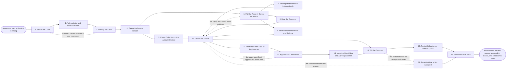

# Reference process: Resolve a Billing Dispute

`ref/fin/resolve-a-billing-dispute v1`

**value stream:** [Billing and collecting](../../streams/finance/billing-and-collecting.md)
A customer says an invoice is wrong, whether in a message to billing, in a
reply to a reminder, or by paying short and naming a deduction. The
dispute-coordinator agent takes in the claim with the invoice, the line,
the amount and the customer's own words, tells the customer who holds it
and the date the answer will come, and classifies it as a price, a
quantity or usage, the tax, the terms, or work the customer says it did
not receive. It freezes the invoice at its version so the argument is
about one document, and the collections-coordinator agent pauses the
reminders on the amount claimed. The billing-administrator agent
recomputes the invoice independently from the agreement, the booking at
its version and the usage readings, and the customer, the account owner
and the delivery lead are heard. The named billing lead decides whether
the claim is upheld, partly upheld or refused. Where it is upheld, the
billing-administrator agent drafts the credit note or the replacement
invoice for exactly what was decided, and the approver the delegation of
authority names for the amount approves it before it is issued. The run
closes when the customer has the answer with its evidence and the route
to escalate, any credit note is issued, collection has restarted on
whatever is still owed, and the cause has gone back to whoever owns it.

**delivers:** verdict, a billing dispute ruling

**starts:** on an event, a customer says an invoice is wrong

## The goals

- Answer each dispute within [10 working days]
- Have [90%] of customers accept the first answer
- Keep credit notes under [1%] of the amount billed
- Cut repeat disputes of the same cause by [50%]

## The activities

| # | Activity | What happens | Agents |
|---|---|---|---|
| 1 | Take In the Claim | the invoice, the line, the amount and the customer's words | [dispute-coordinator](../../agents/dispute-coordinator.md) |
| 2 | Acknowledge and Promise a Date | who holds the claim, and when the answer comes | dispute-coordinator |
| 3 | Classify the Claim | price, quantity or usage, tax, terms or work not received | dispute-coordinator |
| 4 | Freeze the Invoice Version | the invoice under dispute held at its version | dispute-coordinator |
| 5 | Pause Collection on the Amount Claimed | reminders stop on that amount and go on for the rest | [collections-coordinator](../../agents/collections-coordinator.md) |
| 6 | Pull the Records Behind the Invoice | the agreement, the booking at its version and the readings | dispute-coordinator |
| 7 | Recompute the Invoice Independently | the lines worked out again from the same records | [billing-administrator](../../agents/billing-administrator.md) |
| 8 | Hear the Customer | what the customer believes was agreed or received | dispute-coordinator · customer (person) |
| 9 | Hear the Account Owner and Delivery | what was promised and what was delivered | dispute-coordinator · account owner (person) · delivery lead (person) |
| 10 | Decide the Answer | upheld, partly upheld or refused, with the reason | billing lead (person) |
| 11 | Draft the Credit Note or Replacement | the document for exactly what was decided | billing-administrator |
| 12 | Approve the Credit Note | the approver for the amount signs before it is issued | credit note approver (person) |
| 13 | Issue the Credit Note and Any Replacement | numbered, dated and sent in the customer's form | billing-administrator |
| 14 | Tell the Customer | the answer with its evidence and the route to escalate | dispute-coordinator · account owner (person) |
| 15 | Restart Collection on What Is Owed | reminders resume on any amount still owed | collections-coordinator |
| 16 | Escalate What Is Not Accepted | a customer who does not accept is heard by the controller | dispute-coordinator · controller (person) |
| 17 | Feed the Cause Back | the booking, the meter, the template or the price put right | dispute-coordinator · billing-administrator |

A claim arrives from the customer directly, from a reply to a reminder at
`ref/fin/collect-an-overdue-invoice`, or as a deduction taken from a
payment at `ref/fin/apply-a-customer-payment`. The invoice under dispute
was built at `ref/fin/issue-a-customer-invoice` from the booking made at
`ref/sls/book-the-order`, and a booking found to be wrong goes back
through approval there. A credit note reaches revenue accounting for
`ref/fin/recognize-revenue` and the return at
`ref/fin/file-an-indirect-tax-return`, and one that changes what was
booked is passed to Revenue operations for `ref/rev/calculate-commission`,
which decides what it means for any commission.

## The graph



## The document, with the blanks marked

```
PROCESS: resolve a billing dispute    id: <team>/resolve-a-billing-dispute   v1
from: ref/fin/resolve-a-billing-dispute v1
owner: <who>                          effective: <date>
trigger: a customer's claim that an invoice is wrong is logged in <your
         dispute register>, whether it came to billing, in a reply to a
         reminder, or as a deduction named with a payment
         watch: record=<billing claim> system=<your dispute register>
                change=<a claim is logged against an invoice>
concurrency: runs may overlap freely - one invoice under dispute is one
             run, a second claim on the same invoice joins it, and claims
             on a customer's other invoices are runs of their own held by
             the same person
goal: the claim answered as upheld, partly upheld or refused by the named
      billing lead by <the promised date>, with the evidence behind the
      answer and the route to escalate sent to the customer, any credit
      note or replacement approved by the approver <your delegation of
      authority> names and issued, collection restarted on any amount
      still owed, and the cause sent to whoever owns it
phases:
  take-in-claim      - system: the claim lands with the invoice, the line,
                       the amount claimed and what the customer relies on
                       in its own words, and where the claim came from
                       owner: dispute-coordinator   after: trigger
                       automation: <level>
  acknowledge        - human: the customer told within <hours> who holds
                       the claim and the date the answer will come, before
                       anyone knows whether the claim is right
                       owner: dispute-coordinator
                       after: take-in-claim       by: <hours>
                       automation: <level>
  classify-claim     - runs assessment: the claim put in one class, such
                       as a price, a quantity or usage, the tax, the terms
                       or work not received, because the class decides who
                       is heard and what evidence is pulled
                       owner: dispute-coordinator
                       after: acknowledge         automation: <level>
  freeze-invoice     - system: the invoice under dispute frozen at its
                       version in <your billing system>, so the argument
                       is about one document
                       owner: dispute-coordinator
                       after: classify-claim      automation: <level>
  pause-collection   - system: the reminders at
                       ref/fin/collect-an-overdue-invoice paused on the
                       amount claimed, and left running on the rest of the
                       account
                       owner: collections-coordinator
                       after: freeze-invoice      automation: <level>
  pull-records       - runs collect-and-report: the agreement and the
                       clause that governs the line, the booking at its
                       version, the usage readings with their dates, and
                       the delivery record, each with where it was read
                       owner: dispute-coordinator
                       after: freeze-invoice      automation: <level>
  recompute-invoice  - runs assessment: the disputed lines worked out again
                       on their own from the same records the invoice was
                       built from, and both computations set side by side
                       with every input where they differ
                       owner: billing-administrator
                       after: pull-records        automation: <level>
  hear-customer      - convenes briefing: the customer says what it
                       believes was agreed, used or received, and what it
                       holds that the record does not
                       owner: dispute-coordinator
                       after: pull-records        by: <days>
                       automation: <level>
  hear-owner         - convenes briefing: the account owner says what was
                       promised in the sale, and the delivery lead says
                       what was delivered and when, each with what they can
                       show for it
                       owner: dispute-coordinator
                       after: pull-records        by: <days>
                       automation: <level>
  decide-answer      - convenes decide-and-announce: <your billing lead
                       role> decides whether the claim is upheld, partly
                       upheld or refused, from the recompute, the records
                       and what each side said, with the clause or the
                       reading behind the answer
                       owner: <your billing lead role>
                       after: pause-collection + recompute-invoice +
                       hear-customer + hear-owner  by: <days>
                       automation: never
  draft-credit       - human: the credit note, and any replacement invoice,
                       drafted at a version for exactly what was decided,
                       naming the invoice it corrects and treating the tax
                       as <your jurisdiction's indirect tax rules> require
                       owner: billing-administrator
                       after: decide-answer, when the claim is upheld in
                       whole or in part           automation: <level>
  approve-credit     - convenes approval: the approver <your delegation of
                       authority> names for the amount approves the credit
                       note and any replacement at their version, and is
                       someone who had no part in preparing them
                       owner: <your credit note approver role>
                       after: draft-credit        by: <days>
                       automation: never
  issue-credit       - system: the credit note and any replacement given
                       their numbers and dates in <your billing system>,
                       sent in the customer's form, filed for the period
                       <your jurisdiction's rule on invoice retention>
                       sets, and passed to <your receivables ledger> and
                       to revenue accounting
                       owner: billing-administrator
                       after: approve-credit      automation: <level>
  tell-customer      - human: the answer sent to the customer in one
                       message with the evidence behind it, any credit
                       note or replacement, and the route to escalate with
                       its window
                       owner: dispute-coordinator
                       after: issue-credit, or decide-answer when the claim
                       is refused                 by: <the promised date>
                       automation: <level>
  restart-collection - system: the reminders at
                       ref/fin/collect-an-overdue-invoice restarted on any
                       amount still owed after the answer, from the stage
                       they had reached
                       owner: collections-coordinator
                       after: tell-customer       automation: <level>
  escalate           - convenes decide-and-announce: a customer who does
                       not accept the answer is heard by <your controller
                       role> on the route the answer named, inside the
                       window it gave, and the controller confirms the
                       answer or reopens it
                       owner: <your controller role>
                       after: tell-customer, when the customer does not
                       accept                     by: <days>
                       automation: never
  feed-cause-back    - convenes debrief: the cause named as the booking,
                       the price book, the meter, the invoice template,
                       the tax setting or the delivery, and sent to
                       whoever owns it so the same claim does not arrive
                       again
                       owner: dispute-coordinator
                       after: restart-collection, and escalate when it ran
                       automation: <level>
run-scoped:
  clock  - runs roll-call                       owner: dispute-coordinator
           every: <cadence>
           from: acknowledge         until: tell-customer
  frozen - runs assessment                      owner: dispute-coordinator
           from: freeze-invoice      until: tell-customer
handoffs:
  take-in-claim -> acknowledge [billing-claim]: the invoice, the line, the
    amount and the customer's own words
  acknowledge -> classify-claim [acknowledged-claim]: who holds the claim
    and the date promised, as the customer was told
  classify-claim -> freeze-invoice [classified-claim]: the claim with its
    class and the evidence that class needs
  freeze-invoice -> pause-collection / pull-records [frozen-invoice]: the
    invoice at the version under dispute
  pull-records -> recompute-invoice / hear-customer / hear-owner
    [invoice-records]: the clause, the booking, the readings and the
    delivery record, each with where it was read
  pause-collection -> decide-answer [collection-paused]: the amount on
    which reminders are paused
  recompute-invoice -> decide-answer [independent-recompute]: both
    computations side by side, with every input where they differ
  hear-customer -> decide-answer [customer-account]: what the customer
    said and what it can show
  hear-owner -> decide-answer [owner-account]: what the account owner and
    the delivery lead said and what each can show
  decide-answer -> draft-credit / tell-customer [dispute-answer]: upheld,
    partly upheld or refused, with the reason, the clause or reading
    behind it, and the amount of any credit
  draft-credit -> approve-credit [draft-credit-note]: the credit note and
    any replacement at a version, naming the invoice they correct
  approve-credit -> issue-credit [approved-credit-note]: the credit note
    as approved, with the approver and the version. A change to it voids
    the approval
  issue-credit -> tell-customer [issued-credit-note]: the credit note and
    any replacement with their numbers and dates, as sent
  tell-customer -> restart-collection / escalate [answer-sent]: the answer
    as sent, with its evidence and the route to escalate
  restart-collection -> feed-cause-back [collection-restarted]: the amount
    still owed and the stage the reminders restarted from
  escalate -> feed-cause-back [escalation-outcome]: the controller's
    decision, with the date
deviations:
  classify-claim -> take-in-claim [claim-incomplete]: the claim names no
    invoice and no amount, so the customer is asked once to name them
    before the claim is classified
  decide-answer -> pull-records [needs-more-evidence]: the billing lead
    cannot decide on the evidence in hand, so what the billing lead named
    is pulled and the customer is told if the date moves
  approve-credit -> decide-answer [approver-refuses]: the approver will
    not approve the credit note, so the answer is decided again on the
    points the approver named
  tell-customer -> escalate [answer-not-accepted]: the customer does not
    accept the answer, so it is heard by the controller on the route the
    answer named
  escalate -> decide-answer [answer-reopened]: the controller reopens the
    answer, so it is decided again with what the escalation brought
bindings:
  roster:  <who holds each role - agents claiming the abstract agents
           above, and named people for the billing lead, each credit note
           approver <your delegation of authority> names, the controller,
           the account owner and the delivery lead>
  systems: <your dispute register> (write), <your billing system>
           (write), <your order system> (read), the usage record (read),
           <your contract repository> (read), <your receivables ledger>
           (write), <your CRM> (read), the notification channel (write)
  data:    <your delegation of authority> <version>, <your billing
           policy> <version>, <your jurisdiction's invoice rules>
           <version>, <your jurisdiction's indirect tax rules> <version>,
           the agreement and the booking at their versions
policy:
  every claim is acknowledged within <hours> with the name of who holds
    it and the date the answer will come, before anyone knows whether it
    is right
  the invoice is frozen at its version while the claim is argued, and an
    issued invoice is never edited
  the disputed lines are recomputed by the billing-administrator agent
    from the same records the invoice was built from, and both
    computations are shown side by side where they differ
  the answer is decided by <your billing lead role> and never delegated
    to an agent, and the account owner and anyone paid on the sale are
    heard and decide nothing
  a credit note or replacement is issued only once the approver <your
    delegation of authority> names for its amount has approved it at its
    version, and that approver had no part in preparing it
  a credit note carries exactly what was decided, names the invoice it
    corrects, and treats the tax as <your jurisdiction's indirect tax
    rules> require
  reminders pause on the amount claimed while the claim is open, and go
    on for the rest of the account
  a refund of money already paid goes only through
    ref/fin/pay-approved-invoices, released by two named people under
    <your dual control rule>
  a claim that threatens legal action goes to <your counsel role> the
    same day, and the answer waits for counsel
measures:
  cycle time: <days> from the claim to the answer sent
  on time: <target> share of claims answered by the date promised
  volume: <claims per period>
  quality gate: every answer names the clause or the reading behind it,
                every credit note names its approver and the invoice it
                corrects, and every cause is sent to its owner
```

## The failure edges

- **The claim names no invoice and no amount.** The customer is asked
  once to name them. The promised date runs from the day the claim is
  complete, and the customer is told so in the same message.
- **The two computations disagree.** The recompute and the invoice give
  different answers from the same records. Both are set side by side with
  every input where they differ, and the billing lead reads both. A
  billing system that gives two answers from one set of records is
  itself a finding, and it goes to the owner of that system at the cause
  step.
- **The billing lead needs more evidence.** What the billing lead named is
  pulled, and the customer is told before the promised date passes if the
  answer will come later, with the new date and the reason.
- **The approver will not approve the credit note.** The answer is
  decided again on the points the approver named. The customer hears
  nothing about a credit that has not been approved.
- **The promised date will be missed.** The dispute-coordinator agent
  tells the customer before the date passes, with a new date and the
  reason, because a missed date nobody mentioned is how a claim becomes a
  lost customer.
- **The customer does not accept the answer.** The controller hears the
  customer on the route the answer named, inside the window it gave, and
  confirms the answer or reopens it. A claim that threatens legal action
  goes to counsel the same day.
- **The trigger fires while a run is in flight.** One invoice under
  dispute is one run. A second claim on the same invoice joins it, and
  claims on the customer's other invoices are runs of their own, held by
  the same person so the customer hears one voice.
- **A run is abandoned.** The customer withdraws the claim or pays the
  invoice in full. The withdrawal is recorded in the customer's own
  words, the invoice is released at the same version, the reminders
  restart on any amount still owed, and no credit note is issued from an
  abandoned run.
