# Reference process: Respond to a Tax Audit

`ref/fin/respond-to-a-tax-audit v1`

**value stream:** [Filing and paying tax](../../streams/finance/filing-and-paying-tax.md)
A tax authority has given notice that it will audit one or more of the
company's returns, or its auditor has arrived. The filing-coordinator
agent logs the audit with the authority, the entities, the taxes, the
periods and every date. The head of tax confirms who is asking, on what
authority and what the company must give under
`<your jurisdiction's rules on tax audits>`, names the response team, and
counsel puts a hold on the records in scope so nothing in them is deleted
or changed. Each request is logged on its own. The
questionnaire-responder agent reads what each one asks for and drafts the
answer from approved answers and the records behind them, and the
tax-analyst agent pulls only the transactions, the returns and the
workpapers the request covers, holding back other periods, other
entities and any advice that `<your jurisdiction's rules on privilege>`
protect. The head of tax and the outside tax adviser review each
response, a named approver approves it, and the filing-coordinator agent
sends it and logs what went, when and to whom. The filing-coordinator
agent logs each adjustment the auditor proposes, the tax-analyst agent
sets out the tax, interest and penalty at stake with the case for and
against, and the head of tax and the chief financial officer (CFO)
decide whether to agree or contest each one. The tax-analyst agent
prepares the settlement of what is agreed, a named approver who prepared
none of it approves the payment, and two named people release it. The
run closes when the authority closes the audit, every adjustment is
agreed and paid or contested on the record, and counsel lifts the hold.

**delivers:** document, a tax audit response

## The goals

- Answer [100%] of requests by their due date
- Send [zero] records beyond what each request covers
- Close each audit within [12 months] of its notice
- Keep the tax agreed in adjustments under [2%] of the tax the audited returns showed

## The activities

| # | Activity | What happens | Agents |
|---|---|---|---|
| 1 | Log the Audit | the authority, entities, taxes, periods and every date | [filing-coordinator](../../agents/filing-coordinator.md) |
| 2 | Confirm Who Is Asking and on What Authority | the auditor's identity and mandate, and what must be given | head of tax (person) · filing-coordinator |
| 3 | Name the Response Team | the lead, the record owners, the adviser and the approver | head of tax (person) |
| 4 | Put a Hold on the Records | nothing in scope deleted or changed until counsel lifts it | counsel (person) |
| 5 | Log Each Request | each request numbered, with its due date and its owner | filing-coordinator |
| 6 | Read What Each Request Asks For | the records, the periods, the entities and the format | [questionnaire-responder](../../agents/questionnaire-responder.md) |
| 7 | Pull the Records Asked For | only the records, returns and workpapers the request covers | [tax-analyst](../../agents/tax-analyst.md) |
| 8 | Hold Back What the Request Does Not Cover | other periods and entities, and protected advice | tax-analyst · counsel (person) |
| 9 | Route What the Records Cannot Answer | each gap sent to the person who owns the fact | questionnaire-responder |
| 10 | Draft the Answers | from approved answers and the records behind them | questionnaire-responder · tax-analyst |
| 11 | Review the Response | every answer and every record read before it goes | head of tax (person) · tax adviser (person) |
| 12 | Approve the Response | a named person approves it before it goes | response approver (person) |
| 13 | Send the Response and Log It | what went, when, to whom, and at which version | filing-coordinator |
| 14 | Log Each Proposed Adjustment | each adjustment with what it rests on and the tax at stake | filing-coordinator |
| 15 | Assess Each Adjustment | the tax, interest and penalty, and the case for and against | tax-analyst |
| 16 | Decide Each Adjustment | agree or contest each one, decided by named people | head of tax (person) · CFO (person) |
| 17 | Prepare the Settlement | the payment for what is agreed and the entry that books it | tax-analyst |
| 18 | Approve the Payment | a named approver who prepared none of it approves | tax payment approver (person) |
| 19 | Release the Payment | two named people release it under dual control | payment releaser (person) · second releaser (person) |
| 20 | Close the Audit on the Record | the closing letter, the outcome booked, and the hold lifted | filing-coordinator · counsel (person) |

An audit by a tax authority runs here, and the external auditor's audit
of the financial statements runs at `ref/fin/run-the-external-audit`. An
audit that covers only the pay records runs at
`ref/hr/respond-to-an-employment-audit`, with the head of tax told. The
entry for what is agreed is approved and posted at
`ref/fin/post-a-manual-journal-entry` and carried into the next run of
`ref/fin/calculate-the-tax-provision`, a return the audit shows was wrong
is amended through its own process, and the assessment the authority
issues when the audit closes, including any appeal against it, is
answered at `ref/fin/respond-to-a-tax-notice`. Where an outside tax
adviser acts for the company before the authority, the roster says so,
and a named person at the company still approves every response and
every payment.

## The graph

```mermaid
flowchart LR
  T([a tax authority gives notice of an audit, or its auditor arrives]) --> A1[1. Log the Audit]
  A1 --> A2[2. Confirm Who Is Asking and on What Authority]
  A2 -. who is asking cannot be confirmed .-> A1
  A2 --> A3[3. Name the Response Team]
  A2 --> A4[4. Put a Hold on the Records]
  A3 --> A5[5. Log Each Request]
  A5 --> A6[6. Read What Each Request Asks For]
  A6 --> A7[7. Pull the Records Asked For]
  A4 --> A7
  A7 --> A8[8. Hold Back What the Request Does Not Cover]
  A6 --> A9[9. Route What the Records Cannot Answer]
  A8 --> A10[10. Draft the Answers]
  A9 --> A10
  A10 --> A11[11. Review the Response]
  A11 -. the reviewers send answers back .-> A10
  A11 --> A12[12. Approve the Response]
  A12 -. the approver will not approve .-> A10
  A12 --> A13[13. Send the Response and Log It]
  A13 -. the auditor asks for more .-> A5
  A13 --> A14[14. Log Each Proposed Adjustment]
  A14 --> A15[15. Assess Each Adjustment]
  A15 --> A16[16. Decide Each Adjustment]
  A16 -. the company contests an adjustment .-> A10
  A16 -. an adjustment is agreed .-> A17[17. Prepare the Settlement]
  A17 --> A18[18. Approve the Payment]
  A18 -. the approver will not approve the payment .-> A17
  A18 --> A19[19. Release the Payment]
  A16 --> A20[20. Close the Audit on the Record]
  A19 --> A20
  A20 --> DONE([the audit is closed, every adjustment is paid or contested on the record, and the hold is lifted])
```



## The document, with the blanks marked

```
PROCESS: respond to a tax audit       id: <team>/respond-to-a-tax-audit   v1
from: ref/fin/respond-to-a-tax-audit v1
owner: <who>                          effective: <date>
trigger: a tax authority gives notice of an audit of one or more returns,
         or its auditor arrives, and <who> logs it in <your tax audit log>
         watch: record=<tax audit> system=<your tax audit log>
                change=<an audit is logged>
concurrency: runs may overlap, and one audit by one authority is one run.
             Two audits that cover the same records run side by side,
             each with its own log, under one hold
goal: every request answered by its due date with only the records it
      covers, every response reviewed and approved by named people before
      it goes, every proposed adjustment agreed or contested by named
      people, and anything agreed released by named people under dual
      control and booked
phases:
  log-audit            - system: the audit logged with the authority, the
                         entities, the taxes, the periods it covers, the
                         people and places it names, and every date
                         owner: filing-coordinator  after: trigger
                         automation: <level>
  confirm-authority    - runs assessment: who is asking, the authority they
                         act under, and what the company must give and by
                         when under <your jurisdiction's rules on tax
                         audits>, confirmed by <your head of tax role>
                         with <your counsel role>
                         owner: <your head of tax role>
                         after: log-audit           by: <hours>
                         automation: never
  name-team            - human: the response lead, the owner of each kind
                         of record in scope, the outside tax adviser, and
                         the person who approves each response
                         owner: <your head of tax role>
                         after: confirm-authority   automation: <level>
  hold-records         - convenes approval: <your counsel role> sets a hold
                         on the records in scope, and the owners of <your
                         general ledger>, <your ERP> and the document store
                         stop their retention schedules from deleting any
                         of them
                         owner: <your counsel role>
                         after: confirm-authority   automation: never
  log-requests         - runs collect-and-report: each request numbered,
                         with what it asks for, its due date and the owner
                         of the records it reaches
                         owner: filing-coordinator  after: name-team
                         automation: <level>
  read-requests        - runs assessment: each request read for the
                         records, the periods, the entities and the format
                         it asks for, with repeats joined
                         owner: questionnaire-responder
                         after: log-requests        automation: <level>
  pull-records         - runs collect-and-report: only the transactions,
                         the returns and the workpapers each request
                         covers, from <your general ledger>, <your ERP>,
                         <your tax workpapers> and the kept record of each
                         return
                         owner: tax-analyst
                         after: read-requests + hold-records
                         automation: <level>
  hold-back            - runs assessment: periods, entities and taxes
                         outside the request's scope removed, and any
                         advice that <your jurisdiction's rules on
                         privilege> protect left out unless counsel
                         decides to release it
                         owner: tax-analyst         after: pull-records
                         automation: <level>
  route-gaps           - runs collect-and-report: each request the approved
                         answers and the records cannot answer sent to the
                         person who owns the fact, with the date it is
                         needed by
                         owner: questionnaire-responder
                         after: read-requests       by: <days>
                         automation: <level>
  draft-answers        - human: each answer drafted from an approved answer
                         or the records behind it, in the format the
                         request asks for, with each record it sends
                         listed and each figure traced to a return or a
                         workpaper
                         owner: questionnaire-responder
                         after: hold-back + route-gaps
                         automation: <level>
  review-response      - convenes approval: <your head of tax role> and
                         <your outside tax adviser role> read every answer
                         and every record against the request it answers
                         and the scope confirmed for it
                         owner: <your head of tax role>
                         after: draft-answers       by: <days>
                         automation: <level>
  approve-response     - convenes approval: <your response approver role>
                         approves the response at its version as a named
                         approver before it leaves the company
                         owner: <your response approver role>
                         after: review-response     automation: never
  send-response        - system: the approved response sent by the route
                         the auditor asks for, by its due date, with each
                         item logged at its version
                         owner: filing-coordinator  after: approve-response
                         by: <due date>             automation: <level>
  log-adjustments      - runs collect-and-report: each adjustment the
                         auditor proposes logged with what it says, the
                         records it rests on, the tax at stake and the date
                         an answer is due
                         owner: filing-coordinator  after: send-response
                         automation: <level>
  assess-adjustments   - runs assessment: for each adjustment, the tax,
                         interest and penalty at stake, the reading of the
                         rule, the evidence for and against, and what
                         agreeing it would mean for other periods
                         owner: tax-analyst         after: log-adjustments
                         automation: <level>
  decide-adjustments   - convenes decide-and-announce: <your head of tax
                         role> decides whether the company agrees or
                         contests each adjustment, and <your CFO role>
                         decides each one above <your threshold> in <your
                         delegation of authority>
                         owner: <your head of tax role>
                         after: assess-adjustments  by: <days>
                         automation: never
  prepare-settlement   - system: the amount agreed with its interest and
                         any penalty, the authority's reference and the
                         date it must arrive, with the account read from
                         the authority's own published payment details,
                         and the entry that books it, set out for the
                         approvers
                         owner: tax-analyst
                         after: decide-adjustments, when an adjustment is
                         agreed                     automation: <level>
  approve-payment      - convenes approval: <your tax payment approver
                         role> approves the payment as a named approver who
                         prepared none of the settlement
                         owner: <your tax payment approver role>
                         after: prepare-settlement  by: <hours>
                         automation: never
  release-payment      - convenes approval: two named releasers release the
                         payment in <your bank portal> under <your dual
                         control rule>, in time for it to arrive by the
                         date the authority sets
                         owner: <your payment releaser role>
                         after: approve-payment     by: <hours>
                         automation: never
  close-audit          - convenes debrief: the authority's closing letter,
                         the entry for what was agreed sent to
                         ref/fin/post-a-manual-journal-entry, each return
                         to amend sent to its own process, what the next
                         audit should find ready, and the hold lifted by
                         counsel
                         owner: filing-coordinator
                         after: decide-adjustments, and release-payment
                         when an adjustment was agreed
                         automation: <level>
run-scoped:
  due-dates   - runs roll-call              owner: filing-coordinator
                every: <cadence>
                from: log-requests     until: close-audit
  request-log - runs collect-and-report     owner: filing-coordinator
                from: log-audit        until: run close
handoffs:
  log-audit -> confirm-authority [audit-notice]: the authority, the
    entities, the taxes, the periods, the people and places named, and
    every date
  confirm-authority -> name-team / hold-records [confirmed-authority]:
    who is asking, under what authority, and what the company must give
  name-team -> log-requests [response-team]: the lead, each record owner,
    the adviser and the approver
  hold-records -> pull-records [records-hold]: the records in scope and
    the date the hold began
  log-requests -> read-requests [request-log]: each request numbered, with
    its due date and its owner
  read-requests -> pull-records / route-gaps [read-requests]: what each
    request covers, its periods, its entities and its format
  pull-records -> hold-back [pulled-records]: the transactions, returns
    and workpapers each request covers
  hold-back -> draft-answers [records-to-send]: the records with what is
    out of scope removed, and any protected advice counsel decided to
    release
  route-gaps -> draft-answers [routed-gaps]: each gap, its owner and the
    owner's answer
  draft-answers -> review-response [draft-response]: each answer and the
    list of records it sends
  review-response -> approve-response [reviewed-response]: the response as
    the reviewers approved it, at a version
  approve-response -> send-response [approved-response]: the approved
    response. A change after approval voids the approval
  send-response -> log-adjustments [sent-response]: what was sent, when,
    to whom and at which version
  log-adjustments -> assess-adjustments [proposed-adjustments]: each
    adjustment, what it rests on, the tax at stake and its date
  assess-adjustments -> decide-adjustments [assessed-adjustments]: each
    adjustment with the amount at stake and the case for and against
  decide-adjustments -> prepare-settlement / close-audit
    [adjustment-decisions]: each adjustment agreed or contested, with who
    decided it and when
  prepare-settlement -> approve-payment [settlement]: the amount, the
    reference, the date, the authority's published account and the entry
  approve-payment -> release-payment [approved-payment]: the payment as
    approved. A change to the amount or the account voids the approval
  release-payment -> close-audit [released-payment]: the payment released,
    with its bank reference and the people who released it
deviations:
  confirm-authority -> log-audit [authority-unconfirmed]: who is asking or
    the authority they act under cannot be confirmed, so nothing is given
    and the head of tax contacts the authority through its published
    contact details
  review-response -> draft-answers [reviewers-send-back]: the reviewers
    send answers back, so each one named is drafted again and reviewed
    again
  approve-response -> draft-answers [approver-refuses]: the approver will
    not approve, so the answers the approver names are drafted again
  send-response -> log-requests [further-request]: the auditor asks for
    more, so each further request is logged as a new request and goes
    through the same checks
  decide-adjustments -> draft-answers [adjustment-contested]: the company
    contests an adjustment, so its case is drafted as a response and goes
    through the same review and approval
  approve-payment -> prepare-settlement [payment-refused]: the approver
    will not approve the payment, so the settlement is prepared again on
    the points the approver named
bindings:
  roster:  <who holds each role - agents claiming the abstract agents
           above, or an outside tax adviser where it acts for the company
           before the authority, and named people for the head of tax,
           counsel, the outside tax adviser, the CFO, the response
           approver, the tax payment approver, the payment releasers and
           each record owner>
  systems: <your tax audit log> (write), <your general ledger> (read),
           <your ERP> (read), <your tax workpapers> (read), the kept record
           of each return (read), <your answer library> (read), <your bank
           portal> (read), <the authority's correspondence route> (write),
           the document store (write), the notification channel (write)
  data:    the audit notice and its scope, <your jurisdiction's rules on
           tax audits>, <your jurisdiction's rules on privilege>, <your
           retention schedule> <version>, the returns under audit and
           their workpapers, <your delegation of authority> <version>,
           <your dual control rule> <version>, the authority's published
           payment details, the last audit's outcome
policy:
  nothing is given to an auditor before <your head of tax role> has
    confirmed who is asking and on what authority, except where <your
    jurisdiction's rules on tax audits> require access at once, and then
    the head of tax and counsel are called at once
  each request is answered with only the records it covers, and periods,
    entities and taxes outside its scope are left out
  advice that <your jurisdiction's rules on privilege> protect is released
    only where counsel decides to release it
  nothing in scope is deleted or changed while the hold is in place, and
    only counsel lifts it
  every answer comes from an approved answer or a record, and an answer
    the records cannot support goes to the person who owns the fact
  no response leaves the company before <your response approver role> has
    approved it, and a change after approval voids the approval
  every adjustment is agreed or contested by named people, and the agents
    never agree or contest one
  money is released by two named people in <your bank portal> under
    <your dual control rule>, and the release is never delegated to an
    agent
  every item sent is logged with its version, its date and who received
    it
measures:
  cycle time: <days> from the audit notice to the audit closed
  on time: <target> share of requests answered by their due date
  outcome: <tax agreed in adjustments> as a share of the tax the audited
           returns showed
  volume: <tax audits per year>
  quality gate: every item sent traces to the request it answers, a
                version and an approval
```

## The failure edges

- **Who is asking cannot be confirmed.** Nothing is given. The head of tax
  contacts the authority through its published contact details, and the
  run waits until the authority confirms the person and the mandate.
- **The auditor arrives without notice.** The head of tax and counsel are
  called at once, and the auditor is given the access
  `<your jurisdiction's rules on tax audits>` require without waiting for
  the written review. A named person stays with the auditor, and the
  filing-coordinator agent logs every record shown and every question
  asked, so the response that follows matches what was seen.
- **A request reaches beyond the scope.** The head of tax raises it with
  the auditor in writing. The company answers what is in scope by the due
  date, and the rest waits for the auditor's answer.
- **A record holds protected advice.** The tax-analyst agent leaves it out
  and names it, and counsel decides whether the company releases it. A
  record released once is logged, because releasing it may affect what
  else is protected.
- **The records cannot answer a request.** The questionnaire-responder
  agent routes it to the person who owns the fact, and the answer is
  drafted from what that person confirms. Nothing is written to fill a gap
  the records do not support.
- **The reviewers send answers back, or the approver will not approve.**
  Each answer named is drafted again and goes back through review. Nothing
  is sent without an approval.
- **A due date will be missed.** The due-date roll-call raises it at the
  warning point the company sets, and the head of tax asks the auditor for
  more time in writing before the date passes.
- **A record turns out to be wrong.** The record is kept as it was under
  the hold, and the head of tax and counsel decide how the auditor is told.
  The return it affects is amended through its own process once they
  agree, and the record keeps both values.
- **An adjustment reaches other periods.** The tax-analyst agent works out
  what agreeing it would mean for every open period, and the head of tax
  and the CFO decide with that in view. An adjustment agreed for one
  period is never applied to others without its own decision.
- **The approver will not approve the payment.** The settlement is
  prepared again on the approver's points. Where the date is close, the
  head of tax tells the CFO the same day, because interest on an agreed
  amount keeps running.
- **The trigger fires while a run is in flight.** A second audit by a
  different authority, or of different taxes, is its own run with its own
  log. Where the two cover the same records, one hold covers both, and
  counsel lifts it only when both have closed.
- **A run is abandoned.** The authority withdraws the audit. The head of
  tax confirms it in writing, counsel decides when the hold is lifted, and
  the log is kept with everything already sent.
