# Reference process: Respond to a Tax Notice

`ref/fin/respond-to-a-tax-notice v1`

**value stream:** [Filing and paying tax](../../streams/finance/filing-and-paying-tax.md)
A letter, a notice or an assessment has arrived from a tax authority
about one of the company's returns, payments or registrations. The
filing-coordinator agent logs it with the authority, the entity, the tax,
the period, the amount and every date, and checks the sender, the
reference and any payment details against the authority's published
details and the company's own record of what it filed, because a false
notice that asks for payment is a known fraud. The head of tax confirms
any notice that asks for money or does not match, and names the person
who answers and the date the answer is due. The filing-coordinator agent
finds the return, the receipt and the workpapers the notice concerns, and
the tax-analyst agent checks the authority's figures against what was
filed and paid and sets out the options, such as agreeing and paying,
explaining, correcting the return or appealing, with what each would
cost. The head of tax decides, and the chief financial officer (CFO)
decides above `<your threshold>`. The tax-analyst agent drafts the
response, a named approver approves it, and the filing-coordinator agent
sends it by its date and logs what went. Any amount agreed is approved by
a named approver who prepared none of it and released by two named
people. The run closes when the authority confirms the matter is closed,
any payment is released and recorded, any correction has run through the
return's own process, and the receipt is kept with the notice.

**delivers:** document, a response to a tax notice

## The goals

- Answer [100%] of notices by their response date
- Close [80%] of notices with the first response
- Have [90%] of amounts claimed in error withdrawn or refunded
- Spend no more than [4 hours] of staff time on a routine notice

## The activities

| # | Activity | What happens | Agents |
|---|---|---|---|
| 1 | Log the Notice | the authority, entity, tax, period, amount and every date | [filing-coordinator](../../agents/filing-coordinator.md) |
| 2 | Confirm the Notice Is Genuine | the sender and payment details against its published ones | filing-coordinator · head of tax (person) |
| 3 | Name the Owner and the Response Date | who answers, and the date the answer is due | head of tax (person) |
| 4 | Find the Return and the Records | the return, receipt, payment and workpapers it concerns | filing-coordinator |
| 5 | Check the Notice Against the Return | the authority's figures against what was filed and paid | [tax-analyst](../../agents/tax-analyst.md) |
| 6 | Set Out the Options | pay, explain, correct or appeal, with the cost of each | tax-analyst |
| 7 | Decide the Response | the head of tax decides, and the CFO above the threshold | head of tax (person) · CFO (person) |
| 8 | Draft the Response | the letter or the appeal, with the evidence it sends | tax-analyst |
| 9 | Approve the Response | a named person approves it before it goes | response approver (person) |
| 10 | Send the Response and Log It | what went, when, to whom, and at which version | filing-coordinator |
| 11 | Prepare the Payment | the amount agreed, reference and date, for the approver | tax-analyst |
| 12 | Approve the Payment | a named approver who prepared none of it approves | tax payment approver (person) |
| 13 | Release the Payment | two named people release it under dual control | payment releaser (person) · second releaser (person) |
| 14 | Correct the Return | the correction, sent to the return's own process | tax-analyst |
| 15 | Close the Notice With Its Receipt | the closing letter, response and payment, kept together | filing-coordinator |
| 16 | Record What the Notice Taught | the cause, and what the next return does differently | filing-coordinator |

A correction runs through `ref/fin/file-an-indirect-tax-return` or
`ref/fin/file-the-income-tax-return`, where the amended return is
reviewed and signed like the first, and any amount agreed or assessed is
carried into the next run of `ref/fin/calculate-the-tax-provision`. A
notice that opens an audit is logged here and handed to
`ref/fin/respond-to-a-tax-audit`, and an assessment that closes an audit
is answered here. A notice about the tax withheld from pay goes to the
payroll manager with the filings kept at `ref/hr/run-payroll`, and the
head of tax is told. Where an outside tax adviser acts for the company
before the authority, the roster says so, and a named person at the
company still approves every response and every payment.

## The graph

```mermaid
flowchart LR
  T([a letter, a notice or an assessment arrives from a tax authority]) --> A1[1. Log the Notice]
  A1 --> A2[2. Confirm the Notice Is Genuine]
  A2 -. the sender or the payment details cannot be confirmed .-> A1
  A2 --> A3[3. Name the Owner and the Response Date]
  A3 --> A4[4. Find the Return and the Records]
  A4 --> A5[5. Check the Notice Against the Return]
  A5 --> A6[6. Set Out the Options]
  A6 --> A7[7. Decide the Response]
  A7 --> A8[8. Draft the Response]
  A8 --> A9[9. Approve the Response]
  A9 -. the approver sends the response back .-> A8
  A9 --> A10[10. Send the Response and Log It]
  A7 -. an amount is agreed .-> A11[11. Prepare the Payment]
  A11 --> A12[12. Approve the Payment]
  A12 -. the approver will not approve the payment .-> A11
  A12 --> A13[13. Release the Payment]
  A7 -. the return was wrong .-> A14[14. Correct the Return]
  A10 --> A15[15. Close the Notice With Its Receipt]
  A13 --> A15
  A14 --> A15
  A15 -. the authority does not accept the response .-> A6
  A15 --> A16[16. Record What the Notice Taught]
  A16 --> DONE([the authority has closed the notice, any payment is released, and the receipt is kept with the notice])
```



## The document, with the blanks marked

```
PROCESS: respond to a tax notice      id: <team>/respond-to-a-tax-notice   v1
from: ref/fin/respond-to-a-tax-notice v1
owner: <who>                          effective: <date>
trigger: a letter, a notice or an assessment from a tax authority arrives
         and <who> logs it in <your tax notice log>
         watch: record=<tax notice> system=<your tax notice log>
                change=<a notice is logged>
concurrency: runs may overlap freely, and one notice is one run. A further
             notice on the same matter joins the run that is open for it,
             and a notice that opens an audit is handed to
             ref/fin/respond-to-a-tax-audit
goal: every notice confirmed as genuine before anything is answered or
      paid, answered by <the response date> with a response a named person
      approved, any amount agreed released by named people under dual
      control, and the notice closed with its receipt
phases:
  log-notice           - system: the notice logged with the authority, the
                         entity, the tax, the period, the amount claimed,
                         the reference, the date it arrived and the date an
                         answer or a payment is due
                         owner: filing-coordinator  after: trigger
                         automation: <level>
  confirm-genuine      - runs assessment: the sender, the reference and any
                         payment details checked against the authority's
                         published contact and payment details and against
                         the company's own record of returns, and <your
                         head of tax role> confirms any notice that asks
                         for money or does not match before anything else
                         happens
                         owner: filing-coordinator  after: log-notice
                         by: <hours>                automation: <level>
  name-owner           - human: the person who answers the notice and the
                         date the answer is due, set by <your head of tax
                         role> from the notice and <your jurisdiction's
                         rules on appeals>
                         owner: <your head of tax role>
                         after: confirm-genuine     automation: <level>
  find-records         - runs collect-and-report: the return, the receipt,
                         the payment and the data the return was built
                         from, read from the kept record of the return's
                         run
                         owner: filing-coordinator  after: name-owner
                         automation: <level>
  check-notice         - runs assessment: the authority's figures and
                         reasons read against what was filed and paid, line
                         by line, with each difference named and its cause
                         found
                         owner: tax-analyst         after: find-records
                         automation: <level>
  set-out-options      - runs assessment: agreeing and paying, explaining,
                         correcting the return or appealing, each with the
                         tax, interest and penalty at stake, the evidence,
                         the date by which it must be done under <your
                         jurisdiction's rules on appeals> and what it would
                         cost
                         owner: tax-analyst         after: check-notice
                         automation: <level>
  decide-response      - convenes decide-and-announce: <your head of tax
                         role> decides the response in writing, and <your
                         CFO role> decides it where the amount at stake is
                         above <your threshold> in <your delegation of
                         authority>
                         owner: <your head of tax role>
                         after: set-out-options     by: <days>
                         automation: never
  draft-response       - human: the letter or the appeal in the form the
                         authority asks for, with each record it sends
                         listed and each figure traced to the return or
                         the workpapers
                         owner: tax-analyst         after: decide-response
                         automation: <level>
  approve-response     - convenes approval: <your response approver role>
                         approves the response at its version as a named
                         approver before it leaves the company
                         owner: <your response approver role>
                         after: draft-response      by: <days>
                         automation: never
  send-response        - system: the approved response sent by the route
                         the authority asks for, by the response date, with
                         each item logged at its version
                         owner: filing-coordinator  after: approve-response
                         by: <response date>        automation: <level>
  prepare-payment      - system: the amount agreed, the authority's
                         reference and the date it must arrive, with the
                         account read from the authority's own published
                         payment details, set out for the approver
                         owner: tax-analyst         after: decide-response,
                         when an amount is agreed   automation: <level>
  approve-payment      - convenes approval: <your tax payment approver
                         role> approves the payment as a named approver who
                         prepared none of the response or the payment
                         owner: <your tax payment approver role>
                         after: prepare-payment     by: <hours>
                         automation: never
  release-payment      - convenes approval: two named releasers release the
                         payment in <your bank portal> under <your dual
                         control rule>, in time for it to arrive by the
                         date the notice sets
                         owner: <your payment releaser role>
                         after: approve-payment     by: <hours>
                         automation: never
  correct-return       - human: where the notice shows a real error, the
                         correction set out and sent to
                         ref/fin/file-an-indirect-tax-return or
                         ref/fin/file-the-income-tax-return to be amended,
                         reviewed and signed there
                         owner: tax-analyst         after: decide-response,
                         when the return was wrong  automation: <level>
  close-notice         - runs collect-and-report: the authority's closing
                         letter or its receipt for the payment kept with
                         the notice, the response and the record of what
                         was sent, and the notice marked closed
                         owner: filing-coordinator
                         after: send-response, and release-payment and
                         correct-return when they ran
                         automation: <level>
  record-learning      - convenes debrief: what caused the notice, whether
                         it was right, what it cost, and what the next
                         return does differently
                         owner: filing-coordinator  after: close-notice
                         automation: <level>
run-scoped:
  response-date - runs roll-call            owner: filing-coordinator
                  every: <cadence>
                  from: log-notice     until: send-response
  notice-log    - runs collect-and-report   owner: filing-coordinator
                  from: log-notice     until: run close
handoffs:
  log-notice -> confirm-genuine [logged-notice]: the authority, entity,
    tax, period, amount, reference and every date
  confirm-genuine -> name-owner [genuine-notice]: the notice confirmed as
    sent by the authority, with who confirmed it and how
  name-owner -> find-records [notice-owner]: the person who answers and
    the response date
  find-records -> check-notice [return-record]: the return, the receipt,
    the payment and the data the return was built from
  check-notice -> set-out-options [checked-notice]: each difference
    between the notice and the return, with its cause
  set-out-options -> decide-response [response-options]: each option with
    the amount at stake, the evidence, the date and the cost
  decide-response -> draft-response / prepare-payment / correct-return
    [response-decision]: the response decided, the amount agreed if any,
    and who decided it
  draft-response -> approve-response [draft-response]: the letter or the
    appeal at a version, with the records it sends
  approve-response -> send-response [approved-response]: the response as
    approved. A change after approval voids the approval
  prepare-payment -> approve-payment [payment-request]: the amount agreed,
    the reference, the date and the authority's published account
  approve-payment -> release-payment [approved-payment]: the payment as
    approved. A change to the amount or the account voids the approval
  send-response -> close-notice [sent-response]: what was sent, when, to
    whom and at which version
  release-payment -> close-notice [released-payment]: the payment
    released, with its bank reference and the people who released it
  correct-return -> close-notice [correction-sent]: the correction and the
    run of the return's process that carries it
  close-notice -> record-learning [closed-notice]: the closing letter or
    the receipt, kept with the notice and the response
deviations:
  confirm-genuine -> log-notice [sender-unconfirmed]: the sender or the
    payment details cannot be confirmed, so nothing is answered or paid,
    and the filing-coordinator agent asks the authority through its
    published contact details whether it sent the notice
  approve-response -> draft-response [approver-sends-back]: the approver
    sends the response back, so it is drafted again on the points named
  approve-payment -> prepare-payment [approver-refuses]: the approver will
    not approve the payment, so it is prepared again on the points the
    approver named
  close-notice -> set-out-options [authority-does-not-accept]: the
    authority does not accept the response or sends a further notice on
    the same matter, so the options are set out again and the response is
    decided again
bindings:
  roster:  <who holds each role - agents claiming the abstract agents
           above, or an outside tax adviser where it acts for the company
           before the authority, and named people for the head of tax, the
           CFO, the response approver, the tax payment approver and the
           payment releasers>
  systems: <your tax notice log> (write), <your tax calendar> (read), the
           kept record of each return (read), <your general ledger>
           (read), <your tax workpapers> (read), <your bank portal> (read),
           <the authority's correspondence route> (write), the document
           store (write), the notification channel (write)
  data:    the notice and its reference, the return and its receipt, the
           authority's published contact and payment details, <your
           jurisdiction's rules on appeals>, <your delegation of
           authority> <version>, <your dual control rule> <version>
policy:
  nothing is answered or paid before the notice is confirmed as sent by
    the authority, checked against its published contact and payment
    details and never against the details the notice itself gives
  a notice that asks for payment to an account the authority does not
    publish is treated as an attempt at fraud and reported to <who> the
    same day
  the response to every notice is decided in writing by <your head of tax
    role>, or by <your CFO role> above <your threshold>, and the agents
    never agree, contest or appeal anything themselves
  no response leaves the company before <your response approver role> has
    approved it, and a change after approval voids the approval
  every figure in a response traces to the return, the receipt or the
    workpapers, and nothing is written to fill a gap the records do not
    support
  money is released by two named people in <your bank portal> under
    <your dual control rule>, and the release is never delegated to an
    agent
  a return found wrong is corrected through its own process, reviewed and
    signed like the first
  every item sent is logged with its version, its date and who received
    it
measures:
  cycle time: <days> from the notice arriving to the notice closed
  on time: <target> share of notices answered by their response date
  outcome: <share> of amounts claimed in error that were withdrawn or
           refunded
  volume: <notices per year>
  quality gate: every notice was confirmed as genuine before any answer or
                payment, and every response traces to an approval and a
                record
```

## The failure edges

- **The sender or the payment details cannot be confirmed.** Nothing is
  answered or paid. The filing-coordinator agent asks the authority
  through its published contact details whether it sent the notice, and
  the head of tax decides what happens next. A notice that asks for
  payment to an account the authority does not publish is reported as an
  attempt at fraud the same day.
- **The response date is too close to answer properly.** The
  response-date roll-call raises it at the warning point the company sets.
  The head of tax asks the authority for more time in writing before the
  date passes, and where the rules let an appeal lapse, a holding appeal is
  approved and sent while the full answer is prepared.
- **The records cannot answer the notice.** The tax-analyst agent names
  what is missing and the person who holds it, and the response is
  drafted from what that person confirms. Nothing is written to fill a gap
  the records do not support.
- **The notice is right.** The head of tax agrees it, the amount is
  approved and released like any tax payment, and the return is corrected
  through its own process. The cause goes into the record so the next
  return does not repeat it.
- **The approver sends the response back.** It is drafted again on the
  approver's points. Nothing leaves the company without an approval, and
  nobody approves in the place of an approver who refused.
- **The approver will not approve the payment.** The payment is prepared
  again on the approver's points. Where the date is close, the head of tax
  tells the CFO the same day, because interest on an amount due keeps
  running.
- **The authority does not accept the response.** The options are set out
  again with the authority's reasons, and the head of tax decides again,
  including whether to appeal under
  `<your jurisdiction's rules on appeals>`. An appeal is drafted, approved
  and sent like any response.
- **The trigger fires while a run is in flight.** One notice is one run. A
  further notice on the same matter joins the open run, and a notice that
  opens an audit is handed to `ref/fin/respond-to-a-tax-audit`.
- **A run is abandoned.** The authority withdraws the notice. The head of
  tax confirms it in writing, the log is kept with everything already sent
  and paid, and any amount paid in the meantime is claimed back through
  the authority's own route.
