# Reference process: Review Access to Finance Systems

`ref/fin/review-access-to-finance-systems v1`

**value stream:** [Controls and audit](../../streams/finance/controls-and-audit.md)
Each period the company checks who can do what in the systems that hold
and move its money: the general ledger, the payment system and the bank
portals. The tool-administrator agent lists every account in each system
with its role, its permissions, its approval limits and its last use,
and every user each bank portal lets create, approve or release a
payment, and it matches each account to a current employee or to a
service with an approved owner. It matches each right to approve or release a payment
against the releasers and signers the delegation of authority names. The
controls-tester agent reads every person's access across the systems
against the list of duties that must stay separate, flags each person who
could both prepare and approve the same thing, such as setting up a
supplier and paying it or preparing a journal and posting it, and reads
the period's records for anything one person both prepared and approved.
Each access owner confirms or removes the access of the people they
answer for, the controller decides each clash the work needs with
another check in its place, and the tool-administrator agent removes
every access nobody approved and reads the accounts again. The controller
decides what follows for any work a person approved themselves, with the
chief financial officer (CFO) where it may be fraud. The run closes when
every access left in the finance systems has a named approver, every
clash is removed or allowed in writing with another check in its place,
and the controller has signed the review.

**delivers:** status board, a finance systems access review

**starts:** on a schedule, the period for checking access to the finance systems ends

## The goals

- Finish each review within [15 days] of the period's end
- Remove [100%] of access nobody approved by the review's close
- Keep access removed in error below [2%] of removals
- Keep clashes of duties with no second check in their place at [zero]

## The activities

| # | Activity | What happens | Agents |
|---|---|---|---|
| 1 | Open the Review for the Period | the systems in scope, the access owners and the close date | [tool-administrator](../../agents/tool-administrator.md) |
| 2 | List Every Account and Its Role | each account, its role, permissions, limits and last use | tool-administrator |
| 3 | List Who Can Move Money at Each Bank | who can create, approve and release payments, and how much | tool-administrator |
| 4 | Match Each Account to a Person | a current employee, an approved service, or nobody | tool-administrator |
| 5 | Match Each Payment Right to an Approved Releaser | each bank right against the releasers the delegation names | tool-administrator |
| 6 | Check Each Role Against the Job | access wider than the job needs | tool-administrator |
| 7 | Flag Who Could Both Prepare and Approve | each person whose access breaks a separation of duties | [controls-tester](../../agents/controls-tester.md) |
| 8 | Read the Records for Self-Approved Work | anything a flagged person both prepared and approved | controls-tester |
| 9 | Send Each Owner Their Accounts | each access owner gets the accesses they answer for | tool-administrator |
| 10 | Confirm or Remove Each Access | the owner confirms each access or marks it to go | access owner (person) |
| 11 | Decide Each Clash the Work Needs | allowed in writing with another check, or removed | controller (person) |
| 12 | Remove the Access Nobody Approved | removed on the review's close date | tool-administrator |
| 13 | Read Every Account Again | the lists read again to confirm each removal took | tool-administrator |
| 14 | Decide on Self-Approved Work | whether each item is reviewed again, and who is told | controller (person) · CFO (person) |
| 15 | Sign the Review | the controller signs the review | controller (person) |
| 16 | Record the Review | what was found, removed and decided, kept for the auditors | tool-administrator |

Accounts are opened and closed day to day as people join and leave at
`ref/hr/prepare-for-a-new-hire` and `ref/hr/offboard-a-leaver`, and a
change to who may sign or release at a bank runs through
`ref/fin/change-a-bank-account-or-signer`. This review catches what those
missed. The payroll system is reviewed with the rest of the employee data
at `ref/hr/review-access-to-employee-data`, and this review reads that
review's list only to find a person who could both change pay or bank
details there and release the payroll funding here. A company that
reviews the access to all its tools at `ref/rev/administer-a-tool` may run
this review with it, and this one adds the bank portals and the check of
duties that must stay separate. Each clash allowed with another check in
its place is tested at `ref/fin/test-a-financial-control`.

## The graph

```mermaid
flowchart LR
  T([the period for checking access to the finance systems ends]) --> A1[1. Open the Review for the Period]
  A1 --> A2[2. List Every Account and Its Role]
  A1 --> A3[3. List Who Can Move Money at Each Bank]
  A2 --> A4[4. Match Each Account to a Person]
  A3 --> A5[5. Match Each Payment Right to an Approved Releaser]
  A4 --> A6[6. Check Each Role Against the Job]
  A4 --> A7[7. Flag Who Could Both Prepare and Approve]
  A5 --> A7
  A7 --> A8[8. Read the Records for Self-Approved Work]
  A8 -. a person approved their own work .-> A14[14. Decide on Self-Approved Work]
  A5 --> A9[9. Send Each Owner Their Accounts]
  A6 --> A9
  A7 --> A9
  A9 --> A10[10. Confirm or Remove Each Access]
  A10 -. an owner says the work needs both sides of a clash .-> A11[11. Decide Each Clash the Work Needs]
  A10 --> A12[12. Remove the Access Nobody Approved]
  A11 --> A12
  A12 --> A13[13. Read Every Account Again]
  A13 -. an access is still there .-> A12
  A8 --> A15[15. Sign the Review]
  A13 --> A15
  A14 --> A15
  A15 -. the controller finds an access the review missed .-> A2
  A15 --> A16[16. Record the Review]
  A16 --> DONE([every access left has a named approver, and every clash is removed or allowed with another check])
```



## The document, with the blanks marked

```
PROCESS: review access to finance systems  id: <team>/review-access-to-finance-systems   v1
from: ref/fin/review-access-to-finance-systems v1
owner: <who>                          effective: <date>
trigger: a review period ends on <your access review calendar>, or <your
         controller role> calls a review out of cycle
         watch: record=<access review> system=<your access review calendar>
                change=<a review period ends>
concurrency: one review per period is open at a time, and an out-of-cycle
             review of one system runs beside it and joins its record
goal: every access to a finance system confirmed by a named approver or
      removed within <days> of the period's end, every right to release a
      payment held only by a releaser the delegation of authority names,
      and every clash of duties removed or allowed in writing with another
      check in its place
phases:
  open-review          - system: the review opened with the systems in
                         scope, the access owner for each group of
                         accounts, the period and the close date
                         owner: tool-administrator  after: trigger
                         automation: <level>
  list-accounts        - runs collect-and-report: every account in <your
                         general ledger>, <your ERP> and <your payment
                         system>, with its role, its permissions, its
                         approval limits, who approved it and when it was
                         last used
                         owner: tool-administrator  after: open-review
                         automation: <level>
  list-bank-users      - runs collect-and-report: every user of each <your
                         bank portal> with the right to create, approve or
                         release a payment or to add a beneficiary, the
                         amount each may release, and the bank's own record
                         of who may sign on each account
                         owner: tool-administrator  after: open-review
                         automation: <level>
  match-accounts       - runs assessment: each account matched to a current
                         employee, to a service with an approved owner, or
                         to nobody, read against <your HR system> and the
                         leaving records for the period
                         owner: tool-administrator  after: list-accounts
                         automation: <level>
  match-payment-rights - runs assessment: each right to approve or release
                         a payment read against the releasers and signers
                         the delegation of authority names at the version
                         in force and against <your dual control rule>,
                         and any right held by someone it does not name
                         marked to go at once
                         owner: tool-administrator  after: list-bank-users
                         automation: <level>
  check-roles          - runs assessment: each role read against the job of
                         the person who holds it under <your role
                         definitions>, and access wider than the job needs
                         marked
                         owner: tool-administrator  after: match-accounts
                         automation: <level>
  flag-clashes         - runs assessment: every person's access across all
                         the systems, and the payroll access list from
                         ref/hr/review-access-to-employee-data, read against
                         <your list of duties that must stay separate>,
                         such as setting up a supplier and approving its
                         payment, preparing a journal and posting it,
                         preparing a reconciliation and signing it off, or
                         changing bank details and releasing a payment, and
                         each person who holds both sides of one flagged
                         owner: controls-tester
                         after: match-accounts + match-payment-rights
                         automation: <level>
  read-self-approval   - runs assessment: the period's records in each
                         system read for any journal, payment, supplier
                         change or reconciliation that one flagged person
                         both prepared and approved
                         owner: controls-tester     after: flag-clashes
                         automation: <level>
  send-to-owners       - system: each access owner sent the accesses they
                         answer for, with what each check found and the
                         close date
                         owner: tool-administrator
                         after: check-roles + flag-clashes +
                         match-payment-rights       automation: <level>
  confirm-access       - convenes approval: each access owner confirms each
                         access that should stay or marks it to go, and
                         never confirms their own
                         owner: <your access owner role>
                         after: send-to-owners      by: <close date>
                         automation: never
  decide-clashes       - convenes decide-and-announce: for each clash an
                         owner says the work needs, <your controller role>
                         removes one side, or allows it in writing for
                         <period> with another check in its place, such as
                         a review of every item by someone else
                         owner: <your controller role>
                         after: confirm-access      by: <close date>
                         automation: never
  remove-unapproved    - system: every access nobody confirmed, every one
                         marked to go and every clash the controller
                         removed taken away on the close date in <your
                         access system>, and each bank portal user removed
                         under the bank's own rules for changing users
                         owner: tool-administrator
                         after: confirm-access, and decide-clashes when it
                         ran                        automation: <level>
  read-again           - runs assessment: every account and every bank
                         portal user read again after the removals, to
                         confirm each one took
                         owner: tool-administrator
                         after: remove-unapproved   automation: <level>
  decide-self-approval - convenes decide-and-announce: for each item one
                         person both prepared and approved, whether someone
                         else reviews it again, whether <your audit
                         committee role> is told, and whether it goes to
                         <who handles suspected fraud>
                         owner: <your controller role>
                         after: read-self-approval  by: <days>
                         automation: never
  sign-review          - convenes approval: <your controller role> signs
                         the review once every remaining access has a named
                         approver and every clash is removed or allowed
                         owner: <your controller role>
                         after: read-again + read-self-approval, and
                         decide-self-approval when it ran
                         automation: never
  record-review        - runs collect-and-report: what each check found,
                         what was removed, each clash allowed with the check
                         in its place, what was decided, and the signed
                         review, kept for <your retention period>
                         owner: tool-administrator  after: sign-review
                         automation: <level>
run-scoped:
  close-date - runs roll-call               owner: tool-administrator
               every: <cadence>
               from: send-to-owners  until: remove-unapproved
  findings   - runs collect-and-report      owner: tool-administrator
               from: open-review     until: run close
handoffs:
  open-review -> list-accounts / list-bank-users [review-scope]: the
    systems, the access owners, the period and the close date
  list-accounts -> match-accounts [account-list]: every account with its
    role, its permissions, its limits, its approver and its last use
  list-bank-users -> match-payment-rights [bank-user-list]: every bank
    portal user with their rights and the amount each may release
  match-accounts -> check-roles / flag-clashes [matched-accounts]: each
    account with the person or service it belongs to, or marked as
    belonging to nobody
  match-payment-rights -> flag-clashes / send-to-owners
    [payment-right-findings]: each right to approve or release a payment,
    and each one held by someone the delegation does not name
  check-roles -> send-to-owners [role-findings]: access wider than the job
  flag-clashes -> read-self-approval / send-to-owners [clash-list]: each
    person who holds both sides of a duty that must stay separate
  read-self-approval -> decide-self-approval [self-approved-items]: each
    item one person both prepared and approved, with the record behind it
  send-to-owners -> confirm-access [owner-lists]: each owner's accesses
    with what the checks found
  confirm-access -> decide-clashes / remove-unapproved [owner-answers]:
    each access confirmed, marked to go or left unanswered, and each clash
    an owner says the work needs
  decide-clashes -> remove-unapproved [clash-decisions]: each clash
    removed or allowed, with the check in its place and its end date
  remove-unapproved -> read-again [removals]: each access removed, and
    when
  read-again -> sign-review [confirmed-removals]: the accounts as they now
    stand, each with a named approver
  read-self-approval -> sign-review [self-approval-reading]: the period's
    records read, and each self-approved item passed on
  decide-self-approval -> sign-review [self-approval-decisions]: the
    decision on each item and the person who made it
  sign-review -> record-review [signed-review]: the review as signed
deviations:
  read-self-approval -> decide-self-approval [self-approved-work]: one
    person both prepared and approved an item, so the controller decides
    what follows within <days>
  read-again -> remove-unapproved [access-still-there]: an access is still
    there after its removal, so it is removed again and the reason traced
  sign-review -> list-accounts [review-incomplete]: the controller finds an
    access the review missed, so the lists are read again
bindings:
  roster:  <who holds each role - agents claiming the abstract agents
           above, and named people for the controller, the CFO, each
           system administrator, each bank portal administrator and each
           access owner>
  systems: <your general ledger> (read), <your ERP> (read), <your payment
           system> (read), <your bank portal> (read, its users and their
           rights only), <your HR system> (read), <your access system>
           (write), the access review record (write), the notification
           channel (write)
  data:    <your access review calendar>, the delegation of authority
           <version>, <your dual control rule> <version>, <your role
           definitions> <version>, <your list of duties that must stay
           separate> <version>, the leaving records for the period, the
           payroll access list from ref/hr/review-access-to-employee-data
policy:
  every access to a finance system has a named approver, and an access
    nobody confirms by the close date is removed on that date
  only the releasers and signers the delegation of authority names may
    approve or release a payment in a bank portal, and any other right to
    do so is removed on the day it is found
  nobody holds both sides of a duty on <your list of duties that must stay
    separate> unless <your controller role> allows it in writing, for a set
    period, with another check in its place
  no agent holds the right to approve or release a payment, and an account
    an agent uses may prepare and read only
  the agents list, match, flag and remove access, and a person confirms
    every access that stays and decides every clash
  an access owner never confirms their own access
  an account that belongs to someone who has left is closed on the day it
    is found, and the leaving record is checked to see how it was missed
  an item one person both prepared and approved that may be fraud goes to
    <who handles suspected fraud> the same day, and this review decides
    nothing about the person who made it
measures:
  cycle time: <days> from the period's end to the review signed
  on time: <target> share of reviews signed within <days>
  removals: <accesses removed per review>, and <how many> restored as
            removed in error
  clashes: <clashes allowed with another check per review>
  volume: <accounts reviewed per period>
  quality gate: every remaining access traces to a named approver in this
                review, every right to release a payment to the delegation
                of authority, and every clash to a removal or a written
                allowance
```

## The failure edges

- **An account belongs to nobody, or to someone who has left.** The
  tool-administrator agent closes the account of someone who has left on
  the day it is found, and the leaving record at
  `ref/hr/offboard-a-leaver` is checked to see why it was missed. An
  account that belongs to nobody is removed on the close date unless an
  owner claims it and confirms it.
- **Someone can release a payment without being named in the
  delegation.** That right is removed on the day it is found, under the
  bank's own rules for changing users, and the tool-administrator agent
  tells the controller how it came about, such as a user the bank added
  or a signer change that never reached the portal.
- **An access owner does not answer.** The close-date roll-call reminds
  the owner and then the owner's manager. An access still unconfirmed on
  the close date is removed, and the person who loses it asks again
  through the normal access request.
- **The work needs both sides of a clash.** This happens most in a small
  team. The controller allows it in writing for a set period with another
  check in its place, such as a review of every item by someone else, and that
  check is tested at `ref/fin/test-a-financial-control`. The next review
  reads the clash again.
- **One person both prepared and approved an item.** The controller
  decides within the days the company sets whether someone else reviews
  it again and who is told. Where it may be fraud, it goes to the person
  the company names for that the same day, with the CFO told, and this
  review decides nothing about the person who made it.
- **An access was removed in error.** The access owner asks for it again,
  and it is restored through the normal access request on the same day.
  The count of removals made in error is kept, so the next review can see
  whether owners are answering too late.
- **An access is still there after its removal.** It is removed again and
  the reason is traced, such as a second account or a group the person
  belongs to.
- **The trigger fires while a run is in flight.** One review per period is
  open at a time. An out-of-cycle review of one system runs beside it and
  joins its record.
- **A run is abandoned.** A system leaves the company's use during the
  review, so its part of the review stops and its accounts close with it
  at `ref/rev/retire-a-tool`, and the record says so. The rest of the
  review goes on.
