# Reference process: Run the External Audit

`ref/fin/run-the-external-audit v1`

**value stream:** [Controls and audit](../../streams/finance/controls-and-audit.md)
The company's financial year is ending, and the engagement letter for the
external auditor's work on the year has been signed by the people the
delegation of authority names. The audit-coordinator agent opens the
audit, and the controller, the chief financial officer (CFO) and the
auditor agree the plan, the timetable and the materiality the audit works
to. The audit-coordinator agent keeps the auditor's requests on one
numbered list, each with an owner and a due date, and sends each request
to the person or the agent who holds the answer. The meeting-scheduler
agent books the auditor's walkthroughs and interviews and briefs everyone
who attends. The questionnaire-responder agent drafts each answer from
approved answers and the records behind them, such as the
reconciliations, the schedules and the signed approvals, and routes each
question the records cannot answer to the person who owns the fact. The
audit-coordinator agent checks each answer against the ledger, and the
controller approves it before it goes. The audit-coordinator agent tracks
each adjustment the auditor proposes, the controller and the CFO decide
each one, and the audit committee hears the differences left unadjusted.
The named officers sign the representation letter after the financial
statements are signed, and the auditor signs its opinion. Each point in
the auditor's letter gets the company's answer and a fix with an owner
and a date, and the commitment-keeper agent keeps score on each fix. The
run closes when the auditor has signed its opinion, every point in the
auditor's letter is answered, and every fix it calls for is in the
tracker with its owner and its date.

**delivers:** verdict, the auditor's signed opinion

**starts:** on an event, the engagement letter for the year's audit is signed

## The goals

- Answer [95%] of the auditor's requests by their due date
- Have the opinion signed within [60 days] of the year end
- Keep the adjustments the auditor proposes to [3] or fewer
- Hold the audit fee within [5%] of last year

## The activities

| # | Activity | What happens | Agents |
|---|---|---|---|
| 1 | Open the Audit | the year, entities, auditor and signed engagement letter | [audit-coordinator](../../agents/audit-coordinator.md) |
| 2 | Agree the Plan and the Timetable | the scope, the materiality, the areas of risk and the dates | controller (person) · CFO (person) · external auditor (person) |
| 3 | Log the Request List | each request numbered, with its due date and its owner | audit-coordinator |
| 4 | Send Each Request to Its Owner | to the person or the agent who holds the answer | audit-coordinator |
| 5 | Book the Walkthroughs and Interviews | the auditor's sessions booked, with everyone briefed | [meeting-scheduler](../../agents/meeting-scheduler.md) |
| 6 | Hold the Walkthroughs | each control owner shows the auditor how the work runs | control owner (person) · external auditor (person) |
| 7 | Route What the Records Cannot Answer | each gap sent to the person who owns the fact | [questionnaire-responder](../../agents/questionnaire-responder.md) |
| 8 | Draft the Answers From the Records | from approved answers, the reconciliations and the schedules | questionnaire-responder |
| 9 | Check Each Answer Before It Goes | each figure tied to the ledger, nothing beyond the request | audit-coordinator |
| 10 | Approve What Goes to the Auditor | the controller approves each answer before it is sent | controller (person) |
| 11 | Send the Answers and Log Them | what went, when, to whom, and at which version | audit-coordinator |
| 12 | Track Each Proposed Adjustment | each adjustment and difference, with its amount and effect | audit-coordinator |
| 13 | Decide Each Proposed Adjustment | booked, or left unadjusted with the reason | controller (person) · CFO (person) |
| 14 | Tell the Audit Committee | the auditor's findings and the differences left unadjusted | audit committee (person) · external auditor (person) |
| 15 | Prepare the Representation Letter | the letter the named officers sign, on the auditor's form | audit-coordinator |
| 16 | Sign the Representation Letter | the named officers sign it at its version | chief executive (person) · CFO (person) |
| 17 | Receive the Auditor's Opinion | the auditor signs its opinion on the signed statements | external auditor (person) · audit-coordinator |
| 18 | Agree the Response to the Auditor's Letter | the company's answer to each point, and its fix | controller (person) · audit-coordinator |
| 19 | Load Each Fix Into the Tracker | one owner, one date and a state for each point | [commitment-keeper](../../agents/commitment-keeper.md) |
| 20 | Record What the Audit Taught | late requests, adjustments, the fee and next year's changes | audit-coordinator |

The financial statements the auditor reports on are drafted and signed at
`ref/fin/prepare-the-financial-statements`, and an adjustment the
controller and the CFO decide to book is posted through
`ref/fin/post-a-manual-journal-entry` like any other journal. The auditor
may rely on the company's own tests from
`ref/fin/test-a-financial-control` and its access reviews from
`ref/fin/review-access-to-finance-systems`, and each control point in the
auditor's letter is tested again there before it closes. The auditor is
appointed and its fee approved by the audit committee or the shareholders
under `<your jurisdiction's rules on appointing an auditor>` before this
run starts. A fund's own audit runs at
`ref/pc/close-the-year-end-audit-and-tax-documents`, an audit by a tax
authority at `ref/fin/respond-to-a-tax-audit`, and an audit of the benefit
plans or an inspection of employment records at
`ref/hr/respond-to-an-employment-audit`.

## The graph

```mermaid
flowchart LR
  T([the engagement letter for the year's audit is signed]) --> A1[1. Open the Audit]
  A1 --> A2[2. Agree the Plan and the Timetable]
  A2 --> A3[3. Log the Request List]
  A2 --> A5[5. Book the Walkthroughs and Interviews]
  A3 --> A4[4. Send Each Request to Its Owner]
  A4 --> A7[7. Route What the Records Cannot Answer]
  A4 --> A8[8. Draft the Answers From the Records]
  A7 --> A8
  A5 --> A6[6. Hold the Walkthroughs]
  A8 --> A9[9. Check Each Answer Before It Goes]
  A9 -. an answer does not tie to the ledger .-> A8
  A9 --> A10[10. Approve What Goes to the Auditor]
  A10 -. the controller sends an answer back .-> A8
  A10 --> A11[11. Send the Answers and Log Them]
  A11 -. the auditor sends a follow-up request .-> A3
  A6 --> A12[12. Track Each Proposed Adjustment]
  A11 --> A12
  A12 --> A13[13. Decide Each Proposed Adjustment]
  A13 -. the auditor does not accept a decision .-> A12
  A13 --> A14[14. Tell the Audit Committee]
  A13 --> A15[15. Prepare the Representation Letter]
  A14 -. the committee asks for a difference to be booked .-> A13
  A14 --> A16[16. Sign the Representation Letter]
  A15 --> A16
  A16 -. an officer will not sign as drafted .-> A15
  A16 --> A17[17. Receive the Auditor's Opinion]
  A17 --> A18[18. Agree the Response to the Auditor's Letter]
  A18 --> A19[19. Load Each Fix Into the Tracker]
  A19 --> A20[20. Record What the Audit Taught]
  A20 --> DONE([the opinion is signed, the auditor's letter is answered, and every fix has an owner and a date])
```



## The document, with the blanks marked

```
PROCESS: run the external audit       id: <team>/run-the-external-audit   v1
from: ref/fin/run-the-external-audit v1
owner: <who>                          effective: <date>
trigger: the engagement letter for the external auditor's work on a
         financial year is signed under <your delegation of authority>
         and logged in <your audit portal>
         watch: record=<external audit> system=<your audit portal>
                change=<an engagement letter is logged>
concurrency: one audit of one financial year is one run. The audits of
             several entities by the same auditor run side by side, each
             with its own request list, under one plan, and the next
             year's run opens when its own engagement letter is signed and
             reads this run's open fixes
goal: every request answered by its due date from the records, approved
      by a named person before it went, each proposed adjustment decided
      by named people, the representation letter signed by the named
      officers, the opinion signed within <days> of the year end, and
      every point in the auditor's letter answered with a fix that has an
      owner and a date
phases:
  open-audit             - system: the audit opened with the year, the
                           entities in scope, the auditor, the signed
                           engagement letter and the dates in it, and last
                           year's auditor's letter with the state of each
                           fix
                           owner: audit-coordinator   after: trigger
                           automation: <level>
  agree-plan             - convenes decide-and-announce: <your controller
                           role>, <your CFO role> and the auditor agree the
                           scope, the materiality the audit works to, the
                           areas of risk, the timetable and the dates of
                           each visit
                           owner: <your controller role>
                           after: open-audit          by: <days>
                           automation: never
  log-requests           - runs collect-and-report: the auditor's requests
                           held as one numbered list, each with what it
                           asks for, its due date and its owner, and
                           repeats joined
                           owner: audit-coordinator
                           after: agree-plan, and send-answers when a
                           follow-up arrives          automation: <level>
  send-requests          - system: each request sent to the person or the
                           agent who holds the answer, such as the owner
                           of a reconciliation, a schedule or a control
                           test, with its due date
                           owner: audit-coordinator   after: log-requests
                           automation: <level>
  book-sessions          - convenes briefing: each walkthrough and
                           interview the auditor asks for booked with the
                           control owner and the people it needs, and
                           everyone briefed on what the auditor will ask
                           to see
                           owner: meeting-scheduler   after: agree-plan
                           automation: <level>
  hold-walkthroughs      - human: each control owner shows the auditor how
                           the work runs and the evidence it leaves, and
                           the notes and each further request go to the
                           audit-coordinator agent
                           owner: <your control owner role>
                           after: book-sessions       automation: never
  route-gaps             - runs collect-and-report: each request the
                           approved answers and the records cannot answer
                           sent to the person who owns the fact, with the
                           date it is needed by
                           owner: questionnaire-responder
                           after: send-requests       by: <days>
                           automation: <level>
  draft-answers          - human: each answer drafted from an approved
                           answer or the records behind it, such as the
                           reconciliation, the schedule, the signed
                           approval or the control test, in the format
                           the auditor asks for, with each record it sends
                           listed
                           owner: questionnaire-responder
                           after: send-requests, and route-gaps when it
                           ran                        automation: <level>
  check-answers          - runs assessment: each figure in each answer
                           tied to <your general ledger> and the closed
                           trial balance, each record at its version, and
                           nothing sent beyond what the request asks for
                           owner: audit-coordinator   after: draft-answers
                           automation: <level>
  approve-answers        - convenes approval: <your controller role>, or
                           the person the delegation of authority names
                           for that kind of answer, approves each answer
                           before it goes to the auditor
                           owner: <your controller role>
                           after: check-answers       by: <days>
                           automation: never
  send-answers           - system: each approved answer sent through <your
                           audit portal> by its due date, and logged with
                           what went, when, to whom and at which version
                           owner: audit-coordinator   after: approve-answers
                           by: <due date>             automation: <level>
  track-adjustments      - runs collect-and-report: each adjustment the
                           auditor proposes and each difference it finds
                           held on one list, with its amount, the accounts
                           and the period it touches, and its effect on
                           the statements
                           owner: audit-coordinator
                           after: send-answers + hold-walkthroughs
                           automation: <level>
  decide-adjustments     - convenes decide-and-announce: <your controller
                           role> and <your CFO role> decide whether each
                           adjustment is booked through
                           ref/fin/post-a-manual-journal-entry or left
                           unadjusted, and write the reason for each one
                           left
                           owner: <your CFO role>
                           after: track-adjustments   by: <days>
                           automation: never
  tell-committee         - convenes briefing: the auditor and <your CFO
                           role> put the findings, the differences left
                           unadjusted and the state of last year's points
                           before <your audit committee role>
                           owner: <your audit committee role>
                           after: decide-adjustments  automation: never
  prepare-representation - human: the representation letter drafted on
                           the auditor's form, with each statement in it
                           traced to the person who confirmed it and the
                           record behind it
                           owner: audit-coordinator
                           after: decide-adjustments  automation: <level>
  sign-representation    - convenes approval: <your officer roles named to
                           sign> sign the representation letter at its
                           version, once the financial statements are
                           signed at ref/fin/prepare-the-financial-statements
                           owner: <your CFO role>
                           after: prepare-representation + tell-committee
                           by: <days>                 automation: never
  receive-opinion        - system: the auditor's signed opinion on the
                           signed statements received, filed with the
                           statements it covers, and sent to <who>
                           owner: audit-coordinator
                           after: sign-representation automation: <level>
  answer-letter          - convenes decide-and-announce: <your controller
                           role> agrees the company's answer to each point
                           in the auditor's letter, with the fix, its
                           owner and its date, and the audit-coordinator
                           agent drafts each answer from what was agreed
                           owner: <your controller role>
                           after: receive-opinion     by: <days>
                           automation: never
  load-fixes             - system: each fix loaded into <your issue
                           tracker> with its owner, its date and a state,
                           and each control fix sent to
                           ref/fin/test-a-financial-control to be tested
                           again before it closes
                           owner: commitment-keeper   after: answer-letter
                           automation: <level>
  record-learning        - convenes debrief: which requests ran late and
                           why, what the auditor adjusted, the fee against
                           last year, and what next year's audit should
                           find ready
                           owner: audit-coordinator   after: load-fixes
                           automation: <level>
run-scoped:
  due-dates   - runs roll-call              owner: audit-coordinator
                every: <cadence>
                from: log-requests     until: receive-opinion
  request-log - runs collect-and-report     owner: audit-coordinator
                from: open-audit       until: run close
handoffs:
  open-audit -> agree-plan [audit-scope]: the year, the entities, the
    auditor, the engagement letter and last year's open points
  agree-plan -> log-requests / book-sessions [audit-plan]: the scope, the
    materiality, the areas of risk and the timetable
  log-requests -> send-requests [request-log]: each request numbered, with
    its due date and its owner
  send-requests -> route-gaps / draft-answers [sent-requests]: each request
    with the person or the agent who holds the answer
  book-sessions -> hold-walkthroughs [booked-sessions]: each walkthrough
    and interview on the calendar, with everyone briefed
  route-gaps -> draft-answers [routed-gaps]: each gap, its owner and the
    owner's answer
  draft-answers -> check-answers [drafted-answers]: each answer and the
    list of records it sends
  check-answers -> approve-answers [checked-answers]: each answer with its
    figures tied to the ledger and its records at their versions
  approve-answers -> send-answers [approved-answers]: each answer as
    approved. A change after approval voids the approval
  send-answers -> track-adjustments [sent-answers]: what was sent, when,
    to whom and at which version
  hold-walkthroughs -> track-adjustments [walkthrough-notes]: what the
    auditor saw and asked in each walkthrough
  track-adjustments -> decide-adjustments [adjustment-list]: each proposed
    adjustment and each difference, with its amount and its effect
  decide-adjustments -> tell-committee / prepare-representation
    [adjustment-decisions]: each adjustment booked or left unadjusted,
    with the reason and the people who decided
  tell-committee -> sign-representation [committee-briefing]: what the
    committee heard and anything it asked for
  prepare-representation -> sign-representation [draft-representation]:
    the letter at a version, with each statement traced to its source
  sign-representation -> receive-opinion [signed-representation]: the
    letter as signed. A change after signing voids the signatures
  receive-opinion -> answer-letter [signed-opinion]: the opinion as
    signed, and the auditor's letter of points
  answer-letter -> load-fixes [letter-response]: the company's answer to
    each point, with the fix, its owner and its date
  load-fixes -> record-learning [tracked-fixes]: each fix in the tracker
deviations:
  check-answers -> draft-answers [answer-does-not-tie]: a figure does not
    tie to the ledger, so the answer is drafted again once the difference
    is traced
  approve-answers -> draft-answers [controller-sends-back]: the controller
    sends an answer back, so it is drafted again on the controller's
    points and checked again
  send-answers -> log-requests [follow-up-request]: the auditor sends a
    follow-up request, so it is logged as a new request and goes through
    the same checks
  decide-adjustments -> track-adjustments [auditor-does-not-accept]: the
    auditor does not accept the decision on an adjustment, so the
    difference is set out again with its evidence and decided again
  tell-committee -> decide-adjustments [committee-asks-for-booking]: the
    audit committee asks for a difference to be booked, so the controller
    and the CFO decide it again with the committee's view in front of them
  sign-representation -> prepare-representation [officer-will-not-sign]:
    an officer will not sign a statement as drafted, so the letter is
    prepared again from what the officers can confirm
bindings:
  roster:  <who holds each role - agents claiming the abstract agents
           above, and named people for the controller, the CFO, the
           chief executive and the other officers who sign, the audit
           committee, each control owner and each request owner. The
           external auditor is an outside party>
  systems: <your audit portal> (write), <your general ledger> (read),
           <your ERP> (read), <your reconciliation tool> (read), <your
           answer library> (read), <your issue tracker> (write), the
           calendar (write), the document store (write), the signature
           system (trigger), the notification channel (write)
  data:    the engagement letter <version>, the audit plan and timetable
           <version>, the closed trial balance, the financial statements
           <version>, <your accounting framework>, last year's auditor's
           letter and its fixes, the delegation of authority <version>
policy:
  nothing goes to the auditor before a named person has approved it, and
    every item sent is logged with its version, its date and who received
    it
  every answer comes from an approved answer or a record, and an answer
    the records cannot support goes to the person who owns the fact
  each answer is checked against the ledger before it goes, and a figure
    that does not tie is never sent
  each adjustment the auditor proposes is decided by <your controller
    role> and <your CFO role>, and the agents never book, accept or refuse
    an adjustment
  every difference left unadjusted is reported to <your audit committee
    role> with its reason
  the representation letter is signed only by the named officers, and
    only once they have read each statement in it and who confirmed it
  the audit-coordinator agent sends only what a named person has approved,
    and no agent signs anything in the company's name
  the auditor's access to systems and records is read only, granted for
    the audit and removed when it closes
  nobody is asked what they told the auditor, and nobody is treated worse
    for speaking to the auditor
measures:
  cycle time: <days> from the year end to the opinion signed
  on time: <target> share of requests answered by their due date
  adjustments: <adjustments proposed per audit>, and <how many> booked
  fee: <audit fee against last year>
  volume: <requests per audit>
  quality gate: every item sent traces to the request it answers, a
                version and an approval, and every point in the auditor's
                letter to a fix with an owner and a date
```

## The failure edges

- **A request reaches beyond the agreed scope.** The controller raises it
  with the auditor in writing. The company answers what is in scope by the
  due date, and the rest waits for the controller and the auditor to agree
  it.
- **The records cannot answer a request.** The questionnaire-responder
  agent routes it to the person who owns the fact, and the answer is
  drafted from what that person confirms. Nothing is written to fill a gap
  the records do not support.
- **An answer does not tie to the ledger.** The audit-coordinator agent
  holds it and names the difference. Where the ledger is wrong, the
  correction is posted through `ref/fin/post-a-manual-journal-entry`, and
  the controller decides how the auditor is told.
- **A due date will be missed.** The due-date roll-call raises it at the
  warning point the company sets, and the controller agrees a new date
  with the auditor in writing before the date passes.
- **The auditor does not accept a decision on an adjustment.** The
  difference is set out again with its evidence, and the controller and
  the CFO decide it again. A difference that stays in dispute goes to the
  audit committee, which hears both views.
- **The audit committee asks for a difference to be booked.** The
  controller and the CFO decide it again with the committee's view in
  front of them, and the decision and its reason are minuted.
- **An officer will not sign a statement in the representation letter.**
  The statement is traced to the person who confirmed it. The letter is
  prepared again from what the officers can confirm, and where the
  statement touches the financial statements, they go back to
  `ref/fin/prepare-the-financial-statements`. Nobody signs in the place of
  the officer who refused.
- **The auditor finds something that may be fraud.** It goes to the chair
  of the audit committee and to the person the company names for
  suspected fraud the same day, and it is handled outside this run.
  Nobody involved in the matter prepares or approves the answers about it.
- **The trigger fires while a run is in flight.** The next year's run
  opens when its own engagement letter is signed, and it reads this run's
  open fixes. The audits of several entities by the same auditor run side
  by side under one plan, each with its own request list.
- **A run is abandoned.** The auditor resigns or is replaced before the
  opinion is signed. The audit committee decides what follows under
  `<your jurisdiction's rules on a change of auditor>`, the request log and
  everything already sent are kept, and the new auditor's engagement opens
  a new run that reads them.
