# Reference process: Set a Customer's Credit Limit

`ref/fin/set-a-customers-credit-limit v1`

**value stream:** [Billing and collecting](../../streams/finance/billing-and-collecting.md)
A customer wants to buy on credit for the first time, an order would take
it past the limit it already has, its limit has reached its review date,
or a warning sign has appeared, such as a run of late payments or a lower
outside credit rating. The credit-analyst agent takes in the request for
the legal entity that will be billed, reads how that entity has paid the
company before, and has the researcher agent gather its accounts, its
outside credit reports and the public filings about it. The credit-analyst
agent reads the risk against `<your credit policy>` and proposes a limit
and payment terms, with any security the policy asks for, such as a
deposit or a guarantee, and it sets the evidence behind each figure beside
it. The account owner is heard, the delegation-keeper agent names the
approver for the amount from the delegation of authority in force, and
that named credit approver sets, lowers or refuses the limit and the terms
in writing. The run closes when the limit is recorded with its approval,
its conditions and its review date, the customer and the deal desk have
been told, and the account's follow-up level is set for collections.

**delivers:** verdict, a credit limit decision

## The goals

- Decide each credit request within [2 working days]
- Hold back fewer than [2%] of orders for credit
- Keep debt written off under [0.5%] of sales on credit
- Review [100%] of limits by their review date

## The activities

| # | Activity | What happens | Agents |
|---|---|---|---|
| 1 | Take In the Request | the customer, the amount and terms asked for, and by when | [credit-analyst](../../agents/credit-analyst.md) |
| 2 | Identify the Entity That Will Be Billed | the legal entity on the agreement, any parent or guarantor | credit-analyst · deal desk (person) |
| 3 | Read How the Customer Has Paid | days to pay, items past due and disputes on record | credit-analyst |
| 4 | Gather the Accounts and Credit Reports | latest accounts, outside credit reports and public filings | [researcher](../../agents/researcher.md) |
| 5 | Read the Risk Against the Credit Policy | a rating with the policy rule behind each part of it | credit-analyst |
| 6 | Propose a Limit and Terms | the limit, payment terms and any security, with evidence | credit-analyst |
| 7 | Hear the Account Owner | what the customer plans to buy, and what the record misses | credit-analyst · account owner (person) |
| 8 | Name the Approver | the approver for the amount, from the delegation | [delegation-keeper](../../agents/delegation-keeper.md) |
| 9 | Set the Limit and Terms | the named approver sets, lowers or refuses, with the reason | credit approver (person) |
| 10 | Check the Approval Counts | the approver holds the authority and has no part in the sale | delegation-keeper |
| 11 | Record the Limit and Its Conditions | the limit, terms and conditions, entered with the approval | credit approver (person) |
| 12 | Tell the Customer and the Deal Desk | the limit and terms, or the refusal and what would change it | credit and collections lead (person) · account owner (person) |
| 13 | Confirm the Security Is in Hand | any deposit, guarantee or letter of credit, checked | credit and collections lead (person) |
| 14 | Set the Review Date | the next review, set by the rating, and signs to watch | credit-analyst |
| 15 | Set the Follow-Up Level for Collections | how closely this customer's overdue invoices are followed | credit-analyst |
| 16 | Record What the Review Taught | what the evidence showed, and what to read first next time | credit-analyst |

The limit lands in `<your credit record>`, which the credit check in
`ref/sls/book-the-order` reads before an order is booked and which the
deal desk in `vs/rev/deal-to-approval` reads when it shapes the payment
terms of a deal. A review opened by a warning sign often starts from
`ref/fin/collect-an-overdue-invoice`, and a customer whose debt was
written off at `ref/fin/write-off-a-bad-debt` buys on credit again only
after a new run of this process. The approvers come from the delegation of
authority published at `ref/fin/publish-the-delegation-of-authority`, and
the credit policy is published at `ref/fin/publish-a-finance-policy`.

## The graph

```mermaid
flowchart LR
  T([a customer needs credit, or its limit comes due for review]) --> A1[1. Take In the Request]
  A1 --> A2[2. Identify the Entity That Will Be Billed]
  A2 -. the request names no entity that can be billed .-> A1
  A2 --> A3[3. Read How the Customer Has Paid]
  A2 --> A4[4. Gather the Accounts and Credit Reports]
  A3 --> A5[5. Read the Risk Against the Credit Policy]
  A4 --> A5
  A5 -. the evidence is too thin to read the risk .-> A4
  A5 --> A6[6. Propose a Limit and Terms]
  A6 --> A7[7. Hear the Account Owner]
  A7 --> A8[8. Name the Approver]
  A8 --> A9[9. Set the Limit and Terms]
  A9 -. the approver asks for more evidence .-> A4
  A9 --> A10[10. Check the Approval Counts]
  A10 -. the person who set the limit lacks the authority .-> A8
  A10 --> A11[11. Record the Limit and Its Conditions]
  A11 --> A12[12. Tell the Customer and the Deal Desk]
  A11 --> A14[14. Set the Review Date]
  A11 --> A15[15. Set the Follow-Up Level for Collections]
  A12 --> A13[13. Confirm the Security Is in Hand]
  A13 -. the security does not arrive by its date .-> A9
  A12 --> A16[16. Record What the Review Taught]
  A13 --> A16
  A14 --> A16
  A15 --> A16
  A16 --> DONE([the limit is set, recorded and told, with its review date])
```



## The document, with the blanks marked

```
PROCESS: set a customer's credit limit  id: <team>/set-a-customers-credit-limit   v1
from: ref/fin/set-a-customers-credit-limit v1
owner: <who>                          effective: <date>
trigger: a request for credit is opened in <your credit record>, an order
         in <your order system> would take a customer past its limit, a
         limit reaches its review date, or a warning sign is recorded
         against a customer
         watch: record=<customer credit record> system=<your credit record>
                change=<a request, an order past the limit, a review date
                or a warning sign>
concurrency: runs may overlap freely - one legal entity is one run, a
             customer has one credit run open at a time, and a request
             that arrives while one is open joins it
goal: a limit and payment terms set, lowered or refused for the legal
      entity that will be billed, by the approver <your delegation of
      authority> names for the amount, within <days> of the request, and
      recorded with its evidence, its conditions and its review date, with
      the customer, the deal desk and collections told
phases:
  take-in-request    - system: the request lands with the customer, the
                       amount and the payment terms asked for, who asked
                       and the date the answer is needed, or with the
                       order, review date or warning sign that opened it
                       owner: credit-analyst      after: trigger
                       automation: <level>
  identify-entity    - human: the legal entity that will sign and be
                       billed, matched to <your entity list> and to the
                       agreement, with any parent or guarantor that would
                       stand behind it
                       owner: credit-analyst
                       after: take-in-request     automation: <level>
  read-history       - runs collect-and-report: how the entity has paid
                       the company before, from <your receivables
                       ledger>: its days to pay, the items past due, its
                       disputes, its credit notes and any debt written off
                       owner: credit-analyst
                       after: identify-entity     automation: <level>
  gather-reports     - runs collect-and-report: the latest accounts the
                       entity has filed or given, its reports from <your
                       credit reporting service>, and any public filing
                       that shows an insolvency, a judgment or a charge
                       over its assets, each with its source and the date
                       it was read
                       owner: researcher
                       after: identify-entity     automation: <level>
  read-risk          - runs assessment: the history and the reports read
                       against <your credit policy> at its version, to a
                       rating with the rule behind each part of it, and
                       any part the evidence cannot support named as
                       unsupported
                       owner: credit-analyst
                       after: read-history + gather-reports
                       automation: <level>
  propose-limit      - human: a limit, payment terms and any security the
                       policy asks for at that rating, such as a deposit,
                       a guarantee or a letter of credit, with the
                       evidence behind each figure set beside it
                       owner: credit-analyst
                       after: read-risk           automation: <level>
  hear-owner         - convenes briefing: the account owner says what the
                       customer plans to buy and anything known about it
                       that the record does not show, and that view is
                       recorded beside the proposal
                       owner: credit-analyst
                       after: propose-limit       by: <days>
                       automation: <level>
  name-approver      - system: the approver for the amount and the terms,
                       and who stands in for that approver, read from
                       <your delegation of authority> at the version in
                       force
                       owner: delegation-keeper
                       after: hear-owner          automation: <level>
  set-limit          - convenes approval: <your credit approver role>
                       sets, lowers or refuses the limit and the terms,
                       with the reason in writing and any condition, such
                       as security, that must be met before the customer
                       buys on credit
                       owner: <your credit approver role>
                       after: name-approver       by: <days>
                       automation: never
  check-approval     - runs assessment: the person who set the limit is
                       the approver the version in force names for the
                       amount, and is someone other than the account owner
                       or anyone paid on the sale
                       owner: delegation-keeper
                       after: set-limit           automation: <level>
  record-limit       - human: the limit, the terms, each condition and the
                       approval entered in <your credit record> by <your
                       credit approver role>, with the version of the
                       delegation of authority it was set under
                       owner: <your credit approver role>
                       after: check-approval      automation: never
  tell-customer      - human: <your credit and collections lead role>
                       tells the customer the limit and the terms in
                       writing, or the refusal and what would change it,
                       and the account owner and <your deal desk role>
                       hear the same day
                       owner: <your credit and collections lead role>
                       after: record-limit        by: <days>
                       automation: never
  confirm-security   - human: any deposit, guarantee or letter of credit
                       the approver required received and checked against
                       its terms by <your credit and collections lead
                       role>, with the limit held at zero until it is
                       owner: <your credit and collections lead role>
                       after: tell-customer, when security was required
                       by: <days>                 automation: never
  set-review         - system: the next review date, set by the rating
                       under <your credit policy>, and the warning signs
                       to watch for this customer, such as a late payment,
                       a lower outside rating or a new public filing
                       owner: credit-analyst
                       after: record-limit        automation: <level>
  set-follow-up      - system: the follow-up level for an overdue invoice
                       from this customer, set by its rating and passed to
                       collections for ref/fin/collect-an-overdue-invoice
                       owner: credit-analyst
                       after: record-limit        automation: <level>
  record-learning    - convenes debrief: what the evidence showed, how
                       long each step took, where the approver asked for
                       more, and what the next review of this customer
                       reads first
                       owner: credit-analyst
                       after: tell-customer + set-review + set-follow-up,
                       and confirm-security when it ran
                       automation: <level>
run-scoped:
  clock    - runs roll-call                     owner: credit-analyst
             every: <cadence>
             from: take-in-request     until: record-limit
  evidence - runs collect-and-report            owner: researcher
             from: gather-reports      until: set-limit
handoffs:
  take-in-request -> identify-entity [credit-request]: the customer, the
    amount and the terms asked for, who asked, and the date the answer is
    needed
  identify-entity -> read-history / gather-reports [billed-entity]: the
    legal entity that will be billed, matched to the entity list and the
    agreement, with any parent or guarantor
  read-history -> read-risk [payment-history]: how the entity has paid,
    each figure with the ledger it was read from and the date
  gather-reports -> read-risk [credit-evidence]: the accounts, the reports
    and the filings, each with its source and the date it was read
  read-risk -> propose-limit [risk-rating]: the rating, with the policy
    rule behind each part and anything left unsupported
  propose-limit -> hear-owner [proposed-limit]: the limit, the terms and
    any security, with the evidence beside each figure
  hear-owner -> name-approver [proposal-with-view]: the proposal with the
    account owner's view recorded beside it
  name-approver -> set-limit [named-approver]: the approver for the
    amount, the stand-in, and the version of the delegation of authority
  set-limit -> check-approval [credit-decision]: the limit and the terms
    set, lowered or refused, with the reason, any condition and the
    approver's name
  check-approval -> record-limit [checked-decision]: the decision with
    the approver's authority confirmed. A decision by anyone else does
    not count and goes back to the named approver
  record-limit -> tell-customer / set-review / set-follow-up
    [recorded-limit]: the limit as entered in the credit record, with its
    approval and its conditions
  tell-customer -> confirm-security / record-learning [customer-told]: what
    the customer was told and when, and any security it has to provide by
    a date
  confirm-security -> record-learning [security-in-hand]: the security
    received and checked against its terms, with the date
  set-review -> record-learning [review-date]: the next review date and
    the warning signs to watch
  set-follow-up -> record-learning [follow-up-level]: the follow-up level
    as passed to collections
deviations:
  identify-entity -> take-in-request [entity-unclear]: the request names
    no legal entity that the entity list or the agreement holds, so the
    requester names the entity before any evidence is gathered
  read-risk -> gather-reports [evidence-too-thin]: the evidence cannot
    support a rating under the policy, so more is gathered, such as the
    latest accounts asked for from the customer
  set-limit -> gather-reports [approver-asks-for-more]: the approver will
    not decide on the evidence in hand, so what the approver named is
    gathered and the proposal goes back
  check-approval -> name-approver [approval-does-not-count]: the person
    who set the limit does not hold the authority for the amount, or is
    the account owner or someone paid on the sale, so the decision is
    void and the named approver decides
  confirm-security -> set-limit [security-not-received]: the security has
    not arrived by its date, so the limit stays at zero and the approver
    decides again
bindings:
  roster:  <who holds each role - agents claiming the abstract agents
           above, and named people for the credit approver at each
           amount, the credit and collections lead, the deal desk and the
           account owner>
  systems: <your credit record> (write), <your receivables ledger>
           (read), <your ERP> (read), <your entity list> (read), <your
           credit reporting service> (read), the public register of
           companies in each jurisdiction (read), <your CRM> (read), the
           notification channel (write)
  data:    <your credit policy> <version>, <your delegation of authority>
           <version>, <your standard payment terms> <version>, <your
           entity list> <version>
policy:
  no customer buys on credit before a limit is recorded for the legal
    entity that will be billed, and an order past the limit waits at
    ref/sls/book-the-order until a named approver raises the limit or the
    customer pays
  a limit, its terms and every change to them are set only by the
    approver <your delegation of authority> names for the amount, and
    setting a limit is never delegated to an agent
  the account owner and anyone paid on the sale are heard, and none of
    them sets the limit
  every limit rests on evidence that names its source and the date it
    was read, and a figure the evidence does not support is named as
    unsupported
  a limit that needs security is held at zero until the security is in
    hand and checked against its terms
  outside credit reports are bought and used only as <your
    jurisdiction's rules on credit information> and the terms of <your
    credit reporting service> allow
  every limit carries a review date set by its rating, and a warning sign
    opens a review before that date
  a refusal or a lower limit is told to the customer by a named person,
    with what would change it
measures:
  cycle time: <days> from the request to the limit recorded
  on time: <target> share of limits reviewed by their review date
  volume: <credit decisions per period>
  quality gate: every limit traces to its evidence, its rating under the
                policy version and an approver the delegation of
                authority names for the amount
```

## The failure edges

- **The request names no entity that can be billed.** A trading name, a
  group or a reseller appears where the agreement needs a legal entity.
  The run goes back to the requester, who names the entity, and no
  evidence is gathered about a name that will never receive an invoice.
- **The evidence is too thin to read the risk.** A new company may have
  filed no accounts, and an outside report may cover only part of a
  group. The credit-analyst agent names what is missing, more is gathered,
  such as the latest accounts asked for from the customer, and a rating
  the evidence cannot support is never proposed as though it could.
- **The approver asks for more.** The approver names what is missing, it
  is gathered, and the proposal goes back with the new evidence beside
  the old. The deal desk is told the new date for the answer.
- **The approval does not count.** The person who set the limit does not
  hold the authority for the amount, or is the account owner or someone
  paid on the sale. The delegation-keeper agent says so before the limit
  is recorded, the decision is void, and the named approver decides.
- **An order arrives before the decision.** The order waits at the credit
  check in `ref/sls/book-the-order`, and the deal desk is told the date
  the answer will come. Nothing past the current limit is booked on the
  hope that the limit will be raised.
- **The security does not arrive.** The limit stays at zero, the customer
  and the account owner are told once, and the approver decides again
  whether to sell on other terms, such as payment in advance, or to
  refuse credit.
- **The trigger fires while a run is in flight.** A customer has one
  credit run open at a time. A new request, an order past the limit or a
  warning sign that arrives while one is open joins it, and the evidence
  is read again if it changes what was proposed.
- **A run is abandoned.** The request is withdrawn, or the customer stops
  buying. The limit already recorded stays as it was, and a review that a
  warning sign opened closes only when the credit approver decides in
  writing to leave the limit unchanged.
