# Reference process: Set the Annual Budget

`ref/fin/set-the-annual-budget v1`

**value stream:** [Planning and forecasting](../../streams/finance/planning-and-forecasting.md)
Each year, once the executive team has set the company's targets for the
next financial year from the first year of the long-range plan, the
company needs one budget that says what each department may spend and
what the company expects to earn. The planning-analyst agent sets the
calendar and proposes the assumptions the drafts are built on, such as
prices, growth, pay increases and exchange rates, and the chief financial
officer (CFO) agrees them. The budget-keeper agent lists the money that
agreements signed in earlier years already commit to the year, and the
workforce-planner agent supplies each team's headcount and labor cost
from the approved workforce plan. Each department head drafts a budget
inside the instructions. The planning-analyst agent checks each draft,
puts the drafts together into the company's income, costs, cash and
balance sheet, tests the whole against the targets, and builds two or
three options for closing any gap, each saying what it gives up. The
decision-coordinator agent puts the trade-offs to the executive team,
which settles them in a recorded decision, and the people the delegation
of authority names, such as the board, approve the budget. The run closes
when the budget-keeper agent has issued the approved budget at a version,
each budget owner knows what their lines hold for the year, and what the
budget rests on is written down.

**delivers:** sheet, an approved company budget for the year

## The goals

- Approve the budget by [the first day of the financial year]
- Build in [100%] of the targets the executive team set
- Land the year within [3%] of the budgeted operating result
- Settle the budget in no more than [3] rounds of drafts

## The activities

| # | Activity | What happens | Agents |
|---|---|---|---|
| 1 | Open the Budget Year | the year, the calendar of due dates and who approves | [planning-analyst](../../agents/planning-analyst.md) · CFO (person) |
| 2 | Take in the Company Targets | the year's targets from the long-range plan's first year | planning-analyst |
| 3 | Propose the Assumptions | prices, growth, pay, inflation and exchange rates, sourced | planning-analyst |
| 4 | Agree the Assumptions | the CFO agrees what every draft is built on | CFO (person) · head of financial planning (person) |
| 5 | List the Money Already Committed | earlier agreements that commit money in this year | [budget-keeper](../../agents/budget-keeper.md) |
| 6 | Issue the Budget Instructions | the calendar, assumptions, template and committed money | planning-analyst |
| 7 | Take in the Labor Cost | headcount and labor cost by team, from the workforce plan | [workforce-planner](../../agents/workforce-planner.md) |
| 8 | Draft Each Department's Budget | each head's costs and income, with a reason for each line | department heads (person) · planning-analyst |
| 9 | Check Each Draft | complete, and matching the assumptions and workforce plan | planning-analyst |
| 10 | Put the Drafts Together | the year's income, costs, cash and balance sheet | planning-analyst |
| 11 | Test the Budget against the Targets | the gap to each target, line by line | planning-analyst |
| 12 | Build the Options | two or three ways to close the gap, and what each gives up | planning-analyst |
| 13 | Put the Trade-Offs to the Executive Team | the options, their evidence and what each one gives up | [decision-coordinator](../../agents/decision-coordinator.md) |
| 14 | Settle the Trade-Offs | the executive team chooses, with any dissent recorded | executive team (person) · decision-coordinator |
| 15 | Approve the Budget | the approvers the delegation names, such as the board | budget approvers (person) · decision-coordinator |
| 16 | Issue the Budget at a Version | each owner's lines loaded at one version, phased by month | budget-keeper |
| 17 | Tell Each Budget Owner What They Hold | each owner's lines, who may move money, and the next review | budget-keeper · planning-analyst |
| 18 | Record What the Budget Rests On | assumptions, gaps accepted, and what next year checks first | planning-analyst |

The labor cost comes from `ref/hr/plan-the-workforce`, which checks the
workforce plan against the labor cost each department's instructions
carry, and the budget builds no second headcount plan of its own. A
department that divides its own share among its functions, such as
marketing at `ref/mkt/set-marketing-budget`, does so inside the total
this process issues. The issued budget is what
`ref/fin/issue-a-purchase-order` checks each request against, what
`ref/fin/reforecast-the-year` and `ref/fin/report-the-monthly-results`
measure the year against, and what `ref/fin/approve-an-investment-case`
reads when a proposal falls outside it.

## The graph

```mermaid
flowchart LR
  T([the executive team sets the targets for the next financial year, and the CFO opens the budget]) --> A1[1. Open the Budget Year]
  A1 --> A2[2. Take in the Company Targets]
  A1 --> A5[5. List the Money Already Committed]
  A2 --> A3[3. Propose the Assumptions]
  A3 --> A4[4. Agree the Assumptions]
  A4 -. the CFO will not agree an assumption .-> A3
  A4 --> A6[6. Issue the Budget Instructions]
  A5 --> A6
  A6 --> A7[7. Take in the Labor Cost]
  A6 --> A8[8. Draft Each Department's Budget]
  A7 --> A9[9. Check Each Draft]
  A8 --> A9
  A9 -. a draft is incomplete or outside the instructions .-> A8
  A9 --> A10[10. Put the Drafts Together]
  A10 --> A11[11. Test the Budget against the Targets]
  A11 -. the gap is wider than any option can close .-> A8
  A11 --> A12[12. Build the Options]
  A12 --> A13[13. Put the Trade-Offs to the Executive Team]
  A13 --> A14[14. Settle the Trade-Offs]
  A14 -. the executive team rejects every option .-> A12
  A14 --> A15[15. Approve the Budget]
  A15 -. the approvers will not approve .-> A14
  A15 --> A16[16. Issue the Budget at a Version]
  A16 --> A17[17. Tell Each Budget Owner What They Hold]
  A17 --> A18[18. Record What the Budget Rests On]
  A18 --> DONE([one approved budget for the year at one version, and every budget owner knows what their lines hold])
```



## The document, with the blanks marked

```
PROCESS: set the annual budget        id: <team>/set-the-annual-budget   v1
from: ref/fin/set-the-annual-budget v1
owner: <who>                          effective: <date>
trigger: the executive team sets the company's targets for the next
         financial year from the first year of <your long-range plan>,
         and <your CFO role> opens the budget on <your finance calendar>
         watch: record=<company targets for the year>
                system=<your financial planning system>
                change=<the targets for the next financial year are set>
concurrency: one run per financial year - a change to the issued budget
             during the year is its own run that starts from the issued
             budget and replaces it at a new version, approved by the
             same people, and a reforecast never changes the budget
goal: one budget for the financial year at one version, approved by <the
      approvers your delegation of authority names> by <date>, with every
      line built on the agreed assumptions, the labor cost taken from the
      approved workforce plan, every gap to the company's targets closed
      or accepted in a recorded decision, and every budget owner told what
      their lines hold
phases:
  open-budget         - human: the financial year the budget covers, the
                        calendar of due dates, the people who approve it
                        and the targets it is built from
                        owner: planning-analyst    after: trigger
                        automation: <level>
  take-in-targets     - runs collect-and-report: the company's targets for
                        the year, such as revenue, operating result, cash
                        and headcount, from the first year of <your
                        long-range plan> at its version
                        owner: planning-analyst    after: open-budget
                        automation: <level>
  propose-assumptions - runs assessment: the prices, the growth, the pay
                        increases, inflation and the exchange rates the
                        drafts will use, each with its source, and any
                        figure with no source marked as an estimate
                        owner: planning-analyst
                        after: take-in-targets     automation: <level>
  agree-assumptions   - convenes decide-and-announce: <your CFO role>
                        agrees the assumptions every draft is built on,
                        and a change to one later reopens every draft it
                        touches
                        owner: <your CFO role>
                        after: propose-assumptions by: <days>
                        automation: never
  list-commitments    - runs collect-and-report: every agreement signed in
                        an earlier year that commits money in this one,
                        such as a lease, a subscription or a contract for
                        several years, by budget line and with its term
                        owner: budget-keeper       after: open-budget
                        automation: <level>
  issue-instructions  - convenes briefing: each department head given the
                        calendar, the agreed assumptions, <your budget
                        template>, the money already committed to the
                        department, and the labor cost the department's
                        part of the workforce plan is checked against
                        owner: planning-analyst
                        after: agree-assumptions + list-commitments
                        automation: <level>
  take-in-labor-cost  - runs collect-and-report: each team's headcount,
                        start dates and labor cost from the workforce plan
                        approved at ref/hr/plan-the-workforce, at its
                        version
                        owner: workforce-planner
                        after: issue-instructions  automation: <level>
  draft-budgets       - human: each department head's budget for the year,
                        with its costs, any income the department earns,
                        the reason for each line and the target each line
                        serves
                        owner: <your department head role>
                        after: issue-instructions  by: <weeks>
                        automation: never
  check-drafts        - runs assessment: each draft checked as complete,
                        built on the agreed assumptions, carrying the money
                        already committed and agreeing with the workforce
                        plan's labor cost, with each gap named and sent back
                        to its department head
                        owner: planning-analyst
                        after: draft-budgets + take-in-labor-cost
                        automation: <level>
  put-together        - system: the drafts combined into the company's
                        income, costs, cash and balance sheet for the year
                        in <your financial planning system>, by month and
                        by entity, in each entity's currency at the agreed
                        exchange rates
                        owner: planning-analyst    after: check-drafts
                        automation: <level>
  test-targets        - runs assessment: the combined budget set beside
                        each of the company's targets, with the gap on
                        each line and the departments that make it up
                        owner: planning-analyst    after: put-together
                        automation: <level>
  build-options       - human: two or three ways to close the gap, each
                        with its figures by department and what it gives
                        up against the targets
                        owner: planning-analyst    after: test-targets
                        automation: <level>
  put-trade-offs      - convenes briefing: the options put to the
                        executive team, with the evidence behind each
                        figure and what each one gives up
                        owner: decision-coordinator
                        after: build-options       automation: <level>
  settle-trade-offs   - convenes decide-and-announce: the executive team
                        chooses one option, and the decision is recorded
                        with who disagreed and why
                        owner: <your chief executive role>
                        after: put-trade-offs      by: <date>
                        automation: never
  approve-budget      - convenes approval: <the approvers your delegation
                        of authority names for the budget, such as the
                        board> approve the budget at its version as named
                        approvers, and the decision-coordinator agent
                        records the approval
                        owner: <your budget approver role>
                        after: settle-trade-offs   by: <date>
                        automation: never
  issue-budget        - system: the approved budget loaded to <your budget
                        record> at one version, with one line for each
                        budget owner, phased by month
                        owner: budget-keeper       after: approve-budget
                        automation: <level>
  tell-owners         - convenes briefing: each budget owner told what
                        their lines hold, who may move money between lines
                        under <your delegation of authority>, and when the
                        budget is read against the results
                        owner: budget-keeper       after: issue-budget
                        automation: <level>
  record-assumptions  - convenes debrief: what the budget rests on, such as
                        the assumptions, the gaps the executive team
                        accepted and the drafts sent back, and what the
                        next budget checks first
                        owner: planning-analyst    after: tell-owners
                        automation: <level>
run-scoped:
  timeline - runs roll-call                  owner: planning-analyst
             every: <cadence>
             from: open-budget         until: approve-budget
  drafts   - runs collect-and-report         owner: planning-analyst
             from: issue-instructions  until: check-drafts
handoffs:
  open-budget -> take-in-targets / list-commitments [budget-scope]: the
    year, the calendar, the approvers and the targets at their version
  take-in-targets -> propose-assumptions [company-targets]: the year's
    targets, each with its source in the long-range plan
  propose-assumptions -> agree-assumptions [proposed-assumptions]: each
    assumption with its source, and the estimates marked
  agree-assumptions -> issue-instructions [agreed-assumptions]: the
    assumptions as the CFO agreed them, at a version
  list-commitments -> issue-instructions [committed-money]: each
    commitment by budget line, with its term and the agreement behind it
  issue-instructions -> take-in-labor-cost / draft-budgets
    [budget-instructions]: the calendar, the assumptions, the template,
    the committed money and each department's labor cost to check against
  take-in-labor-cost -> check-drafts [labor-cost]: each team's headcount
    and labor cost, at the workforce plan's version
  draft-budgets -> check-drafts [department-drafts]: each department's
    draft at a version, with the reason for each line
  check-drafts -> put-together [checked-drafts]: each draft marked
    complete and agreeing, with the name of who checked it
  put-together -> test-targets [combined-budget]: the company's figures
    for the year, by month and by entity
  test-targets -> build-options [target-gaps]: the gap to each target,
    with the lines that make it up
  build-options -> put-trade-offs [budget-options]: two or three options,
    each with its figures and what it gives up
  put-trade-offs -> settle-trade-offs [options-briefed]: the options as
    the executive team saw them, with their evidence
  settle-trade-offs -> approve-budget [trade-off-decision]: the option
    chosen, the gaps accepted, and who disagreed and why
  approve-budget -> issue-budget [approved-budget]: the budget as
    approved, with the names of the approvers. A change to any line voids
    the approval
  issue-budget -> tell-owners [issued-budget]: the budget at its version,
    and the date it was issued
  tell-owners -> record-assumptions [owners-told]: each budget owner told,
    and the questions they raised
deviations:
  agree-assumptions -> propose-assumptions [assumption-not-agreed]: the
    CFO will not agree an assumption, so it is proposed again with the
    source or the range the CFO asked for
  check-drafts -> draft-budgets [draft-outside-instructions]: a draft is
    incomplete, off the agreed assumptions or out of line with the
    workforce plan, so it goes back to its department head with each gap
    named
  test-targets -> draft-budgets [gap-too-wide]: the gap to the targets is
    wider than any option could close, so the department heads draft again
    against a figure the CFO sets for each department
  settle-trade-offs -> build-options [every-option-rejected]: the
    executive team rejects every option, so new options are built and the
    rejected ones are kept with the reason
  approve-budget -> settle-trade-offs [approvers-refuse]: the approvers
    will not approve, so the trade-offs are settled again on the lines the
    approvers named
bindings:
  roster:  <who holds each role - agents claiming the abstract agents
           above, and named people for the CFO, the head of financial
           planning, the chief executive, the executive team, the
           department heads and each budget approver>
  systems: <your financial planning system> (write), <your general
           ledger> (read), <your budget record> (write), the workforce
           plan (read), the contract record (read), <your decision
           record> (write), the document store (write), the notification
           channel (write)
  data:    <your long-range plan> <version>, the company's targets
           <version>, the agreed assumptions <version>, <your budget
           template> <version>, <your delegation of authority> <version>,
           the workforce plan <version>, <your accounting framework> for
           how each figure is stated
policy:
  every figure traces to an agreed assumption, a signed commitment, the
    approved workforce plan or a department head's draft with its reason,
    and a figure with no source is marked as an estimate
  the labor cost is the approved workforce plan's at its version, and the
    budget builds no second headcount plan
  the trade-offs are settled by the executive team and the budget is
    approved by <the approvers your delegation of authority names> in a
    recorded decision, and an agent never approves a budget
  the people who prepare the budget, such as <your head of financial
    planning role>, are never among its approvers
  no money is committed against a line of the new budget before the
    budget is issued at its version, except under <your rule for spending
    before a budget is approved>
  a change to the issued budget makes a new version, approved the same
    way, and the version it replaces stays where it was
  a department that divides its share among its own functions does so
    inside the total the issued budget gives it
  each entity is budgeted in its own currency and stated under <your
    accounting framework>, and the group figures use the agreed exchange
    rates
measures:
  cycle time: <weeks> from the targets to the issued budget
  accuracy: the year's operating result against the budget, line by line
  volume: <rounds of drafts per budget>
  quality gate: every line traces to an assumption, a commitment, the
                workforce plan or a draft with its reason, and the budget
                carries one version
```

## The failure edges

- **The CFO will not agree an assumption.** The planning-analyst agent
  proposes it again with the source or the range the CFO asked for. No
  department drafts on an assumption the CFO has not agreed, and an
  assumption changed after the instructions went out reopens every draft
  it touches.
- **A draft is incomplete or outside the instructions.** The draft goes
  back to its department head with each gap named, such as a line with no
  reason, a cost the assumptions do not support or a labor cost that does
  not match the workforce plan. The planning-analyst agent never fills a
  gap with a figure of its own.
- **The workforce plan is late or does not match the drafts.** The drafts
  wait for the approved plan at `ref/hr/plan-the-workforce`, and the
  calendar shows the delay. A department head who wants more people than
  the plan holds asks through that process, and the budget carries the
  labor cost the approved plan holds.
- **The gap to the targets is wider than any option can close.** The CFO
  sets a figure for each department, and the department heads draft
  again against it. Each round of drafts is recorded, so the executive
  team can see how many rounds the targets took.
- **The executive team rejects every option.** New options are built. The
  options already shown are kept with the reason each was rejected, so
  the next round does not offer them again unchanged.
- **The approvers will not approve.** The trade-offs are settled again on
  the lines the approvers named, and the budget goes back to them. A
  budget approved on one set of figures and issued with another is two
  budgets, so any change after approval needs the approval again.
- **The trigger fires while a run is in flight.** The targets change while
  the budget is open. The run already open takes in the new targets at
  their version and works again from the first figure the change touches,
  and only one budget for a financial year is open at a time.
- **A run is abandoned.** The year starts without an approved budget.
  Spending goes on only under `<your rule for spending before a budget is
  approved>`, such as a share of the last approved budget each month, the
  reason the run stopped is recorded, and the budget is approved as soon
  as the run can finish.
