# Reference process: Set Up a Supplier

`ref/fin/set-up-a-supplier v1`

**value stream:** [Buying and paying](../../streams/finance/buying-and-paying.md)
The company needs to buy from a supplier that has no record yet, after a
request to buy or a choice of supplier names it. The
supplier-record-keeper agent takes in the request, and the deduper agent
looks for the same supplier already on file under another name, tax
number, address or bank account. The supplier-record-keeper agent collects
the supplier's legal name, address, contacts, payment terms and bank
details, and the tax forms and numbers that
`<your jurisdiction's rules>` require a supplier to provide. The
supplier-check agent checks that the supplier is registered and in good
standing on the public record and screens it and its owners against the
sanctions lists, and the compliance lead decides each hit. The wire-check
agent checks where the bank details came from and that the account name
matches the supplier, and finds a contact for the supplier from a source
apart from the request, such as the signed agreement or the public
record. A person calls that contact to confirm the details, because
false bank details slipped into a new supplier's record are a common way
to steal from a company. A named approver who neither asked for the
supplier nor made the call approves the record. The run closes when the
record is open for orders and payments and the requester and the
supplier have been told.

**delivers:** status board, an approved supplier record

**starts:** on an event, a new supplier is requested

## The goals

- Open each supplier record within [5 working days] of the request
- Confirm [100%] of new bank details by a call to a contact found apart from the request
- Keep duplicate supplier records under [0.5%] of active records
- Get a complete set of details from [80%] of suppliers at the first request

## The activities

| # | Activity | What happens | Agents |
|---|---|---|---|
| 1 | Take in the Request for a Supplier | who asked, for what, and the order or choice behind it | [supplier-record-keeper](../../agents/supplier-record-keeper.md) |
| 2 | Look for the Supplier on File | the same name, tax number, address or bank account on file | [deduper](../../agents/deduper.md) |
| 3 | Collect the Supplier's Details | legal name, address, contacts, terms and bank details | supplier-record-keeper |
| 4 | Collect What Tax Rules Require | the tax forms and numbers the local rules ask a supplier for | supplier-record-keeper |
| 5 | Check the Supplier Is Real | its registration and good standing on the public record | [supplier-check](../../agents/supplier-check.md) |
| 6 | Screen the Supplier | the supplier and its owners against the sanctions lists | supplier-check |
| 7 | Clear a Screening Hit | the compliance lead decides each hit in writing | compliance lead (person) |
| 8 | Check the Bank Details | their source, and the account name against the legal name | [wire-check](../../agents/wire-check.md) |
| 9 | Find a Contact Apart from the Request | a contact from the signed agreement or the public record | wire-check |
| 10 | Confirm the Bank Details with the Supplier | a person calls that contact and records who confirmed | payables lead (person) |
| 11 | Assemble the Record | every field with its evidence, and every check's result | supplier-record-keeper |
| 12 | Approve the Supplier Record | a named approver who neither asked for it nor made the call | supplier approver (person) |
| 13 | Open the Record for Use | open to orders and payments from the date it was approved | supplier-record-keeper |
| 14 | Tell the Requester and the Supplier | the record is open, and where invoices go | supplier-record-keeper |
| 15 | Record What the Setup Taught | late details, stalled checks and duplicates caught | supplier-record-keeper |

The request comes from `ref/fin/issue-a-purchase-order` or from
`ref/fin/choose-a-supplier`. Every later change to the supplier's bank
details runs through `ref/fin/change-a-suppliers-bank-details`, whatever
channel it arrives in, and the supplier-record-keeper agent closes a
record nobody has used for `<your period>`. Who can create or change a
supplier record in `<your ERP>` is checked each period at
`ref/fin/review-access-to-finance-systems`.

## The graph

```mermaid
flowchart LR
  T([a new supplier is requested]) --> A1[1. Take in the Request for a Supplier]
  A1 --> A2[2. Look for the Supplier on File]
  A2 -. the supplier is already on file .-> A14
  A2 --> A3[3. Collect the Supplier's Details]
  A3 --> A4[4. Collect What Tax Rules Require]
  A4 --> A5[5. Check the Supplier Is Real]
  A4 --> A6[6. Screen the Supplier]
  A4 --> A8[8. Check the Bank Details]
  A5 -. the supplier is not on the public record as given .-> A3
  A6 -. a name matches a sanctions list .-> A7[7. Clear a Screening Hit]
  A8 -. the account name does not match the supplier .-> A3
  A8 --> A9[9. Find a Contact Apart from the Request]
  A9 --> A10[10. Confirm the Bank Details with the Supplier]
  A10 -. the supplier does not confirm the details .-> A3
  A5 --> A11[11. Assemble the Record]
  A6 --> A11
  A7 --> A11
  A10 --> A11
  A11 --> A12[12. Approve the Supplier Record]
  A12 -. the approver finds a gap .-> A3
  A12 --> A13[13. Open the Record for Use]
  A13 --> A14[14. Tell the Requester and the Supplier]
  A14 --> A15[15. Record What the Setup Taught]
  A15 --> DONE([the supplier's record is approved and open for orders and payments])
```



## The document, with the blanks marked

```
PROCESS: set up a supplier            id: <team>/set-up-a-supplier   v1
from: ref/fin/set-up-a-supplier v1
owner: <who>                          effective: <date>
trigger: a request for a supplier with no record is raised in <your ERP>
         from ref/fin/issue-a-purchase-order or
         ref/fin/choose-a-supplier
         watch: record=<supplier request> system=<your ERP>
                change=<a new supplier is requested>
concurrency: runs may overlap freely - one supplier is one run, a second
             request for the same supplier joins the run already open,
             and an order for the supplier waits until its record is
             approved
goal: one record for the supplier in <your ERP>, with its legal and tax
      details checked against the public record and <your
      jurisdiction's rules>, its screening clear or decided, its bank
      details confirmed by a person through a contact found apart from
      the request, and the record approved by a named person and open
      for orders and payments within <days> of the request
phases:
  take-in-request    - system: the request lands with the supplier's name
                       and contact as given, who asked, and the order or
                       the choice of supplier behind it
                       owner: supplier-record-keeper   after: trigger
                       automation: <level>
  look-on-file       - runs assessment: the supplier record searched for
                       the same legal name, trading name, tax number,
                       address or bank account, with each possible match
                       scored and a match below <threshold> sent to a
                       person
                       owner: deduper
                       after: take-in-request     automation: <level>
  collect-details    - runs collect-and-report: the legal name, the
                       address, the contacts, the payment terms from the
                       agreement or <your payment terms policy>, and the
                       bank details, asked of the supplier in one request
                       through <your supplier portal>
                       owner: supplier-record-keeper
                       after: look-on-file        by: <days>
                       automation: <level>
  collect-tax        - runs collect-and-report: the tax forms, numbers and
                       certificates that <your jurisdiction's rules>
                       require a supplier to provide for each place the
                       company buys from it
                       owner: supplier-record-keeper
                       after: collect-details     automation: <level>
  check-real         - runs assessment: the supplier's registration, good
                       standing and registered address read from the
                       public record and set against the details it gave
                       owner: supplier-check
                       after: collect-tax         automation: <level>
  screen-supplier    - runs assessment: the supplier and its owners, where
                       they are known, screened against <your sanctions
                       lists>, with every hit sent to <your compliance
                       lead role>
                       owner: supplier-check
                       after: collect-tax         automation: <level>
  clear-hit          - convenes decide-and-announce: <your compliance lead
                       role> reads each hit and decides in writing whether
                       the company may buy from the supplier
                       owner: <your compliance lead role>
                       after: screen-supplier, when a name matches
                       automation: never
  check-bank         - runs assessment: where the bank details came from,
                       the channel and the sender, and the account name
                       and the bank set against the supplier's legal name
                       and its country
                       owner: wire-check
                       after: collect-tax         automation: <level>
  find-contact       - runs assessment: a contact for the supplier found
                       apart from the request, such as in the signed
                       agreement or on the public record, with where it
                       was found
                       owner: wire-check
                       after: check-bank          automation: <level>
  confirm-bank       - human: <your bank detail confirmer role> calls that
                       contact, reads the bank details back, and records
                       the person reached, the number called, the date and
                       the result
                       owner: <your bank detail confirmer role>
                       after: find-contact        by: <days>
                       automation: never
  assemble-record    - system: the record built at a version with every
                       field's evidence and the result of every check
                       owner: supplier-record-keeper
                       after: check-real + screen-supplier + confirm-bank,
                       and clear-hit when one ran
                       automation: <level>
  approve-record     - convenes approval: <your supplier approver role>,
                       who neither asked for the supplier nor confirmed
                       its bank details, approves the record at its
                       version
                       owner: <your supplier approver role>
                       after: assemble-record     by: <days>
                       automation: never
  open-record        - system: the record opened in <your ERP> for orders
                       and payments from the date it was approved, with
                       the approver named
                       owner: supplier-record-keeper
                       after: approve-record      automation: <level>
  tell-requester     - system: the requester told the record is open, and
                       the supplier told through the contact on its record
                       where to send invoices and what each invoice must
                       carry
                       owner: supplier-record-keeper
                       after: open-record, or look-on-file when the
                       supplier is already on file
                       automation: <level>
  record-learning    - convenes debrief: which details came late, which
                       checks stalled and why, which duplicates were
                       caught, and what the next setup does differently
                       owner: supplier-record-keeper
                       after: tell-requester      automation: <level>
run-scoped:
  status   - runs roll-call                     owner: supplier-record-keeper
             every: <cadence>
             from: collect-details     until: approve-record
handoffs:
  take-in-request -> look-on-file [supplier-request]: the supplier's name
    and contact as given, who asked, and the order or the choice behind
    it
  look-on-file -> collect-details [no-match]: the records searched, with
    any near match and its score
  look-on-file -> tell-requester [existing-record]: the record already on
    file for the supplier
  collect-details -> collect-tax [supplier-details]: the legal name, the
    address, the contacts, the payment terms and the bank details as the
    supplier gave them, with the channel they came through
  collect-tax -> check-real / screen-supplier / check-bank [tax-details]:
    the tax forms and numbers, with the details collected
  check-real -> assemble-record [registry-check]: the supplier's
    registration and standing as the public record shows them
  screen-supplier -> assemble-record [screening-result]: the screening
    result for the supplier and its owners
  screen-supplier -> clear-hit [screening-hit]: each hit, for the
    compliance lead alone
  clear-hit -> assemble-record [hit-decision]: the compliance lead's
    decision in writing, and nothing about the hit beyond the outcome
  check-bank -> find-contact [bank-check]: where the bank details came
    from, and the account name against the legal name
  find-contact -> confirm-bank [independent-contact]: the contact found,
    and where it was found
  confirm-bank -> assemble-record [confirmed-bank-details]: who called,
    who confirmed, the number called, the date and the result
  assemble-record -> approve-record [record-for-approval]: the record at
    a version, with every field's evidence and every check's result
  approve-record -> open-record [approved-record]: the record as
    approved, with the approver and the date. A change to any field
    voids the approval
  open-record -> tell-requester [opened-record]: the record open in <your
    ERP>, and the date it opened
  tell-requester -> record-learning [setup-told]: the requester and the
    supplier told, and when
deviations:
  look-on-file -> tell-requester [already-on-file]: the supplier already
    has a record, so the requester is told which record to use and no
    second record is made
  check-real -> collect-details [not-on-public-record]: the supplier is
    not on the public record as it gave its details, so the legal name or
    the registration is asked for again
  screen-supplier -> clear-hit [screening-hit]: a name matches a
    sanctions list, so the setup stops until the compliance lead decides
  check-bank -> collect-details [account-name-does-not-match]: the
    account is not in the supplier's legal name, so the supplier is asked
    for an account in its own name
  confirm-bank -> collect-details [details-not-confirmed]: the person
    reached does not confirm the bank details, so they are collected
    again and confirmed again, and a suspected fraud is reported to <who>
    the same day
  approve-record -> collect-details [approver-finds-gap]: the approver
    finds a field without its evidence, so that field is collected again
bindings:
  roster:  <who holds each role - agents claiming the abstract agents
           above, and named people for the requester, <your bank detail
           confirmer role>, <your supplier approver role> and <your
           compliance lead role>>
  systems: <your ERP> (write), <your supplier portal> (write), the
           screening service (read), company registry sources (read), the
           signed agreements (read), the notification channel (write)
  data:    <your supplier setup policy> <version>, <your jurisdiction's
           rules> on supplier tax details <version>, <your screening
           procedure> <version>, <your payment terms policy> <version>
policy:
  no order and no payment uses a supplier record before a named approver
    has approved it
  the approver is someone other than whoever asked for the supplier and
    whoever confirmed its bank details
  bank details are confirmed by a person who calls a contact found apart
    from the request, such as in the signed agreement or on the public
    record, and no contact detail on the form that carried the bank
    details is used to confirm them
  a supplier already on file is never set up a second time, and a
    possible match the deduper agent is unsure of goes to a person
  the tax details are collected and checked as <your jurisdiction's
    rules> require for each place the company buys from the supplier
  a screening hit stops the setup until <your compliance lead role> has
    decided in writing, and nothing about the hit is said to the supplier
  the agents approve no record and confirm no bank details themselves
  each field on the record keeps its evidence, and the bank details are
    open only to <the named payables and treasury people>
measures:
  cycle time: <days> from the request to the record open
  first time: <target> share of suppliers whose details were complete at
              the first request
  volume: <new suppliers per period>
  quality gate: every open record has its public record and screening
                checks, its bank details confirmed by a person through a
                contact found apart from the request, and an approval by
                someone who neither asked for the supplier nor made the
                call
```

## The failure edges

- **The supplier is already on file.** The deduper agent names the
  record and the fields it matched on, and a match it is unsure of goes
  to a person. The requester is told which record to use, and a new bank
  account for that supplier goes through
  `ref/fin/change-a-suppliers-bank-details`.
- **The supplier's details are incomplete or late.** The
  supplier-record-keeper agent asks the supplier once for everything
  missing, and the purchase waits. A record is never opened with a field
  left blank in the hope that it is filled in later.
- **The supplier is not on the public record as given.** The legal name
  or the registration is asked for again. A supplier that cannot show it
  exists goes to the purchasing lead, and no record opens.
- **A name matches a sanctions list.** The setup stops until the
  compliance lead has decided in writing. Nothing about the hit is said
  to the supplier, and the requester hears only the outcome.
- **The bank details cannot be confirmed.** The account is not in the
  supplier's name, no contact can be found apart from the request, or
  the person reached does not confirm the details. The record does not
  open with those details, and a party that claims to be a supplier and
  cannot be confirmed is reported to the controller the same day as a
  suspected fraud.
- **The trigger fires while a run is in flight.** One supplier is one
  run. A second request for the same supplier joins the run already
  open, and an order for it waits until the record is approved.
- **A run is abandoned.** The purchase goes away before the record
  opens. The record stays closed, the supplier is told, and the details
  collected are kept only as long as `<your data retention policy>`
  allows.
