# Reference process: Test a Financial Control

`ref/fin/test-a-financial-control v1`

**value stream:** [Controls and audit](../../streams/finance/controls-and-audit.md)
A control on the company's control list has reached its test date, or the
controller has asked for a test out of cycle because the process it sits
in changed or a failure was found elsewhere. The controls-tester agent
reads the control as written: the risk it covers, what it does, who
performs it, how often, and the evidence it leaves. It walks through one
instance with the control owner to confirm the control runs as written.
Before any item is drawn, the statistician agent sets the size of the
sample from how often the control runs and how much rests on it. The
controls-tester agent draws the sample from the whole period, tests each
item against its evidence and writes up each failure with its cause, and
the statistician agent says what the results support about the period.
The controller rates each finding under `<your control framework>` and
signs the result, the control owner agrees a fix with an owner and a
date, and the chief financial officer (CFO) takes each finding rated above
`<your reporting level>` to the audit committee. The commitment-keeper
agent keeps score on each fix to its date, and the controls-tester agent
tests the fix again on a new sample once its owner says it is done. The
run closes when the controller has signed the result and has closed every
finding it raised on the strength of a passed test.

**delivers:** verdict, a control test result

## The goals

- Test [100%] of key controls by their test date
- Close each finding within [60 days] of its write-up
- Keep the time spent testing each control under [8 hours]
- Keep findings the external auditor raises before the company does at [zero]

## The activities

| # | Activity | What happens | Agents |
|---|---|---|---|
| 1 | Open the Test | the control, the period, the owner and the last result | [controls-tester](../../agents/controls-tester.md) |
| 2 | Read the Control as Written | the risk, what it does, who does it, how often, evidence | controls-tester |
| 3 | Walk Through the Control With Its Owner | one instance followed from start to end, as it runs today | controls-tester · control owner (person) |
| 4 | Set the Sample Size | before drawing, from how often it runs and what rests on it | [statistician](../../agents/statistician.md) |
| 5 | Draw the Sample | the items picked from the whole period at the size set | controls-tester |
| 6 | Test Each Item Against Its Evidence | each item passed or failed, with the evidence it rests on | controls-tester |
| 7 | Write Up Each Failure With Its Cause | what failed, why, and what it could have let through | controls-tester |
| 8 | Say What the Results Support | whether the items tested speak for the whole period | statistician |
| 9 | Rate Each Finding | how serious each failure is, under the control framework | controller (person) |
| 10 | Sign the Test Result | the controller signs whether it worked for the period | controller (person) |
| 11 | Agree the Fix With Its Owner | the change, its owner and its date | control owner (person) · controller (person) |
| 12 | Report a Serious Finding to the Audit Committee | each finding above the reporting level, its cause and fix | CFO (person) · audit committee (person) |
| 13 | Load Each Fix Into the Tracker | one owner, one date and a state for each fix | [commitment-keeper](../../agents/commitment-keeper.md) |
| 14 | Chase Each Fix to Its Date | each fix read as met, running, late or untouched | commitment-keeper |
| 15 | Test the Fix Again | a new sample once the owner says the fix is done | controls-tester · statistician |
| 16 | Close the Finding | the controller closes each finding whose fix passed its test | controller (person) |
| 17 | Record What the Test Taught | what failed, what changed, and the next test date | controls-tester |

The controls on the list include the approvals each Finance process reads
from `ref/fin/publish-the-delegation-of-authority`, the reviews of
journals and reconciliations at `ref/fin/post-a-manual-journal-entry` and
`ref/fin/reconcile-a-balance-sheet-account`, the matching and the dual
release at `ref/fin/pay-approved-invoices`, the confirmation of new bank
details at `ref/fin/change-a-suppliers-bank-details`, and each clash of
duties allowed with another check in its place at
`ref/fin/review-access-to-finance-systems`. The external auditor may rely
on these tests at `ref/fin/run-the-external-audit`, and each control point
in the auditor's letter is tested again here before it closes. An
internal audit team or an outside firm may hold the controls-tester role
for the company, and the roster says which, but nobody tests a control
they perform.

## The graph

```mermaid
flowchart LR
  T([a control reaches its test date, or the controller calls a test out of cycle]) --> A1[1. Open the Test]
  A1 --> A2[2. Read the Control as Written]
  A2 --> A3[3. Walk Through the Control With Its Owner]
  A3 -. the control does not run as written .-> A7[7. Write Up Each Failure With Its Cause]
  A3 --> A4[4. Set the Sample Size]
  A4 --> A5[5. Draw the Sample]
  A5 --> A6[6. Test Each Item Against Its Evidence]
  A6 --> A7
  A7 --> A8[8. Say What the Results Support]
  A8 -. the results do not support a conclusion .-> A4
  A8 --> A9[9. Rate Each Finding]
  A9 -. the controller asks for more evidence .-> A6
  A9 --> A10[10. Sign the Test Result]
  A10 -. no finding was raised .-> A17[17. Record What the Test Taught]
  A10 --> A11[11. Agree the Fix With Its Owner]
  A11 -. a finding is rated above the reporting level .-> A12[12. Report a Serious Finding to the Audit Committee]
  A11 --> A13[13. Load Each Fix Into the Tracker]
  A13 --> A14[14. Chase Each Fix to Its Date]
  A14 -. a fix misses its date .-> A11
  A14 --> A15[15. Test the Fix Again]
  A15 -. the fix fails its test .-> A11
  A15 --> A16[16. Close the Finding]
  A12 --> A17
  A16 --> A17
  A17 --> DONE([the result is signed, and every finding is closed on a passed test])
```



## The document, with the blanks marked

```
PROCESS: test a financial control     id: <team>/test-a-financial-control   v1
from: ref/fin/test-a-financial-control v1
owner: <who>                          effective: <date>
trigger: a control on <your control list> reaches its test date, or <your
         controller role> calls a test out of cycle after a change to the
         process or a failure found elsewhere
         watch: record=<control test> system=<your control list>
                change=<a test date arrives or a test is called>
concurrency: runs may overlap across controls, and one test of one control
             for one period is one run. A control has one test open at a
             time, and a test called out of cycle joins the open test of
             that control or opens one
goal: the control tested by its test date on a sample sized before testing
      started, the result signed by <your controller role>, each failure
      written up with its cause, and each finding closed within <days> on
      the strength of a passed test of its fix
phases:
  open-test            - system: the test opened from <your control list>
                         with the control, the period it covers, the
                         control owner, the test date and the result of
                         the last test
                         owner: controls-tester     after: trigger
                         automation: <level>
  read-control         - runs collect-and-report: the control as written,
                         with the risk it covers, what it does, who
                         performs it, how often, the evidence it leaves,
                         and the systems and reports it relies on
                         owner: controls-tester     after: open-test
                         automation: <level>
  walk-through         - runs assessment: one instance of the control
                         followed with <your control owner role> from start
                         to end in the systems it runs in, to confirm it
                         runs as written and leaves the evidence it should
                         owner: controls-tester     after: read-control
                         automation: <level>
  size-sample          - runs assessment: the size of the sample set from
                         how often the control runs, how many times it ran
                         in the period, what rests on it and the confidence
                         <your testing standard> asks for, before any item
                         is drawn
                         owner: statistician        after: walk-through
                         automation: <level>
  draw-sample          - system: the items drawn from the whole population
                         for the period at the size set, by the method the
                         statistician agent named, with the population and
                         the draw recorded so anyone can draw it again
                         owner: controls-tester     after: size-sample
                         automation: <level>
  test-items           - runs assessment: each item tested against the
                         evidence the control should leave, such as an
                         approval by the person the delegation of authority
                         names, a reconciliation signed by someone other
                         than its preparer, or a match to the order and the
                         receipt, and marked passed or failed
                         owner: controls-tester     after: draw-sample
                         automation: <level>
  write-up-failures    - human: each failure written up on <your finding
                         template> with what failed, the cause, the items
                         it touched and what it could have let through
                         owner: controls-tester
                         after: test-items, or walk-through when the
                         control does not run as written
                         automation: <level>
  read-results         - runs assessment: for a control tested on a
                         sample, what the failures found support about the
                         whole period, and whether a larger sample is
                         needed before the result can be read
                         owner: statistician
                         after: write-up-failures   automation: <level>
  rate-findings        - convenes decide-and-announce: <your controller
                         role> rates each finding under <your control
                         framework> on <your finding ratings>, and says
                         whether the control worked for the period
                         owner: <your controller role>
                         after: read-results        by: <days>
                         automation: never
  sign-result          - convenes approval: <your controller role> signs
                         the test result for the period, with the evidence
                         behind it
                         owner: <your controller role>
                         after: rate-findings       automation: never
  agree-fix            - convenes decide-and-announce: <your control owner
                         role> and <your controller role> agree each fix,
                         the person who makes it and the date it is done by
                         owner: <your control owner role>
                         after: sign-result, and chase-fixes or retest-fix
                         when a fix must be agreed again
                         by: <days>                 automation: never
  report-to-committee  - convenes briefing: each finding rated above <your
                         reporting level> put before <your audit committee
                         role> by <your CFO role>, with its cause, what it
                         could have let through and its fix
                         owner: <your CFO role>
                         after: agree-fix           by: <days>
                         automation: never
  load-fixes           - system: each fix loaded into <your issue tracker>
                         with its owner, its date and a state, and linked
                         to the finding it answers
                         owner: commitment-keeper   after: agree-fix
                         automation: <level>
  chase-fixes          - runs roll-call: each fix read as met, running,
                         late or untouched, and a fix past its date sent to
                         <your controller role>
                         owner: commitment-keeper   after: load-fixes
                         every: <cadence>           automation: <level>
  retest-fix           - runs assessment: once the owner says a fix is
                         done, a new sample sized by the statistician agent
                         drawn from the time since the fix, and each item
                         tested against its evidence
                         owner: controls-tester
                         after: chase-fixes, when the owner says a fix is
                         done                       automation: <level>
  close-finding        - convenes approval: <your controller role> closes
                         each finding whose fix passed its test, with the
                         test behind it
                         owner: <your controller role>
                         after: retest-fix          automation: never
  record-learning      - convenes debrief: what failed and why, what each
                         fix changed, whether the control or the control
                         list needs to change, the hours the test took, and
                         the next test date
                         owner: controls-tester
                         after: close-finding, and report-to-committee
                         when it ran, or sign-result when no finding was
                         raised                     automation: <level>
run-scoped:
  findings - runs collect-and-report        owner: controls-tester
             from: test-items       until: run close
  fixes    - runs roll-call                 owner: commitment-keeper
             every: <cadence>
             from: load-fixes       until: close-finding
handoffs:
  open-test -> read-control [test-scope]: the control, the period, the
    owner, the test date and the last result
  read-control -> walk-through [control-as-written]: the risk, the steps,
    the performer, the frequency and the evidence the control should leave
  walk-through -> size-sample [walkthrough-notes]: the instance followed,
    and whether the control runs as written
  walk-through -> write-up-failures [design-failure]: how the control as it
    runs differs from the control as written
  size-sample -> draw-sample [sample-size]: the size and the method of the
    draw, set before any item is drawn
  draw-sample -> test-items [sample]: the items drawn, with the population
    and the draw recorded
  test-items -> write-up-failures [tested-items]: each item passed or
    failed, with the evidence it rests on
  write-up-failures -> read-results [failures]: each failure with its
    cause, the items it touched and what it could have let through
  read-results -> rate-findings [results-reading]: what the results
    support about the period, with the method and the figures
  rate-findings -> sign-result [rated-findings]: each finding with its
    rating and the controller's reasons
  sign-result -> agree-fix [signed-result]: the result as signed, and each
    finding it raised
  agree-fix -> report-to-committee / load-fixes [agreed-fixes]: each fix,
    its owner and its date
  load-fixes -> chase-fixes [tracked-fixes]: each fix in the tracker with
    its owner, its date and its state
  chase-fixes -> retest-fix [fix-reported-done]: the fix the owner says is
    done, with the date it took effect
  retest-fix -> close-finding [retest-result]: the new sample and the
    result of each item
  report-to-committee -> record-learning [committee-briefing]: what the
    committee heard and anything it asked for
  close-finding -> record-learning [closed-findings]: each finding closed,
    with the test behind it
deviations:
  walk-through -> write-up-failures [control-not-as-written]: the control
    does not run as written, so it is written up as a failure of its
    design and no sample is drawn until it is fixed
  read-results -> size-sample [result-unclear]: the results do not support
    a conclusion about the period, so the statistician agent sets a larger
    sample and the new items are tested
  rate-findings -> test-items [more-evidence-needed]: the controller asks
    for more evidence on an item, so it is tested again with the evidence
    named
  chase-fixes -> agree-fix [fix-misses-date]: a fix misses its date, so
    the controller and the owner agree a new date or a different fix, and
    the miss is recorded
  retest-fix -> agree-fix [fix-fails-test]: the fix fails its test, so a
    new fix is agreed and the finding stays open
bindings:
  roster:  <who holds each role - agents claiming the abstract agents
           above, or the internal audit team or the outside firm where it
           holds controls-tester for the company, and named people for the
           controller, the CFO, the audit committee and each control
           owner>
  systems: <your control list> (read), <your general ledger> (read),
           <your ERP> (read), <your payment system> (read), <your bank
           portal> (read), <your expense tool> (read), <your issue
           tracker> (write), the test record (write), the notification
           channel (write)
  data:    <your control list> <version>, <your control framework>, <your
           testing standard> <version>, <your finding template>
           <version>, <your finding ratings>, the delegation of authority
           <version>, the last test of the control and its findings
policy:
  the sample size is set before any item is drawn, and it is never changed
    after testing starts to make a result come out one way
  the sample is drawn from the whole period, and the population and the
    draw are recorded so anyone can draw it again
  whoever performs a control never tests it, and a tester never tests a
    control on work they prepared or approved
  each finding is rated by <your controller role>, and the agents never
    rate a finding, decide a fix or close a finding
  a finding closes only once its fix has passed a new test, and the
    owner's word that it is done is never enough on its own
  every finding rated above <your reporting level> reaches <your audit
    committee role> within <days> of its rating
  a failure that looks like fraud goes to <who> the same day and is
    handled outside this run, and the test asks nothing of the person
    involved
  each test keeps its evidence for <your retention period>, so the
    external auditor can rely on it
measures:
  on time: <target> share of key controls tested by their test date
  cycle time: <days> from a finding's write-up to its close
  effort: <hours> per control tested
  volume: <controls tested per period>
  quality gate: every result traces to a sample sized before testing, each
                item to its evidence, and each closed finding to a passed
                test of its fix
```

## The failure edges

- **The control does not run as written.** The controls-tester agent
  writes it up as a failure of its design, and no sample is drawn until it
  is fixed. Where the control as it runs is sound and only the text is
  out of date, the controller decides whether to change the control list
  and test the control as it runs.
- **The evidence a control should leave is missing.** The item fails. A
  person's memory that the control was done is recorded with the finding
  and never passes the item.
- **The results do not support a conclusion.** The statistician agent
  sets a larger sample, and the new items are tested the same way. The
  size is set again before the new items are drawn, and the first sample
  stays in the record.
- **The controller asks for more evidence.** The item is tested again with
  the evidence the controller named. The rating waits for it, and the
  test date is not moved to make room.
- **A finding is serious.** The CFO takes it to the audit committee within
  the days the company sets, with its cause and its fix. The external
  auditor hears of it from the company before the auditor's own work
  finds it.
- **A failure looks like fraud.** It goes to the person the company names
  for suspected fraud the same day. The test stops for the items
  involved, asks nothing of the person involved, and goes on for the rest.
- **A fix misses its date.** The commitment-keeper agent sends it to the
  controller, who agrees a new date or a different fix with the owner. The
  miss is recorded, and the finding stays open.
- **The fix fails its test.** A new fix is agreed and the finding stays
  open. The new fix is tested on a new sample from the time after it took
  effect.
- **The trigger fires while a run is in flight.** A control has one test
  open at a time. A test called out of cycle joins the open test of that
  control or opens one, and tests of different controls run side by side.
- **A run is abandoned.** The control is retired or replaced before its
  test ends. The controller records why, the evidence gathered so far is
  kept, and the control that replaces it is tested on its own schedule.
