# Reference process: Write Off a Bad Debt

`ref/fin/write-off-a-bad-debt v1`

**value stream:** [Billing and collecting](../../streams/finance/billing-and-collecting.md)
Collection has ended without recovering a debt. The credit and collections
lead has proposed a write-off at the end of the follow-up, an agency has
returned a debt it cannot recover, the customer has entered insolvency, or
a settlement gave up part of what was owed. The receivables-keeper agent
sets out the debt with the amount still owed on each invoice, anything
still open against it, and any deposit, guarantee or other security that
covers it, and the collections-coordinator agent sets beside it
everything tried, every promise made and broken, and what any agency
reported. The decision-coordinator agent opens the decision with the
approvers the delegation of authority names for the amount, the account
owner is heard, and those named people decide whether to write the debt
off, keep collecting, take legal action or accept a settlement. An
approved write-off is recorded against the allowance for bad debts with
its approval attached, any indirect tax relief the local rules allow is
passed to the tax return, and the reminders stop while the account stays
open for any later recovery. The run closes when the decision is recorded
and acted on, the customer can buy on credit again only after a new credit
decision, and the period's write-offs have reached the controller.

**delivers:** statement, a bad debt write-off

**starts:** on an event, collection has ended without recovering a debt

## The goals

- Decide each write-off proposal within [10 working days]
- Keep debt written off under [0.5%] of sales on credit
- Carry no debt older than [365 days] without a recorded decision
- Recover [10%] of written-off debt within two years of the write-off

## The activities

| # | Activity | What happens | Agents |
|---|---|---|---|
| 1 | Take In the Proposal | the debt, the reason collection ended, and who proposed it | [receivables-keeper](../../agents/receivables-keeper.md) |
| 2 | Confirm the Amount Still Owed | each invoice, with any receipt, credit or dispute still open | receivables-keeper |
| 3 | Gather Everything Tried | reminders, promises, payment plans and agency reports | [collections-coordinator](../../agents/collections-coordinator.md) |
| 4 | List the Security and Other Routes | deposits, guarantees, insurance and claims in an insolvency | receivables-keeper |
| 5 | Set Out the Write-Off Proposal | the debt, everything tried, the security and the options | receivables-keeper |
| 6 | Open the Decision | the question, the approvers for the amount and the date due | [decision-coordinator](../../agents/decision-coordinator.md) |
| 7 | Hear the Account Owner | open orders, the relationship, and anything still in play | decision-coordinator · account owner (person) |
| 8 | Decide Whether to Write It Off | write off, keep collecting, take legal action or settle | write-off approver (person) |
| 9 | Record the Decision | the answer, who decided, the reasons and any dissent | decision-coordinator |
| 10 | Record the Write-Off with Its Approval | each invoice written off against the allowance, as approved | receivables-keeper |
| 11 | Pass the Write-Off to Tax and the Close | the tax relief the rules allow, and the period's write-offs | receivables-keeper · controller (person) |
| 12 | Announce the Decision | account team, collections and controller hear one answer | decision-coordinator · account owner (person) |
| 13 | Bring Collections in Line with the Decision | reminders stopped on what was written off, or restarted | collections-coordinator |
| 14 | Close the Customer's Credit | the limit set to zero until a new credit decision | credit and collections lead (person) |
| 15 | Keep the Account Open for Recovery | any later payment applied and reported as a recovery | receivables-keeper |
| 16 | Record What the Debt Taught | the warning signs that came first, and what would change | collections-coordinator · receivables-keeper |

A proposal comes from the decision at
`ref/fin/collect-an-overdue-invoice`, or from a settlement agreed there
for less than was owed. A shortfall below `<your small balance tolerance>`
is cleared at `ref/fin/apply-a-customer-payment` and never comes here.
The allowance a write-off is set against is held under
`<your accounting framework>` and reviewed at each close at
`ref/fin/close-the-month`, and any entry the write-off needs by hand is
approved at `ref/fin/post-a-manual-journal-entry`. A later payment from
the customer is applied at `ref/fin/apply-a-customer-payment` as a
recovery, and the customer buys on credit again only after a new run of
`ref/fin/set-a-customers-credit-limit`.

## The graph

```mermaid
flowchart LR
  T([collection has ended without recovering a debt]) --> A1[1. Take In the Proposal]
  A1 --> A2[2. Confirm the Amount Still Owed]
  A2 -. a receipt, a credit or a dispute changes the amount .-> A1
  A1 --> A3[3. Gather Everything Tried]
  A2 --> A4[4. List the Security and Other Routes]
  A3 --> A5[5. Set Out the Write-Off Proposal]
  A4 --> A5
  A5 --> A6[6. Open the Decision]
  A6 --> A7[7. Hear the Account Owner]
  A7 --> A8[8. Decide Whether to Write It Off]
  A8 -. the approvers ask for more evidence .-> A3
  A8 --> A9[9. Record the Decision]
  A9 --> A10[10. Record the Write-Off with Its Approval]
  A10 -. the amount to record differs from what was approved .-> A8
  A10 --> A11[11. Pass the Write-Off to Tax and the Close]
  A9 --> A12[12. Announce the Decision]
  A12 --> A13[13. Bring Collections in Line with the Decision]
  A12 --> A14[14. Close the Customer's Credit]
  A11 --> A15[15. Keep the Account Open for Recovery]
  A13 --> A16[16. Record What the Debt Taught]
  A14 --> A16
  A15 --> A16
  A16 --> DONE([the decision is recorded and acted on, and the account stays open for recovery])
```



## The document, with the blanks marked

```
PROCESS: write off a bad debt         id: <team>/write-off-a-bad-debt   v1
from: ref/fin/write-off-a-bad-debt v1
owner: <who>                          effective: <date>
trigger: a write-off is proposed in <your receivables ledger> at the end
         of ref/fin/collect-an-overdue-invoice, an agency returns a debt
         it cannot recover, a customer's insolvency is recorded, or a
         settlement for less than was owed is agreed
         watch: record=<customer debt> system=<your receivables ledger>
                change=<a write-off is proposed for a debt>
concurrency: runs may overlap freely - one customer's proposed debt is one
             run, a second proposal for the same customer joins it, and
             no invoice is in two runs at once
goal: the debt decided by the approvers <your delegation of authority>
      names for the amount within <days> of the proposal, and where it is
      written off, recorded for exactly the amount approved against the
      allowance with the approval attached, the reminders stopped, the
      customer's credit closed, the tax relief passed on where the rules
      allow it, and the account kept open for any later recovery
phases:
  take-in-proposal   - system: the proposal lands with the customer, the
                       invoices and the amount, the reason collection
                       ended, such as a decision at
                       ref/fin/collect-an-overdue-invoice, an agency's
                       return, an insolvency or a settlement, and who
                       proposed it
                       owner: receivables-keeper  after: trigger
                       automation: <level>
  confirm-amount     - runs assessment: each invoice's open amount in
                       <your receivables ledger>, with any receipt held,
                       credit note pending or dispute open against it, and
                       the amount still owed agreed to the customer's
                       account
                       owner: receivables-keeper
                       after: take-in-proposal    automation: <level>
  gather-history     - runs collect-and-report: every reminder sent, every
                       promise made and whether it was kept, every payment
                       plan, what any agency reported, and each decision
                       already taken on the account, each with its date
                       owner: collections-coordinator
                       after: take-in-proposal    automation: <level>
  list-security      - runs collect-and-report: any deposit, guarantee,
                       letter of credit or credit insurance that covers the
                       debt, any claim lodged in an insolvency, and any
                       amount the company owes the customer, each with
                       whether the agreement or the rules let it be set
                       against the debt
                       owner: receivables-keeper
                       after: confirm-amount      automation: <level>
  set-out-proposal   - human: the write-off proposal set out with the
                       amount still owed, everything tried, the security
                       and the other routes, the cost of going on, and the
                       choices open
                       owner: receivables-keeper
                       after: gather-history + list-security
                       automation: <level>
  open-decision      - convenes briefing: the decision written down as a
                       question, with the approvers <your delegation of
                       authority> names for the amount at the version in
                       force, the evidence each needs and the date it is
                       due
                       owner: decision-coordinator
                       after: set-out-proposal    automation: <level>
  hear-owner         - convenes briefing: the account owner says what
                       orders are open, what the relationship is worth and
                       anything still in play with the customer, and that
                       view goes beside the proposal
                       owner: decision-coordinator
                       after: open-decision       by: <days>
                       automation: <level>
  decide-write-off   - convenes approval: the approvers <your delegation
                       of authority> names for the amount decide whether
                       to write the debt off in whole or in part, keep
                       collecting, take legal action on the advice of
                       <your counsel role>, or accept a settlement, each
                       with the reason in writing, and none of them
                       proposed or prepared the write-off
                       owner: <your write-off approver role>
                       after: hear-owner          by: <days>
                       automation: never
  record-decision    - system: the answer at a version, naming who
                       decided, the date, the reasons and anyone who
                       disagreed, with the date the decision is looked at
                       again
                       owner: decision-coordinator
                       after: decide-write-off    automation: <level>
  record-write-off   - system: each approved invoice written off in <your
                       receivables ledger> against the allowance for bad
                       debts that <your accounting framework> requires, for
                       exactly the amount approved, with the approval and
                       its version attached, and any entry <your general
                       ledger> needs by hand sent to
                       ref/fin/post-a-manual-journal-entry
                       owner: receivables-keeper
                       after: record-decision, when a write-off was
                       approved                   automation: <level>
  pass-on            - system: the indirect tax on each written-off
                       invoice passed to ref/fin/file-an-indirect-tax-return
                       where <your jurisdiction's rule on tax relief for
                       bad debts> allows relief, and the period's
                       write-offs given to <your controller role> for the
                       review of the allowance at ref/fin/close-the-month
                       owner: receivables-keeper
                       after: record-write-off    automation: <level>
  announce           - convenes decide-and-announce: the account owner,
                       <your deal desk role>, collections and the
                       controller hear the same answer at the same time,
                       with the date it applies from
                       owner: decision-coordinator
                       after: record-decision     automation: <level>
  align-follow-up    - system: the follow-up at
                       ref/fin/collect-an-overdue-invoice ended on the
                       amount written off, or restarted on the date the
                       approvers set when they decided to keep collecting,
                       and any agency holding the debt told the outcome as
                       the agency agreement sets
                       owner: collections-coordinator
                       after: announce            automation: <level>
  close-credit       - human: <your credit and collections lead role> sets
                       the customer's limit in <your credit record> to
                       zero, so the customer buys on credit again only
                       after a new decision at
                       ref/fin/set-a-customers-credit-limit
                       owner: <your credit and collections lead role>
                       after: announce, when a write-off was approved
                       automation: never
  keep-open          - system: the customer's account kept open with the
                       written-off amount on its record, so that any later
                       payment is applied at
                       ref/fin/apply-a-customer-payment as a recovery and
                       reported to <your controller role>
                       owner: receivables-keeper
                       after: pass-on             automation: <level>
  record-learning    - convenes debrief: which warning signs came first,
                       when the credit review saw them, what was tried and
                       when, and what the credit policy and the follow-up
                       levels would change
                       owner: collections-coordinator
                       after: align-follow-up, and close-credit and
                       keep-open when they ran     automation: <level>
run-scoped:
  clock    - runs roll-call                     owner: decision-coordinator
             every: <cadence>
             from: open-decision       until: record-decision
  evidence - runs collect-and-report            owner: receivables-keeper
             from: confirm-amount      until: decide-write-off
handoffs:
  take-in-proposal -> confirm-amount / gather-history [write-off-proposal]:
    the customer, the invoices, the amount, the reason collection ended
    and who proposed it
  confirm-amount -> list-security [amount-owed]: each invoice's open
    amount, agreed to the customer's account, with nothing left open
    against it
  gather-history -> set-out-proposal [collection-history]: everything
    tried, each promise and whether it was kept, and what any agency
    reported
  list-security -> set-out-proposal [security-and-routes]: each security
    and each other route, with what the agreement or the rules allow
  set-out-proposal -> open-decision [write-off-case]: the debt, everything
    tried, the security, the cost of going on and the choices open
  open-decision -> hear-owner [decision-question]: the question, the
    approvers for the amount, the version of the delegation of authority
    and the date due
  hear-owner -> decide-write-off [case-with-view]: the proposal with the
    account owner's view beside it
  decide-write-off -> record-decision [write-off-decision]: the decision
    for each invoice, with the reasons and the approvers' names
  record-decision -> record-write-off / announce [recorded-decision]: the
    decision at a version, with its review date. A change to it is a new
    version and needs the approvers again
  record-write-off -> pass-on [recorded-write-off]: each invoice written
    off for the amount approved, with the approval attached
  pass-on -> keep-open [write-off-passed-on]: the tax relief passed to the
    return and the write-offs given to the controller, each with its date
  announce -> align-follow-up / close-credit [announced-decision]: the
    answer as announced, and the date it applies from
  align-follow-up -> record-learning [follow-up-aligned]: the reminders
    stopped or restarted, and any agency told
  close-credit -> record-learning [credit-closed]: the limit set to zero,
    by whom and when
  keep-open -> record-learning [account-kept-open]: the account open with
    the written-off amount on its record
deviations:
  confirm-amount -> take-in-proposal [amount-changed]: a receipt, a credit
    note or a dispute is still open against the debt, so it is settled in
    its own process and the proposal is taken in again at the amount still
    owed
  decide-write-off -> gather-history [approvers-ask-for-more]: the
    approvers will not decide on the evidence in hand, so what they named
    is gathered and the case goes back to them
  record-write-off -> decide-write-off [amount-differs]: the amount the
    ledger would record differs from the amount approved, so nothing is
    recorded and the approvers decide again on the right amount
bindings:
  roster:  <who holds each role - agents claiming the abstract agents
           above, and named people for each write-off approver <your
           delegation of authority> names, the credit and collections
           lead, the controller, the account owner, the deal desk and
           counsel, and the collection agency where one is engaged>
  systems: <your receivables ledger> (write), <your general ledger>
           (read), <your credit record> (write), <your collections tool>
           (read), <your decision record> (write), <your CRM> (read), the
           notification channel (write)
  data:    <your delegation of authority> <version>, <your credit policy>
           <version>, <your accounting framework> at the version for each
           entity, <your jurisdiction's rule on tax relief for bad debts>
           <version>, <your agency agreement> <version>
policy:
  a debt is written off only by the approvers <your delegation of
    authority> names for the amount, and that decision is never delegated
    to an agent
  the person who proposed the write-off, and anyone who prepared the
    proposal, approves no part of it
  a write-off is recorded for exactly the amount approved, against the
    allowance <your accounting framework> requires, and only once the
    approval is recorded at its version
  a write-off ends the reminders and leaves the debt on the customer's
    record, and any later payment is applied and reported as a recovery
  a settlement for less than is owed is agreed only by the named people,
    and the part given up is written off only through this process
  legal action against a customer is taken only on the advice of <your
    counsel role> and as the named people decide
  indirect tax relief on a written-off debt is claimed only as <your
    jurisdiction's rule on tax relief for bad debts> allows, and the
    relief is reversed as the same rule requires when the debt is later
    recovered
  a customer whose debt was written off buys on credit again only after a
    new decision at ref/fin/set-a-customers-credit-limit
  a claim in a customer's insolvency is lodged as <your jurisdiction's
    insolvency rules> require, by the date they set
measures:
  cycle time: <days> from the proposal to the decision recorded
  on time: <target> share of proposals decided by their due date
  volume: <write-off proposals per period>
  quality gate: every write-off traces to a recorded decision by the
                approvers the delegation of authority names for its
                amount, and to the record of everything tried
```

## The failure edges

- **The amount still owed is not what was proposed.** A receipt is held,
  a credit note is pending or a dispute is open against the debt. It is
  settled in its own process first, and the proposal is taken in again at
  the amount still owed, so nothing is written off that the customer has
  paid or claimed.
- **Security or another route covers the debt.** A deposit, a guarantee,
  credit insurance or an amount the company owes the customer may cover
  some of it. The proposal says so, and the approvers decide whether that
  route is used first. Nothing is set against the debt unless the
  agreement or the rules allow it.
- **The approvers ask for more.** What they named is gathered, and the
  case goes back to them with the new evidence beside the old.
- **The approvers decide to keep collecting.** The follow-up restarts at
  `ref/fin/collect-an-overdue-invoice` on the date they set, and the
  decision comes back up on its review date with what the follow-up
  brought.
- **The amount to record differs from what was approved.** Nothing is
  recorded. The approvers decide again on the right amount, and a
  write-off is never recorded for an amount nobody approved.
- **A payment arrives after the write-off.** It is applied at
  `ref/fin/apply-a-customer-payment` as a recovery and reported to the
  controller, and any tax relief already claimed is reversed as the local
  rule requires.
- **The trigger fires while a run is in flight.** One customer's proposed
  debt is one run. A second proposal for the same customer joins it, so
  the approvers decide on the whole debt at once.
- **A run is abandoned.** The customer pays in full or opens a dispute
  before the approvers decide. The proposal is withdrawn with the reason,
  nothing is written off, and the follow-up or the dispute goes on in its
  own process.
