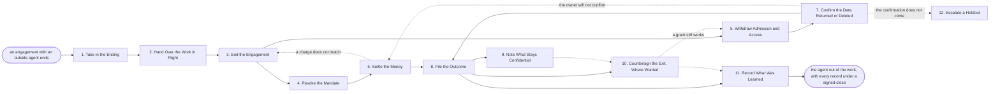

# Reference process: Offboard an Agent

`ref/gm/offboard-an-agent v1`

**value stream:** [Engage-to-Exit](../../streams/general-management/engage-to-exit.md)
An engagement with an outside agent is ending, and this process takes
the agent out of the organization's work the way a departing employee
or contractor is taken out. Its unfinished work is given a new holder
first. The engagement is ended on its own terms, the agent's mandate is
revoked with everything under it, and every grant it was given is
withdrawn against the list made when it was brought in. The money is
settled and any reservation released. The agent's owner confirms in
writing what was returned and what was deleted, the outcome is filed
with the reputation bureau the engagement names, and the confidentiality
terms that outlast the engagement are written on the register entry.
The run closes with a signed close: the process owner signs the digest
of every record the run left, so the run's own records are the signed
proof that all of that happened (Agent Processes §13.5.1). An
organization that also wants named people to countersign the exit keeps
the `sign-exit` gate.

This is a reference process. It is a first draft for an organization to
adopt and argue with, and it is not running anywhere. Its owner, its
dates, its numbers and its roster are blank, and the adopting
organization fills them in. Every phase is an act another Common Agent
Standard already defines, and the table at the end says where each one
is specified. The process is written from the side of the organization
the agent worked for. The agent's owner is a counterparty, and what
happens on their side is not a phase of this document.

It is the counterpart of [onboard an agent](./onboard-an-agent.md), and
it reads that run's access list.

## The activities

| # | Activity | What happens | Agents |
|---|---|---|---|
| 1 | Take in the Ending | why the engagement ends, on what terms, and when | sponsor (person) |
| 2 | Hand Over the Work in Flight | each open item given a new holder or closed | [handover-coordinator](../../agents/handover-coordinator.md) |
| 3 | End the Engagement | terminated for convenience or cause, or lapsed | [signature-manager](../../agents/signature-manager.md) · sponsor (person) |
| 4 | Revoke the Mandate | the agent's mandate revoked, with every mandate under it | spending authority (person) |
| 5 | Withdraw Admission and Access | admission revoked, every grant withdrawn and tried | [tool-administrator](../../agents/tool-administrator.md) |
| 6 | Settle the Money | final charges checked, reservation released | [budget-keeper](../../agents/budget-keeper.md) |
| 7 | Confirm the Data Returned or Deleted | the owner confirms in writing what was returned or deleted | [supplier-check](../../agents/supplier-check.md) · agent's owner (person) |
| 8 | File the Outcome | outcome and review filed with the reputation bureau | sponsor (person) |
| 9 | Note What Stays Confidential | surviving confidentiality terms written on the register | [supplier-manager](../../agents/supplier-manager.md) |
| 10 | Countersign the Exit, Where Wanted | named people countersign the run's records | sponsor (person) · security reviewer (person) |
| 11 | Record What Was Learned | what to repeat, what to avoid | supplier-manager · sponsor (person) |
| 12 | Escalate a Holdout | the unanswered data request put in writing | legal (person) |

## The graph



## What the graph says

The work in flight is handed over before anything is withdrawn. An
engagement ended for convenience lets in-flight tasks complete and be
paid, so the handover decides which of them finish with the agent and
which move to a new holder before its access goes. An engagement ended
for cause cancels its in-flight tasks, and the handover then has only
new holders to name.

Ending the engagement opens two branches that run at the same time. The
mandate is revoked and the money settled on one, and admission and
access are withdrawn and the data confirmed on the other. The outcome
is filed only when both have finished, because the outcome depends on
how the money settled and on whether the agent's owner confirmed what
happened to the data.

Noting what stays confidential is marked as a phase that does not run
in every run. An engagement that ran under no NDA has no surviving terms
to write down, and nothing waits for it. Countersigning the exit is
marked the same way. The signed close already proves the run happened as
recorded, so the countersignature is for an organization that wants
named people, such as a security reviewer, to put their own names to it.
An adopter that does not want it drops the phase. An adopter whose engagements
never run under an NDA also drops the `confidential-under:` line, which
holds every outside participant in the run to the agreement the
engagement ran under.

The data confirmation comes from the agent's owner, and `confirm-data`
reads it as it arrived. The process records what the confirmation says,
when it came and who sent it. It cannot see the deletion itself, which
is why the confirmation is in writing and the run stays open until it
comes.

Three edges point backwards. A grant that still works when the exit is
countersigned returns the run to withdrawing access. A data confirmation that
does not come returns the run to the money, where the final settlement
and any open dispute are what the organization still holds. A final
charge that does not match the engagement returns the run to ending
the engagement, where the terms it was charged under sit.

## The document, with the blanks marked

```
PROCESS: offboard an agent            id: <team>/offboard-an-agent   v1
from: ref/gm/offboard-an-agent v1
owner: <who>                          effective: <date>
confidential-under: <your agreement>
trigger: an engagement with an outside agent is terminated, is given
         notice of termination, or reaches its end date, as recorded in
         <your agreement store>
         watch: record=<the engagement>
                system=<your agreement store>
                change=<the engagement is terminated, given notice, or
                        reaches its end date>
concurrency: runs may overlap - <how many> offboardings open at once,
             and one agent is offboarded by one run at a time
goal: the agent out of the organization's work, with its engagement
      ended, its mandate revoked, every grant withdrawn, the money
      settled, the data confirmed returned or deleted, the work handed
      over, and the run closed with a signed close
phases:
  take-in-ending   - human: why the engagement is ending, whether for
                     convenience with notice, for cause, or by reaching
                     its end date, and the date the agent stops
                     owner: <your sponsoring role>   after: trigger
                     automation: <level>
  hand-over-work   - harness: everything the agent has open, each item
                     with its state, and each one either finishing with
                     the agent under the notice, given a new holder, or
                     closed with a reason
                     owner: handover-coordinator after: take-in-ending
                     by: <days>                  automation: <level>
  end-engagement   - convenes approval: the engagement terminated for
                     convenience with the notice it requires, or for
                     cause with the reason recorded, or its lapse
                     recorded on the end date
                     owner: signature-manager
                     after: take-in-ending + hand-over-work
                     by: <days>                  automation: never
  revoke-mandate   - human: the agent's mandate revoked in
                     <your mandate registry>, with every mandate issued
                     under it
                     owner: <your spending authority role>
                     after: end-engagement
                     by: <days>                  automation: never
  withdraw-access  - human: the agent's admission revoked, and every
                     grant on the access list withdrawn and tried, so
                     each one is known to be closed and not only
                     recorded as closed
                     owner: tool-administrator   after: end-engagement
                     by: <days>                  automation: <level>
  settle-money     - harness: the final charges read against the
                     engagement's price and cap, the reservation
                     released, and every open dispute listed with its
                     state
                     owner: budget-keeper        after: revoke-mandate
                     by: <days>                  automation: <level>
  confirm-data     - harness: the agent's owner's written confirmation
                     of what was returned, what was deleted and when,
                     and what is still held and why, read against the
                     engagement's retention terms
                     owner: supplier-check       after: withdraw-access
                     by: <weeks>                 automation: <level>
  file-outcome     - human: the engagement's outcome and a review filed
                     with the reputation bureau the engagement names,
                     written from the record of the work
                     owner: <your sponsoring role>
                     after: settle-money + confirm-data
                     by: <days>                  automation: <level>
  note-confidentiality - human: the confidentiality terms that outlast
                     the engagement, and the date each one ends,
                     written on the register entry
                     owner: supplier-manager     after: file-outcome
                     automation: <level>
  sign-exit        - convenes approval: named people countersign the
                     run's records, saying the engagement ended, the
                     mandate was revoked, every grant was withdrawn and
                     tried, the money was settled, the data was
                     confirmed and the work was handed over, each with
                     the record it rests on
                     owner: <your security role>
                     after: file-outcome + note-confidentiality?
                     by: <days>                  automation: never
  record-learnings - convenes debrief: what to repeat, what to avoid
                     owner: supplier-manager
                     after: file-outcome + note-confidentiality? + sign-exit?
                     automation: <level>
  escalate-holdout - human: the agent's owner has not confirmed what
                     happened to the data by the date, so the request is
                     put in writing against the engagement by
                     <your legal role>
                     owner: <your legal role>
                     after: confirm-data, when it is not answered
                     by: <days>                  automation: never
run-scoped:
  status - harness: a status report      owner: supplier-manager
           every: <cadence>
           from: take-in-ending   until: record-learnings
           automation: <level>
handoffs:
  take-in-ending -> hand-over-work [ending]: why the engagement ends,
    on what terms, and the date the agent stops
  take-in-ending -> end-engagement [ending]: the same record
  hand-over-work -> end-engagement [work-handed-over]: every open item,
    and for each whether it finishes with the agent, has a new holder,
    or was closed with a reason
  end-engagement -> revoke-mandate [engagement-ended]: the termination
    or lapse record, its date, and the engagement's identifier and
    version
  end-engagement -> withdraw-access [engagement-ended]: the same record
  revoke-mandate -> settle-money [mandate-revoked]: the revocation, its
    date, and every mandate it reached
  withdraw-access -> confirm-data [access-withdrawn]: every grant on the
    access list, withdrawn and tried, with the date of each
  settle-money -> file-outcome [settlement]: the final charges, the
    released reservation, and every open dispute with its state
  confirm-data -> file-outcome [data-confirmed]: the confirmation read
    against the retention terms, and every difference
  file-outcome -> note-confidentiality [outcome-filed]: the outcome and
    review as filed, and the bureau they were filed with
  note-confidentiality -> sign-exit [surviving-terms]: each
    confidentiality term that outlasts the engagement, with its end date
  file-outcome -> sign-exit [outcome-filed]: the same record
  sign-exit -> record-learnings [exit-record]: the countersigned exit
  file-outcome -> record-learnings [outcome-filed]: the same record
deviations:
  sign-exit -> withdraw-access [grant-still-open]: a grant still works
    when the exit is countersigned, so access is withdrawn again and
    tried again
  confirm-data -> settle-money [owner-will-not-confirm]: the agent's
    owner will not confirm what happened to the data, so the final
    settlement and any open dispute are worked again against the
    engagement's retention terms
  settle-money -> end-engagement [charge-does-not-match]: a final charge
    does not match the engagement, so it is read again against the
    terms the engagement ended on
bindings:
  roster:  <who holds each role - agents claiming the abstract agents
           above, named people for the sponsor, the spending authority,
           the security reviewer and the legal role, and the agent's
           owner, who is the counterparty>
  systems: <your agreement store> (write), <your mandate registry>
           (write), <your access control> (write), the register of
           outside parties (write), <your settlement records> (read),
           <the reputation bureau the engagement names> (write)
  data:    the engagement at the version it ended under, the access list
           from the onboarding run, <your retention rules> <version>,
           the agreement named in confidential-under
policy:
  in-flight work has a named holder before the agent's access is
    withdrawn
  every grant on the access list is tried after it is withdrawn, and a
    grant that still works keeps the run open
  the run stays open until the agent's owner has confirmed in writing
    what was returned and what was deleted
  ending the engagement, revoking the mandate and countersigning the
    exit are human gates and are never delegated to an agent
  the run closes with a signed close that names every record it left
measures:
  cycle time: <target> from the ending to the signed close
  coverage: <share> of grants on the access list withdrawn and tried
            before the run closes
  quality gate: no run closes while a grant still works or the data is
                unconfirmed
records:
  work-handover - every open item and where it went
  access-check  - every grant on the access list, withdrawn and tried,
                  with the date of each
  exit-record   - the signed close over every record of the run, and,
                  where the exit is countersigned, the named people who
                  signed it and the record each statement rests on
```

## The records a run leaves

Each phase leaves the record its own kind of work produces, and three
records matter across the whole run. The exit record is the one an
auditor asks for, and it is the run's own records under a signed close.
The termination, the revocation, the access check, the settlement, the
data confirmation and the handover are each a record of the run, and the
process owner signs the digest of every one of them when the run closes
(Agent Processes §13.5.1). An auditor who holds the records can check
that they are the ones the owner closed on.

The signed close proves what the records were when the run closed. It
does not prove that they are true, and it is the owner's signature only.
An organization that wants named people, such as a security reviewer, to
put their own names to the exit keeps the `sign-exit` gate, where they
countersign the records before the run closes.

The run closes:

```
RUN DONE: <team>/offboard-an-agent v1 · run <n>
outcome: <completed | abandoned>
result: <the agent out of the work, with every record under a signed close>
open: <what nobody finished, and who may close it>
```

and the process owner signs the close over every record from `RUN`
through `RUN DONE`.

## The failure edges

- **The agent's owner will not confirm what happened to the data.** The
  run stays open. The request is put in writing against the engagement,
  and what the owner is still holding is recorded on the register entry.
  An unanswered request is not a deletion.
- **A grant still works after it was withdrawn.** The run returns to
  withdrawing access. A run closed while a grant still works puts a
  signature on something that is not true.
- **There is no access list from the onboarding run.** The grants are
  found from the access control systems instead, and the run records
  that the list was rebuilt. The next onboarding is where that gap is
  closed.
- **The engagement is ended for cause.** In-flight tasks are cancelled
  with a recorded reason. The handover then names only new holders, and
  the outcome filed with the bureau says the engagement ended for cause.
- **A final charge does not match the engagement.** The run returns to
  the ending, where the terms the charge was made under sit. The dispute
  is listed in the settlement, and the outcome waits for it.
- **The trigger fires while runs are in flight.** Offboardings overlap
  normally, and the concurrency line says how many. One agent is
  offboarded by one run at a time.
- **A run is abandoned.** The engagement may already have ended, so an
  abandoned offboarding is the dangerous case: access and authority may
  outlast the work. The register entry says the offboarding did not
  complete and lists every grant and mandate not yet withdrawn, so the
  gap is visible to the next person who reads it.

## Where each phase is specified

| Phase | Where it is specified |
|---|---|
| end-engagement | [Termination](https://agentsow.com/spec.html#s5-9) and [term and renewal](https://agentsow.com/spec.html#s5-7) in Agent SoW |
| revoke-mandate | [The lifecycle](https://agentmandate.net/spec.html#s9) in Agent Mandate |
| withdraw-access | [The door](https://commonagent.net/spec.html#7-1-the-door) in the Common Agent Specification; [granting access](https://agentsow.com/spec.html#s5-3-1) in Agent SoW |
| settle-money | [Disputes](https://agentsow.com/spec.html#s5-10) in Agent SoW |
| confirm-data | [Confidentiality and retention](https://agentsow.com/spec.html#s5-11) in Agent SoW |
| file-outcome | [Evidence and the ledger](https://agentreputations.com/spec.html#s4) and [engagements as an evidence source](https://agentreputations.com/spec.html#s4-4) in Agent Reputations |
| note-confidentiality | [Termination and other acts](https://agentnda.net/spec.html#s7-3) in Agent NDA |
