# Reference process: Onboard an Agent

`ref/gm/onboard-an-agent v1`

**value stream:** [Engage-to-Exit](../../streams/general-management/engage-to-exit.md)
An organization has decided it wants an outside agent to take on a
piece of its work, and this process brings that agent in the way a new
employee or contractor is brought in. The agent is checked against what
it declares about itself and interviewed before anyone signs anything.
Where the work involves confidential material, an Agent NDA is signed
first. The terms are agreed and the engagement is formed under Agent
SoW, the agent is given a mandate no wider than the work needs, and it
is admitted and given access that ends when the engagement ends. It is
handed the context it needs, run on a trial against a pass line agreed
in advance, and only then put into the work. The run closes when the
agent is working, every grant it holds is on one list with an end date,
and the people working beside it know it is there.

This is a reference process. It is a first draft for an organization to
adopt and argue with, and it is not running anywhere. Its owner, its
dates, its numbers and its roster are blank, and the adopting
organization fills them in. Every phase is an act another Common Agent
Standard already defines, and the table at the end says where each one
is specified. The process is written from the side of the organization
bringing the agent in. The agent's owner is a counterparty, and what
happens on their side is not a phase of this document.

## The activities

| # | Activity | What happens | Agents |
|---|---|---|---|
| 1 | Take in the Request | the work, the team, the systems, and who sponsors it | sponsor (person) |
| 2 | Verify the Agent | Descriptor and records verified, reputation read | [supplier-check](../../agents/supplier-check.md) |
| 3 | Interview the Agent | the five questions asked and checked against declarations | supplier-check |
| 4 | Sign the NDA | an Agent NDA signed, where the work is confidential | [signature-manager](../../agents/signature-manager.md) · sponsor (person) · agent's owner (person) |
| 5 | Agree the Terms | the terms scored against the standard terms | [terms-check](../../agents/terms-check.md) |
| 6 | Form the Engagement | the Agent SoW engagement signed by both owners | signature-manager · sponsor (person) · agent's owner (person) |
| 7 | Grant the Mandate | a mandate no wider than the engagement needs | spending authority (person) · [budget-keeper](../../agents/budget-keeper.md) |
| 8 | Admit the Agent and Grant Access | the agent admitted, each grant scoped to the engagement | [tool-administrator](../../agents/tool-administrator.md) |
| 9 | Hand Over the Context | the material, documents and contacts the agent needs | [handover-coordinator](../../agents/handover-coordinator.md) |
| 10 | Run the Trial | a trial run against the pass line the engagement states | [certification-check](../../agents/certification-check.md) |
| 11 | Decide on Go-Live | named people decide on the trial result | sponsor (person) · security reviewer (person) |
| 12 | Put the Agent into the Work | the roster updated and the register entry opened | [supplier-manager](../../agents/supplier-manager.md) |
| 13 | Record What Was Learned | what to repeat, what to avoid | supplier-manager · sponsor (person) |
| 14 | Close a Rejected Onboarding | closed with its reason, and nothing left granted | sponsor (person) |

## The graph

```mermaid
flowchart LR
  T([a request to bring an outside agent into the work]) --> A1[1. Take in the Request]
  A1 --> A2[2. Verify the Agent]
  A2 --> A3[3. Interview the Agent]
  A3 --> A4[4. Sign the NDA]
  A3 --> A5[5. Agree the Terms]
  A4 -.-> A5
  A5 --> A6[6. Form the Engagement]
  A6 --> A7[7. Grant the Mandate]
  A7 --> A8[8. Admit the Agent and Grant Access]
  A8 --> A9[9. Hand Over the Context]
  A9 --> A10[10. Run the Trial]
  A10 --> A11[11. Decide on Go-Live]
  A11 --> A12[12. Put the Agent into the Work]
  A12 --> A13[13. Record What Was Learned]
  A13 --> DONE([the agent working under a formed engagement, with every grant on the access list])
  A2 -. verification failed .-> A1
  A3 -. answers contradict .-> A2
  A10 -. missing context .-> A9
  A11 -. trial not passed .-> A10
  A2 -. the agent is not brought in .-> A14[14. Close a Rejected Onboarding]
  A11 -. the agent is not brought in .-> A14
```



## What the graph says

The graph is a single line with one branch that does not always run.
Verification and the interview come before anything is signed, because
both read only what the agent publishes about itself, and nothing
confidential has to reach the agent for either of them. The NDA comes
next where the work needs one. It is marked as a phase that does not run
in every run, so a run with no confidential material goes straight from
the interview to the terms and nothing waits for an agreement that was
never needed.

The mandate is granted after the engagement is formed and before the
agent is admitted. The order matters. An agent that is admitted before
its mandate exists can be asked to commit the organization to something
with nothing saying how far it may go, and an agent given a mandate
before an engagement exists holds authority with no terms behind it.

Two things in the run come from the agent's owner: the engagement they
propose, which `agree-terms` reads as it arrived, and their signatures on
the NDA and the engagement. The process records what arrived and when,
and makes no claim about what happened on the other side to produce it.

Four edges point backwards. A verification that fails returns the run to
the request, where the sponsor either names another candidate or closes
the run. Interview answers that contradict the signed declarations
return the run to verification, because the declarations are what the
organization is entitled to rely on and they have to be read again. A
trial that falls short of its pass line returns the run to the context
handover when the agent lacked something it needed, and the go-live
decision can send the run back to the trial with the findings named.

## The document, with the blanks marked

```
PROCESS: onboard an agent             id: <team>/onboard-an-agent   v1
from: ref/gm/onboard-an-agent v1
owner: <who>                          effective: <date>
trigger: a request to bring an outside agent into <your team's work> is
         approved in <your request or procurement process>
         watch: record=<the request>
                system=<your request or procurement process>
                change=<the request is approved, with a sponsor named>
concurrency: runs may overlap - <how many> onboardings open at once,
             and one agent is onboarded by one run at a time
goal: the agent working in the organization under a formed engagement
      and a mandate no wider than the work, with every grant it holds on
      one list with an end date, and the people beside it told
phases:
  take-in-request  - human: what work the agent will do, for which
                     team, on which systems and with which data, who
                     sponsors it, and whether the work involves
                     confidential material
                     owner: <your sponsoring role>   after: trigger
                     automation: <level>
  verify-agent     - harness: the agent checked against what it
                     declares: its signed Descriptor verified and
                     current, its build, deployment and evaluation
                     records read at their versions, and its reputation
                     report read with the date it was issued
                     owner: supplier-check       after: take-in-request
                     by: <days>                  automation: <level>
  interview-agent  - harness: the five questions asked, each answer
                     compared with the signed declarations, and
                     questions outside its offerings asked so its
                     refusals can be read
                     owner: supplier-check       after: verify-agent
                     by: <days>                  automation: <level>
  sign-nda         - convenes approval: an Agent NDA signed by both
                     sides at one version, naming what is confidential
                     and for how long, before any confidential material
                     reaches the agent
                     owner: signature-manager    after: interview-agent
                     by: <days>                  automation: never
  agree-terms      - harness: the engagement the agent's owner
                     proposes, as it arrived and at its version, scored
                     clause by clause against <your standard terms>:
                     scope, price and cap, term, termination, disputes,
                     confidentiality and retention, and access
                     owner: terms-check
                     after: interview-agent + sign-nda?
                     by: <days>                  automation: <level>
  form-engagement  - convenes approval: the Agent SoW engagement signed
                     by both owners at one version, carrying
                     <your purchase reference> where the organization
                     uses one
                     owner: signature-manager    after: agree-terms
                     by: <days>                  automation: never
  grant-mandate    - human: a mandate issued to the agent under
                     <your charter>, with the powers, the counterparties
                     and the amounts the engagement needs and no more
                     owner: <your spending authority role>
                     after: form-engagement
                     by: <days>                  automation: never
  admit-and-grant  - human: the agent admitted, and each grant it needs
                     made with its scope written down and an end date no
                     later than the engagement's end
                     owner: tool-administrator   after: grant-mandate
                     by: <days>                  automation: <level>
  hand-over-context - harness: the material, the process documents and
                     the contacts the agent needs to start, given at
                     their versions, with what was withheld and why
                     owner: handover-coordinator after: admit-and-grant
                     by: <days>                  automation: <level>
  run-trial        - harness: a trial run on <your trial work> against
                     the pass line the engagement states, with every
                     result kept beside the line it was scored against
                     owner: certification-check  after: hand-over-context
                     by: <days>                  automation: <level>
  decide-go-live   - convenes approval: the trial result read against
                     the pass line, and a go or no-go signed by named
                     people
                     owner: <your sponsoring role>   after: run-trial
                     by: <days>                  automation: never
  go-live          - human: the agent put into the work: the roster
                     updated, the register entry opened with the
                     engagement's end date, and the people working
                     beside it told what it does and whom to ask
                     owner: supplier-manager     after: decide-go-live
                     automation: <level>
  record-learnings - convenes debrief: what to repeat, what to avoid
                     owner: supplier-manager     after: go-live
                     automation: <level>
  close-rejected   - human: the onboarding closed with the reason the
                     agent was not brought in, and the sponsor told
                     owner: <your sponsoring role>
                     after: verify-agent or decide-go-live, whichever
                            ended the onboarding
                     by: <days>                  automation: never
run-scoped:
  status - harness: a status report      owner: supplier-manager
           every: <cadence>
           from: verify-agent   until: go-live
           automation: <level>
handoffs:
  take-in-request -> verify-agent [agent-request]: the work, the team,
    the systems and data the agent will need, the sponsor, and whether
    confidential material is involved
  verify-agent -> interview-agent [verification-report]: the Descriptor
    digest that was verified, each record read with its version, the
    reputation report with its date, and every check that could not be
    made with the reason
  interview-agent -> sign-nda [interview-record]: each of the five
    answers beside the declaration it was compared with, and every
    difference found
  interview-agent -> agree-terms [interview-record]: the same record,
    which the terms are read against
  sign-nda -> agree-terms [nda]: the agreement's identifier, version and
    digest, what it makes confidential, and for how long
  agree-terms -> form-engagement [scored-terms]: every clause that
    departs from the standard terms, by how far, and the answer given
  form-engagement -> grant-mandate [engagement]: the engagement's
    identifier, version and digest, its scope, price and cap, its end
    date, and the purchase reference where there is one
  grant-mandate -> admit-and-grant [mandate]: the mandate's identifier,
    the powers it grants and the amounts it allows
  admit-and-grant -> hand-over-context [access-list]: every grant the
    agent holds, with its scope and its end date
  hand-over-context -> run-trial [context-given]: what was handed over
    at which version, and what was withheld and why
  run-trial -> decide-go-live [trial-result]: each result beside the
    pass line it was scored against
  decide-go-live -> go-live [go-decision]: the signed decision, the
    signers, and any condition attached to it
  go-live -> record-learnings [register-entry]: the opened register
    entry, with the engagement's end date and the access list
deviations:
  verify-agent -> take-in-request [verification-failed]: the agent's
    declarations do not verify, or its records do not support the work,
    so the request is taken in again with another candidate or closed
  interview-agent -> verify-agent [answers-contradict]: the interview
    answers contradict the signed declarations, so the declarations are
    read again at their current version
  run-trial -> hand-over-context [missing-context]: the trial fell short
    because the agent lacked material it needed, so the context is
    handed over again with the gap named
  decide-go-live -> run-trial [trial-not-passed]: the trial did not
    meet the pass line, so it is run again against the findings named
bindings:
  roster:  <who holds each role - agents claiming the abstract agents
           above, named people for the sponsor, the spending authority
           and the security reviewer, and the agent's owner, who is the
           counterparty>
  systems: <your request or procurement process> (read),
           the register of outside parties (write), <your agreement
           store> (write), <your access control> (write),
           <your mandate registry> (write)
  data:    <your standard terms> <version>, <your charter> <version>,
           <your security and privacy standards> <version>
policy:
  nothing confidential reaches the agent before the NDA is in force
  the agent is not admitted before the engagement is formed and the
    mandate is granted
  every grant carries an end date no later than the engagement's end
  the mandate is no wider than the engagement needs
  signing the NDA, forming the engagement, granting the mandate and
    deciding on go-live are human gates and are never delegated to an
    agent
measures:
  cycle time: <target> from the approved request to go-live
  coverage: <share> of grants on the access list with an end date
  quality gate: no agent goes live without a formed engagement, a
                mandate and a passed trial
records:
  verification-report - the Descriptor digest, each record read with its
                        version, and the reputation report with its date
  interview-record    - each answer beside the declaration it was
                        compared with
  access-list         - every grant the agent holds, with its scope and
                        its end date, read again at offboarding
  go-live-decision    - the signed decision and its signers
```

## The records a run leaves

Each phase leaves the record its own kind of work produces. The two
signing phases and the go-live decision leave their approval records,
and the harness phases leave one closing record each. Four records
matter across the whole run, and the document names them in its
`records:` block. The access list matters most. It is the list the
offboarding process reads when the engagement ends, and every grant on
it has to carry an end date for that reading to work.

The run closes:

```
RUN DONE: <team>/onboard-an-agent v1 · run <n>
outcome: <completed | abandoned>
result: <the agent in the work under its engagement and mandate>
open: <what nobody finished, and who may close it>
```

## The failure edges

- **The declarations do not verify.** The run returns to the request.
  An agent whose signed Descriptor does not verify has nothing the
  organization can rely on, and the right next step is another
  candidate or a closed request, recorded with the reason.
- **The interview contradicts the declarations.** The signed
  declarations govern, and the run reads them again. Where they still
  do not support the work, the run closes as rejected.
- **The agent's owner will not sign the NDA.** The run stops before any
  confidential material moves. The sponsor decides whether the work can
  be done without that material, which removes the NDA phase from the
  run, or the run closes as rejected.
- **The terms cannot be agreed.** The departures stay on the scored
  list with the answer given to each, and the run waits. An engagement
  formed on terms nobody scored is the failure this phase exists to
  prevent.
- **The mandate cannot be as narrow as the work.** The spending
  authority narrows the engagement through an amendment, or the run
  stops. A mandate wider than the engagement is authority with no terms
  behind it.
- **The trial does not pass.** The run returns to the trial, or to the
  context handover when the agent lacked something it needed. A trial
  passed by changing the pass line has not been passed.
- **The trigger fires while runs are in flight.** Onboardings overlap
  normally, and the concurrency line says how many. One agent is
  onboarded by one run at a time.
- **A run is abandoned.** Every grant already made is withdrawn, any
  mandate already granted is revoked, and an engagement already formed
  is terminated on its own terms. The register entry says the
  onboarding did not complete, so nobody later finds an agent with
  access and no record of why it has it.

## Where each phase is specified

| Phase | Where it is specified |
|---|---|
| verify-agent | [The signed Descriptor](https://commonagent.net/spec.html#4-9-it-serves-a-bound-signed-descriptor) and [what others attest](https://commonagent.net/spec.html#8-what-others-attest) in the Common Agent Specification; [reports](https://agentreputations.com/spec.html#s8) in Agent Reputations |
| interview-agent | [The five questions](https://commonagent.net/spec.html#4-3-the-five-questions) in the Common Agent Specification |
| sign-nda | [Signatures](https://agentnda.net/spec.html#s6) and [what is confidential](https://agentnda.net/spec.html#s5-4) in Agent NDA |
| agree-terms, form-engagement | [Agent SoW](https://agentsow.com/spec.html), including [the NDA an engagement runs under](https://agentsow.com/spec.html#s5-16) |
| grant-mandate | [The mandate](https://agentmandate.net/spec.html#s6) in Agent Mandate |
| admit-and-grant | [Scope and authority](https://commonagent.net/spec.html#6-11-scope-and-authority) and [the door](https://commonagent.net/spec.html#7-1-the-door) in the Common Agent Specification; [granting access](https://agentsow.com/spec.html#s5-3-1) in Agent SoW |
| hand-over-context | [Context](https://commonagent.net/spec.html#5-6-context) and [the job manifest](https://commonagent.net/spec.html#5-7-the-job-manifest-and-revisions) in the Common Agent Specification |
| run-trial | [Trials](https://commonagent.net/spec.html#7-7-trials) in the Common Agent Specification |

The process that ends the engagement is
[offboard an agent](./offboard-an-agent.md).
