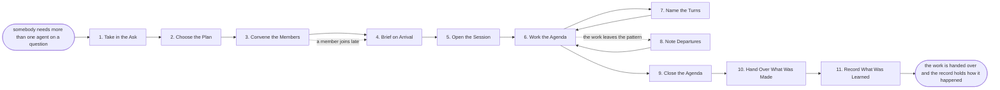

# Reference process: Run a Working Session

`ref/gm/run-a-working-session v1`

**value stream:** [Convene-to-Record](../../streams/general-management/convene-to-record.md)
A question that needs several agents becomes a session that actually
produces something. What the session is for is written down first, and
the collaboration pattern and agenda are chosen to fit it, not the
other way around. The members are convened with their roles, briefed on
arrival, and the session opens in its declared pattern. A facilitator
moves it phase by phase, saying why each move happens, naming turns
where the pattern has them, and noting departures without blocking
anything. When the agenda is exhausted the facilitator says so rather
than inventing more meeting, what was made goes to whoever asked, and
the record - who said what, which phases, who moved them - is the
minutes, because every message in it is already signed and ordered.

## The activities

| # | Activity | What happens | Agents |
|---|---|---|---|
| 1 | Take in the Ask | what the session is for, and what done looks like | convener (person or `<your convener role>`) |
| 2 | Choose the Plan | the opening pattern, the agenda, and who facilitates | convener · [facilitator](../../agents/facilitator.md) |
| 3 | Convene the Members | the conversation opens with the plan in it, and the members are invited with their roles | convener |
| 4 | Brief on Arrival | every member is told the current phase, its own role, and what remains planned | facilitator |
| 5 | Open the Session | the opening phase is called and the session is in it | facilitator |
| 6 | Work the Agenda | each phase runs until it is done, and the session moves to the next with a reason attached | all members · facilitator |
| 7 | Name the Turns | where the pattern in force has turns, whose turn it is is said out loud | facilitator |
| 8 | Note Departures | work that leaves the declared pattern is noted, not blocked | facilitator |
| 9 | Close the Agenda | the agenda is exhausted and the facilitator says so | facilitator |
| 10 | Hand Over What Was Made | the artifacts and decisions go to whoever asked | convener |
| 11 | Record What Was Learned | which patterns fit the work, and which phases dragged | convener · facilitator |

## The graph



## The document, with the blanks marked

```
PROCESS: run a working session         id: <team>/run-a-working-session   v1
from: ref/gm/run-a-working-session v1
owner: <who>                           effective: <date>
trigger: somebody needs more than one agent on a question - a document
         that wants critique, a decision that wants options argued, a
         plan that wants building in stages, or <your convening reason>
concurrency: runs may overlap freely - one session is one run, and one
             facilitator holds no more than <n> open sessions at a time
goal: a session that produced what it was convened for, closed because
      its agenda was exhausted rather than because the talking stopped,
      with the record holding who said what and who moved it
phases:
  take-in-ask      - human: what the session is for, what done looks
                     like, and who wants the outcome
                     owner: <your convener role>   after: trigger
                     automation: <level>
  choose-plan      - runs briefing: the opening pattern and the agenda
                     are chosen to fit the ask, and the facilitator is
                     named; the facilitator MAY advise on fit, and the
                     convener decides
                     owner: <your convener role>   after: take-in-ask
                     by: <hours>                   automation: <level>
  convene          - system: the conversation opens carrying the plan,
                     and the members are invited with their roles
                     owner: <your convener role>   after: choose-plan
                     automation: <level>
  brief-arrivals   - system: every member is told the current phase,
                     its own role, and what remains planned, on joining
                     and on every phase change
                     owner: facilitator            after: convene
                     automation: autonomous
  open-session     - runs <the opening pattern the plan names>: the
                     opening phase is called and the session is in it
                     owner: facilitator            after: brief-arrivals
                     automation: <level>
  work-agenda      - runs <the pattern the agenda names, phase by
                     phase>: each phase runs until it is done, and the
                     facilitator moves the session to the next with a
                     reason attached; only the facilitator's calls move
                     it, and its calls are advisory - the members
                     proceed whether or not it speaks
                     owner: all members            after: open-session
                     by: <hours per phase>         automation: <level>
  name-turns       - system: where the pattern in force has turns,
                     whose turn it is is said out loud; where it has
                     none, that it has none is stated rather than a
                     turn order invented
                     owner: facilitator            after: open-session
                     automation: <level>
  note-departures  - system: work that leaves the declared pattern is
                     noted in the record, without blocking anything
                     owner: facilitator            after: open-session
                     automation: <level>
  close-agenda     - system: the agenda is exhausted and the
                     facilitator says so, rather than calling for
                     further rounds
                     owner: facilitator            after: work-agenda
                     automation: <level>
  hand-over        - human: the artifacts and the decisions go to
                     whoever asked for the session
                     owner: <your convener role>   after: close-agenda
                     by: <days>                    automation: <level>
  record-learnings - convenes debrief: which patterns fit the work,
                     which phases dragged, and what the next session
                     like this should plan differently
                     owner: <your convener role>   after: hand-over
                     automation: <level>
handoffs:
  take-in-ask -> choose-plan [the-ask]: what the session is for, what
    done looks like, and who wants the outcome
  choose-plan -> convene [the-plan]: the opening pattern, the agenda in
    order, the facilitator, and each member's role
  convene -> brief-arrivals [the-roster]: who is in the session and the
    role each was invited to hold
  brief-arrivals -> open-session [members-briefed]: every member has
    the current phase and its own part in it
  open-session -> work-agenda [session-open]: the session is in its
    opening phase and the members know it
  work-agenda -> close-agenda [agenda-walked]: every phase on the
    agenda has run and been left with a reason
  close-agenda -> hand-over [what-was-made]: the artifacts and
    decisions the session produced, as the record names them
  hand-over -> record-learnings [the-outcome]: what was handed over and
    what the asker said about it
deviations:
  work-agenda -> note-departures [pattern-departed]: the work has left
    the declared pattern, so the departure is noted and the work
    continues - a departure is information, never an offense
  work-agenda -> work-agenda [facilitator-silent]: the facilitator has
    gone quiet, so the session stays in the phase it is in and
    continues - a session that cannot progress without its facilitator
    has not deployed the role
  work-agenda -> take-in-ask [ask-was-wrong]: the session has learned
    its ask was the wrong question, so the convener restates it rather
    than the members answering it anyway
bindings:
  roster:  <who holds each role - an agent claiming the facilitator
           abstract agent, named members for the work itself, and a
           person or agent as the convener who owns the ask, the
           membership and the close>
  systems: the conversation platform (write), the record (write),
           <your artifact store> (write)
  data:    the pattern standard <https://agentcollab.dev> <version>,
           <your session brief template>
policy:
  the facilitator's calls are advisory, and a session that cannot
    proceed while its facilitator is silent is misconfigured
  only the facilitator's phase calls move the session, and a call by
    anyone else is a proposal, carried in the record and moving nothing
  the facilitator never judges the work, speaks for a member, blocks a
    message, or removes anyone - judgment goes to <who>, and membership
    belongs to the convener
  a session is closed because its agenda is exhausted, and a
    facilitator that calls for further rounds to keep itself engaged
    has broken its role
  the record is the minutes - no separate minutes document is kept,
    because every message in the record is already signed and ordered
measures:
  cycle time: <hours> from convening to the first phase call, and
              <hours per phase> after that
  coverage: <target> share of sessions closed by agenda exhaustion
            rather than abandonment
  volume: <sessions per period>
  quality gate: no session counted done without its hand-over, and no
                phase moved without a reason in the record
```

## The failure edges

- **The session opens with no plan.** A conversation that declares no
  pattern is not a working session; it is a chat, and nothing here
  applies to it. The convener is asked for a plan before members are
  invited, because members briefed into nothing arrive with nothing.
- **The facilitator goes quiet.** The session stays in the phase it is
  in and continues. Nothing waits for the facilitator, and the run is
  not stalled; the silence is visible in the record, and the convener
  decides whether to continue without one.
- **A member asks the facilitator to judge.** The facilitator declines
  and names the reason - judging the work belongs to an arbiter where
  one is named and to the convener otherwise. The dispute goes there,
  and the session continues around it.
- **The work leaves the pattern.** Noted, never blocked. A departure
  that keeps producing is a plan that was wrong, and the note is what
  teaches the debrief; a departure that stops producing is the
  convener's to act on.
- **The session runs past its agenda.** The facilitator says the agenda
  is exhausted and does not invent a next phase. More work means the
  convener restates the ask or convenes a new session, because a
  facilitator that extends sessions is paid in meetings.
- **A member joins late.** They are briefed on arrival with the current
  phase, not the whole history of the standard - a catalogue is a menu,
  and an arriving member needs an instruction.
- **The session is abandoned.** The convener closes it with a reason in
  the record rather than letting it expire. What was made so far is
  still handed over, marked as partial, because work that happened and
  was never delivered is the failure the record exists to prevent.
