# Reference process: Answer a Records Request

`ref/hr/answer-a-records-request v1`

**value stream:** [HR operations](../../streams/human-resources/hr-operations.md)
Someone asks to see, correct, confirm or delete the data the company holds
about an employee. An employee or a former employee may ask for their own
records, a lender or a landlord may ask the company to confirm someone's
employment with that person's consent, and a court or an authority may
order records. A request from an employee often arrives in the human
resources (HR) help channel, where the employee-question-responder agent
recognizes it, acknowledges it with its deadline and passes it on, and
the privacy lead logs any request that arrives another way. The
employee-record-keeper agent checks the requester's identity against
details already on the record, and the privacy lead confirms the
authority of anyone asking about someone else. The record keeper finds
every record the request covers, the named holders search the health,
investigation and background check records they hold, and other people's
details are set aside. The privacy lead decides what is released,
corrected, deleted or withheld, and why, and a record that a legal hold
or the retention schedule keeps stays, with the requester told which rule
keeps it. The privacy lead approves the answer, and the record keeper
sends it within the deadline the location's rules set. The run closes
when the requester has the answer and the record shows the request, the
decision and what was sent.

**delivers:** document, an answer to a records request

**starts:** by hand, someone asks to see, correct, confirm or delete employee data

## The goals

- Answer [100%] of requests inside their deadline
- Release records to [zero] people whose identity or authority was not confirmed
- Ask a requester for proof of identity no more than [once]
- Disclose [zero] details about other people in an answer

## The activities

| # | Activity | What happens | Agents |
|---|---|---|---|
| 1 | Take in the Request | a request from the help channel, a letter or a third party | [employee-question-responder](../../agents/employee-question-responder.md) · privacy lead (person) |
| 2 | Acknowledge the Request | the receipt, the deadline and anything more it needs | employee-question-responder · privacy lead (person) |
| 3 | Log the Request | the requester, what they ask for and the deadline | [employee-record-keeper](../../agents/employee-record-keeper.md) |
| 4 | Confirm the Requester's Identity | checked against details already on the record | employee-record-keeper |
| 5 | Confirm the Authority to Ask | consent, an order or a mandate for someone else's data | privacy lead (person) |
| 6 | Find Every Record It Covers | across the HR, payroll, benefits and other systems | employee-record-keeper |
| 7 | Ask the Holders of Restricted Records | each named holder searches the records they hold | employee-record-keeper · restricted record holder (person) |
| 8 | Set Aside Other People's Details | names and details of other people marked for removal | employee-record-keeper |
| 9 | Decide What Is Released | what is given, corrected, deleted or withheld, and why | privacy lead (person) · counsel (person) |
| 10 | Correct the Record | each granted correction applied as a record change | employee-record-keeper |
| 11 | Delete What the Rules Allow | deleted, or kept with the rule that keeps it named | employee-record-keeper |
| 12 | Prepare the Answer | the records released, with the reason for anything withheld | employee-record-keeper |
| 13 | Approve the Answer | the privacy lead signs the answer | privacy lead (person) |
| 14 | Send the Answer | by a route the confirmed identity names | employee-record-keeper |
| 15 | Answer Questions About the Answer | from the approved text, or passed to the privacy lead | employee-question-responder |
| 16 | Record the Request | the request, the decision, what was sent and when | employee-record-keeper |

A request from an employee or a former employee to see their own records,
a request to confirm employment, and an order from a court or an
authority all run through this process, each under
`<your jurisdiction's rules on records requests>`. A request that comes
with a claim against the company is told to counsel the day it arrives,
and counsel handles the records for the claim itself.

## The graph

```mermaid
flowchart LR
  T([someone asks to see, correct, confirm or delete employee data]) --> A1[1. Take in the Request]
  A1 --> A2[2. Acknowledge the Request]
  A2 --> A3[3. Log the Request]
  A3 --> A4[4. Confirm the Requester's Identity]
  A4 -. the identity cannot be confirmed .-> A2
  A4 -. the request is about someone else .-> A5[5. Confirm the Authority to Ask]
  A5 -. the authority is not shown .-> A2
  A4 --> A6[6. Find Every Record It Covers]
  A4 --> A7[7. Ask the Holders of Restricted Records]
  A5 --> A6
  A5 --> A7
  A6 --> A8[8. Set Aside Other People's Details]
  A7 --> A8
  A8 --> A9[9. Decide What Is Released]
  A9 -. a correction is granted .-> A10[10. Correct the Record]
  A9 -. a deletion is granted .-> A11[11. Delete What the Rules Allow]
  A9 --> A12[12. Prepare the Answer]
  A10 --> A12
  A11 --> A12
  A12 --> A13[13. Approve the Answer]
  A13 -. the answer misses a record or shows too much .-> A6
  A13 --> A14[14. Send the Answer]
  A14 --> A15[15. Answer Questions About the Answer]
  A15 -. the requester shows a record was missed .-> A6
  A14 --> A16[16. Record the Request]
  A15 --> A16
  A16 --> DONE([the requester has the answer, and the request, the decision and what was sent are recorded])
```



## The document, with the blanks marked

```
PROCESS: answer a records request     id: <team>/answer-a-records-request   v1
from: ref/hr/answer-a-records-request v1
owner: <who>                          effective: <date>
trigger: an employee, a former employee or an outside party asks to see,
         correct, confirm or delete employee data, in <your HR help
         channel> or by a route <your privacy lead role> logs
         watch: record=<records request> system=<your records request log>
                change=<a request is logged with its requester>
concurrency: runs may overlap freely, and one request is one run. A second
             request from the same requester about the same records while
             the first is open joins the open run
goal: every request answered within <your jurisdiction's deadline> to a
      requester whose identity and authority were confirmed, with only
      the records the request covers, and every decision to withhold,
      correct or delete made by the privacy lead with its reason
phases:
  take-in-request      - runs assessment: a records request recognized
                         among the questions in <your HR help channel>, or
                         logged by <your privacy lead role> when it came by
                         letter or from an outside party
                         owner: employee-question-responder
                         after: trigger             automation: <level>
  acknowledge          - system: the requester told the request has
                         arrived, what happens next, the deadline and
                         anything more it needs, in the approved text, and
                         an outside party answered by <your privacy lead
                         role>
                         owner: employee-question-responder
                         after: take-in-request     by: <days>
                         automation: <level>
  log-request          - system: the request logged with the requester,
                         the person it is about, what it asks for, the
                         route it came by and the deadline
                         owner: employee-record-keeper
                         after: acknowledge         automation: <level>
  confirm-identity     - runs assessment: the requester's identity checked
                         against details already on the record, by <your
                         identity check procedure>, asking once for
                         anything missing
                         owner: employee-record-keeper
                         after: log-request         automation: <level>
  confirm-authority    - convenes approval: for a request about someone
                         else, the consent, the order or the authority
                         behind it confirmed under <your jurisdiction's
                         rules on records requests>
                         owner: <your privacy lead role>
                         after: confirm-identity    automation: never
  find-records         - runs collect-and-report: every record the request
                         covers in <your HR system>, <your payroll system>,
                         <your benefits system> and the other systems on
                         <your data map>
                         owner: employee-record-keeper
                         after: confirm-identity, and confirm-authority
                         when it ran                automation: <level>
  ask-holders          - runs collect-and-report: each named holder of
                         health, investigation and background check
                         records asked to search the records they hold and
                         report what the request covers
                         owner: employee-record-keeper
                         after: confirm-identity, and confirm-authority
                         when it ran                automation: <level>
  set-aside-others     - runs assessment: the names and details of other
                         people in the records found, marked for removal
                         unless they have agreed or a rule requires their
                         release
                         owner: employee-record-keeper
                         after: find-records + ask-holders
                         automation: <level>
  decide-release       - convenes decide-and-announce: what is given,
                         corrected, deleted or withheld, the rule behind
                         each choice, and any record a legal hold or <your
                         retention schedule> keeps
                         owner: <your privacy lead role>
                         after: set-aside-others    by: <days>
                         automation: never
  correct-record       - system: each correction granted sent through
                         ref/hr/change-an-employee-record, with the request
                         as its evidence
                         owner: employee-record-keeper
                         after: decide-release      automation: <level>
  delete-records       - system: each deletion granted made in every system
                         that holds the record, and confirmed deleted
                         owner: employee-record-keeper
                         after: decide-release      automation: <level>
  prepare-answer       - human: the records released with other people's
                         details removed, the corrections and deletions
                         made, and the reason for anything withheld
                         owner: employee-record-keeper
                         after: decide-release, and correct-record and
                         delete-records when they ran
                         automation: <level>
  approve-answer       - convenes approval: the privacy lead reads the
                         whole answer against the decision and signs it
                         owner: <your privacy lead role>
                         after: prepare-answer      automation: never
  send-answer          - system: the answer sent by <your secure delivery
                         route> to the contact the confirmed identity
                         names, within the deadline
                         owner: employee-record-keeper
                         after: approve-answer
                         by: <your jurisdiction's deadline>
                         automation: <level>
  answer-questions     - human: the requester's questions about the answer
                         answered from the approved text, and any question
                         about what was withheld passed to the privacy
                         lead
                         owner: employee-question-responder
                         after: send-answer         by: <days>
                         automation: <level>
  record-request       - runs collect-and-report: the request, the
                         identity and authority checks, the decision and
                         its reasons, what was sent, and when
                         owner: employee-record-keeper
                         after: send-answer, and answer-questions when it
                         ran                        automation: <level>
run-scoped:
  deadline     - runs roll-call             owner: employee-record-keeper
                 every: <cadence>
                 from: log-request      until: send-answer
  request-file - runs collect-and-report    owner: employee-record-keeper
                 from: log-request      until: run close
handoffs:
  take-in-request -> acknowledge [records-request]: the request as made,
    who made it and the route it came by
  acknowledge -> log-request [acknowledged-request]: the request and the
    date the requester was told of the deadline
  log-request -> confirm-identity [logged-request]: the requester, the
    person it is about, what it asks for and the deadline
  confirm-identity -> confirm-authority / find-records / ask-holders
    [confirmed-identity]: the identity confirmed and how
  confirm-authority -> find-records / ask-holders [confirmed-authority]:
    the consent, order or authority, and what it covers
  find-records -> set-aside-others [found-records]: every record the
    request covers, by system
  ask-holders -> set-aside-others [restricted-results]: what each named
    holder found that the request covers
  set-aside-others -> decide-release [marked-records]: the records with
    other people's details marked for removal
  decide-release -> correct-record / delete-records / prepare-answer
    [release-decision]: what is given, corrected, deleted or withheld,
    and the rule behind each
  correct-record / delete-records -> prepare-answer [changes-made]: each
    correction and deletion, confirmed in every system
  prepare-answer -> approve-answer [draft-answer]: the answer and every
    record it releases
  approve-answer -> send-answer [approved-answer]: the answer as signed. A
    change after signing voids the signature
  send-answer -> answer-questions / record-request [sent-answer]: what was
    sent, to which contact, by which route and when
  answer-questions -> record-request [follow-up-answers]: each question
    and its answer, and any passed to the privacy lead
deviations:
  confirm-identity -> acknowledge [identity-unconfirmed]: the identity
    cannot be confirmed, so the requester is asked once for what is
    missing, and nothing is released meanwhile
  confirm-authority -> acknowledge [authority-not-shown]: the requester
    shows no consent, order or authority for someone else's data, so they
    are told what is needed, and nothing is released meanwhile
  approve-answer -> find-records [answer-sent-back]: the answer misses a
    record or shows more than the decision allows, so the records are
    found and set aside again
  answer-questions -> find-records [record-missed]: the requester shows a
    record the answer missed, so the search runs again and a further
    answer is sent
bindings:
  roster:  <who holds each role - agents claiming the abstract agents
           above, and named people for the privacy lead, counsel and each
           holder of restricted records>
  systems: <your HR help channel> (read), <your records request log>
           (write), <your HR system> (read), <your payroll system> (read),
           <your benefits system> (read), <your restricted records store>
           (read by its named holders), the document store (write), <your
           secure delivery route> (write), the notification channel
           (write)
  data:    <your jurisdiction's rules on records requests>, <your
           retention schedule> <version>, <your identity check procedure>
           <version>, <your data map> <version>, the legal holds in force,
           the consent or the order behind the request
policy:
  no record is released before the requester's identity is confirmed
    against details already on the record, and the answer goes only to a
    contact the confirmed identity names
  a request about someone else is answered only with that person's
    written consent, an order or another authority <your jurisdiction's
    rules> recognize, confirmed by <your privacy lead role>
  the answer covers only what the request asks for, and other people's
    names and details are removed unless they have agreed or <your
    jurisdiction's rules> require their release
  health, investigation and background check records are searched only by
    the named people who hold them
  every decision to withhold, refuse, correct or delete is made by <your
    privacy lead role> with its reason recorded, and the agents never make
    it
  a record that a legal hold or <your retention schedule> keeps is not
    deleted, and the requester is told which rule keeps it
  a request is answered within <your jurisdiction's deadline>, and any
    extension the rule allows is told to the requester in writing before
    the deadline, with the reason
  a confirmation of employment gives the dates and the job title only,
    unless the employee has agreed in writing to more
  the requester is asked once for anything missing, and only for what the
    request needs
measures:
  cycle time: <days> from the request to the answer sent
  on time: <target> share of requests answered within their deadline
  volume: <requests per period>, by kind
  quality gate: every answer traces to a confirmed identity, a decision by
                the privacy lead and a list of what was sent
```

## The failure edges

- **The identity cannot be confirmed.** The requester is asked once for
  what is missing, through a contact already on the record. Nothing is
  released until the identity holds, and the deadline runs as
  `<your jurisdiction's rules on records requests>` set while the company
  waits.
- **Someone asks about another person without authority.** The requester
  is told what consent or order is needed, and nothing is released. A
  request that looks like an attempt to find someone, such as a request
  for a home address, goes to the privacy lead the same day.
- **The request is very broad.** The privacy lead asks the requester to
  say what they most need where the rule allows it, and the company
  answers in full what it can by the deadline.
- **A record names other people.** Their names and details are removed,
  and the privacy lead decides any case in doubt. Where removing them
  would leave the record meaningless, the privacy lead decides with
  counsel whether to release a summary.
- **A record is kept by a hold or the retention schedule.** It is not
  deleted, and the requester is told which rule keeps it and until when.
- **The request comes during a dispute.** Counsel is told the same day.
  The request is answered on its own terms, and nothing is withheld
  because of the dispute alone unless a rule allows it.
- **The deadline will be missed.** The deadline roll-call raises it at the
  warning point the company sets, and where the rule allows more time the
  privacy lead tells the requester in writing before the deadline, with
  the reason.
- **The requester shows a record was missed.** The search runs again, and
  the further records go out through the same decision and approval.
- **The trigger fires while a run is in flight.** A second request from
  the same requester about the same records joins the open run, and the
  earlier of the two deadlines applies. Any other request is its own run.
- **A run is abandoned.** The requester withdraws the request in writing.
  Nothing more is sent, the record shows the withdrawal, and any
  correction or deletion already made stands.
