# Reference process: Answer an Employee's Question

`ref/hr/answer-an-employees-question v1`

**value stream:** [HR operations](../../streams/human-resources/hr-operations.md)
An employee asks the human resources (HR) team a question about pay,
benefits, leave or a policy through the HR help channel. The
employee-question-responder agent reads only the parts of the employee's
record that decide which answer applies, such as the location, the type of
employment and the benefit plan, and the policy-keeper agent finds the
policy at the version in force for that location on the date the question
is about. The responder answers from the approved library, naming the
source and its version, inside the promised time. Anything personal or
sensitive goes straight to a named person: a question about the employee's
health, a concern about someone at work, a dispute about pay, the
employee's own figures or circumstances, or a request for a decision about
the employee. The responder never approves leave, changes pay or decides
anything about a person, and it tells the employee which process and which
person decide it. A question the library cannot answer is answered by the
person who owns the subject, and that answer is used for anyone else only
once the policy owner approves it. The run closes when the employee has an
answer, or a named person has taken the question on, and the record shows
the source behind every answer.

**delivers:** document, an answer to an employee's question

**starts:** by hand, an employee asks HR a question about pay, benefits, leave or a policy

## The goals

- Answer [90%] of questions inside the promised time
- Answer [75%] of questions from the approved library
- Keep answers corrected after sending below [1%]
- Put every sensitive question with a named person within [4 hours]

## The activities

| # | Activity | What happens | Agents |
|---|---|---|---|
| 1 | Take in the Question | the question, the channel and the time it arrived | [employee-question-responder](../../agents/employee-question-responder.md) |
| 2 | Confirm Who Is Asking | the asker matched to one employee record | employee-question-responder |
| 3 | Spot What Is Personal or Sensitive | health, a concern, a pay dispute or a decision asked for | employee-question-responder |
| 4 | Pass It to a Named Person | the question and why, with the employee told who has it | employee-question-responder |
| 5 | Answer the Personal Question | the named person answers, or opens the process that decides | named HR contact (person) |
| 6 | Read Only What Decides the Answer | the location, the type of employment and the plan | employee-question-responder |
| 7 | Find the Policy That Applies | the version in force for that location on that date | [policy-keeper](../../agents/policy-keeper.md) |
| 8 | Match an Approved Answer | the question matched to a library answer at its version | employee-question-responder |
| 9 | Read the Answer Against the Policy | the answer still agrees with the policy it cites | employee-question-responder · policy-keeper |
| 10 | Answer the Employee | the answer with its source and version, in time | employee-question-responder |
| 11 | Answer What the Library Cannot | the person who owns the subject answers in writing | subject owner (person) |
| 12 | Approve the New Answer | the policy owner approves it before anyone else receives it | policy owner (person) |
| 13 | Add the Answer to the Library | stored beside the policy version it rests on | policy-keeper |
| 14 | Check the Question Is Settled | the employee says whether the answer settled it | employee-question-responder |
| 15 | Close the Question on the Record | what was asked and answered, the source and the time | employee-question-responder |

Some questions belong to other processes. A concern about conduct at work
is taken on at `ref/hr/resolve-an-employee-concern`, a request for leave
at `ref/hr/manage-a-leave-of-absence`, a request to see or correct one's
own records at `ref/hr/answer-a-records-request`, and a change to one's
own details at `ref/hr/change-an-employee-record`. The
employee-question-responder agent tells the employee which process takes
the question and who decides there, and it answers nothing that process
decides.

## The graph

```mermaid
flowchart LR
  T([an employee asks HR a question about pay, benefits, leave or a policy]) --> A1[1. Take in the Question]
  A1 --> A2[2. Confirm Who Is Asking]
  A2 -. the asker cannot be matched to one record .-> A1
  A2 --> A3[3. Spot What Is Personal or Sensitive]
  A3 -. the question is personal or sensitive .-> A4[4. Pass It to a Named Person]
  A4 --> A5[5. Answer the Personal Question]
  A3 --> A6[6. Read Only What Decides the Answer]
  A6 --> A7[7. Find the Policy That Applies]
  A7 --> A8[8. Match an Approved Answer]
  A8 -. no approved answer fits .-> A11[11. Answer What the Library Cannot]
  A8 --> A9[9. Read the Answer Against the Policy]
  A9 -. the answer no longer agrees with the policy .-> A11
  A9 --> A10[10. Answer the Employee]
  A11 --> A12[12. Approve the New Answer]
  A12 -. the policy owner finds the answer wrong .-> A11
  A12 --> A13[13. Add the Answer to the Library]
  A10 --> A14[14. Check the Question Is Settled]
  A11 --> A14
  A14 -. the employee says it is not settled .-> A3
  A14 --> A15[15. Close the Question on the Record]
  A5 --> A15
  A13 --> A15
  A15 --> DONE([the employee has an answer from a named source, or a named person has the question])
```



## The document, with the blanks marked

```
PROCESS: answer an employee's question  id: <team>/answer-an-employees-question   v1
from: ref/hr/answer-an-employees-question v1
owner: <who>                          effective: <date>
trigger: an employee asks a question about pay, benefits, leave or a
         policy in <your HR help channel>
         watch: record=<employee question> system=<your HR help channel>
                change=<a question is opened by an employee>
concurrency: runs may overlap freely, and one question is one run. A
             second question from the same employee on the same subject
             joins the open run
goal: every question answered inside <hours> from an approved answer at
      the version for the employee's location, or taken on by a named
      person, with the source of every answer on the record
phases:
  take-in-question     - system: the question as asked, the channel it
                         came through, the time it arrived and the answer
                         time <your service promise> sets for it
                         owner: employee-question-responder
                         after: trigger             automation: <level>
  confirm-asker        - runs assessment: the asker matched to one
                         employee record through the sign-in to <your HR
                         help channel>, and nothing about a person read
                         until the match holds
                         owner: employee-question-responder
                         after: take-in-question    automation: <level>
  sort-sensitive       - runs assessment: whether the question touches
                         health, a concern about someone at work, a
                         dispute about pay, the employee's own figures or
                         circumstances, or asks for a decision about the
                         employee, read against <your list of sensitive
                         subjects>
                         owner: employee-question-responder
                         after: confirm-asker       automation: <level>
  pass-to-person       - human: the question and the reason it was
                         passed, sent to the named person for its subject
                         in <your routing list>, and the employee told who
                         has it and when they will hear
                         owner: employee-question-responder
                         after: sort-sensitive      by: <hours>
                         automation: <level>
  answer-personal      - human: the named person answers the employee, or
                         opens the process that decides the matter, such
                         as ref/hr/resolve-an-employee-concern or
                         ref/hr/manage-a-leave-of-absence
                         owner: <your HR contact role for the subject>
                         after: pass-to-person      by: <hours>
                         automation: never
  read-facts           - runs collect-and-report: only the parts of the
                         record that decide which answer applies, such as
                         the location, the type of employment and the
                         benefit plan, and nothing from the health,
                         investigation or background check records
                         owner: employee-question-responder
                         after: sort-sensitive      automation: <level>
  find-policy          - runs assessment: the policy and the variant in
                         force for the employee's location on the date
                         the question is about, at its version
                         owner: policy-keeper       after: read-facts
                         automation: <level>
  match-answer         - runs assessment: the question matched to an
                         approved answer in <your answer library> that
                         rests on that policy version, or marked as having
                         none
                         owner: employee-question-responder
                         after: find-policy         automation: <level>
  check-answer         - runs assessment: the matched answer read back
                         against the policy text it cites, at the version
                         in force
                         owner: employee-question-responder
                         after: match-answer        automation: <level>
  send-answer          - system: the answer sent to the employee in the
                         channel they asked in, with the policy, its
                         version and the place to read it
                         owner: employee-question-responder
                         after: check-answer        by: <hours>
                         automation: <level>
  answer-gap           - human: the person who owns the subject in <your
                         routing list> answers the employee in writing,
                         citing the policy and its version
                         owner: <your subject owner role>
                         after: match-answer or check-answer
                         by: <hours>                automation: <level>
  approve-answer       - convenes approval: the policy owner approves the
                         new answer before it is used for anyone else
                         owner: <your policy owner role>
                         after: answer-gap          by: <days>
                         automation: never
  add-to-library       - system: the approved answer stored in <your
                         answer library> beside the policy version it
                         rests on, with its owner and its review date
                         owner: policy-keeper       after: approve-answer
                         automation: <level>
  check-settled        - human: the employee asked whether the answer
                         settled the question, and any follow-up read as a
                         new question
                         owner: employee-question-responder
                         after: send-answer or answer-gap
                         by: <days>                 automation: <level>
  close-question       - runs collect-and-report: what was asked, the
                         answer, its source and version, who answered and
                         the time it took, and for a passed question only
                         its subject and the person who took it
                         owner: employee-question-responder
                         after: check-settled or answer-personal, and
                         add-to-library when it ran
                         automation: <level>
run-scoped:
  answer-clock - runs roll-call             owner: employee-question-responder
                 every: <cadence>
                 from: take-in-question  until: close-question
  question-log - runs collect-and-report    owner: employee-question-responder
                 from: take-in-question  until: run close
handoffs:
  take-in-question -> confirm-asker [question]: the question as asked,
    the channel, the time it arrived and the answer time owed
  confirm-asker -> sort-sensitive [confirmed-asker]: the one employee
    record the asker matches
  sort-sensitive -> pass-to-person [sensitive-question]: the question,
    the subject it touches and the rule that marked it
  pass-to-person -> answer-personal [passed-question]: the question, the
    reason it was passed and the time the employee was promised
  sort-sensitive -> read-facts [general-question]: a question the
    library may answer
  read-facts -> find-policy [deciding-facts]: the location, the type of
    employment, the plan and the date the question is about
  find-policy -> match-answer [policy-in-force]: the policy, its variant
    and its version
  match-answer -> check-answer [matched-answer]: the approved answer and
    the policy version it rests on
  match-answer -> answer-gap [unanswered-question]: the question, the
    policy in force and the owner of the subject
  check-answer -> send-answer [checked-answer]: the answer, confirmed
    against the policy text it cites
  answer-gap -> approve-answer [new-answer]: the answer the subject owner
    sent, with the policy and the version it cites
  approve-answer -> add-to-library [approved-answer]: the answer as
    approved, its owner and its review date
  send-answer -> check-settled [sent-answer]: the answer, its source and
    the time it was sent
  check-settled -> close-question [settled-question]: whether the
    employee said it settled the question, and any follow-up
  answer-personal -> close-question [taken-on]: the person who took the
    question and the process they opened, if any
deviations:
  confirm-asker -> take-in-question [asker-unconfirmed]: the asker cannot
    be matched to one record, so the employee is asked to sign in and ask
    again, and nothing about a person is answered meanwhile
  check-answer -> answer-gap [answer-out-of-date]: the library answer no
    longer agrees with the policy in force, so the question goes to the
    subject owner and the library answer is marked for review
  approve-answer -> answer-gap [answer-not-approved]: the policy owner
    finds the answer wrong, so the subject owner sends the employee a
    correction and writes the answer again for approval
  check-settled -> sort-sensitive [not-settled]: the employee says the
    answer did not settle it, so the follow-up is read again, and anything
    that has turned personal goes to a named person
bindings:
  roster:  <who holds each role - agents claiming the abstract agents
           above, and named people for each HR contact in the routing
           list, each subject owner for pay, benefits and leave, and each
           policy owner>
  systems: <your HR help channel> (write), <your HR system> (read),
           <your policy library> (read), <your answer library> (write),
           the notification channel (write)
  data:    <your policies> at their versions with each location's
           variant, <your list of sensitive subjects> <version>, <your
           routing list> <version>, <your service promise> <version>
policy:
  every answer comes from an approved answer at its version for the
    employee's location, or from the named person who owns the subject,
    and no answer is written from memory
  a question about health, a concern about someone at work, a dispute
    about pay, the employee's own figures or circumstances, or a decision
    about the employee goes to a named person, and the agent does not
    answer it
  the agent reads only the parts of the record that decide which answer
    applies, it never reads health, investigation or background check
    records, and it never weighs a protected characteristic in choosing
    or wording an answer
  the agent never approves, refuses or promises leave, a pay change, an
    accommodation or any other decision about a person, and it names the
    process and the person who decide it
  a new answer is used for anyone else only once <your policy owner
    role> has approved it
  an answer found wrong after it was sent is corrected to the employee in
    writing, and every other employee who received it in the last <days>
    is told too
  a question that suggests someone is in danger goes to <who> at once,
    whatever the hour and whatever the promised time
measures:
  cycle time: <hours> from the question to the answer
  on time: <target> share of questions answered inside the promised time
  reuse: <target> share of questions answered from the library
  volume: <questions per period>
  quality gate: every answer traces to a library answer at its version or
                to the named person who wrote it
```

## The failure edges

- **The asker cannot be matched to one record.** The question came from
  an address the record does not hold, or the sign-in matches no employee
  or more than one. The employee is asked to sign in and ask again, and
  the agent answers nothing about a person until the match holds.
- **The question is personal or sensitive.** The
  employee-question-responder agent passes it to the named person for its
  subject and tells the employee who has it and when they will hear. A
  concern about conduct goes on to `ref/hr/resolve-an-employee-concern`,
  and the question record keeps only the subject and the person who took
  it. A question that suggests someone is in danger goes to a named person
  at once.
- **No approved answer fits.** The subject owner answers in writing,
  citing the policy. The answer reaches anyone else only once the policy
  owner has approved it and the policy-keeper agent has stored it beside
  its version.
- **The library answer no longer agrees with the policy.** The question
  goes to the subject owner as if no answer fitted, and the library answer
  is marked for review so nobody else receives it.
- **A sent answer was wrong.** The employee receives a correction in
  writing, and so does every other employee who received the same answer
  in the period the policy owner sets. Where someone acted on the wrong
  answer, such as by booking leave, the named person for that subject
  decides what the company does to put it right.
- **The employee says the answer did not settle it.** The follow-up is
  read again as a new question. Anything that has turned personal goes to
  a named person, and the same library answer is never sent twice for the
  same question.
- **The promised time will be missed.** The answer clock raises it at the
  warning point the company sets, and the subject owner or the HR contact
  tells the employee when they will hear.
- **The trigger fires while a run is in flight.** A second question from
  the same employee on the same subject joins the open run, and a question
  on another subject is its own run.
- **A run is abandoned.** The employee withdraws the question or leaves
  the company before it is answered. The record closes with the reason,
  and a question already with a named person stays with that person until
  they close it.
