# Reference process: Change an Employee Record

`ref/hr/change-an-employee-record v1`

**value stream:** [HR operations](../../streams/human-resources/hr-operations.md)
A change to an employee's record arrives. The employee updates an address
or the bank account their pay goes to, a manager moves someone to a new
team, or another process hands over a decision a named person has made,
such as a new job or an approved pay change. The employee-record-keeper
agent checks that whoever asked has the authority to make that change for
that employee and that the evidence it needs is in hand, and it refuses
any change that carries a decision about a person when no named person
has made that decision. A change to the bank account pay goes to is
confirmed by the wire-check agent with the employee through a contact
already on the record, and the message that asked for the change is never
used to confirm it, because a false request to change bank details is a
common way to steal pay. A named person approves each change on the
company's approval list. The record keeper applies the change on its
effective date, keeps the old value with its dates, and passes the change
to payroll, benefits and access before the cut-off that applies. The run
closes when every system that reads the change shows it and the employee
has been told what changed.

**delivers:** status board, an updated employee record

## The goals

- Apply [98%] of changes by their effective date
- Let employees make [70%] of their own changes without waiting for a person
- Confirm [100%] of bank account changes through a contact on file
- Keep errors found after a change below [0.5%]

## The activities

| # | Activity | What happens | Agents |
|---|---|---|---|
| 1 | Take in the Change | the change, who asked, and the date it takes effect | [employee-record-keeper](../../agents/employee-record-keeper.md) |
| 2 | Check the Authority to Ask | the asker may make this change for this employee | employee-record-keeper |
| 3 | Check the Evidence | the document or the decision record the change needs | employee-record-keeper |
| 4 | Confirm a New Bank Account | confirmed with the employee on a contact already on file | [wire-check](../../agents/wire-check.md) |
| 5 | Approve the Change | a named person approves a change on the approval list | HR operations lead (person) |
| 6 | Find What Else the Change Touches | pay cycle, tax location, benefits, policy variant and access | employee-record-keeper |
| 7 | Apply the Change on Its Date | the new value dated, the old one kept with its dates | employee-record-keeper |
| 8 | Pass the Change to Payroll | before the cut-off of the period it falls in | employee-record-keeper |
| 9 | Pass the Change to Benefits | an eligibility change or a life event, to benefits | employee-record-keeper |
| 10 | Pass the Change to Access | a new manager, team, location or job, to access | employee-record-keeper |
| 11 | Confirm Each System Shows the Change | each system read back after it takes the change | employee-record-keeper |
| 12 | Tell the Employee What Changed | a notice to the contact on file, with old and new | employee-record-keeper |
| 13 | Close the Change on the Record | who asked, who approved, the evidence and where it went | employee-record-keeper |

The decisions behind many changes are made elsewhere. A pay change is
decided at `ref/hr/change-an-employees-pay`, a new job at
`ref/hr/move-an-employee-to-a-new-role`, a new manager in a
reorganization at `ref/hr/change-the-organization-structure`, and a last
day at `ref/hr/offboard-a-leaver`, and this process applies each one from
the record of the person who decided it. A life event that opens a
benefits window also starts `ref/hr/enroll-an-employee-in-benefits`.

## The graph

```mermaid
flowchart LR
  T([a change to an employee's record is asked for or handed over]) --> A1[1. Take in the Change]
  A1 --> A2[2. Check the Authority to Ask]
  A2 -. the asker may not make this change .-> A1
  A2 --> A3[3. Check the Evidence]
  A3 -. the evidence or the decision is missing .-> A1
  A3 -. the change is to a bank account .-> A4[4. Confirm a New Bank Account]
  A3 -. the change is on the approval list .-> A5[5. Approve the Change]
  A3 --> A6[6. Find What Else the Change Touches]
  A4 -. the employee does not confirm the change .-> A1
  A4 --> A6
  A5 -. the approver will not approve .-> A3
  A5 --> A6
  A6 --> A7[7. Apply the Change on Its Date]
  A7 --> A8[8. Pass the Change to Payroll]
  A7 --> A9[9. Pass the Change to Benefits]
  A7 --> A10[10. Pass the Change to Access]
  A8 --> A11[11. Confirm Each System Shows the Change]
  A9 --> A11
  A10 --> A11
  A11 -. a system does not show the change .-> A7
  A11 --> A12[12. Tell the Employee What Changed]
  A12 --> A13[13. Close the Change on the Record]
  A13 --> DONE([the change shows in every system that reads it, and the employee knows])
```



## The document, with the blanks marked

```
PROCESS: change an employee record    id: <team>/change-an-employee-record   v1
from: ref/hr/change-an-employee-record v1
owner: <who>                          effective: <date>
trigger: an employee, a manager or <your HR operations role> asks for a
         change in <your HR system>, or another process hands over a
         change a named person has decided
         watch: record=<employee record change> system=<your HR system>
                change=<a change is submitted with its effective date>
concurrency: runs may overlap freely, and one change is one run. Two
             changes to the same field of the same record are applied in
             the order of their effective dates, and the second waits
             until the first is applied
goal: every change applied on its effective date by someone with the
      authority to make it, on its evidence, and showing in payroll,
      benefits and access before the cut-off that applies
phases:
  take-in-change       - system: the change, the field it touches, the
                         employee it is for, who asked, the effective date
                         and any decision record or document that came
                         with it
                         owner: employee-record-keeper
                         after: trigger             automation: <level>
  check-authority      - runs assessment: the asker read against <your
                         record change rules>, so an employee changes only
                         their own personal details, a manager only what
                         the rules allow for the people they manage, and
                         HR operations the rest
                         owner: employee-record-keeper
                         after: take-in-change      automation: <level>
  check-evidence       - runs assessment: the document the change needs,
                         such as proof of a new legal name, and for a
                         change that carries a decision about a person,
                         such as a pay change, a new job or the end of
                         employment, the record of the named person who
                         decided it
                         owner: employee-record-keeper
                         after: check-authority     automation: <level>
  confirm-bank-account - runs assessment: a change to the account pay goes
                         to confirmed with the employee through a contact
                         already on the record, by <your bank change
                         procedure>, and the message that asked for it is
                         never used to confirm it
                         owner: wire-check          after: check-evidence
                         by: <days>                 automation: <level>
  approve-change       - convenes approval: <your HR operations role>
                         approves each change on <your list of changes
                         that need approval>, reading it against its
                         evidence
                         owner: <your HR operations role>
                         after: check-evidence      by: <days>
                         automation: never
  find-touched         - runs assessment: what else the change touches,
                         such as the pay period, the tax location, benefit
                         eligibility, the policy variant, required training
                         and access
                         owner: employee-record-keeper
                         after: check-evidence, and confirm-bank-account
                         and approve-change when they ran
                         automation: <level>
  apply-change         - system: the new value written to <your HR
                         system> with its effective date and its evidence,
                         and the old value kept with the dates it held
                         owner: employee-record-keeper
                         after: find-touched        by: <effective date>
                         automation: <level>
  pass-to-payroll      - system: the change sent to <your payroll system>
                         before the cut-off of the pay period it falls in
                         owner: employee-record-keeper
                         after: apply-change        by: <cut-off>
                         automation: <level>
  pass-to-benefits     - system: a change to eligibility, or a life event
                         that opens an election window, sent to <your
                         benefits system>
                         owner: employee-record-keeper
                         after: apply-change        automation: <level>
  pass-to-access       - system: a new manager, team, location or job sent
                         to <your access system>, so access follows the job
                         owner: employee-record-keeper
                         after: apply-change        automation: <level>
  confirm-systems      - runs assessment: each system that took the change
                         read back, field by field, against the record
                         owner: employee-record-keeper
                         after: pass-to-payroll + pass-to-benefits +
                         pass-to-access, each when it ran
                         automation: <level>
  tell-employee        - system: a notice to the employee at the contact on
                         record saying what changed, from what, and from
                         which date, and for a change of contact details to
                         the old contact as well
                         owner: employee-record-keeper
                         after: confirm-systems     automation: <level>
  close-change         - runs collect-and-report: who asked, who approved,
                         the evidence, the effective date, and each system
                         the change reached
                         owner: employee-record-keeper
                         after: tell-employee       automation: <level>
run-scoped:
  effective-date - runs roll-call           owner: employee-record-keeper
                   every: <cadence>
                   from: take-in-change  until: apply-change
  history        - runs collect-and-report  owner: employee-record-keeper
                   from: take-in-change  until: run close
handoffs:
  take-in-change -> check-authority [change-request]: the change, the
    field, the employee, the asker, the effective date and what came with
    it
  check-authority -> check-evidence [authorized-change]: the change and
    the rule that lets the asker make it
  check-evidence -> confirm-bank-account / approve-change / find-touched
    [evidenced-change]: the change with its document or the decision
    record behind it
  confirm-bank-account -> find-touched [confirmed-account]: the new
    account, the contact it was confirmed on, and when
  approve-change -> find-touched [approved-change]: the change, the
    approver and the date
  find-touched -> apply-change [change-plan]: the change and every system,
    period and rule it touches
  apply-change -> pass-to-payroll / pass-to-benefits / pass-to-access
    [applied-change]: the new value, its effective date and the old value
    it replaced
  pass-to-payroll / pass-to-benefits / pass-to-access -> confirm-systems
    [passed-change]: what each system was sent and when
  confirm-systems -> tell-employee [confirmed-change]: each system showing
    the change as the record does
  tell-employee -> close-change [employee-notice]: the notice, the contact
    it went to and the date
deviations:
  check-authority -> take-in-change [no-authority]: the asker may not make
    this change for this employee, so it is refused with the reason and
    the person who may ask is named
  check-evidence -> take-in-change [evidence-missing]: the evidence is
    missing, or the change carries a decision no named person has made,
    so the asker is told what is needed or which process decides it
  confirm-bank-account -> take-in-change [bank-change-unconfirmed]: the
    employee does not confirm the change on the contact already on record,
    so the change is held, pay keeps going to the account on record, and
    the request is reported to <who> as an attempt at fraud
  approve-change -> check-evidence [approver-refuses]: the approver will
    not approve, so the change goes back with the reason, and the asker is
    told
  confirm-systems -> apply-change [system-disagrees]: a system does not
    show the change as the record does, so it is passed again and the
    difference traced before the run closes
bindings:
  roster:  <who holds each role - agents claiming the abstract agents
           above, and named people for the HR operations lead and the
           payroll manager>
  systems: <your HR system> (write), <your payroll system> (write), <your
           benefits system> (write), <your access system> (write), the
           document store (read), the notification channel (write)
  data:    <your record change rules> <version>, <your list of changes
           that need approval> <version>, <your bank change procedure>
           <version>, <your payroll calendar> with its cut-offs, <your
           restricted records rule> <version>
policy:
  a change is applied only when the asker has the authority to make it
    for that employee under <your record change rules>
  a change that carries a decision about a person, such as a pay change,
    a new job, a promotion, discipline or the end of employment, is
    applied only from the record of the named person who decided it, and
    the agent never makes that decision
  a change to the account pay goes to is confirmed with the employee
    through a contact already on the record, the message that asked for
    it is never used to confirm it, and a change that cannot be confirmed
    is reported to <who> as an attempt at fraud
  a change to an employee's contact details is told to the old contact as
    well as the new one
  the old value is kept with its dates, and no change overwrites the
    history of the record
  health, investigation and background check details never enter the
    main record, and a change that touches them goes to the restricted
    record under <your restricted records rule>
  a change reaches payroll before the cut-off of the period it falls in,
    or it is carried to the next period and the employee is told
  a change dated before today is passed to payroll as a correction, and
    <your payroll manager role> approves the correction before it pays
measures:
  cycle time: <days> from the request to the change showing in every
              system
  on time: <target> share of changes applied by their effective date
  self-service: <target> share of changes the employee made alone
  volume: <changes per period>
  quality gate: every change traces to an asker with authority and its
                evidence, and every bank change to a confirmation on a
                contact already on record
```

## The failure edges

- **The asker may not make the change.** The employee-record-keeper agent
  refuses it, names the rule, and tells the asker who may ask. A manager
  who asks to change the team of someone they do not manage is pointed to
  that person's manager or to HR operations.
- **The evidence or the decision is missing.** The asker is told what is
  needed. A change that carries a decision about a person with no named
  person's decision behind it, such as a manager entering a new salary,
  is refused and sent to the process where that decision is made, and the
  agent never applies it on the asker's word.
- **A bank change is not confirmed.** The change is held and pay keeps
  going to the account already on record. The employee is told on the
  contact already on record, and the request is reported as an attempt at
  fraud the same day. A request that arrived from the employee's own email
  account is treated the same way, because an email account can be taken
  over.
- **The approver will not approve.** The change goes back with the reason,
  and the asker is told. Nothing is applied in part.
- **The effective date has already passed.** The change is applied with
  its true date, and payroll and benefits receive it as a correction. The
  payroll manager approves any back pay or recovery before it pays, and
  the employee is told what will change on which payslip under
  `<your jurisdiction's rules on deductions from pay>`.
- **The change misses the payroll cut-off.** It is carried to the next
  period and the employee is told, unless the payroll manager decides an
  off-cycle payment is owed.
- **A system does not show the change.** It is passed again and the
  difference is traced. The run does not close while any system disagrees
  with the record.
- **A change was made in error.** A new change reverses it with its own
  evidence, and the history keeps both. Any effect on pay or benefits is
  corrected through `ref/hr/run-payroll` or
  `ref/hr/enroll-an-employee-in-benefits`, and the employee is told.
- **The trigger fires while a run is in flight.** Two changes to the same
  field of the same record are applied in the order of their effective
  dates, and the second waits for the first. Changes to different fields
  run side by side.
- **A run is abandoned.** The asker withdraws the change before its date.
  Nothing is applied, the systems that were sent it are told to drop it,
  and the record shows the withdrawal.
