# Reference process: Change an Employee's Pay

`ref/hr/change-an-employees-pay v1`

**value stream:** [Pay and benefits](../../streams/human-resources/pay-and-benefits.md)
A manager asks to change an employee's pay outside the yearly pay review,
for a promotion, a move to a new job, a market adjustment or a correction
of an error. The compensation-analyst agent confirms the job and the level
the new pay is for, and it checks the figure asked against the range for
that level, the budget for changes outside the review and the pay of
people doing like work. Where the request falls outside any of them, it
proposes the figure the checks support and gives each reason. The named
approvers that `<your delegation of authority>` sets decide the change,
and an agent never approves one. The employee-record-keeper agent applies
an approved change to the record on its effective date with its evidence
and passes it to payroll, and the payroll-administrator agent works out
any back pay and confirms the first pay at the new rate. The run closes
when the change is on the record, the employee has been paid at the new
rate and holds the change in writing, or when a declined request has gone
back to the manager with its reason.

**delivers:** verdict, an approved pay change

**starts:** by hand, a manager asks to change an employee's pay outside the pay review

## The goals

- Decide each request within [5 working days]
- Keep [95%] of employees paid inside their range
- Spend no more than [1%] of payroll on changes outside the review
- Pay [98%] of changes from their effective date with no back pay

## The activities

| # | Activity | What happens | Agents |
|---|---|---|---|
| 1 | Take in the Request | the employee, the reason, the figure asked and the date | [compensation-analyst](../../agents/compensation-analyst.md) · manager (person) |
| 2 | Check the Request Is Complete | the reason, the evidence and the approvals the policy needs | compensation-analyst |
| 3 | Confirm the Job and Its Level | the job and the level the new pay is for | compensation-analyst |
| 4 | Check the Figure Against the Range | where the figure sits in the range for the level | compensation-analyst |
| 5 | Compare with People Doing Like Work | the figure beside others' pay in the same job and level | compensation-analyst |
| 6 | Check the Cost Against the Budget | the cost this year and in a full year, against what is left | compensation-analyst |
| 7 | Propose a Figure | the figure the checks support, with each reason | compensation-analyst |
| 8 | Decide the Change | the named approvers approve, change or decline it | pay approver (person) · compensation lead (person) |
| 9 | Return a Decline to the Manager | the decision and its reason, in writing | compensation lead (person) |
| 10 | Apply the Change to the Record | the new pay, its effective date and its evidence | [employee-record-keeper](../../agents/employee-record-keeper.md) |
| 11 | Pass the Change to Payroll | the new rate and its date, for the next pay period | employee-record-keeper |
| 12 | Work Out Any Back Pay | the difference owed from a past effective date | [payroll-administrator](../../agents/payroll-administrator.md) |
| 13 | Confirm the First Pay at the New Rate | the first payslip at the new rate, matched to the record | payroll-administrator |
| 14 | Tell the Employee in Writing | the new pay, its date and its reason | manager (person) |
| 15 | Record What the Change Shows | a range often breached, flagged for the pay review | compensation-analyst |

A promotion is decided at `ref/hr/decide-promotions` and a move at
`ref/hr/move-an-employee-to-a-new-role`, and each of them sends its pay
change here. The yearly changes for everyone run at
`ref/hr/run-the-pay-review`, and the new rate is paid at
`ref/hr/run-payroll`. A change to someone's pay that a disciplinary
outcome or a leave sets comes here like any other, with the decision that
set it attached.

## The graph

```mermaid
flowchart LR
  T([a manager asks to change an employee's pay outside the pay review]) --> A1[1. Take in the Request]
  A1 --> A2[2. Check the Request Is Complete]
  A2 -. the request is incomplete .-> A1
  A2 --> A3[3. Confirm the Job and Its Level]
  A3 --> A4[4. Check the Figure Against the Range]
  A3 --> A5[5. Compare with People Doing Like Work]
  A3 --> A6[6. Check the Cost Against the Budget]
  A4 --> A7[7. Propose a Figure]
  A5 --> A7
  A6 --> A7
  A7 --> A8[8. Decide the Change]
  A8 -. the approvers ask for another figure .-> A7
  A8 -. the change is declined .-> A9[9. Return a Decline to the Manager]
  A8 --> A10[10. Apply the Change to the Record]
  A10 --> A11[11. Pass the Change to Payroll]
  A11 --> A12[12. Work Out Any Back Pay]
  A12 --> A13[13. Confirm the First Pay at the New Rate]
  A13 -. the pay does not match the approved figure .-> A11
  A13 --> A14[14. Tell the Employee in Writing]
  A9 --> A15[15. Record What the Change Shows]
  A14 --> A15
  A15 --> DONE([the change is decided, and an approved change is on the record and paid])
```



## The document, with the blanks marked

```
PROCESS: change an employee's pay     id: <team>/change-an-employees-pay   v1
from: ref/hr/change-an-employees-pay v1
owner: <who>                          effective: <date>
trigger: a manager submits a pay change request for an employee in <your
         HR system>, or a promotion or a move hands one on
         watch: record=<pay change request> system=<your HR system>
                change=<a request is submitted with its reason and figure>
concurrency: runs may overlap across employees - one request for one
             employee is one run, an employee has one pay change open at
             a time, and a request made while the pay review is open
             waits for the review unless <who> allows it
goal: the change approved, changed or declined by the named approvers
      within <days> of the request, and an approved change on the record
      from its effective date, paid in the first pay period after it, and
      confirmed to the employee in writing
phases:
  take-in-request     - system: the request lands with the employee, the
                        reason, the figure asked, the effective date and
                        the manager who asks
                        owner: compensation-analyst  after: trigger
                        automation: <level>
  check-complete      - runs assessment: the reason, the evidence and the
                        approvals <your pay policy> asks for with each kind
                        of change, such as a promotion decision or a
                        written market case
                        owner: compensation-analyst
                        after: take-in-request     automation: <level>
  confirm-level       - runs assessment: the job and the level the new pay
                        is for, read from <your job framework>, and a new
                        job placed at a level first where it has none
                        owner: compensation-analyst
                        after: check-complete      automation: <level>
  check-range         - runs assessment: where the figure asked sits in
                        the range for the level and the location, and how
                        far outside it any part of the figure falls
                        owner: compensation-analyst
                        after: confirm-level       automation: <level>
  compare-like-work   - runs assessment: the figure set beside the pay of
                        people in the same job, level and location, using
                        only the factors <your pay policy> names, such as
                        time in the job and the last rating
                        owner: compensation-analyst
                        after: confirm-level       automation: <level>
  check-budget        - runs assessment: the cost of the change this year
                        and in a full year, against what is left in <your
                        budget for changes outside the review>
                        owner: compensation-analyst
                        after: confirm-level       automation: <level>
  propose-figure      - human: the figure the three checks support, with
                        the reason for each point, and the exception and
                        the approver it needs where the figure falls
                        outside the range or the budget
                        owner: compensation-analyst
                        after: check-range + compare-like-work +
                        check-budget               automation: <level>
  decide-change       - convenes decide-and-announce: the named approvers
                        under <your delegation of authority> approve the
                        change, approve another figure, or decline it,
                        and any exception to the range is approved in
                        writing with its reason
                        owner: <your pay approver role>
                        after: propose-figure      by: <days>
                        automation: never
  return-decline      - human: the decision and its reason given to the
                        manager in writing, with what would have to change
                        for a new request
                        owner: <your compensation lead role>
                        after: decide-change, when it declines
                        automation: <level>
  apply-to-record     - system: the approved pay written to the
                        employee's record in <your HR system> on its
                        effective date, with the decision and the approver
                        as its evidence
                        owner: employee-record-keeper
                        after: decide-change, when it approves
                        automation: <level>
  pass-to-payroll     - system: the new rate and its effective date passed
                        to <your payroll system> for the next pay period
                        before its cutoff
                        owner: employee-record-keeper
                        after: apply-to-record     automation: <level>
  work-out-back-pay   - runs allocate-and-reconcile: the difference owed
                        from an effective date already past, period by
                        period, with the tax and deductions on it under
                        <your jurisdiction's tax and deduction rules>
                        owner: payroll-administrator
                        after: pass-to-payroll     automation: <level>
  confirm-first-pay   - runs assessment: the first payslip at the new rate
                        and any back pay checked against the approved
                        figure and the record
                        owner: payroll-administrator
                        after: work-out-back-pay   automation: <level>
  tell-employee       - convenes briefing: the manager tells the employee
                        the new pay, its date and its reason, and gives
                        the written confirmation that <your jurisdiction's
                        rule on notice of a pay change> requires
                        owner: <your manager role>
                        after: confirm-first-pay   by: <days>
                        automation: never
  record-learning     - convenes debrief: where the request fell outside
                        the range or the budget, and any range that keeps
                        being breached, flagged for the next pay review
                        owner: compensation-analyst
                        after: tell-employee or return-decline
                        automation: <level>
run-scoped:
  clock - runs roll-call                        owner: compensation-analyst
          every: <cadence>
          from: take-in-request   until: decide-change
handoffs:
  take-in-request -> check-complete [pay-change-request]: the employee,
    the reason, the figure asked, the effective date and the manager
  check-complete -> confirm-level [complete-request]: the request with
    the evidence and the approvals its kind of change needs
  confirm-level -> check-range / compare-like-work / check-budget
    [job-and-level]: the job, the level and the location the pay is for
  check-range -> propose-figure [range-check]: where the figure sits in
    the range, and any part outside it
  compare-like-work -> propose-figure [like-work-check]: the figure beside
    the pay of people doing like work, with the factors used
  check-budget -> propose-figure [budget-check]: the cost this year and in
    a full year, and what is left in the budget
  propose-figure -> decide-change [proposed-figure]: the figure, the
    reason for each point, and any exception with the approver it needs
  decide-change -> return-decline [declined-change]: the decision and its
    reason, and the person who decided
  decide-change -> apply-to-record [approved-change]: the approved figure,
    its effective date, any exception and the people who approved it
  apply-to-record -> pass-to-payroll [recorded-change]: the change on the
    record, with its evidence
  pass-to-payroll -> work-out-back-pay [payroll-change]: the new rate and
    its date in the payroll system
  work-out-back-pay -> confirm-first-pay [back-pay]: any amount owed for
    past periods, with its tax and deductions
  confirm-first-pay -> tell-employee [paid-change]: the first pay at the
    new rate, checked against the approved figure
  tell-employee / return-decline -> record-learning [change-closed]: the
    confirmation the employee received, or the decline the manager
    received
deviations:
  check-complete -> take-in-request [request-incomplete]: the request
    lacks the reason, the evidence or an approval its kind of change needs,
    so it goes back to the manager with what is missing named
  decide-change -> propose-figure [approvers-ask-for-another-figure]: the
    approvers want another figure checked, so the checks run again on the
    figure they named before anyone decides
  confirm-first-pay -> pass-to-payroll [pay-does-not-match]: the pay does
    not match the approved figure, so the change is passed again and the
    difference is paid off cycle at ref/hr/run-payroll
bindings:
  roster:  <who holds each role - agents claiming the abstract agents
           above, and named people for the managers, the pay approvers
           and the compensation lead>
  systems: the HR system (write), the compensation planning system
           (read), the payroll system (write), the budget (read), the
           notification channel (write)
  data:    <your pay policy> <version>, <your job framework> <version>,
           the pay ranges <version>, <your delegation of authority>
           <version>, <your budget for changes outside the review>
           <version>, <your pay change letter template> <version>
policy:
  a pay change is approved only by the named approvers <your delegation of
    authority> sets, and an agent never approves, changes or declines one
  the agents never read or weigh a protected characteristic, and the
    comparison with like work uses only the factors <your pay policy>
    names
  a figure outside the range or the budget needs <who> to approve the
    exception in writing, and the reason stays on the record with the
    change
  each step sees the least personal data it needs, so the manager sees
    the range and the decision, and the comparison with like work is open
    only to <the named compensation people>
  a change takes effect from the date the approvers set, and back pay is
    paid only for a past date they set in writing
  a request made while the pay review is open waits for the review unless
    <who> allows it
  every change is confirmed to the employee in writing by the first payday
    at the new rate, under <your jurisdiction's rule on notice of a pay
    change>
measures:
  cycle time: <days> from the request to the decision
  on time: <target> share of approved changes paid from their effective
           date in the first pay period after it
  volume: <pay changes outside the review per period>
  quality gate: every change on the record traces to an approval, and
                every figure outside the range carries an approved
                exception
```

## The failure edges

- **The request is incomplete.** It goes back to the manager with what is
  missing named, such as the promotion decision or the written market
  case. The compensation-analyst agent checks nothing on a reason nobody
  has written down.
- **The job has no level.** A new job is placed at a level in the job
  framework first, and the compensation lead confirms the placement
  before the figure is checked against a range.
- **The figure falls outside the range or the budget.** The
  compensation-analyst agent proposes the figure the checks support and
  names the exception and the approver it needs. The approvers decide
  either way, and an exception they approve is recorded with its reason.
- **The approvers ask for another figure.** The checks run again on the
  figure they named, so the approvers never decide on a number that
  nobody compared with like work.
- **The pay does not match the approved figure.** The change is passed to
  payroll again, the difference is paid off cycle at `ref/hr/run-payroll`,
  and the employee is told in writing what happened.
- **The employee disagrees with a decline.** The employee may raise it at
  `ref/hr/resolve-an-employee-concern`, and that run reads this run's
  decision and its reason.
- **The trigger fires while a run is in flight.** An employee has one pay
  change open at a time. A second request for the same employee joins the
  open run as a change to it, and a request made during the pay review
  waits for the review unless a named person allows it.
- **A run is abandoned.** The manager withdraws the request, or the
  employee leaves before the change is decided. Nothing reaches the record
  or payroll, the manager is told in writing, and a change already
  approved but not yet effective is withdrawn by the approvers who
  approved it.
