# Reference process: Change the Organization Structure

`ref/hr/change-the-organization-structure v1`

**value stream:** [Workforce planning](../../streams/human-resources/workforce-planning.md)
A leader proposes a change to how one or more teams are organized, such
as merging two teams, splitting one, or moving reporting lines. Only the
people the head of human resources (HR) names see the work before it is
announced. The workforce-planner agent draws the structure as it stands
and two or three options, each with its reporting lines and its cost, and
lists the effect of each option on every role. Counsel says what notice
and consultation the local rules require. The decision-coordinator agent
puts the options to the executive sponsor, who chooses one, and then runs
the decisions in which named leaders decide what happens to each person.
Pay changes and roles that end go on to the processes that decide them.
Each affected person hears from a manager first, the comms-manager agent
runs the staff announcement, and the employee-record-keeper agent records
every change on one date. The run closes when the new structure is in the
record and in the chart read from it, and the date to review it is set.

**delivers:** status board, a new organization structure

## The goals

- Tell [100%] of affected people before the announcement
- Make the change effective within [8 weeks] of the proposal
- Keep the new structure's cost within [the approved budget]
- Keep leaving from the changed teams under [5%] in the next six months

## The activities

| # | Activity | What happens | Agents |
|---|---|---|---|
| 1 | Take in the Proposal | the reason, the teams in scope and the date wanted | [decision-coordinator](../../agents/decision-coordinator.md) · executive sponsor (person) |
| 2 | Name Who May See the Work | the named people who see the options before the decision | head of HR (person) · decision-coordinator |
| 3 | Draw the Current Structure | teams, roles, reporting lines and cost today | [workforce-planner](../../agents/workforce-planner.md) |
| 4 | Draw the Options | two or three structures, each with its reporting lines | workforce-planner |
| 5 | Cost Each Option | the labor cost of each, against the plan and the budget | workforce-planner · finance lead (person) |
| 6 | List the Effect on Each Role | each role kept, changed, moved, added or ended | workforce-planner |
| 7 | Check the Consultation Rules | the notice and consultation the local rules require | counsel (person) · HR business partner (person) |
| 8 | Put the Options to the Sponsor | the options, their cost and their effect on roles | decision-coordinator |
| 9 | Choose the Structure | the sponsor chooses, with any dissent recorded | executive sponsor (person) · decision-coordinator |
| 10 | Consult Where the Rules Require It | the representatives consulted, and each view answered | HR business partner (person) · counsel (person) · decision-coordinator |
| 11 | Decide What Happens to Each Person | each continuing role's holder, manager and team | named leaders (person) · decision-coordinator |
| 12 | Hand On Pay Changes and Ended Roles | each one to the process that decides it | decision-coordinator |
| 13 | Plan the Announcement | who hears what, in what order and on what date | [comms-manager](../../agents/comms-manager.md) |
| 14 | Tell Each Affected Person | each person hears from a manager first | managers (person) · comms-manager |
| 15 | Announce the Change | the staff announcement, on the planned date | comms-manager |
| 16 | Record the Change on One Date | every new role, manager and team, on the effective date | [employee-record-keeper](../../agents/employee-record-keeper.md) |
| 17 | Report on the Announcement | the questions raised, and how they were answered | comms-manager |
| 18 | Review the Structure at Its Date | whether the change did what it was for | decision-coordinator · executive sponsor (person) |

Three kinds of change leave this process. A change to someone's pay goes
to `ref/hr/change-an-employees-pay`. A new role that more people could
fill than it has places for is filled through
`ref/hr/move-an-employee-to-a-new-role`, on the same criteria for
everyone. A role that ends goes to `ref/hr/run-a-layoff`, which fixes the
selection before any names are applied and follows the notice and
consultation rules, and the staff announcement waits until the people
whose roles end have been told there.

## The graph

```mermaid
flowchart LR
  T([a leader proposes a change to how one or more teams are organized]) --> A1[1. Take in the Proposal]
  A1 --> A2[2. Name Who May See the Work]
  A2 --> A3[3. Draw the Current Structure]
  A3 --> A4[4. Draw the Options]
  A4 --> A5[5. Cost Each Option]
  A5 -. no option fits the budget .-> A4
  A5 --> A6[6. List the Effect on Each Role]
  A6 --> A7[7. Check the Consultation Rules]
  A7 --> A8[8. Put the Options to the Sponsor]
  A8 --> A9[9. Choose the Structure]
  A9 -. the sponsor rejects every option .-> A4
  A9 --> A10[10. Consult Where the Rules Require It]
  A10 -. the consultation changes the proposal .-> A4
  A9 -. no consultation is required .-> A11[11. Decide What Happens to Each Person]
  A10 --> A11
  A11 -. a decision about a person would change the structure .-> A9
  A11 --> A12[12. Hand On Pay Changes and Ended Roles]
  A12 --> A13[13. Plan the Announcement]
  A13 --> A14[14. Tell Each Affected Person]
  A14 --> A15[15. Announce the Change]
  A15 --> A16[16. Record the Change on One Date]
  A16 --> A17[17. Report on the Announcement]
  A17 --> A18[18. Review the Structure at Its Date]
  A18 --> DONE([the new structure is in the record on one date, and every affected person heard first])
```



## The document, with the blanks marked

```
PROCESS: change the organization structure   id: <team>/change-the-organization-structure   v1
from: ref/hr/change-the-organization-structure v1
owner: <who>                          effective: <date>
trigger: <your executive sponsor role> proposes a change to how one or
         more teams are organized, recorded in <your decision record>
         watch: record=<reorganization proposal>
                system=<your decision record>
                change=<a reorganization is proposed>
concurrency: runs may overlap across parts of the company - one change is
             one run, and two changes that touch the same team are joined
             into one run, or the later one waits, as <who> decides
goal: one structure chosen by the executive sponsor, every continuing
      role's holder decided by a named leader, every affected person told
      by a manager before the announcement, and every change recorded in
      <your HR system> on one effective date
phases:
  take-in-proposal    - human: the change proposed, the reason for it,
                        the teams in scope, the date wanted and the
                        executive sponsor who will choose
                        owner: decision-coordinator   after: trigger
                        automation: <level>
  name-access         - human: the named people who may see the options,
                        the costs and the effects before the
                        announcement, recorded with the date each one was
                        added
                        owner: <your head of HR role>
                        after: take-in-proposal    automation: <level>
  draw-current        - runs collect-and-report: the teams in scope as
                        they stand today, with each role, its level, its
                        reporting line and its cost, read from
                        <your HR system> and the workforce plan
                        owner: workforce-planner   after: name-access
                        automation: <level>
  draw-options        - human: two or three structures that meet the
                        reason for the change, each with its teams, its
                        roles and its reporting lines
                        owner: workforce-planner   after: draw-current
                        automation: <level>
  cost-options        - runs assessment: the labor cost of each option
                        for the year and for a full year, set beside the
                        workforce plan and the budget, with the one-time
                        cost of making the change
                        owner: workforce-planner   after: draw-options
                        automation: <level>
  list-effects        - runs assessment: each role in scope marked as
                        kept, changed, moved to a new manager, added or
                        ended under each option, read from the work the
                        role does
                        owner: workforce-planner   after: cost-options
                        automation: <level>
  check-consultation  - runs assessment: whether
                        <your jurisdiction's rules on consultation>
                        require notice to employees or consultation with
                        their representatives before any decision about a
                        person, and the dates they set
                        owner: <your counsel role>
                        after: list-effects        by: <days>
                        automation: <level>
  put-options         - convenes briefing: the options put to the
                        executive sponsor with their cost, their effect on
                        roles and the consultation each one needs
                        owner: decision-coordinator
                        after: check-consultation  automation: <level>
  choose-structure    - convenes decide-and-announce: the executive
                        sponsor chooses one structure, and the decision is
                        recorded with who disagreed and why
                        owner: <your executive sponsor role>
                        after: put-options         by: <date>
                        automation: never
  consult             - human: the employee representatives informed and
                        consulted on the chosen structure for the time
                        <your jurisdiction's rules on consultation> set,
                        and each view they gave answered in writing
                        owner: <your HR business partner role>
                        after: choose-structure, when the rules require
                        consultation               automation: never
  decide-people       - convenes decide-and-announce: for each continuing
                        role in scope, the named leader decides who holds
                        it, the manager and the team, and each decision is
                        recorded with the leader's name
                        owner: <your named leader role>
                        after: consult, or choose-structure when no
                        consultation is required   automation: never
  hand-on-changes     - human: each pay change sent to
                        ref/hr/change-an-employees-pay, each new role with
                        more candidates than places to
                        ref/hr/move-an-employee-to-a-new-role, and each
                        role that ends to ref/hr/run-a-layoff
                        owner: decision-coordinator   after: decide-people
                        automation: <level>
  plan-announcement   - human: who hears what, from whom, in what order
                        and on what date, with the affected people first
                        and the staff announcement after them
                        owner: comms-manager       after: hand-on-changes
                        automation: <level>
  tell-people         - human: each affected person told in a
                        conversation with a manager what changes for them,
                        before the staff announcement and on the planned
                        day
                        owner: <your manager role>
                        after: plan-announcement   automation: never
  announce            - human: the staff announcement issued on the
                        planned date, in the version every audience
                        shares, with the effective date and where to ask
                        questions
                        owner: comms-manager       after: tell-people
                        automation: <level>
  record-change       - system: every new role, manager and team in scope
                        applied in <your HR system> on the effective date,
                        so the organization chart read from the record
                        shows the new structure that day, and each change
                        passed to payroll, benefits and access
                        owner: employee-record-keeper   after: announce
                        automation: <level>
  report-announcement - runs collect-and-report: the questions people
                        raised, how each one was answered, and what the
                        announcement got wrong or left out
                        owner: comms-manager       after: record-change
                        automation: <level>
  review-structure    - convenes debrief: on <the review date>, whether
                        the change did what it was for, set against the
                        reason recorded at the start
                        owner: decision-coordinator
                        after: report-announcement automation: <level>
run-scoped:
  timeline    - runs roll-call               owner: decision-coordinator
                every: <cadence>
                from: take-in-proposal  until: announce
  options-log - runs collect-and-report      owner: workforce-planner
                from: draw-options      until: run close
handoffs:
  take-in-proposal -> name-access [reorganization-proposal]: the change,
    its reason, the teams in scope, the date wanted and the sponsor
  name-access -> draw-current [access-list]: the named people who may see
    the work, with the date each one was added
  draw-current -> draw-options [current-structure]: each role in scope
    with its level, its reporting line and its cost
  draw-options -> cost-options [structure-options]: two or three
    structures with their teams, roles and reporting lines
  cost-options -> list-effects [option-costs]: the cost of each option
    against the plan and the budget, and the one-time cost of the change
  list-effects -> check-consultation [role-effects]: the effect on each
    role under each option
  check-consultation -> put-options [consultation-reading]: the notice and
    consultation each option needs, with the dates and the rule behind
    each one
  put-options -> choose-structure [options-briefed]: the options as the
    sponsor saw them
  choose-structure -> consult / decide-people [chosen-structure]: the
    structure chosen, the conditions on it, and who disagreed and why
  consult -> decide-people [consultation-record]: each view the
    representatives gave, and the answer to it
  decide-people -> hand-on-changes [person-decisions]: each continuing
    role's holder, manager and team, with the leader who decided
  hand-on-changes -> plan-announcement [changes-handed-on]: each pay
    change, contested role and ended role, with the run that now holds it
  plan-announcement -> tell-people [announcement-plan]: who hears what,
    from whom, in what order and when
  tell-people -> announce [people-told]: each affected person told, by
    whom and when
  announce -> record-change [announcement-issued]: the announcement as
    issued, and the effective date
  record-change -> report-announcement [structure-recorded]: every change
    applied on the effective date, and the chart that shows it
  report-announcement -> review-structure [announcement-report]: the
    questions raised, the answers, and what to fix
deviations:
  cost-options -> draw-options [no-option-fits-budget]: no option fits the
    plan and the budget, so the options are drawn again, or the sponsor
    asks for a revision of the plan under ref/hr/plan-the-workforce
  choose-structure -> draw-options [every-option-rejected]: the sponsor
    rejects every option, so new options are drawn and the rejected ones
    are kept with the reason
  consult -> draw-options [consultation-changes-proposal]: the
    consultation shows a better structure or a cost nobody counted, so
    the options are drawn again and the sponsor chooses again
  decide-people -> choose-structure [person-decision-changes-structure]:
    a decision about a person would change the chosen structure, so the
    sponsor decides the structure again before any other decision about a
    person is final
bindings:
  roster:  <who holds each role - agents claiming the abstract agents
           above, and named people for the executive sponsor, the head of
           HR, the finance lead, counsel, the HR business partners, the
           named leaders and the managers of the affected people>
  systems: <your HR system> (write), the workforce plan (read),
           <your decision record> (write),
           <your financial planning system> (read), the staff
           communication channel (write), the notification channel
           (write)
  data:    the workforce plan <version>, the labor cost budget <version>,
           <your job framework> <version>,
           <your jurisdiction's rules on consultation>, the announcement
           at its version
policy:
  only the named people on the access list see the options, the costs
    and the effects before the announcement
  the options and their effects are drawn by role from the work each role
    does, and no step weighs a protected characteristic
  an agent never decides the structure or what happens to a person, and
    each decision is recorded with the name of who made it
  no decision about a person is final before the consultation ends, where
    <your jurisdiction's rules on consultation> require one
  a role that ends goes to ref/hr/run-a-layoff, and the staff
    announcement waits until the people whose roles end have been told
    under that process
  a pay change goes through ref/hr/change-an-employees-pay, and the
    reorganization never sets one by itself
  each affected person hears from a manager before the staff
    announcement
  every change takes effect on one date, and the record, the chart and
    the announcement all carry that date
measures:
  cycle time: <weeks> from the proposal to the effective date
  told first: <target> share of affected people told by a manager before
              the announcement
  volume: <changes per year>
  quality gate: every affected role has a recorded decision with the name
                of who made it, and the record matches the chosen
                structure on the effective date
```

## The failure edges

- **No option fits the budget.** The options are drawn again with fewer
  or smaller changes. When no structure that meets the reason fits, the
  sponsor asks for a revision of the plan under
  `ref/hr/plan-the-workforce`, and this run waits for the revised plan.
- **The sponsor rejects every option.** New options are drawn. The
  options already shown are kept with the reason each one was rejected,
  under the same restricted access, so the next round does not offer them
  again unchanged.
- **The consultation changes the proposal.** The representatives show a
  better structure, or a cost or an effect nobody had counted. The
  options are drawn again and the sponsor chooses again, and no decision
  about a person made before that choice stands.
- **A decision about one person would change the structure.** A leader
  finds that the chosen structure cannot work with the people it has, for
  example because a new role needs a skill no one in scope holds. The
  sponsor decides the structure again before any other decision about a
  person is made final.
- **The news gets out before the announcement.** The comms-manager agent
  and the sponsor agree a short holding statement. The affected people
  who have not yet been told are told that day wherever it can be done,
  and the head of HR checks the access list for how the news got out.
- **An affected person raises a concern.** It is logged and answered
  through `ref/hr/resolve-an-employee-concern`. A concern about the
  decision itself goes to the leader who made it, with the record of that
  decision.
- **The record does not match the decisions on the effective date.** The
  employee-record-keeper agent lists each difference, and each one is
  corrected to the recorded decision before payroll runs on it. A change
  that nobody decided is removed from the record, however long it has
  been there.
- **The trigger fires while a run is in flight.** A second change that
  touches the same team joins the run already open, or waits until this
  one is recorded, as the named person decides. A change in another part
  of the company is its own run.
- **A run is abandoned.** The sponsor withdraws the change before it is
  announced. The options and the decisions are kept with the reason the
  run stopped, under the same restricted access. Anyone who was already
  told hears from a manager that the change will not go ahead, and no
  record changes.
