# Reference process: Check a Candidate's Background

`ref/hr/check-a-candidates-background v1`

**value stream:** [Hiring](../../streams/human-resources/hiring.md)
The hiring manager has chosen a candidate, and the role calls for
references and checks. The background-check agent confirms which checks
the company's policy sets for the role in each place, and the point at
which `<your jurisdiction's rules on background checks>` let them run,
which in some places comes only after a conditional offer. It gives the candidate a plain notice of each check
and asks for written consent. The researcher agent takes references from
the people the candidate named, and the hiring manager reads them. The
background-check agent orders the checks, holds the results apart where
only the named people can open them, and tells the hiring team only the
outcome. When a check comes back with a finding, the candidate first
receives a copy of what was found and the time the rules allow to respond
or to correct an error, and only then does a named person in HR decide
whether the finding bears on the job. The run closes when every check is
clear or decided, the candidate has been told, the outcome is with the
offer, and the results are set to be destroyed when the retention period
ends.

**delivers:** verdict, a background check decision

## The goals

- Finish the checks within [5 working days] of consent
- Keep [95%] of chosen candidates through the checks
- Run no more than [3] kinds of check for a role
- Show the hiring team only the outcome on [100%] of checks

## The activities

| # | Activity | What happens | Agents |
|---|---|---|---|
| 1 | Take in the Chosen Candidate | the candidate, the role and the hiring decision | [background-check](../../agents/background-check.md) |
| 2 | Confirm the Checks the Role Requires | only the checks the policy sets for this role and place | background-check |
| 3 | Confirm When the Checks May Run | before or after a conditional offer, as local rules allow | background-check |
| 4 | Ask for Written Consent | a notice of each check, and the candidate's signed consent | background-check |
| 5 | Collect the Referees | the people the candidate names, and what each may be asked | [researcher](../../agents/researcher.md) |
| 6 | Take the References | each referee asked the same questions about the must-haves | researcher |
| 7 | Read the References | the hiring manager reads them and decides on any concern | hiring manager (person) |
| 8 | Order the Checks | each check ordered with only the details it needs | background-check |
| 9 | Track the Checks | each check chased to a result by its date | background-check |
| 10 | Hold the Results Apart | results stored where only the named people can open them | background-check |
| 11 | Send the Candidate the Finding | a copy of what was found and the time allowed to respond | background-check |
| 12 | Take the Candidate's Response | the candidate's answer, or an error returned to the provider | background-check |
| 13 | Decide on the Finding | a named person decides whether it bears on the job | HR business partner (person) |
| 14 | Tell the Candidate the Decision | the outcome in writing, with any notice the rules require | background-check |
| 15 | Hand the Outcome to the Offer | clear or decided, with nothing about what was found | background-check |
| 16 | Destroy the Results on Time | removed when retention ends, with a record that they were | background-check |
| 17 | Record What the Checks Taught | how long each check took and what the disputes found | background-check · researcher |

The checks run where the rules place them in the hire. Where
`<your jurisdiction's rules on background checks>` let them run before an
offer, the chosen candidate comes here from `ref/hr/run-the-interviews`
and the offer at `ref/hr/make-an-offer` waits for the outcome. Where they
may run only after a conditional offer, this run waits at activity 3
until the candidate has accepted one. An outside background check
provider runs the checks themselves, and the roster names the provider
and the checks it runs.

## The graph

```mermaid
flowchart LR
  T([the hiring manager chooses a candidate for a role that requires checks]) --> A1[1. Take in the Chosen Candidate]
  A1 --> A2[2. Confirm the Checks the Role Requires]
  A2 --> A3[3. Confirm When the Checks May Run]
  A3 --> A4[4. Ask for Written Consent]
  A4 -. the candidate will not consent to a check .-> A13[13. Decide on the Finding]
  A4 --> A5[5. Collect the Referees]
  A5 --> A6[6. Take the References]
  A6 -. a referee cannot be reached .-> A5
  A6 --> A7[7. Read the References]
  A4 --> A8[8. Order the Checks]
  A8 --> A9[9. Track the Checks]
  A9 -. the provider needs more from the candidate .-> A4
  A9 --> A10[10. Hold the Results Apart]
  A10 -. a check comes back with a finding .-> A11[11. Send the Candidate the Finding]
  A11 --> A12[12. Take the Candidate's Response]
  A12 -. the candidate shows the report is wrong .-> A9
  A12 --> A13
  A13 --> A14[14. Tell the Candidate the Decision]
  A10 --> A15[15. Hand the Outcome to the Offer]
  A7 --> A15
  A14 --> A15
  A15 --> A16[16. Destroy the Results on Time]
  A16 --> A17[17. Record What the Checks Taught]
  A17 --> DONE([every check is clear or decided, the candidate is told, and the outcome is with the offer])
```



## The document, with the blanks marked

```
PROCESS: background check  id: <team>/check-a-candidates-background   v1
from: ref/hr/check-a-candidates-background v1
owner: <who>                          effective: <date>
trigger: the hiring manager's choice is recorded at
         ref/hr/run-the-interviews for a role that <your screening
         policy> says requires checks, in <your applicant tracking
         system>
         watch: record=<hiring decision>
                system=<your applicant tracking system>
                change=<a candidate is chosen for a role that requires
                checks>
concurrency: runs may overlap freely - one candidate for one position is
             one run, and a candidate chosen for two positions is checked
             once, with each run reading the same outcome
goal: every check the role requires run with the candidate's written
      consent at the point <your jurisdiction's rules on background
      checks> allow, finished within <days>, every finding decided by a
      named person after the candidate had the chance to respond, and
      only the outcome passed to the offer
phases:
  take-in-candidate    - system: the chosen candidate lands with the
                         role, the locations it is in and the hiring
                         decision
                         owner: background-check    after: trigger
                         automation: <level>
  confirm-checks       - runs assessment: only the checks <your screening
                         policy> sets for this role in each location,
                         such as identity, qualifications, past
                         employment or a record check, and each one's
                         reason
                         owner: background-check
                         after: take-in-candidate   automation: <level>
  confirm-timing       - runs assessment: the point <your jurisdiction's
                         rules on background checks> allow each check to
                         run, and where a check may run only after a
                         conditional offer, the run waits here until
                         ref/hr/make-an-offer reports that the candidate
                         has accepted one
                         owner: background-check
                         after: confirm-checks      automation: <level>
  ask-consent          - human: a plain notice of each check, what it
                         reads, who will see the result and how long it
                         is kept, with the candidate's signed consent to
                         each
                         owner: background-check
                         after: confirm-timing      by: <days>
                         automation: <level>
  collect-referees     - runs collect-and-report: the people the
                         candidate names as referees, how each knows the
                         candidate's work, and what each may be asked
                         under <your reference policy>
                         owner: researcher
                         after: ask-consent         automation: <level>
  take-references      - runs collect-and-report: each referee asked the
                         same questions, tied to the must-haves, and what
                         each said written down and attributed
                         owner: researcher
                         after: collect-referees    by: <days>
                         automation: <level>
  read-references      - convenes decide-and-announce: the hiring manager
                         reads the references and decides on any concern
                         they raise, with the reason in terms of the
                         must-haves
                         owner: <your hiring manager role>
                         after: take-references     automation: never
  order-checks         - system: each consented check ordered from <your
                         background check provider> with only the details
                         that check needs
                         owner: background-check
                         after: ask-consent         automation: <level>
  track-checks         - runs roll-call: each check chased to a result by
                         its date, and the candidate told of any delay
                         owner: background-check
                         after: order-checks        every: <cadence>
                         automation: <level>
  hold-apart           - system: each result stored where only <your
                         named reviewers> can open it, apart from the
                         hiring record, with every opening logged
                         owner: background-check
                         after: track-checks        automation: <level>
  send-finding         - human: where a check comes back with a finding,
                         the candidate receives a copy of the report, a
                         notice of the step being considered, and the
                         <days> <your jurisdiction's rules on background
                         checks> allow to respond or to correct an error
                         owner: background-check
                         after: hold-apart          automation: <level>
  take-response        - runs collect-and-report: the candidate's
                         explanation or evidence, and any error they
                         point to sent to the provider to correct
                         owner: background-check
                         after: send-finding        by: <days>
                         automation: <level>
  decide-finding       - convenes decide-and-announce: <your background
                         check decision role> decides whether the finding
                         bears on the job, under <your jurisdiction's
                         rules on using records in hiring>, with the
                         candidate's response in hand
                         owner: <your background check decision role>
                         after: take-response       automation: never
  tell-decision        - human: the decision sent to the candidate in
                         writing, with any notice and rights <your
                         jurisdiction's rules on background checks>
                         require
                         owner: background-check
                         after: decide-finding      automation: <level>
  hand-outcome         - system: the outcome handed to
                         ref/hr/make-an-offer as clear, or as decided for
                         or against the hire, with nothing about what was
                         found
                         owner: background-check
                         after: hold-apart, or tell-decision when a
                         finding was decided, and read-references
                         automation: <level>
  destroy-results      - system: the results and the references destroyed
                         at the end of <your jurisdiction's retention
                         period for background check records>, with a
                         record that they were
                         owner: background-check
                         after: hand-outcome        automation: <level>
  record-learning      - convenes debrief: how long each check took, how
                         many candidates withdrew during the checks, what
                         the disputes found, and what the next run does
                         differently
                         owner: background-check
                         after: destroy-results     automation: <level>
run-scoped:
  status     - runs roll-call                 owner: background-check
               every: <cadence>
               from: ask-consent        until: hand-outcome
  restricted - runs collect-and-report        owner: background-check
               from: order-checks       until: run close
handoffs:
  take-in-candidate -> confirm-checks [chosen-candidate]: the candidate,
    the role, its locations and the hiring decision
  confirm-checks -> confirm-timing [required-checks]: each check the role
    requires, with its reason and the policy clause behind it
  confirm-timing -> ask-consent [check-timing]: the point each check may
    run, and the conditional offer it waits for when one is needed
  ask-consent -> collect-referees / order-checks [consent]: the notice the
    candidate read and the consent signed for each check
  collect-referees -> take-references [referees]: each referee, how they
    know the candidate's work, and what they may be asked
  take-references -> read-references [references]: what each referee
    said, attributed, with what they agreed could be shared
  read-references -> hand-outcome [reference-decision]: the hiring
    manager's decision on the references, with the reason
  order-checks -> track-checks [ordered-checks]: each check, its order
    reference and the date it is due
  track-checks -> hold-apart [check-results]: each result as the provider
    returned it
  hold-apart -> send-finding / hand-outcome [held-results]: each result
    held apart, marked clear or with a finding
  send-finding -> take-response [finding-notice]: the copy and the notice
    sent, and the date the response time ends
  take-response -> decide-finding [candidate-response]: the candidate's
    response, and any correction the provider made
  decide-finding -> tell-decision [finding-decision]: the decision, the
    reason and the person who decided
  tell-decision -> hand-outcome [decision-sent]: the decision as sent to
    the candidate, and the date
  hand-outcome -> destroy-results [check-outcome]: the outcome as handed
    to the offer, clear or decided
  destroy-results -> record-learning [destruction-record]: what was
    destroyed and on what date
deviations:
  ask-consent -> decide-finding [consent-refused]: the candidate will not
    consent to a check the role requires, so a named person decides
    whether the hire can go on without it
  take-references -> collect-referees [referee-unreachable]: a referee
    cannot be reached, so the candidate is asked to name another
  track-checks -> ask-consent [more-needed]: the provider needs more from
    the candidate to complete a check, so the candidate is asked for it,
    with consent for anything new
  hold-apart -> send-finding [check-finding]: a check comes back with a
    finding, so the candidate receives a copy and the time to respond
    before anyone decides
  take-response -> track-checks [report-wrong]: the candidate shows the
    report is wrong, so the provider corrects it and the check is tracked
    to a corrected result before anyone decides
bindings:
  roster:  <who holds each role - agents claiming the abstract agents
           above, <your background check provider> for the checks
           themselves, and named people for the hiring manager and <your
           background check decision role>>
  systems: <your applicant tracking system> (write), <your background
           check provider's system> (write), the restricted records store
           (write), the consent record (write), the notification channel
           (write)
  data:    <your screening policy> <version>, <your reference policy>
           <version>, <your jurisdiction's rules on background checks>
           <version>, <your jurisdiction's rules on using records in
           hiring> <version>, <your consent notice> <version>
policy:
  no check runs before the point <your jurisdiction's rules on background
    checks> allow, and none runs without the candidate's written consent
    to that check
  only the checks <your screening policy> sets for the role are run, and
    each check reads only what it needs
  references are taken only from the people the candidate named, unless
    the candidate agrees in writing to others
  the results are held apart where only <your named reviewers> can open
    them, every opening is logged, and the hiring team sees only the
    outcome
  before anyone decides against a candidate on a finding, the candidate
    receives a copy of what was found and the time the rules allow to
    respond or to correct it
  a finding is decided by a named person who weighs whether it bears on
    the job, and the decision is never delegated to an agent
  the agents never weigh a protected characteristic, and no check asks
    about one
  the results are destroyed at the end of <your jurisdiction's retention
    period for background check records>, and for a hire they are kept
    only in the restricted part of the employee record, as <your records
    policy> allows
measures:
  cycle time: <days> from consent to the outcome
  privacy: <target> share of results opened only by the named reviewers
  volume: <checks per period>
  quality gate: every check ran with consent at an allowed point, and
                every finding decided against a candidate followed a
                notice and the time to respond
```

## The failure edges

- **The rules let a check run only after a conditional offer.** The run
  waits at activity 3 while the offer is made conditional on the checks
  at `ref/hr/make-an-offer`. Once the candidate accepts it, the run goes
  on. When a finding is later decided against the hire, a named person
  withdraws the conditional offer in writing at the offer process.
- **The candidate will not consent to a check.** That check does not run.
  A named person decides whether the hire can go on without it, and a
  check the role cannot do without ends the hire with the reason recorded
  and the candidate told in writing.
- **A referee cannot be reached, or a reference raises a concern.** The
  candidate is asked to name another referee. The hiring manager decides
  on a concern with the reason written in terms of the must-haves, and a
  referee who says something about a protected characteristic has that
  part struck before anyone reads it.
- **A check comes back with a finding.** Nobody decides on it until the
  candidate has received a copy, a notice of the step being considered,
  and the full time the rules allow to respond. The hiring team knows
  only that a finding is with HR.
- **The candidate shows the report is wrong.** The provider corrects it,
  and the decision waits for the corrected result. A finding that turns
  out to belong to someone else is removed from the candidate's file and
  recorded as an error the provider made.
- **A check cannot be completed.** A past employer no longer exists or a
  record office does not answer. The candidate is asked for other
  evidence, and a named person decides whether the hire goes on with the
  check open.
- **Someone outside the named people asks to see the results.** The
  background-check agent refuses, logs the request and tells the head of
  HR. A hiring manager who needs to know more than the outcome asks the
  person who decided.
- **The trigger fires while a run is in flight.** One candidate for one
  position is one run. A candidate chosen for two positions is checked
  once, and both runs read the same outcome.
- **A run is abandoned.** The candidate withdraws or the position is
  closed. Every check still open is cancelled with the provider, the
  candidate is told, and the results and references gathered so far are
  destroyed as the retention rule requires.
