# Reference process: Close the Payroll Year

`ref/hr/close-the-payroll-year v1`

**value stream:** [Pay and benefits](../../streams/human-resources/pay-and-benefits.md)
The last payday of the tax year has been paid, and the year's payroll has
to be closed. The filing-coordinator agent opens the close with every
year-end deadline the company owes in each place it employs people. The
payroll-administrator agent takes in the last adjustments the year still
owes, totals each person's pay, tax, contributions and deductions for the
year, and reconciles the totals to every return and payment filed during
the year, while a named finance person reconciles the payroll accounts to
the ledger. Every difference is corrected before the deadline. The
filing-coordinator agent prepares the annual returns from the reconciled
figures and checks that the statements add up to them, a named person
signs each return before it is filed, and each employee and former
employee receives the year-end pay and tax statement
`<your jurisdiction>` requires. The run closes when the year reconciles to
the returns and the ledger, every annual return is filed with its
receipt, and every person paid in the year holds a statement that matches
what was filed.

**delivers:** statement, year-end pay and tax statements

## The goals

- Send every year-end statement [10 days] before its deadline
- Reconcile the year with [zero] unexplained differences
- Correct statements for fewer than [0.5%] of people paid
- Close the year within [20 working days] of the last payday

## The activities

| # | Activity | What happens | Agents |
|---|---|---|---|
| 1 | Open the Year-End Close | the timetable, deadlines and the returns each place requires | [filing-coordinator](../../agents/filing-coordinator.md) · payroll manager (person) |
| 2 | Take in the Last Adjustments | taxable benefits, late bonuses and corrections still owed | [payroll-administrator](../../agents/payroll-administrator.md) |
| 3 | Set Up the New Year's Rates | new rates, thresholds and limits, before the first payday | payroll-administrator · payroll manager (person) |
| 4 | Total Each Person's Year | pay, tax, contributions and deductions for everyone paid | payroll-administrator |
| 5 | Reconcile the Year to the Filings | the year's totals against each period's returns and payments | payroll-administrator |
| 6 | Reconcile the Year to the Ledger | the payroll accounts against the year's totals | finance controller (person) · payroll-administrator |
| 7 | Check Each Person's Details | the identifiers and addresses each statement needs | payroll-administrator |
| 8 | Correct the Differences | each difference corrected in payroll before the deadline | payroll-administrator · payroll manager (person) |
| 9 | Prepare the Annual Returns | each return owed in each place, from the reconciled figures | filing-coordinator |
| 10 | Produce the Year-End Statements | one statement for each person paid in the year | payroll-administrator |
| 11 | Check the Statements Against the Returns | the statements add up to the returns, person by person | filing-coordinator |
| 12 | Sign the Returns | the named signer signs each return before it is filed | filing signer (person) |
| 13 | File the Returns | each return filed by its deadline, with its receipt kept | filing-coordinator |
| 14 | Issue the Statements | each statement in the employee portal, or sent to a leaver | payroll-administrator |
| 15 | Answer Questions on the Statements | each question answered, and a wrong statement corrected | payroll manager (person) · payroll-administrator |
| 16 | File a Corrected Return | a correction after filing, with its own receipt | filing-coordinator · filing signer (person) |
| 17 | Record What the Year Taught | the corrections, the late items, and what changes next year | payroll-administrator |

Each period's withholding is paid and filed at `ref/hr/run-payroll`, and
this process reads those filings. The filing-coordinator agent keeps the
year-end deadlines on the same calendar as every other filing the company
owes about its workforce, which is worked at
`ref/hr/file-a-required-report`. An outside payroll provider may hold the
payroll-administrator role for the company, producing the statements and
the returns that the company checks, and the roster says which it does.
Where the company employs people in several places, each place's tax
year, returns, statements and deadlines are filled in once for that place,
and a place whose tax year ends on another date runs its own close.

## The graph

```mermaid
flowchart LR
  T([the last payday of the tax year has been paid]) --> A1[1. Open the Year-End Close]
  A1 --> A2[2. Take in the Last Adjustments]
  A1 --> A3[3. Set Up the New Year's Rates]
  A2 --> A4[4. Total Each Person's Year]
  A4 --> A5[5. Reconcile the Year to the Filings]
  A4 --> A6[6. Reconcile the Year to the Ledger]
  A4 --> A7[7. Check Each Person's Details]
  A5 -. the totals do not match the filings .-> A8[8. Correct the Differences]
  A6 -. the ledger does not agree .-> A8
  A7 -. a detail is missing or wrong .-> A8
  A8 -. the corrections change the totals .-> A4
  A5 --> A9[9. Prepare the Annual Returns]
  A6 --> A9
  A7 --> A9
  A9 --> A10[10. Produce the Year-End Statements]
  A10 --> A11[11. Check the Statements Against the Returns]
  A11 -. the statements do not add up to the returns .-> A10
  A11 --> A12[12. Sign the Returns]
  A12 -. the signer will not sign .-> A9
  A12 --> A13[13. File the Returns]
  A13 --> A14[14. Issue the Statements]
  A14 --> A15[15. Answer Questions on the Statements]
  A15 -. a statement was wrong after filing .-> A16[16. File a Corrected Return]
  A15 --> A17[17. Record What the Year Taught]
  A16 --> A17
  A3 --> A17
  A17 --> DONE([the year reconciles, every return is filed, and every person holds a statement])
```



## The document, with the blanks marked

```
PROCESS: close the payroll year       id: <team>/close-the-payroll-year   v1
from: ref/hr/close-the-payroll-year v1
owner: <who>                          effective: <date>
trigger: the last pay period of the tax year is paid in <your payroll
         system> for an employing company in a place
         watch: record=<tax year> system=<your payroll system>
                change=<the last payday of the tax year is paid and
                confirmed>
concurrency: runs may overlap across employing companies and places - one
             tax year of one employing company in one place is one run, a
             place whose tax year ends on another date runs its own close,
             and the new year's payroll runs at ref/hr/run-payroll while
             this run is open
goal: the year's payroll reconciled to the filed returns and to the
      ledger with every difference corrected, every annual return filed
      by <the deadline> with its receipt, and every person paid in the
      year holding the statement <your jurisdiction> requires by <the
      deadline>
phases:
  open-close           - runs collect-and-report: every annual return,
                         statement and deadline the year owes in each
                         place under <your jurisdiction's filing
                         calendar>, with the timetable counted back from
                         each deadline
                         owner: filing-coordinator   after: trigger
                         automation: <level>
  take-in-adjustments  - human: taxable benefits, late bonuses, corrections
                         from earlier periods and any adjustment the year
                         still owes, each with the approval behind it, put
                         through payroll before the year is totalled
                         owner: payroll-administrator
                         after: open-close          by: <days>
                         automation: <level>
  set-up-new-year      - human: the new year's rates, thresholds and limits
                         under <your jurisdiction's tax and deduction
                         rules> entered in <your payroll system> and
                         confirmed by <your payroll manager role> before
                         the new year's first payday
                         owner: payroll-administrator
                         after: open-close          automation: <level>
  total-year           - runs collect-and-report: each person's pay, tax,
                         contributions and deductions for the year, for
                         everyone paid in it, including leavers
                         owner: payroll-administrator
                         after: take-in-adjustments automation: <level>
  reconcile-filings    - runs allocate-and-reconcile: the year's totals
                         set beside every return and payment filed during
                         the year, period by period and authority by
                         authority, with each difference named
                         owner: payroll-administrator
                         after: total-year          automation: <level>
  reconcile-ledger     - runs allocate-and-reconcile: the payroll accounts
                         in <your general ledger> agreed to the year's
                         totals by <your finance controller role>, with
                         each difference named and owned
                         owner: <your finance controller role>
                         after: total-year          by: <days>
                         automation: <level>
  check-details        - runs assessment: each person's tax identifier,
                         address and the other details each statement
                         needs, read from the payroll record, with any gap
                         sent to the person to confirm
                         owner: payroll-administrator
                         after: total-year          automation: <level>
  correct-differences  - human: each difference corrected in <your payroll
                         system> before the deadline, with any correction
                         that moves money or a filed figure approved by
                         <your payroll manager role>
                         owner: payroll-administrator
                         after: reconcile-filings, reconcile-ledger or
                         check-details, when a difference is found
                         automation: <level>
  prepare-returns      - human: each annual return the year owes in each
                         place, prepared from the reconciled figures on
                         <your return template>, with the figures it rests
                         on attached
                         owner: filing-coordinator
                         after: reconcile-filings + reconcile-ledger +
                         check-details              automation: <level>
  produce-statements   - system: one year-end statement for each person
                         paid in the year, in the form <your jurisdiction>
                         requires, from the reconciled figures
                         owner: payroll-administrator
                         after: prepare-returns     automation: <level>
  check-statements     - runs assessment: the statements added up and
                         compared with the returns, person by person and
                         in total, before anything is signed
                         owner: filing-coordinator
                         after: produce-statements  automation: <level>
  sign-returns         - convenes approval: <your filing signer role> signs
                         each return as a named signer before it is filed
                         owner: <your filing signer role>
                         after: check-statements    by: <days>
                         automation: never
  file-returns         - system: each signed return filed through the
                         authority's filing channel by its deadline, and
                         its receipt kept with the return
                         owner: filing-coordinator  after: sign-returns
                         automation: <level>
  issue-statements     - system: each statement published to the employee
                         portal, or sent to the last address a leaver
                         gave, by the deadline <your jurisdiction> sets
                         owner: payroll-administrator
                         after: file-returns        automation: <level>
  answer-questions     - human: each question about a statement answered
                         in writing, and a wrong statement corrected and
                         issued again as a new version
                         owner: <your payroll manager role>
                         after: issue-statements    by: <days>
                         automation: <level>
  file-correction      - human: a correction to a filed return prepared,
                         signed by <your filing signer role> and filed
                         with its own receipt, with the first filing kept
                         on record
                         owner: filing-coordinator
                         after: answer-questions, when a statement was
                         wrong after filing         automation: <level>
  record-learning      - convenes debrief: which figures needed
                         correcting, which items arrived late, what the
                         reconciliations caught, and what next year does
                         differently
                         owner: payroll-administrator
                         after: answer-questions, file-correction when one
                         ran, and set-up-new-year   automation: <level>
run-scoped:
  deadlines - runs roll-call                    owner: filing-coordinator
              every: <cadence>
              from: open-close         until: issue-statements
  year      - runs allocate-and-reconcile       owner: payroll-administrator
              from: total-year         until: run close
handoffs:
  open-close -> take-in-adjustments / set-up-new-year [year-end-plan]:
    every return, statement and deadline, with the timetable
  take-in-adjustments -> total-year [last-adjustments]: each adjustment
    put through payroll, with its approval
  total-year -> reconcile-filings / reconcile-ledger / check-details
    [year-totals]: each person's totals for the year
  reconcile-filings -> prepare-returns [reconciled-filings]: the totals
    agreed to every return and payment filed in the year
  reconcile-ledger -> prepare-returns [reconciled-ledger]: the payroll
    accounts agreed to the totals, with the name of whoever agreed them
  check-details -> prepare-returns [checked-details]: each person's
    details complete, with any gap the person confirmed
  correct-differences -> total-year [corrections]: each correction made,
    with its approval, for the year to be totalled again
  prepare-returns -> produce-statements [draft-returns]: each return at a
    version, with the figures it rests on
  produce-statements -> check-statements [draft-statements]: one
    statement for each person, at a version
  check-statements -> sign-returns [checked-returns]: the returns and the
    statements, agreed person by person and in total
  sign-returns -> file-returns [signed-returns]: the signed returns. A
    change to any figure voids the signature
  file-returns -> issue-statements [filed-returns]: each return filed,
    with its receipt
  issue-statements -> answer-questions [issued-statements]: each
    statement, its version and the date it was issued
  answer-questions -> file-correction [wrong-statement]: the statement
    that was wrong, the corrected figure and the return it changes
  answer-questions / file-correction / set-up-new-year -> record-learning
    [year-closed]: the questions answered, the corrections filed and the
    new year's rates confirmed
deviations:
  reconcile-filings -> correct-differences [totals-do-not-match]: the
    year's totals do not match what was filed, so the difference is
    traced to a period and corrected before the deadline
  reconcile-ledger -> correct-differences [ledger-does-not-agree]: the
    ledger does not agree with the totals, so the difference is traced and
    corrected in payroll or in the ledger, whichever holds the error
  check-details -> correct-differences [detail-missing]: a person's
    details are missing or wrong, so the person is asked to confirm them
    before a statement is produced
  correct-differences -> total-year [totals-change]: the corrections
    change the totals, so the year is totalled and reconciled again
  check-statements -> produce-statements [statements-do-not-add-up]: the
    statements do not add up to the returns, so they are produced again
    once the difference is found
  sign-returns -> prepare-returns [signer-refuses]: the signer will not
    sign, so the returns are prepared again on the lines the signer named
  answer-questions -> file-correction [statement-wrong-after-filing]: a
    statement was wrong after the return was filed, so a correction is
    filed and a new statement issued
bindings:
  roster:  <who holds each role - agents claiming the abstract agents
           above, or the outside payroll provider where it holds
           payroll-administrator for the company, and named people for
           the payroll manager, the finance controller and the filing
           signer>
  systems: the payroll system (write), the general ledger (read), the
           HR system (read), the employee portal (write), each tax
           authority's filing channel (write), the filing calendar
           (write), the notification channel (write)
  data:    <your jurisdiction's filing calendar> <version>, <your
           jurisdiction's tax and deduction rules> for the year closed and
           the year opened, <your return template> <version>, <your
           statement template> <version>, <your payroll policy> <version>
policy:
  no return is filed before <your filing signer role> has signed it, and a
    change to any figure after signing voids the signature
  every statement adds up to the filed returns, person by person and in
    total, before any statement is issued
  a correction to a filed figure is filed as a correction with its own
    receipt, and the first filing stays on record
  a statement goes only to the person it is about, through the employee
    portal or to the last address the person gave
  each step sees the least personal data it needs, and the statements are
    open only to <the named payroll people> and the person each is about
  payroll records and filings are kept for <your jurisdiction's retention
    period for payroll records> and deleted when it ends
  the new year's rates and limits take effect only once <your payroll
    manager role> has confirmed them against the authority's published
    figures
measures:
  cycle time: <days> from the last payday to the last statement issued
  on time: <target> share of returns and statements by their deadlines
  volume: <statements per year>
  quality gate: every statement adds up to the returns, and the year
                agrees with the ledger with every difference named
```

## The failure edges

- **The totals do not match what was filed.** The payroll-administrator
  agent traces the difference to a period and an authority, and the
  correction goes through payroll with the payroll manager's approval.
  The year is totalled again, and no return is prepared on figures that
  happen to be close.
- **The ledger does not agree.** The finance controller and the
  payroll-administrator agent trace the difference together, and it is
  corrected in payroll or in the ledger, whichever holds the error. The
  returns wait until every difference is named and owned.
- **A person's details are missing or wrong.** The person is asked to
  confirm them before a statement is produced. A leaver who cannot be
  reached at the last address given receives the statement through the
  route `<your jurisdiction>` allows, and the attempts are recorded.
- **The statements do not add up to the returns.** They are produced
  again once the difference is found. Nothing is signed while the two
  disagree.
- **The signer will not sign.** The returns go back to be prepared again
  on the lines the signer named. When the deadline is close, the signer
  and the payroll manager decide with `<your tax adviser>` whether to file
  on time and correct later, and the decision is recorded.
- **A deadline will be missed.** The filing-coordinator agent tells the
  payroll manager and the finance controller as soon as the timetable
  shows it, and the payroll manager decides whether to ask the authority
  for more time where `<your jurisdiction>` allows it. Any penalty is
  recorded against the run.
- **A statement was wrong after the return was filed.** A correction is
  filed with its own receipt, a new statement is issued as a new version,
  and the person is told in writing what changed and why.
- **The trigger fires while a run is in flight.** One tax year of one
  employing company in one place has one close. A place whose tax year
  ends on another date runs its own close, and the next year's close
  starts only once this one has filed its returns.
- **A run is abandoned.** The year still has to be closed, so an
  abandoned run is replaced at once by a new run that reads what this one
  reconciled. Nothing is filed from a run that did not reach the signer,
  and statements already issued stay valid unless a correction is filed.
