# Reference process: Decide Promotions

`ref/hr/decide-promotions v1`

**value stream:** [Performance and development](../../streams/human-resources/performance-and-development.md)
On the cycle the company sets, managers nominate the people they believe
already do the work of the next level. The performance-review-coordinator
agent opens the round, takes in each nomination, and checks that the case
each manager writes has an example of the work behind every expectation
of the next level and no remark about personality. The
compensation-analyst agent confirms the job at the next level in the
company's job framework and proposes the new pay against its range, the
round's budget and the pay of people doing like work. The
decision-coordinator agent sends the panel its pack, runs the promotion
panel, and records each decision with its reasons and any dissent. The
panel decides, each new figure goes to the named approvers who decide
pay changes, each nominee hears the answer from the manager before
anyone else does, and each promotion carries its pay change and its
announcement. The run closes when every nomination has a recorded
decision, every promotion has its approved pay change and its effective
date, and every nominee who was not promoted knows what the next level
still needs.

**delivers:** verdict, promotion decisions

**starts:** on a schedule, the head of HR opens the promotion round on its date

## The goals

- Decide every nomination within [6 weeks] of the round opening
- Back [100%] of promotions with an example for each expectation of the next level
- Stay inside the promotion budget in [100%] of rounds
- See [90%] of people promoted meet the new level's expectations at their next review

## The activities

| # | Activity | What happens | Agents |
|---|---|---|---|
| 1 | Open the Promotion Round | the dates, the budget, the panel and the level expectations | [performance-review-coordinator](../../agents/performance-review-coordinator.md) · head of HR (person) |
| 2 | Take In the Nominations | each manager names the people nominated and the level | performance-review-coordinator · manager (person) |
| 3 | Write the Case for Each Nominee | the evidence against each expectation of the next level | manager (person) |
| 4 | Check Each Case for Evidence | an example per expectation, and personality remarks flagged | performance-review-coordinator |
| 5 | Confirm the Job at the Next Level | the job and its level in the job framework | [compensation-analyst](../../agents/compensation-analyst.md) |
| 6 | Propose the Pay for Each Promotion | a figure against the range, the budget and like work | compensation-analyst |
| 7 | Prepare the Panel Pack | each case, its evidence and its proposed pay | performance-review-coordinator · compensation-analyst |
| 8 | Send the Pack Ahead | every panel member reads every case before the panel | [decision-coordinator](../../agents/decision-coordinator.md) |
| 9 | Hold the Promotion Panel | each manager presents the case and answers questions | promotion panel (person) · manager (person) · decision-coordinator |
| 10 | Decide Each Promotion | promote or not yet, with the reason | promotion panel (person) |
| 11 | Record the Decisions | each decision, its reasons and any dissent | decision-coordinator · performance-review-coordinator |
| 12 | Get the Pay Changes Approved | each new figure decided by the named approvers | compensation-analyst · pay approver (person) |
| 13 | Tell Each Nominee | the answer and reasons, in private, before any announcement | manager (person) |
| 14 | Give Feedback to Those Not Promoted | what the next level still needs, with examples | manager (person) · performance-review-coordinator |
| 15 | Announce the Promotions | each promotion announced on its date | head of HR (person) · manager (person) |
| 16 | Hand On Each Promotion | the new job, level and date to the employee record | compensation-analyst · performance-review-coordinator |
| 17 | Close the Round on the Record | nominations, promotions and the spend against the budget | performance-review-coordinator |

Each promotion's pay change is decided by the named approvers at
`ref/hr/change-an-employees-pay`, which also pays it from its effective
date, and no nominee hears a figure until it is approved there. The new
job and level reach the employee record at
`ref/hr/change-an-employee-record`, and the pay review at
`ref/hr/run-the-pay-review` reads the promotions so nobody is counted
twice. The nominations the last review named arrive from
`ref/hr/run-the-performance-review`, and a nominee who was not promoted
takes the feedback into the development plan at the next review.

## The graph

```mermaid
flowchart LR
  T([the head of HR opens the promotion round on its date]) --> A1[1. Open the Promotion Round]
  A1 --> A2[2. Take In the Nominations]
  A2 --> A3[3. Write the Case for Each Nominee]
  A3 --> A4[4. Check Each Case for Evidence]
  A4 -. an expectation has no example behind it .-> A3
  A4 --> A5[5. Confirm the Job at the Next Level]
  A5 -. the framework holds no such job at the next level .-> A3
  A5 --> A6[6. Propose the Pay for Each Promotion]
  A6 --> A7[7. Prepare the Panel Pack]
  A7 --> A8[8. Send the Pack Ahead]
  A8 --> A9[9. Hold the Promotion Panel]
  A9 --> A10[10. Decide Each Promotion]
  A10 -. the panel needs more evidence .-> A3
  A10 --> A11[11. Record the Decisions]
  A11 --> A12[12. Get the Pay Changes Approved]
  A12 -. the approvers ask for another figure .-> A6
  A12 --> A13[13. Tell Each Nominee]
  A13 --> A14[14. Give Feedback to Those Not Promoted]
  A13 --> A15[15. Announce the Promotions]
  A15 --> A16[16. Hand On Each Promotion]
  A14 --> A17[17. Close the Round on the Record]
  A16 --> A17
  A17 --> DONE([every nomination is decided, every promotion's pay is approved with its date, and every nominee knows why])
```



## The document, with the blanks marked

```
PROCESS: decide promotions            id: <team>/decide-promotions   v1
from: ref/hr/decide-promotions v1
owner: <who>                          effective: <date>
trigger: <your head of HR role> opens the promotion round on the date
         <your promotion calendar> sets, once the review cycle has
         handed on its nominations, in <your performance review system>
         watch: record=<promotion round>
                system=<your performance review system>
                change=<a promotion round is opened with its budget>
concurrency: one round at a time across the company - a nomination that
             arrives after the round closes waits for the next one unless
             <who> opens a round out of cycle for it
goal: every nomination in the round decided by the promotion panel on a
      written case with an example for each expectation of the next
      level, every promotion's pay change approved inside the round's
      budget, and every nominee told the answer and the reasons by
      <date>
phases:
  open-round          - runs collect-and-report: the round's dates, its
                        budget, the panel, the expectations of each level
                        at a version, and the nominations the review
                        cycle handed on
                        owner: performance-review-coordinator
                        after: trigger            automation: <level>
  take-nominations    - runs collect-and-report: each manager's
                        nominations, and self-nominations where <your
                        promotion policy> allows them, each naming the
                        job and the level proposed
                        owner: performance-review-coordinator
                        after: open-round         by: <days>
                        automation: <level>
  write-cases         - human: the case for each nominee, written against
                        each expectation of the next level, with an
                        example of the work for each and the last
                        review's final rating
                        owner: <your manager role>
                        after: take-nominations   by: <days>
                        automation: <level>
  check-cases         - runs assessment: every expectation of the next
                        level read for an example of the work behind it,
                        and every remark about personality flagged with
                        its line named
                        owner: performance-review-coordinator
                        after: write-cases        automation: <level>
  confirm-level       - runs assessment: the job proposed at the next
                        level read against <your job framework>, with
                        its level and its pay range
                        owner: compensation-analyst
                        after: check-cases        automation: <level>
  propose-pay         - runs assessment: a proposed figure for each
                        promotion, read against the range for the new
                        level, the round's budget and the pay of people
                        doing like work, for named people to approve
                        owner: compensation-analyst
                        after: confirm-level      automation: <level>
  prepare-pack        - runs collect-and-report: each case, its evidence
                        and its proposed pay, with the round's spend
                        against its budget, and no health, leave reason,
                        case record or protected characteristic in it
                        owner: performance-review-coordinator
                        after: propose-pay        automation: <level>
  send-pack           - convenes briefing: the pack sent to every panel
                        member <days> before the panel, with the cases
                        each member must read and any conflict a member
                        declared
                        owner: decision-coordinator
                        after: prepare-pack       automation: <level>
  hold-panel          - convenes briefing: each manager presents the case
                        and answers the panel's questions, and every
                        question and answer is noted
                        owner: <your promotion panel chair role>
                        after: send-pack          by: <days>
                        automation: <level>
  decide-promotions   - convenes decide-and-announce: the panel decides
                        each nomination, promote or not yet, with the
                        reason, under <your promotion policy>
                        owner: <your promotion panel chair role>
                        after: hold-panel         automation: never
  record-decisions    - runs collect-and-report: each decision, its
                        reasons and any dissent, written down at a
                        version and confirmed by the panel chair
                        owner: decision-coordinator
                        after: decide-promotions  automation: <level>
  get-pay-approved    - human: each promotion's proposed figure and
                        effective date sent to ref/hr/change-an-employees-pay
                        with the panel's decision attached, where <your
                        pay approver roles> decide it, and each decision
                        brought back to this run
                        owner: compensation-analyst
                        after: record-decisions   by: <days>
                        automation: <level>
  tell-nominees       - human: the manager tells each nominee the answer
                        and the reasons in a private conversation, and
                        tells a promoted nominee the new job, level, pay
                        and date, with the changed terms in writing as
                        <your jurisdiction's rules on a change of terms>
                        require
                        owner: <your manager role>
                        after: get-pay-approved   by: <days>
                        automation: never
  give-feedback       - human: each nominee not promoted hears what the
                        next level still needs, with the examples the
                        panel looked for, and the feedback is recorded
                        with the decision
                        owner: <your manager role>
                        after: tell-nominees      automation: <level>
  announce-promotions - human: each promotion announced to the teams it
                        affects on its date, after the nominee has heard
                        it
                        owner: <your head of HR role>
                        after: tell-nominees      automation: <level>
  hand-on-promotions  - system: each promotion's new job, level and
                        effective date, with the panel's decision,
                        passed to ref/hr/change-an-employee-record, beside
                        the pay change already approved at
                        ref/hr/change-an-employees-pay
                        owner: compensation-analyst
                        after: announce-promotions
                        automation: <level>
  close-round         - convenes debrief: the nominations, the
                        promotions, the cases sent back and why, the
                        spend against the budget, any review a nominee
                        asked for, and what the next round does
                        differently
                        owner: performance-review-coordinator
                        after: give-feedback + hand-on-promotions
                        automation: <level>
run-scoped:
  clock  - runs roll-call             owner: performance-review-coordinator
           every: <cadence>
           from: open-round       until: tell-nominees
  budget - runs allocate-and-reconcile owner: compensation-analyst
           from: propose-pay      until: get-pay-approved
handoffs:
  open-round -> take-nominations [round-plan]: the dates, the budget,
    the panel and the expectations of each level at a version
  take-nominations -> write-cases [nominations]: each nominee, the
    manager, and the job and level proposed
  write-cases -> check-cases [promotion-cases]: each case at a version,
    with its examples against each expectation
  check-cases -> confirm-level [checked-cases]: the cases with an example
    behind every expectation and no flagged remark left open
  confirm-level -> propose-pay [confirmed-levels]: each job at its level
    in the framework, with its pay range
  propose-pay -> prepare-pack [proposed-pay]: each proposed figure, and
    the range, the budget and the like-work comparison it was read
    against
  prepare-pack -> send-pack [panel-pack]: every case, its evidence and
    its proposed pay, and the spend against the budget
  send-pack -> hold-panel [pack-sent]: the pack, and the date each panel
    member received it
  hold-panel -> decide-promotions [panel-notes]: each manager's
    presentation, and the questions and answers noted
  decide-promotions -> record-decisions [panel-decisions]: each decision
    and its reason, and any member who disagreed
  record-decisions -> get-pay-approved [recorded-decisions]: the
    confirmed decisions at a version, with the figure for each promotion
  get-pay-approved -> tell-nominees [approved-pay-changes]: each new
    figure and its effective date, as the named approvers decided it
  tell-nominees -> give-feedback / announce-promotions [nominees-told]:
    the date each nominee heard the answer
  give-feedback -> close-round [feedback-recorded]: what each nominee
    not promoted heard about the next level
  announce-promotions -> hand-on-promotions [promotions-announced]: each
    promotion and the date it was announced
  hand-on-promotions -> close-round [promotions-handed-on]: each new job
    and level passed to the record, with its effective date
deviations:
  check-cases -> write-cases [case-lacks-evidence]: an expectation of the
    next level has no example of the work behind it, or a remark is about
    the person's personality, so the case goes back to the manager with
    the line named
  confirm-level -> write-cases [no-job-at-level]: the framework holds no
    such job at the next level, so the manager names a job it does hold,
    or <your compensation lead role> places the new job first and the
    case waits for the next panel
  decide-promotions -> write-cases [panel-needs-evidence]: the panel
    cannot decide on the evidence in the case, so the manager adds
    evidence and the case comes back to the panel by <date>
  get-pay-approved -> propose-pay [approvers-ask-another-figure]: the
    approvers decline the figure or ask for another, so it is worked out
    again on the lines they named
bindings:
  roster:  <who holds each role - agents claiming the abstract agents
           above, and named people for the head of HR, the managers,
           the promotion panel and its chair, and the pay approvers>
  systems: the performance review system (write), the job framework
           (read), the pay data store (read), the HR system (read), the
           decision record (write), the calendar (write), the
           notification channel (write)
  data:    <your promotion policy> <version>, the expectations of each
           level <version>, <your job framework> <version>, the pay
           ranges <version>, the round's budget <version>
policy:
  a promotion is decided by the promotion panel, and no agent proposes,
    ranks or decides one
  every case is read against the written expectations of the next level
    at their version, and a case without an example for each expectation
    goes back to the manager
  no case, pack or panel discussion weighs a protected characteristic,
    time on an approved leave or an accommodation, and the pack carries
    none of them
  a panel member who manages a nominee, or has a conflict, declares it
    and takes no part in that decision
  the proposed pay stays inside the range for the new level, and a
    figure outside it needs <who> to approve it in writing
  each new figure is decided by <your pay approver roles> at
    ref/hr/change-an-employees-pay before the nominee is told it
  each nominee hears the answer from the manager before any announcement
  a nominee who was not promoted hears what the next level still needs,
    and may ask <your review route> to look at the decision again
  a change to a recorded decision is a new version, and the version it
    replaces is kept
  the records are kept under <your jurisdiction's rule on keeping
    employee records>
measures:
  cycle time: <weeks> from the round opening to the last nominee told
  on time: <target> share of nominations decided at the panel date
  volume: <nominations per round>
  quality gate: every promotion has an example for each expectation of
                the next level, a recorded panel decision and an
                approved pay change
```

## The failure edges

- **A case has no example for an expectation.** The case goes back to the
  manager with the expectation named. The performance-review-coordinator
  agent flags the gap and leaves the case and the judgment to the
  manager and the panel.
- **The framework holds no such job at the next level.** The manager
  names a job the framework holds, or the compensation lead places the new
  job first and the case waits for the next panel. Nobody is promoted
  into a job with no level and no range.
- **The promotions the panel would make cost more than the budget.** The
  compensation-analyst agent shows the spend against the budget before the
  panel meets. Where the decisions would pass it, the head of HR and the
  finance lead decide whether the budget moves, and the panel decides
  again with their answer. A figure is never set below the range for the
  new level to make the budget fit.
- **The panel needs more evidence.** The manager adds evidence and the
  case comes back to the panel by a set date. The nominee is told the
  decision is waiting and when it will be made.
- **The approvers ask for another figure.** The figure is worked out again
  on the lines the approvers named and goes back to them, and the nominee
  hears nothing about pay until an approved figure exists.
- **A nominee asks for the decision to be looked at again.** The request
  goes to the review route the promotion policy names, a person who took
  no part in the panel reads the case and the reasons, and any change is
  recorded as a new version with the old one kept. A request that is a
  complaint of unfair treatment goes to
  `ref/hr/resolve-an-employee-concern`.
- **A nominee is on leave during the round.** The case is decided on the
  work like any other, and time on an approved leave is never held against
  the nominee. The nominee hears the answer in the way they asked to be
  reached while away.
- **The trigger fires while a run is in flight.** One round runs at a time.
  A nomination that arrives late waits for the next round, unless a named
  person opens a round out of cycle for it, such as to keep someone the
  company would otherwise lose.
- **A run is abandoned.** The company stops the round. Every nominee and
  manager is told, nothing reaches pay or the record, the cases are kept
  at their versions for the next round, and the reason is recorded.
