# Reference process: Dismiss an Employee

`ref/hr/dismiss-an-employee v1`

**value stream:** [Leaving the company](../../streams/human-resources/leaving-the-company.md)
A manager proposes to dismiss an employee for performance or for conduct.
This process gathers the record the proposal rests on, checks that every
step the policy requires has been taken and that the employee has seen
and answered the evidence, and sets the case beside the outcomes of
similar past cases with the names taken out. Counsel reviews the case
against `<your jurisdiction's rules on dismissal>` before anyone decides.
Named people then decide whether to dismiss, choose another outcome, or
ask for more evidence. The agents never weigh a protected characteristic,
and an open concern, leave or accommodation reaches the case only as the
fact that it is open and its dates. Where the decision is to dismiss, the
letter is signed by a named person, the manager tells the employee in
private with the HR business partner present, and the employee is told
how to appeal. The run closes when the decision and the record behind it
are in the restricted case file and, for a dismissal, the leaving process
has started.

**delivers:** verdict, a dismissal decision

**starts:** by hand, a manager proposes a dismissal for performance or conduct

## The goals

- Decide within [15 working days] of the proposal
- Reach the outcome like past cases reached in [90%] of decisions
- Keep dismissals overturned on appeal or challenge below [5%]
- Hold counsel's review to [3 hours] a case

## The activities

| # | Activity | What happens | Agents |
|---|---|---|---|
| 1 | Take in the Proposed Dismissal | the manager's proposal, the reason, and the evidence named | [separation-coordinator](../../agents/separation-coordinator.md) · manager (person) |
| 2 | Gather the Record | the plan, the cases, the warnings and the employee's answers | [employee-case-keeper](../../agents/employee-case-keeper.md) · separation-coordinator |
| 3 | Check the Steps the Policy Requires | each warning, plan and hearing, with its date and the reply | separation-coordinator |
| 4 | Compare with Similar Past Cases | the outcomes of like cases, with the names taken out | employee-case-keeper |
| 5 | Check for Open Matters | a concern, investigation, leave or accommodation, dates only | employee-case-keeper · separation-coordinator |
| 6 | Review the Case with Counsel | the record against the policy and local rules on dismissal | counsel (person) · HR business partner (person) |
| 7 | Decide on the Dismissal | dismiss, choose another outcome, or ask for more evidence | department head (person) · head of HR (person) |
| 8 | Set the Notice and the Last Day | the notice the contract and local rules set, worked or paid | separation-coordinator · HR business partner (person) |
| 9 | Draft the Dismissal Letter | the decision, the reason, the dates and the route to appeal | separation-coordinator |
| 10 | Sign the Letter | counsel reads it and a named person signs | head of HR (person) · counsel (person) |
| 11 | Prepare the Conversation | the time, the place, who attends and the support on offer | separation-coordinator · HR business partner (person) |
| 12 | Hold the Conversation | the manager tells the employee in private, with HR present | manager (person) · HR business partner (person) |
| 13 | Record the Conversation | what was said and handed over, confirmed by both who held it | separation-coordinator · HR business partner (person) |
| 14 | Start the Leaving Process | the decision and the last day handed to the offboarding | separation-coordinator |
| 15 | Hear an Appeal | a person with no part in the decision hears it and decides | appeal decider (person) · employee-case-keeper |
| 16 | Close the Case | the decision, record and letters in the restricted file | employee-case-keeper |

A dismissal for performance usually arrives from
`ref/hr/run-a-performance-improvement-plan`, and one for conduct from
`ref/hr/issue-a-disciplinary-action`, which reads the signed findings of
any investigation run at `ref/hr/investigate-a-workplace-complaint`. This
run reads those findings and never opens the investigation file itself.
When the deciders choose another outcome, the matter goes back to the
process it came from. Any separation terms offered are agreed at
`ref/hr/negotiate-a-separation-agreement`.

## The graph

```mermaid
flowchart LR
  T([a manager proposes a dismissal for performance or conduct]) --> A1[1. Take in the Proposed Dismissal]
  A1 --> A2[2. Gather the Record]
  A2 --> A3[3. Check the Steps the Policy Requires]
  A3 -. a step the policy requires was not taken .-> A1
  A3 --> A4[4. Compare with Similar Past Cases]
  A3 --> A5[5. Check for Open Matters]
  A4 --> A6[6. Review the Case with Counsel]
  A5 --> A6
  A6 -. counsel finds a gap in the record .-> A2
  A6 --> A7[7. Decide on the Dismissal]
  A7 -. the deciders ask for more evidence .-> A2
  A7 -. the deciders choose another outcome .-> A16
  A7 --> A8[8. Set the Notice and the Last Day]
  A8 --> A9[9. Draft the Dismissal Letter]
  A9 --> A10[10. Sign the Letter]
  A10 -. the letter needs changes .-> A9
  A10 --> A11[11. Prepare the Conversation]
  A11 --> A12[12. Hold the Conversation]
  A12 --> A13[13. Record the Conversation]
  A13 --> A14[14. Start the Leaving Process]
  A13 -. the employee appeals .-> A15[15. Hear an Appeal]
  A15 -. the appeal decider sends the decision back .-> A7
  A14 --> A16[16. Close the Case]
  A15 --> A16
  A16 --> DONE([the decision and its record are filed, and any dismissal has passed to the leaving process])
```



## The document, with the blanks marked

```
PROCESS: dismiss an employee          id: <team>/dismiss-an-employee   v1
from: ref/hr/dismiss-an-employee v1
owner: <who>                          effective: <date>
trigger: <your manager role> proposes a dismissal for performance or
         conduct to <your HR business partner role> in <your employee
         relations case system>
         watch: record=<proposed dismissal>
                system=<your employee relations case system>
                change=<a dismissal is proposed with its reason>
concurrency: runs may overlap across employees - one proposed dismissal
             is one run, an employee has one at a time, and a run waits
             while an investigation or a grievance about the same matter
             is open
goal: every proposed dismissal decided by named people on a record the
      employee has answered and counsel has reviewed against <your
      jurisdiction's rules on dismissal>, and where the decision is to
      dismiss, the employee told in person with a signed letter and the
      route to appeal, and the leaving process started within <days> of
      the decision
phases:
  take-in-proposal     - system: the proposal lands with the employee, the
                         manager, whether it is for performance or for
                         conduct, the reason given and the evidence the
                         manager names
                         owner: separation-coordinator   after: trigger
                         automation: <level>
  gather-record        - runs collect-and-report: the performance plan and
                         its check-ins, the disciplinary cases and their
                         outcomes, the warnings given, the signed findings
                         of any investigation, and the employee's written
                         answer to each, from the restricted file
                         owner: employee-case-keeper
                         after: take-in-proposal    automation: <level>
  check-steps          - runs assessment: each step <your disciplinary
                         policy> and <your performance policy> require
                         before a dismissal, such as a warning, a plan or a
                         hearing, matched to its date and to the
                         employee's chance to answer
                         owner: separation-coordinator
                         after: gather-record       automation: <level>
  compare-past-cases   - runs assessment: the outcomes of past cases with
                         like conduct or a like performance record, with
                         names and personal details taken out, set beside
                         this one on the conduct, the record and the
                         outcome alone
                         owner: employee-case-keeper
                         after: check-steps         automation: <level>
  check-open-matters   - runs assessment: an open concern, grievance or
                         investigation from the case record, and an
                         approved leave or an accommodation in progress as
                         the employee's record shows it, each passed on as
                         the fact that it is open and its dates
                         owner: employee-case-keeper
                         after: check-steps         automation: <level>
  review-with-counsel  - human: <your counsel role> reads the record, the
                         steps taken, the past cases and the open matters
                         against <your jurisdiction's rules on dismissal>,
                         and writes down the risks and any gap
                         owner: <your counsel role>
                         after: compare-past-cases + check-open-matters
                         by: <days>                 automation: never
  decide-dismissal     - convenes decide-and-announce: the named deciders
                         dismiss, choose another outcome such as a final
                         warning or a plan, or ask for more evidence,
                         under <your delegation of authority>, and write
                         down why
                         owner: <your department head role>
                         after: review-with-counsel   by: <days>
                         automation: never
  set-notice           - convenes approval: the notice the contract and
                         <your jurisdiction's rules on notice> set, worked
                         out to a last day by separation-coordinator and
                         confirmed by <your HR business partner role>, who
                         decides whether it is worked or paid
                         owner: <your HR business partner role>
                         after: decide-dismissal    automation: never
  draft-letter         - human: the letter with the decision, the reason,
                         the last day, the notice, when final pay will be
                         paid, the support on offer, and the route to
                         appeal with its deadline, on <your dismissal
                         letter template>
                         owner: separation-coordinator
                         after: set-notice          automation: <level>
  sign-letter          - convenes approval: <your counsel role> reads the
                         letter, and <your head of HR role> signs it as a
                         named signer before the conversation
                         owner: <your head of HR role>
                         after: draft-letter        automation: never
  prepare-conversation - human: the time, a private room or call, the
                         manager and the HR business partner who attend,
                         the employee's right to bring a companion where
                         <your jurisdiction's rules> give one, the support
                         on offer, and the time access ends
                         owner: separation-coordinator
                         after: sign-letter         automation: <level>
  hold-conversation    - convenes briefing: the manager tells the employee
                         the decision in private with the HR business
                         partner present, hands over the signed letter
                         and explains the route to appeal
                         owner: <your manager role>
                         after: prepare-conversation   automation: never
  record-conversation  - system: the date, who attended, what was said and
                         what was handed over, confirmed by the manager
                         and the HR business partner and filed in the
                         restricted case
                         owner: separation-coordinator
                         after: hold-conversation   by: <hours>
                         automation: <level>
  start-leaving        - human: the decision, the last day and the time
                         access ends handed to ref/hr/offboard-a-leaver,
                         with the reason for the dismissal held back from
                         every team outside HR
                         owner: separation-coordinator
                         after: record-conversation   automation: <level>
  hear-appeal          - convenes decide-and-announce: an appeal lodged
                         within <days> heard by <your appeal decider
                         role>, a person with no part in the decision,
                         who upholds the dismissal, overturns it or sends
                         it back, in writing
                         owner: <your appeal decider role>
                         after: record-conversation, when the employee
                         appeals                    automation: never
  close-case           - convenes debrief: the decision, the record it
                         rests on, the letters and any appeal kept in the
                         restricted file for <your jurisdiction's record
                         retention period>, with what the case taught
                         owner: employee-case-keeper
                         after: start-leaving, or decide-dismissal when it
                         chose another outcome, and hear-appeal when one
                         ran                        automation: <level>
run-scoped:
  clock - runs roll-call                     owner: employee-case-keeper
          every: <cadence>
          from: take-in-proposal  until: hold-conversation
  file  - runs assessment                    owner: employee-case-keeper
          from: gather-record     until: run close
handoffs:
  take-in-proposal -> gather-record [proposed-dismissal]: the employee,
    the manager, the kind of dismissal, the reason and the evidence named
  gather-record -> check-steps [case-record]: every plan, case, warning
    and finding the proposal rests on, with the employee's answer to each
  check-steps -> compare-past-cases / check-open-matters [steps-checked]:
    each step the policy requires, its date, and the employee's chance to
    answer it
  compare-past-cases -> review-with-counsel [past-outcomes]: the outcomes
    of like cases, with names taken out and the reason each is alike
  check-open-matters -> review-with-counsel [open-matters]: each open
    matter as the fact that it is open and its dates
  review-with-counsel -> decide-dismissal [counsel-review]: counsel's
    written view of the risks and any gap, with the rules it was read
    against
  decide-dismissal -> set-notice [dismissal-decision]: the decision, the
    reason the deciders wrote down, and the name of each decider
  set-notice -> draft-letter [notice-and-last-day]: the notice, whether
    it is worked or paid, the last day, and who confirmed them
  draft-letter -> sign-letter [draft-letter]: the letter at a version
  sign-letter -> prepare-conversation [signed-letter]: the signed letter.
    A change to it voids the signature
  prepare-conversation -> hold-conversation [conversation-plan]: the
    time, the place, who attends, the support on offer and the time
    access ends
  hold-conversation -> record-conversation [conversation-held]: what was
    said and handed over, and the employee's response
  record-conversation -> start-leaving / hear-appeal
    [conversation-record]: the confirmed record of the conversation
  start-leaving -> close-case [leaving-started]: the offboarding run
    opened, with its last day
  hear-appeal -> close-case [appeal-decision]: the appeal decision, the
    reason and the person who decided
deviations:
  check-steps -> take-in-proposal [step-not-taken]: a step the policy
    requires was not taken, so the proposal goes back to the manager with
    the step named, and the matter returns to the process that owns it
  review-with-counsel -> gather-record [gap-in-record]: counsel finds a
    gap, so the missing evidence is gathered and the employee is given
    the chance to answer it
  decide-dismissal -> gather-record [more-evidence-asked]: the deciders
    ask for more evidence, so it is gathered and the employee answers it
    before the case returns to them
  sign-letter -> draft-letter [letter-changes]: counsel or the signer
    changes the letter, so it is drafted again at a new version
  hear-appeal -> decide-dismissal [appeal-sends-back]: the appeal decider
    sends the decision back, so it is made again on the lines the appeal
    named, and the leaving run is held until it is
bindings:
  roster:  <who holds each role - agents claiming the abstract agents
           above, and named people for the manager, the HR business
           partner, counsel, the department head and the head of HR who
           decide, and the appeal decider>
  systems: the employee relations case system (write), the HR system
           (read), the performance system (read), the document store
           (write), the signature system (trigger), the notification
           channel (write)
  data:    the employment contract, <your disciplinary policy>
           <version>, <your performance policy> <version>, <your
           jurisdiction's rules on dismissal>, <your delegation of
           authority> <version>, <your dismissal letter template>
           <version>
policy:
  a dismissal is decided only by the named people <your delegation of
    authority> sets, and an agent never decides, ranks or recommends a
    dismissal
  no decision is made before <your counsel role> has reviewed the case
    against <your jurisdiction's rules on dismissal>
  the decision rests only on evidence the employee has seen and has had
    the chance to answer
  agents never weigh a protected characteristic, and past cases are
    compared on the conduct, the performance record and the outcome
    alone
  an open concern, leave or accommodation reaches this run only as the
    fact that it is open and its dates, and its contents stay with the
    people named on that file
  the employee hears the decision in person and in private from the
    manager, with the HR business partner present, before anyone else is
    told
  an appeal is heard by a person who had no part in the decision
  the case file is open only to the people named in <your access list
    for the case>
measures:
  cycle time: <days> from the proposal to the decision
  on time: <target> share of decisions made within <days> of the proposal
  volume: <proposed dismissals per period>
  quality gate: every decision traces to the record the employee
                answered, counsel's review and the named deciders
```

## The failure edges

- **A step the policy requires was not taken.** The employee was never
  warned, the plan never ran its course, or no hearing was held. The
  separation-coordinator agent names the missing step, and the proposal
  goes back to the manager. The matter returns to the process that owns
  the step, and no dismissal is decided on a record with a step missing.
- **Counsel finds a gap or a risk.** The missing evidence is gathered and
  the employee is given the chance to answer it before the case goes to
  the deciders. A risk counsel names is written into the case, so the
  deciders read it with the record.
- **The employee has an open concern, leave or accommodation.** Counsel
  decides whether the run waits. The deciders confirm in writing that the
  dismissal rests on the record and has nothing to do with the open
  matter, and a dismissal is never decided while an investigation into
  the same matter is open.
- **Past cases point to a different outcome.** The employee-case-keeper
  agent shows the deciders the like cases and their outcomes. The
  deciders either reach the outcome those cases support or write down
  why this case differs.
- **The deciders choose another outcome.** A final warning, a plan or no
  action at all goes back to the process it belongs to. The case closes
  here with the decision and its reason, and nothing passes to the
  leaving process.
- **The employee does not attend the conversation.** The HR business
  partner offers another time. When the employee still cannot be met,
  the signed letter is sent by `<the delivery your jurisdiction's rules
  accept>`, and the HR business partner calls to explain it.
- **The appeal succeeds.** The appeal decider overturns the dismissal or
  sends it back. The leaving run is held or abandoned, any account
  already closed is opened again, any pay lost is restored under `<your
  jurisdiction's rules>`, and the employee's record is corrected.
- **The trigger fires while a run is in flight.** An employee has one
  proposed dismissal at a time. A second proposal for the same employee
  joins the open run, and its evidence is added to the record the
  employee is asked to answer.
- **A run is abandoned.** The manager withdraws the proposal, or the
  employee resigns first. When the employee knew of the proposal, they
  are told in writing that it is withdrawn. Nothing passes to the leaving
  process from this run, and the case file keeps the proposal and the
  reason it ended.
