# Reference process: Enroll an Employee in Benefits

`ref/hr/enroll-an-employee-in-benefits v1`

**value stream:** [Pay and benefits](../../streams/human-resources/pay-and-benefits.md)
A new hire has become eligible for benefits, or an employee reports a life
event that lets them change their benefits outside open enrollment, such
as a birth, an adoption, a marriage, a divorce or the loss of other cover.
The benefits-administrator agent checks the employee and each dependent
against the plan rules, sets the election window the event allows, tells
the employee what they may elect and by when, and asks only for the
evidence the plan requires. It records the elections as the employee
confirms them, reminds the employee before the window closes, and applies
the plan's default where no election arrives. A late or disputed request
is decided by a named person under the plan rules. The elections go to the
carriers with their coverage date and the deductions go to payroll, where
the payroll-administrator agent starts them in the first pay period the
rules allow and works out any catch-up or refund. The run closes when the
carriers confirm the coverage from the right date, the deductions are in
payroll, and the employee holds a confirmation of what they are covered
for and what it costs.

**delivers:** statement, a confirmation of benefits coverage

## The goals

- Cover [100%] of new hires from their first eligible day
- Send each election to the carriers within [3 working days]
- Find [zero] ineligible dependents when the carriers audit
- Match [99%] of new deductions to the carriers' bills in the first month

## The activities

| # | Activity | What happens | Agents |
|---|---|---|---|
| 1 | Take in the Event | the new hire or the life event, and its date | [benefits-administrator](../../agents/benefits-administrator.md) |
| 2 | Check Eligibility | the employee and each dependent against the plan rules | benefits-administrator |
| 3 | Set the Election Window | the window to elect, and the changes the event allows | benefits-administrator |
| 4 | Tell the Employee the Options | the plans, the costs and the deadline | benefits-administrator |
| 5 | Record the Elections | each choice and dependent, as the employee confirms them | benefits-administrator |
| 6 | Ask for the Evidence the Plan Requires | only the documents the plan names | benefits-administrator |
| 7 | Remind Before the Window Closes | reminders until the employee elects or the window closes | benefits-administrator |
| 8 | Decide a Late or Disputed Request | the benefits lead decides under the plan rules | benefits lead (person) |
| 9 | Apply the Default | the plan's default where no election arrives | benefits-administrator |
| 10 | Send the Elections to the Carriers | each carrier's enrollment with its coverage date | benefits-administrator |
| 11 | Send the Deductions to Payroll | each new deduction and the date it starts | benefits-administrator |
| 12 | Start the Deductions | in the first pay period the rules allow | [payroll-administrator](../../agents/payroll-administrator.md) |
| 13 | Work Out Any Catch-Up or Refund | for cover that started before the first deduction | payroll-administrator |
| 14 | Confirm the Carriers Hold the Coverage | each carrier's confirmation matched to the election | benefits-administrator |
| 15 | Send the Employee a Confirmation | the cover, the dependents and the cost each pay period | benefits-administrator |
| 16 | Close the Enrollment on the Record | the elections, the evidence kept and the dates met | benefits-administrator |

A new hire's record and first payroll are set up at
`ref/hr/prepare-for-a-new-hire`, which starts this run. A life event
usually reaches the company as a change to the employee's record at
`ref/hr/change-an-employee-record`, such as a new dependent or a new
marital status, and the employee asks for the change here. The yearly
elections for everyone run at `ref/hr/run-benefits-open-enrollment`, and
cover that continues after someone leaves is offered at
`ref/hr/offboard-a-leaver`. The rules on who may elect what, and when,
come from the plan documents and
`<your jurisdiction's rules on benefit elections>`, and they are filled in
once for each place.

## The graph

```mermaid
flowchart LR
  T([a new hire becomes eligible, or an employee reports a life event]) --> A1[1. Take in the Event]
  A1 --> A2[2. Check Eligibility]
  A2 -. the event does not allow the change asked .-> A8[8. Decide a Late or Disputed Request]
  A2 --> A3[3. Set the Election Window]
  A8 -. the request is allowed .-> A3
  A3 --> A4[4. Tell the Employee the Options]
  A4 --> A5[5. Record the Elections]
  A4 --> A7[7. Remind Before the Window Closes]
  A7 -. the employee elects after a reminder .-> A5
  A7 -. the window closes with no election .-> A9[9. Apply the Default]
  A5 --> A6[6. Ask for the Evidence the Plan Requires]
  A6 -. the evidence does not support a dependent .-> A5
  A6 --> A10[10. Send the Elections to the Carriers]
  A9 --> A10
  A10 --> A11[11. Send the Deductions to Payroll]
  A11 --> A12[12. Start the Deductions]
  A12 --> A13[13. Work Out Any Catch-Up or Refund]
  A10 --> A14[14. Confirm the Carriers Hold the Coverage]
  A14 -. a carrier's record does not match the election .-> A10
  A13 --> A15[15. Send the Employee a Confirmation]
  A14 --> A15
  A8 -. the request is declined .-> A16[16. Close the Enrollment on the Record]
  A15 --> A16
  A16 --> DONE([the employee is covered, the deductions are in payroll, and the employee holds a confirmation])
```



## The document, with the blanks marked

```
PROCESS: enroll an employee in benefits id: <team>/enroll-an-employee-in-benefits   v1
from: ref/hr/enroll-an-employee-in-benefits v1
owner: <who>                          effective: <date>
trigger: a new hire's record reaches the benefits eligibility date in
         <your HR system>, or an employee reports a life event in <your
         benefits system>
         watch: record=<employee benefits record> system=<your benefits
                system> change=<an employee becomes eligible or reports a
                life event>
concurrency: runs may overlap across employees - one event for one
             employee is one run, a second event for the same employee
             inside an open window joins that run unless the plan rules
             give it a window of its own, and an event during open
             enrollment runs here on the plans in force on its date
goal: the employee covered from <the date the plan rules set> on the
      elections the employee made or the plan's default, the carriers
      holding the cover, the deductions in payroll, and the employee
      holding a confirmation, inside <the election window>
phases:
  take-in-event       - system: the new hire's eligibility or the life
                        event lands with its date and the change the
                        employee asks for
                        owner: benefits-administrator  after: trigger
                        automation: <level>
  check-eligibility   - runs assessment: the employee and each dependent
                        checked against <your plan rules>, and the event
                        checked against the changes the rules allow for it
                        owner: benefits-administrator
                        after: take-in-event       automation: <level>
  set-window          - system: the election window the plan rules and
                        <your jurisdiction's rules on benefit elections>
                        allow for the event, counted from the event's date
                        owner: benefits-administrator
                        after: check-eligibility   automation: <level>
  tell-options        - human: the employee told the plans they may elect,
                        the cost of each in every pay period, the evidence a
                        choice will need, what happens without an
                        election, and the date the window closes
                        owner: benefits-administrator
                        after: set-window          automation: <level>
  record-elections    - system: each choice and each dependent recorded
                        in <your benefits system> as the employee
                        confirmed them
                        owner: benefits-administrator
                        after: tell-options        automation: <level>
  ask-evidence        - runs collect-and-report: only the documents the
                        plan names for the choices made, such as proof of
                        a dependent's relationship, held where only <the
                        named benefits people> may open them, with any
                        evidence of good health sent from the employee to
                        the carrier directly
                        owner: benefits-administrator
                        after: record-elections    by: <days>
                        automation: <level>
  remind-employee     - runs roll-call: a reminder to the employee until
                        the employee elects or the window closes
                        owner: benefits-administrator
                        after: tell-options        every: <cadence>
                        automation: <level>
  decide-request      - convenes decide-and-announce: <your benefits lead
                        role> decides a request the rules do not plainly
                        allow, such as one after the window or a change
                        the event may not cover, under the plan rules and
                        <your jurisdiction's rules on benefit elections>
                        owner: <your benefits lead role>
                        after: check-eligibility, when the event does not
                        allow the change asked     automation: never
  apply-default       - system: the default <your plan rules> set applied
                        once the window has closed with no election
                        owner: benefits-administrator
                        after: remind-employee     automation: <level>
  send-to-carriers    - system: the enrollment sent to each carrier with
                        its coverage date, within <days> of the election
                        or the default
                        owner: benefits-administrator
                        after: ask-evidence or apply-default
                        automation: <level>
  send-to-payroll     - system: each new or changed deduction and the date
                        it starts, sent to <your payroll system> before
                        the cutoff of the pay period it starts in
                        owner: benefits-administrator
                        after: send-to-carriers    automation: <level>
  start-deductions    - system: the deductions started in the first pay
                        period <your plan rules> allow, under <your
                        jurisdiction's tax and deduction rules>
                        owner: payroll-administrator
                        after: send-to-payroll     automation: <level>
  work-out-catch-up   - runs allocate-and-reconcile: any deduction owed
                        for cover that started before the first deduction,
                        or any refund owed, spread under <your rule on
                        catch-up deductions> after the employee is told in
                        writing
                        owner: payroll-administrator
                        after: start-deductions    automation: <level>
  confirm-coverage    - runs allocate-and-reconcile: each carrier's
                        confirmation matched to the election, dependent by
                        dependent, with its coverage date
                        owner: benefits-administrator
                        after: send-to-carriers    by: <days>
                        automation: <level>
  send-confirmation   - human: the employee sent a confirmation of the
                        cover, the dependents covered, the coverage date
                        and the cost each pay period
                        owner: benefits-administrator
                        after: work-out-catch-up + confirm-coverage
                        automation: <level>
  close-enrollment    - system: the elections, the evidence the plan must
                        keep and the dates met written to the employee's
                        benefits record, and any evidence beyond what must
                        be kept deleted under <your retention rule>
                        owner: benefits-administrator
                        after: send-confirmation, or decide-request when it
                        declines                   automation: <level>
run-scoped:
  window - runs roll-call                       owner: benefits-administrator
           every: <cadence>
           from: set-window       until: apply-default or record-elections
handoffs:
  take-in-event -> check-eligibility [benefits-event]: the event, its
    date, and the change the employee asks for
  check-eligibility -> set-window [eligibility]: the employee and each
    dependent found eligible, with the plan rule for each
  check-eligibility -> decide-request [request-outside-rules]: the change
    asked, the rule it falls outside, and the employee's reason
  decide-request -> set-window [allowed-request]: the change the benefits
    lead allowed, and the reason
  set-window -> tell-options [election-window]: the window's dates and the
    changes the event allows
  tell-options -> record-elections / remind-employee [options-notice]: the
    notice sent, and the date the window closes
  record-elections -> ask-evidence [elections]: each choice and each
    dependent, as the employee confirmed them
  remind-employee -> apply-default [no-election]: the window closed, and
    each reminder sent
  ask-evidence / apply-default -> send-to-carriers [final-elections]: the
    elections with the evidence the plan requires, or the default
  send-to-carriers -> send-to-payroll / confirm-coverage [carrier-files]:
    each carrier's enrollment, with its coverage date
  send-to-payroll -> start-deductions [new-deductions]: each deduction and
    the date it starts
  start-deductions -> work-out-catch-up [started-deductions]: the first pay
    period with the deductions in it
  work-out-catch-up / confirm-coverage -> send-confirmation
    [confirmed-cover]: the cover each carrier confirmed, and any catch-up
    or refund with its notice
  send-confirmation -> close-enrollment [confirmation-sent]: the
    confirmation and the date it was sent
deviations:
  check-eligibility -> decide-request [event-does-not-allow-change]: the
    event does not allow the change asked, or the request came after the
    window, so a named person decides under the plan rules
  decide-request -> close-enrollment [request-declined]: the request is
    declined, so the employee is told why in writing and when the next
    chance to change comes
  remind-employee -> record-elections [late-election]: the employee
    elects after a reminder, so the election is recorded while the window
    is open
  ask-evidence -> record-elections [evidence-does-not-qualify]: the
    evidence does not support a dependent, so the employee is told why and
    may elect again while the window is open
  confirm-coverage -> send-to-carriers [carrier-record-differs]: a
    carrier's record does not match the election, so the enrollment is
    sent again and confirmed again
bindings:
  roster:  <who holds each role - agents claiming the abstract agents
           above, or the outside payroll provider where it holds
           payroll-administrator for the company, the carriers named as
           outside parties, and a named person for the benefits lead>
  systems: the benefits system (write), the HR system (read), the payroll
           system (write), each carrier's enrollment channel (write), the
           restricted evidence store (write), the employee portal
           (write), the notification channel (write)
  data:    the plan documents <version>, <your plan rules> <version>,
           <your jurisdiction's rules on benefit elections> for each
           place, <your rule on catch-up deductions> <version>, <your
           retention rule> <version>, <your confirmation template>
           <version>
policy:
  only the evidence the plan requires is asked for, it is seen only by
    <the named benefits people>, and it is deleted once <your retention
    rule> allows
  the agents never ask about anyone's health, evidence of good health goes
    from the employee to the carrier directly, and the agents record only
    the carrier's answer
  an election is recorded only as the employee confirmed it
  a late or disputed request is decided by a named person under the plan
    rules and <your jurisdiction's rules on benefit elections>, and never
    by an agent
  the plan's default applies only after the window has closed and the
    employee was reminded <how many> times
  a catch-up deduction is taken only after the employee is told in writing,
    and it is spread under <your rule on catch-up deductions>
  the agents never weigh a protected characteristic, and each step sees
    the least personal data it needs
measures:
  cycle time: <days> from the event to the carriers' confirmation
  on time: <target> share of employees covered from their first eligible
           day or the date of their event
  volume: <enrollments per period>
  quality gate: every enrollment matches the carrier's record and the
                deduction in payroll, and every dependent covered carries
                the evidence the plan requires
```

## The failure edges

- **The event does not allow the change asked.** A named person decides
  under the plan rules. A declined request is explained to the employee
  in writing, with the date of the next open enrollment or the next event
  that would allow the change.
- **The employee does not elect.** The employee is reminded until the
  window closes, and the plan's default then applies. The employee is told
  in writing what the default is and when it can next be changed.
- **The evidence does not support a dependent.** The employee is told why
  and may elect again while the window is open. A disagreement goes to
  the benefits lead, who decides under the plan rules, and the evidence
  stays where only the named people may open it.
- **A carrier's record does not match the election.** The enrollment is
  sent again and confirmed again. Where cover was needed in the meantime,
  such as a claim for a new baby, the benefits lead takes it up with the
  carrier the same day so the employee is never left without the cover
  they elected.
- **The deductions start late.** The payroll-administrator agent works
  out the catch-up, the employee is told in writing before it is taken,
  and it is spread under the company's rule so no single payslip carries
  more than the rule allows.
- **The trigger fires while a run is in flight.** A second event for the
  same employee inside an open window joins that run, unless the plan
  rules give it a window of its own. An event during open enrollment runs
  here on the plans in force on its date.
- **A run is abandoned.** The employee leaves before the window closes,
  or withdraws the request. Nothing is sent to a carrier for elections
  that were never made, any enrollment already sent is ended from its
  coverage date with the carrier, and any deduction taken for cover that
  never started is refunded.
