# Reference process: File a Required Report

`ref/hr/file-a-required-report v1`

**value stream:** [HR operations](../../streams/human-resources/hr-operations.md)
A date on the compliance calendar shows a filing, a return or a notice the
company owes about its workforce in one of its locations, such as a report
of new hires, a report of the workforce by job group, a report on pay, or
a notice the law requires before a set date. The filing-coordinator agent
opens the filing with its form, its deadline and the named person who
signs it, asks counsel whether the form or the rule behind it has changed
since the last filing, and gathers only the fields the filing asks for.
Where the filing needs figures about groups of employees, the privacy lead
releases the data on those characteristics for that filing alone, and a
named analyst works out the figures. The data-quality-check agent checks
the data before anything is prepared, and a failure is fixed in the system
it came from before the data is gathered again. The coordinator prepares
the filing and sets it beside the last one, the human resources (HR)
operations lead reviews it, and the named signer signs it. The run closes
when the authority has the signed filing by its deadline, the receipt, the
filed copy and the data it was built from are kept at a version, and the
calendar shows the next date.

**delivers:** statement, a required filing

**starts:** on a schedule, a filing, a return or a notice comes due on the compliance calendar

## The goals

- File [100%] of filings by their deadline
- Keep amended filings to [1] a year or fewer
- Spend no more than [8 hours] of staff time on a routine filing
- Limit the people who see the personal data behind a filing to [3]

## The activities

| # | Activity | What happens | Agents |
|---|---|---|---|
| 1 | Open the Filing From the Calendar | the filing, the location, the deadline and the signer | [filing-coordinator](../../agents/filing-coordinator.md) |
| 2 | Confirm What the Filing Asks For | the current form, and whether the rule behind it changed | filing-coordinator · counsel (person) |
| 3 | Gather the Data the Filing Needs | only the fields the form asks for, at a date | filing-coordinator |
| 4 | Release the Group Data | data on the characteristics counted, for this filing alone | privacy lead (person) |
| 5 | Work Out the Group Figures | the group figures in the form the filing asks for | workforce analyst (person) |
| 6 | Check the Data | complete, consistent, and agreeing with payroll | [data-quality-check](../../agents/data-quality-check.md) |
| 7 | Trace Each Failure to Its Source | the record, import or form that wrote the bad value | data-quality-check |
| 8 | Fix the Data at Its Source | the owner of the system corrects it there | HR system administrator (person) |
| 9 | Prepare the Filing | the form filled from the checked data, at a version | filing-coordinator |
| 10 | Compare With the Last Filing | each change from the last filing explained | filing-coordinator |
| 11 | Review the Filing | the HR operations lead reads it as the authority will | HR operations lead (person) |
| 12 | Sign the Filing | the named signer signs it | filing signer (person) |
| 13 | File by the Deadline | sent through the route the authority sets | filing-coordinator |
| 14 | Keep the Receipt | the receipt, the filed copy and the data at a version | filing-coordinator |
| 15 | Answer the Authority's Follow-Ups | each question answered, and any correction signed again | filing-coordinator · HR operations lead (person) |
| 16 | Record What the Filing Taught | what the checks caught, and the next date with its lead time | filing-coordinator |

Payroll tax returns and the year-end pay statements are filed at
`ref/hr/run-payroll` and `ref/hr/close-the-payroll-year`, and this process
covers every other filing, return and notice about the workforce. An
outside provider may prepare a filing for the company, and the roster says
which, but the company's named signer still signs it.

## The graph

```mermaid
flowchart LR
  T([a filing, a return or a notice comes due on the compliance calendar]) --> A1[1. Open the Filing From the Calendar]
  A1 --> A2[2. Confirm What the Filing Asks For]
  A2 --> A3[3. Gather the Data the Filing Needs]
  A2 -. the filing needs figures about groups .-> A4[4. Release the Group Data]
  A4 --> A5[5. Work Out the Group Figures]
  A3 --> A6[6. Check the Data]
  A5 --> A6
  A6 -. a check fails .-> A7[7. Trace Each Failure to Its Source]
  A7 --> A8[8. Fix the Data at Its Source]
  A8 -. the source is fixed .-> A3
  A6 --> A9[9. Prepare the Filing]
  A9 --> A10[10. Compare With the Last Filing]
  A10 -. a change from the last filing has no explanation .-> A6
  A10 --> A11[11. Review the Filing]
  A11 -. the lead sends the filing back .-> A9
  A11 --> A12[12. Sign the Filing]
  A12 -. the signer will not sign .-> A9
  A12 --> A13[13. File by the Deadline]
  A13 --> A14[14. Keep the Receipt]
  A14 --> A15[15. Answer the Authority's Follow-Ups]
  A15 -. the authority asks for a correction .-> A9
  A14 --> A16[16. Record What the Filing Taught]
  A15 --> A16
  A16 --> DONE([the signed filing is with the authority by its deadline, kept with its receipt and its data])
```



## The document, with the blanks marked

```
PROCESS: file a required report       id: <team>/file-a-required-report   v1
from: ref/hr/file-a-required-report v1
owner: <who>                          effective: <date>
trigger: a filing, a return or a notice comes due on <your compliance
         calendar>, <lead time> before its deadline
         watch: record=<required filing> system=<your compliance calendar>
                change=<a filing reaches its lead time>
concurrency: runs may overlap freely, and one filing for one location and
             one period is one run. An amended filing for a period already
             filed is its own run, and it reads the first run's record
goal: every filing signed by the named signer and filed by its deadline,
      built only from data the checks passed, and kept with its receipt
      and its data at a version
phases:
  open-filing          - system: the filing opened from <your compliance
                         calendar> with the authority, the location, the
                         period, the form, the deadline and the named
                         signer
                         owner: filing-coordinator  after: trigger
                         automation: <level>
  confirm-form         - runs assessment: the current form and its
                         instructions read against the last filing, and
                         <your counsel role> asked to confirm whether <your
                         jurisdiction's rule> for this filing has changed
                         owner: filing-coordinator  after: open-filing
                         by: <days>                 automation: <level>
  gather-data          - runs collect-and-report: only the fields the form
                         asks for, read from <your HR system> and <your
                         payroll system> at the date the filing counts
                         from
                         owner: filing-coordinator  after: confirm-form
                         automation: <level>
  release-group-data   - convenes approval: <your privacy lead role>
                         releases the data on the characteristics the
                         filing counts, for this filing alone and for the
                         analyst named in the run
                         owner: <your privacy lead role>
                         after: confirm-form        automation: never
  group-figures        - human: the group figures worked out in the form
                         the filing asks for, from the released data, and
                         the data closed again once they are done
                         owner: <your workforce analyst role>
                         after: release-group-data  by: <days>
                         automation: <level>
  check-data           - runs assessment: the data read against <your data
                         quality rules> for completeness and consistency,
                         the headcount and the pay totals agreed to <your
                         payroll system>, and the group figures agreed to
                         the headcount they add up to
                         owner: data-quality-check
                         after: gather-data, and group-figures when it ran
                         automation: <level>
  trace-failure        - runs assessment: each failure confirmed as real,
                         measured, and traced to the record, the import or
                         the form that wrote the bad value
                         owner: data-quality-check  after: check-data
                         automation: <level>
  fix-source           - human: the bad values corrected in the system
                         they came from by the person who owns it
                         owner: <your HR system administrator role>
                         after: trace-failure       by: <days>
                         automation: <level>
  prepare-filing       - human: the form filled from the checked data at a
                         version, with each figure traced to the data
                         behind it
                         owner: filing-coordinator  after: check-data
                         automation: <level>
  compare-last         - runs assessment: each figure set beside the same
                         figure in the last filing, and every change beyond
                         <your tolerance> explained
                         owner: filing-coordinator  after: prepare-filing
                         automation: <level>
  review-filing        - convenes approval: <your HR operations role>
                         reads the whole filing as the authority will
                         owner: <your HR operations role>
                         after: compare-last        by: <days>
                         automation: <level>
  sign-filing          - convenes approval: <your filing signer role> signs
                         the filing as a named signer
                         owner: <your filing signer role>
                         after: review-filing       by: <days>
                         automation: never
  submit-filing        - system: the signed filing sent through the route
                         the authority sets, by the deadline
                         owner: filing-coordinator  after: sign-filing
                         by: <deadline>             automation: <level>
  keep-receipt         - system: the receipt, the filed copy and the data
                         it was built from kept at a version for <your
                         jurisdiction's retention period>
                         owner: filing-coordinator  after: submit-filing
                         automation: <level>
  answer-follow-ups    - human: the authority's questions answered from the
                         kept data, and any correction prepared, signed and
                         filed again
                         owner: filing-coordinator  after: keep-receipt
                         by: <days>                 automation: <level>
  record-learning      - convenes debrief: what the checks caught, what was
                         fixed at its source, what changed in the form, and
                         the next date on the calendar with its lead time
                         owner: filing-coordinator
                         after: keep-receipt, and answer-follow-ups when it
                         ran                        automation: <level>
run-scoped:
  deadline - runs roll-call                 owner: filing-coordinator
             every: <cadence>
             from: open-filing      until: submit-filing
  data-set - runs collect-and-report        owner: filing-coordinator
             from: gather-data      until: run close
handoffs:
  open-filing -> confirm-form [opened-filing]: the authority, location,
    period, form, deadline and signer
  confirm-form -> gather-data / release-group-data [filing-requirements]:
    the fields the form asks for, any group figures it needs, and what
    counsel says has changed
  release-group-data -> group-figures [released-data]: the data on the
    characteristics the filing counts, released for this filing alone
  group-figures -> check-data [group-figures]: the figures in the form the
    filing asks for, with the headcount they add up to
  gather-data -> check-data [filing-data]: the fields gathered, read at the
    date the filing counts from
  check-data -> trace-failure [failed-checks]: each rule that failed and
    the records it failed on
  trace-failure -> fix-source [traced-failures]: each failure, how far it
    spread and the source that wrote it
  check-data -> prepare-filing [checked-data]: the data the checks passed,
    at a version
  prepare-filing -> compare-last [draft-filing]: the filled form, each
    figure traced to its data
  compare-last -> review-filing [compared-filing]: the filing with each
    change from the last one explained
  review-filing -> sign-filing [reviewed-filing]: the filing the lead
    approved, at a version
  sign-filing -> submit-filing [signed-filing]: the signed filing. A change
    to any figure after signing voids the signature
  submit-filing -> keep-receipt [sent-filing]: the filing as sent, the
    route and the time
  keep-receipt -> answer-follow-ups / record-learning [filing-record]: the
    receipt, the filed copy and the data set at its version
  answer-follow-ups -> record-learning [follow-up-answers]: each question
    from the authority and its answer, and any correction filed
deviations:
  fix-source -> gather-data [source-fixed]: the source is fixed, so the
    data is gathered again and checked from the start, and nothing is
    patched in the filing alone
  compare-last -> check-data [change-unexplained]: a change from the last
    filing has no explanation, so the data behind it is checked again
  review-filing -> prepare-filing [lead-sends-back]: the HR operations lead
    sends the filing back, so it is prepared again on the lead's points
  sign-filing -> prepare-filing [signer-refuses]: the signer will not sign,
    so the filing is prepared again on the signer's points
  answer-follow-ups -> prepare-filing [correction-needed]: the authority
    asks for a correction, so an amended filing is prepared, checked and
    signed like the first
bindings:
  roster:  <who holds each role - agents claiming the abstract agents
           above, or an outside provider where it prepares a filing for
           the company, and named people for counsel, the privacy lead,
           the workforce analyst, the HR system administrator, the HR
           operations lead and each filing signer>
  systems: <your compliance calendar> (write), <your HR system> (read),
           <your payroll system> (read), <your restricted data store>
           (read, released for one filing), <the authority's filing
           route> (write), the document store (write), the notification
           channel (write)
  data:    the form and its instructions <version>, <your jurisdiction's
           rule> for each filing as counsel confirmed it, the last filing
           and its receipt, <your data quality rules> <version>, <your
           tolerance> for changes from the last filing, <your minimum
           group size>
policy:
  no filing is sent before <your filing signer role> has signed it, and a
    change to any figure after signing voids the signature
  every filing is built from data the checks passed, and a failure is
    fixed in the system it came from and never patched in the filing
    alone
  each filing gathers only the fields its form asks for, and only the
    people named in the run see the personal data behind it
  data on protected characteristics is released by <your privacy lead
    role> for one filing alone, used only for the group figures, closed
    again once they are done, and never joined to anything decided about
    a person
  a group figure leaves the run only on the filing itself, and a figure
    about a group smaller than <your minimum group size> appears only
    where the filing's own rules require it
  counsel confirms before each filing whether the form or the rule behind
    it has changed since the last one
  a filing that will miss its deadline is raised with <who> at least
    <days> before it, and any extension is asked of the authority in
    writing
  the filed copy, the receipt and the data it was built from are kept for
    <your jurisdiction's retention period>
measures:
  cycle time: <days> from the filing opening to the filing sent
  on time: <target> share of filings sent by their deadline
  corrections: <amended filings per year>
  volume: <filings per period>
  quality gate: every figure traces to checked data at a version, and
                every filing to a signature and a receipt
```

## The failure edges

- **The form or the rule has changed.** Counsel confirms what changed, and
  the filing-coordinator agent updates the fields it gathers before any
  data is read. A change counsel cannot confirm before the deadline goes
  to the HR operations lead, who decides whether to file on the last
  confirmed reading with a note to the authority or to ask for more time.
- **A data check fails.** The data-quality-check agent traces the failure
  to its source, and the owner of that system fixes it there. The data is
  gathered again and checked from the start, so the filing and the system
  it came from agree.
- **A change from the last filing has no explanation.** The data behind it
  is checked again. A real change, such as a new office or a
  reorganization, is written beside the figure, and an unexplained one is
  traced like any failure.
- **The lead or the signer sends the filing back.** It is prepared again
  on their points. Nothing is sent with a signature missing, and nobody
  signs in the place of a signer who refused.
- **The deadline will be missed.** The deadline roll-call raises it at the
  warning point the company sets. The HR operations lead asks the
  authority for more time in writing where `<your jurisdiction's rules>`
  allow it, and records any penalty the authority sets.
- **The authority's route refuses the filing.** The filing and the refusal
  are kept, the fault is fixed, and the filing is sent again the same day.
  Proof of the first attempt is kept in case the authority asks.
- **The authority asks for a correction.** An amended filing is prepared,
  checked and signed like the first, and the record keeps both with the
  reason for the change.
- **The trigger fires while a run is in flight.** One filing for one
  location and one period has one run. An amended filing for a period
  already filed is its own run and reads the first run's record.
- **A run is abandoned.** The filing is no longer owed, for example
  because the company no longer employs anyone in that location. Counsel
  confirms it in writing, the calendar is updated, and the record shows
  why nothing was filed.
