# Reference process: Find Candidates

`ref/hr/find-candidates v1`

**value stream:** [Hiring](../../streams/human-resources/hiring.md)
The hiring plan is signed and names the sources the search may use. The
candidate-sourcer agent asks employees for referrals, searches the past
applicants who agreed to be kept on file, and searches the outside
sources the company's policy allows, looking for people who match the
written must-haves. Each person found is read against the must-haves
only, recorded once with where they came from and when, and checked
against who may be approached. The relationship-mapper agent finds who at
the company already knows each person, so that a referral comes through
the employee who holds the relationship. The recruiter chooses the people
to approach, the candidate-sourcer agent drafts each approach, and the
recruiter sends it. The run closes when the people who said yes are in
the pipeline as candidates on the same footing as every applicant, the
data of people who said no or did not reply has been removed as the rules
require, and the search is recorded for the next hire.

**delivers:** shortlist, a sourced candidate list

## The goals

- Find [8] interested candidates for each opening
- Bring [40%] of hires from referrals and past applicants
- Approach nobody more than [2] times in one search
- Remove the data of people who did not reply within [30 days]

## The activities

| # | Activity | What happens | Agents |
|---|---|---|---|
| 1 | Take in the Hiring Plan | the must-haves, the sources and the dates | [candidate-sourcer](../../agents/candidate-sourcer.md) |
| 2 | Ask Employees for Referrals | the opening and must-haves, sent to the teams the plan names | candidate-sourcer |
| 3 | Take in Each Referral | the person, who referred them and how they know each other | candidate-sourcer |
| 4 | Search the Past Applicants | people kept on file by consent who match the must-haves | candidate-sourcer |
| 5 | Search the Allowed Sources | the outside sources the company's policy allows | candidate-sourcer |
| 6 | Read Each Person Against the Must-Haves | the must-haves only, with the evidence found for each | candidate-sourcer |
| 7 | Record Each Person Once | one entry each, with the source and the date it was found | candidate-sourcer |
| 8 | Check Who May Be Approached | consent, the do-not-approach list, employees and agreements | candidate-sourcer |
| 9 | Find Who Knows Each Person | employees who already know them, and how well | [relationship-mapper](../../agents/relationship-mapper.md) |
| 10 | Choose the People to Approach | the recruiter picks from the list against the must-haves | recruiter (person) |
| 11 | Draft Each Approach | the role, why this person, and who referred them | candidate-sourcer |
| 12 | Ask for the Introduction | the employee who knows the person makes the first contact | relationship-mapper · referring employee (person) |
| 13 | Send the Approaches | the recruiter sends each one from their own account | recruiter (person) |
| 14 | Follow Up Once | one follow-up drafted for the recruiter, then no more | candidate-sourcer · recruiter (person) |
| 15 | Bring the Interested People In | each one added as a candidate, with their source | candidate-sourcer |
| 16 | Record the Answers | who said yes, no or nothing, and when to approach each again | candidate-sourcer |
| 17 | Remove the Data No Longer Needed | data of those who said no or did not reply, removed on time | candidate-sourcer |
| 18 | Record What the Search Taught | which sources found people who went forward | candidate-sourcer · relationship-mapper |

A person found here enters the same pipeline as anyone who applied to the
posting at `ref/hr/post-a-job`, and is read at
`ref/hr/screen-applications` against the same must-haves. A referral
brings a warm introduction, and the screen gives it no weight. An outside
search firm may hold the candidate-sourcer role for the company, and the
roster says which.

## The graph

```mermaid
flowchart LR
  T([the hiring plan is signed and names the sources the search may use]) --> A1[1. Take in the Hiring Plan]
  A1 --> A2[2. Ask Employees for Referrals]
  A1 --> A4[4. Search the Past Applicants]
  A1 --> A5[5. Search the Allowed Sources]
  A2 --> A3[3. Take in Each Referral]
  A3 --> A6[6. Read Each Person Against the Must-Haves]
  A4 --> A6
  A5 --> A6
  A6 --> A7[7. Record Each Person Once]
  A7 --> A8[8. Check Who May Be Approached]
  A8 --> A9[9. Find Who Knows Each Person]
  A9 --> A10[10. Choose the People to Approach]
  A10 -. too few people match the must-haves .-> A5
  A10 --> A11[11. Draft Each Approach]
  A11 --> A12[12. Ask for the Introduction]
  A11 --> A13[13. Send the Approaches]
  A12 -. the employee would rather not make the introduction .-> A13
  A12 --> A14[14. Follow Up Once]
  A13 --> A14
  A14 --> A15[15. Bring the Interested People In]
  A15 --> A16[16. Record the Answers]
  A16 -. too few people said yes .-> A10
  A16 --> A17[17. Remove the Data No Longer Needed]
  A17 --> A18[18. Record What the Search Taught]
  A18 --> DONE([the people who said yes are candidates, and the rest are recorded or removed])
```



## The document, with the blanks marked

```
PROCESS: find candidates              id: <team>/find-candidates   v1
from: ref/hr/find-candidates v1
owner: <who>                          effective: <date>
trigger: the hiring plan is signed at ref/hr/plan-the-hire and names
         referrals, past applicants or outside sources, in <your
         applicant tracking system>
         watch: record=<hiring plan>
                system=<your applicant tracking system>
                change=<a signed hiring plan is handed to the search>
concurrency: runs may overlap freely - one position is one run, and a
             person found for two openings is recorded once and
             approached once, for the opening the recruiter chooses
goal: <how many> people who match the must-haves approached within
      <days> of the signed plan, each with a recorded source and a right
      to be approached, the ones who said yes in the pipeline as
      candidates, and the details of the rest removed within <days>
phases:
  take-in-plan         - system: the signed hiring plan lands with the
                         must-haves, the sources the search may use and
                         the dates
                         owner: candidate-sourcer   after: trigger
                         automation: <level>
  ask-referrals        - human: the opening and the must-haves sent to
                         the teams the plan names, with how to refer
                         someone and what <your referral policy> offers
                         owner: candidate-sourcer
                         after: take-in-plan        automation: <level>
  take-referrals       - runs collect-and-report: each referral with the
                         person referred, the employee who referred them,
                         how they know each other, and the person's
                         agreement to be contacted
                         owner: candidate-sourcer
                         after: ask-referrals       automation: <level>
  search-past          - runs collect-and-report: past applicants who
                         agreed to be kept on file, whose agreement has
                         not lapsed, and who match the must-haves
                         owner: candidate-sourcer
                         after: take-in-plan        automation: <level>
  search-sources       - runs collect-and-report: the outside sources
                         <your sourcing policy> and <your jurisdiction's
                         rules on candidate data> allow, searched for the
                         must-haves alone
                         owner: candidate-sourcer
                         after: take-in-plan        automation: <level>
  read-must-haves      - runs assessment: each person read against the
                         written must-haves only, with the evidence found
                         for each must-have and what is still unclear
                         owner: candidate-sourcer
                         after: take-referrals + search-past +
                         search-sources             automation: <level>
  record-once          - system: each person recorded once, with the
                         first source that found them and the date, and
                         anyone already in the pipeline left where they
                         are
                         owner: candidate-sourcer
                         after: read-must-haves     automation: <level>
  check-approach       - runs assessment: each person checked against the
                         consent on file, the do-not-approach list, the
                         company's own employees and <your
                         non-solicitation agreements>
                         owner: candidate-sourcer
                         after: record-once         automation: <level>
  find-who-knows       - runs collect-and-report: the employees who
                         already know each person, how well from recorded
                         contact, and the warmest path in
                         owner: relationship-mapper
                         after: check-approach      automation: <level>
  choose-approaches    - convenes decide-and-announce: the recruiter
                         chooses the people to approach from the list,
                         against the must-haves
                         owner: <your recruiter role>
                         after: find-who-knows      automation: <level>
  draft-approaches     - human: a short approach for each person, with
                         the role, the must-haves it matches, where their
                         details came from, and the employee who referred
                         them when there is one
                         owner: candidate-sourcer
                         after: choose-approaches   automation: <level>
  ask-introduction     - human: the employee who knows the person asked
                         to make the first contact, and told what may be
                         said about the role
                         owner: relationship-mapper
                         after: draft-approaches    automation: <level>
  send-approaches      - human: <your recruiter role> sends each approach
                         from their own account, after any introduction
                         owner: <your recruiter role>
                         after: draft-approaches, and ask-introduction
                         when one ran               automation: <level>
  follow-up            - human: one follow-up drafted for the recruiter
                         after <days> without a reply, and no approach
                         after it
                         owner: candidate-sourcer
                         after: send-approaches     by: <days>
                         automation: <level>
  bring-in             - system: each person who said yes added to <your
                         applicant tracking system> as a candidate, with
                         their source and their agreement to be
                         considered
                         owner: candidate-sourcer
                         after: follow-up           automation: <level>
  record-answers       - system: who said yes, who said no and who did
                         not reply, with the date each may be approached
                         again under <your sourcing policy>
                         owner: candidate-sourcer
                         after: bring-in            automation: <level>
  remove-data          - system: the details of people who said no or did
                         not reply removed within <days>, or sooner where
                         <your jurisdiction's rules on candidate data>
                         require, with a record that they were removed
                         owner: candidate-sourcer
                         after: record-answers      by: <days>
                         automation: <level>
  record-learning      - convenes debrief: how many each source found,
                         how many said yes, how many went forward at the
                         screen, and what the next search does
                         differently
                         owner: candidate-sourcer
                         after: remove-data         automation: <level>
run-scoped:
  status   - runs roll-call                   owner: candidate-sourcer
             every: <cadence>
             from: take-in-plan       until: bring-in
  personal - runs collect-and-report          owner: candidate-sourcer
             from: take-referrals     until: run close
handoffs:
  take-in-plan -> ask-referrals / search-past / search-sources
    [hiring-plan]: the must-haves, the sources and the dates, at the
    plan's version
  ask-referrals -> take-referrals [referral-request]: the request as sent,
    to whom and on what date
  take-referrals -> read-must-haves [referrals]: each person referred,
    the employee who referred them and how they know each other
  search-past -> read-must-haves [past-applicants]: each past applicant
    found, with the date their agreement to be kept on file runs to
  search-sources -> read-must-haves [sourced-people]: each person found,
    the source and the date
  read-must-haves -> record-once [read-people]: each person, the evidence
    for each must-have, and what is unclear
  record-once -> check-approach [person-list]: each person once, with
    their source and its date
  check-approach -> find-who-knows [approachable-people]: the people who
    may be approached, and the reason any others may not
  find-who-knows -> choose-approaches [known-paths]: each person, the
    employees who know them and the warmest path in
  choose-approaches -> draft-approaches [chosen-people]: the people the
    recruiter chose, with the path for each
  draft-approaches -> ask-introduction / send-approaches
    [drafted-approaches]: one approach for each person, at a version
  ask-introduction -> send-approaches [introductions]: each introduction
    made, or the employee's reason for not making it
  send-approaches -> follow-up [sent-approaches]: each approach sent, by
    whom and on what date
  follow-up -> bring-in [replies]: each reply, and the people who did not
    reply after the follow-up
  bring-in -> record-answers [new-candidates]: each new candidate, with
    their source and their agreement to be considered
  record-answers -> remove-data [answer-record]: every person approached,
    their answer and the date
  remove-data -> record-learning [removal-record]: the people whose
    details were removed, and the date
deviations:
  choose-approaches -> search-sources [too-few-matches]: too few people
    match the must-haves, so the allowed sources are searched more widely,
    or the hiring plan goes back to its signers
  ask-introduction -> send-approaches [introduction-declined]: the
    employee would rather not make the introduction, so the recruiter
    approaches the person directly and does not name the employee
  record-answers -> choose-approaches [too-few-yes]: too few people said
    yes, so the recruiter chooses more from the list or the search widens
bindings:
  roster:  <who holds each role - agents claiming the abstract agents
           above, or an outside search firm where it holds the
           candidate-sourcer role for the company, and named people for
           the recruiter and each referring employee>
  systems: <your applicant tracking system> (write), <your HR system>
           (read), the contact database (read), the outside sources
           <your sourcing policy> allows (read), the consent record
           (read), the notification channel (write)
  data:    the signed hiring plan <version>, <your sourcing policy>
           <version>, <your referral policy> <version>, <your
           jurisdiction's rules on candidate data> <version>, <your
           non-solicitation agreements> <version>
policy:
  every person is found and read against the written must-haves only,
    and the agents never search for or weigh a protected characteristic
  past applicants are searched only where they agreed to be kept on
    file, and only while that agreement lasts
  only the outside sources <your sourcing policy> and <your
    jurisdiction's rules on candidate data> allow are used, and each
    person is told in the first approach where their details came from
  a referred person is read against the same must-haves as everyone
    else, and the referral counts for nothing in the screen
  the recruiter sends every approach, and no approach names an employee
    who has not agreed to be named
  nobody is approached more than <how many> times in one search, and a
    person who says no is not approached again for <days>
  nobody is approached where <your non-solicitation agreements> forbid
    it, and the company's own employees hear of the opening through
    <your internal posting policy>
  the details of people who said no or did not reply are removed within
    <days>, or sooner where <your jurisdiction's rules on candidate data>
    require
measures:
  cycle time: <days> from the signed plan to the first interested
              candidates
  yield: <target> share of people approached who become candidates
  volume: <people approached per opening>
  quality gate: every person approached met the must-haves, had a
                recorded source, and could be approached under the policy
```

## The failure edges

- **Too few people match the must-haves.** The candidate-sourcer agent
  searches the allowed sources more widely and reports how many it found
  in each. When the wider search still finds too few, the hiring plan
  goes back to its signers at `ref/hr/plan-the-hire`, because a
  must-have may be asking for more than the work needs. The search never
  relaxes a must-have on its own.
- **A person may not be approached.** A person has no consent on file, is
  on the do-not-approach list, works at a company the employer has agreed
  not to hire from, or already works for the company. The
  candidate-sourcer agent records the reason and leaves them out. An
  employee found by the search hears of the opening through the internal
  posting.
- **An employee would rather not make the introduction.** The recruiter
  approaches the person directly and does not name the employee. The
  employee is never asked twice.
- **A person asks where their details came from or asks to be
  removed.** The candidate-sourcer agent answers from the recorded
  source, and a request to be removed is carried out within the time
  `<your jurisdiction's rules on candidate data>` set, with the person
  told when it is done.
- **Too few people said yes.** The recruiter chooses more people from the
  list, or the search widens. The reasons people gave for saying no are
  recorded, because a pattern of the same reason usually means the role
  or the pay range needs another look.
- **The trigger fires while a run is in flight.** One position is one
  run. A person found for two openings is recorded once and approached
  once, for the opening the recruiter chooses, and the other run sees
  that they were approached.
- **A run is abandoned.** The position is withdrawn or put on hold. Every
  person already approached hears from the recruiter that the search has
  stopped, people who said yes are offered a place on file with their
  agreement, and the details of everyone else are removed as the rules
  require.
